<p align="center">
  
</p>

<p align="center">
  <a href="README.md">🇬🇧 English</a> ·
  <a href="README.nl.md">🇳🇱 Nederlands</a> ·
  <a href="docs/fr/CONFIGURATION.md">Configuration</a> ·
  <a href="docs/fr/ENTITES.md">Entités et services</a> ·
  <a href="docs/fr/FAQ.md">FAQ</a> ·
  <a href="docs/BLUEPRINT.md">Architecture (EN)</a> ·
  <a href="docs/DESIGN_SYSTEM.md">Système de design (EN)</a>
</p>

<p align="center">
  
  
  
  
  
</p>

# Hortulus — gestionnaire de potager pour Home Assistant

*Hortulus* (« petit jardin » en latin, d'après le poème de Walahfrid Strabon, au IXᵉ siècle,
sur le potager de son monastère) fait de Home Assistant un compagnon de potager. Dessinez
vos planches et votre serre, glissez-y les cultures, et Hortulus calcule **quand semer,
repiquer, fertiliser, tailler et récolter** – puis garde ces plans réalistes grâce à vos
**capteurs de sol, aux prévisions météo et à la météo réellement enregistrée chez vous**. Il vous dit quoi faire aujourd'hui, tient
votre carnet de jardin et votre registre de récolte, et transforme ce qui est **prêt à
cueillir** en **recettes, menus et liste de courses**.

Tout fonctionne en local. Pas de compte, pas de cloud. Les seuls appels externes sont
facultatifs : Open‑Meteo pour de meilleures estimations d'évaporation et pour compléter
l'historique du climat avec la météo observée (désactivé tant que vous ne l'activez pas), les photos de plantes de Wikipédia dans votre navigateur (désactivables dans les Paramètres)
et, sans caméra radar dans Home Assistant, la carte publique de Buienradar dans l'onglet Météo
en Belgique et aux Pays‑Bas. Le panneau entier, la base de plantes, le
manuel et les recettes existent en **français, anglais et néerlandais**.

<table>
  <tr>
    <td width="34%" valign="top"></td>
    <td width="66%" valign="top">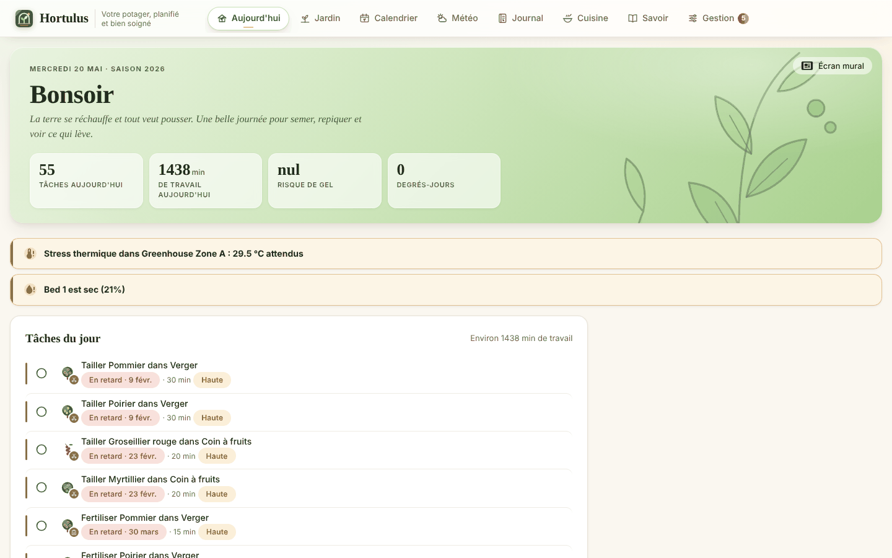</td>
  </tr>
</table>

## Ce que contient Hortulus

Hortulus ajoute un **panneau** à la barre latérale de Home Assistant, organisé en huit
espaces, ainsi que des entités, des services, une carte de tableau de bord et des
commandes vocales pour le reste de Home Assistant.

| Espace | Onglets | À quoi ça sert |
|---|---|---|
| **Aujourd'hui** | Aujourd'hui · Écran mural | La journée en un coup d'œil : tâches, alertes, météo, récolte rapide, planches. |
| **Jardin** | Planificateur · Plan du jardin · Cultures | Dessiner le terrain, organiser les zones, planter les planches ; toutes les cultures en une liste, frise, plan de semis, graines, successions et prévision de récolte. |
| **Calendrier** | Calendrier | Mois, semaine, liste, frise de saison et vue annuelle de toutes les tâches et cultures. |
| **Météo** | Météo | Prévisions, ce qu'elles signifient pour votre jardin, radar de pluie et historique du climat avec statistiques de température. |
| **Journal** | Carnet · Récolte · Cuisine · Boîte à graines · Eau · Bilan de saison · Journal système | Tout ce que vous notez, et ce que cela donne. |
| **Cuisine** | Idées · Mon livre de cuisine · Liste de courses | Un livre de recettes de saison à partir de ce qui est prêt à cueillir. |
| **Savoir** | Plantes · Conseils · Manuel | 232 cultures, questions et réponses, un manuel de 23 chapitres. |
| **Gestion** | Analyse · Imprimer · Paramètres | Contrôle du plan et diagnostic, PDF pour le papier et la reMarkable, tous les réglages. |

## Le jardin

### Planifier le terrain en cinq étapes

**1 · Terrain** (maison, allée, rue, terrasse, pelouse, chemins, haie, clôture, arbres,
mare, abri, bac à compost, récupérateur d'eau …) sur une grille de 10 × 10 cm,
**2 · Zones de culture** (potager, serre, châssis froid, **verger, petits fruits, jardin
d'herbes et de fleurs**), **3 · Planches** et bacs dans les zones, **4 · Vivaces** (arbres
fruitiers, baies, asperges, aromatiques vivaces) et **5 · Annuelles** – à la main, ou
laissez le **remplissage automatique** proposer une saison entière. Chaque étape ne modifie
que son propre type d'objets : un glissement à l'étape 5 ne déplace donc jamais un mur. Les
plantes ont des **icônes** reconnaissables (une carotte ressemble à une carotte), les
cultures denses sont dessinées en rangs de plants, et un élément posé sur un autre (pelouse
sous une terrasse) réduit la surface en dessous. Sélection multiple, alignement, calques,
semis successifs, annuler/rétablir et import/export sont inclus.

<table>
  <tr>
    <td width="50%">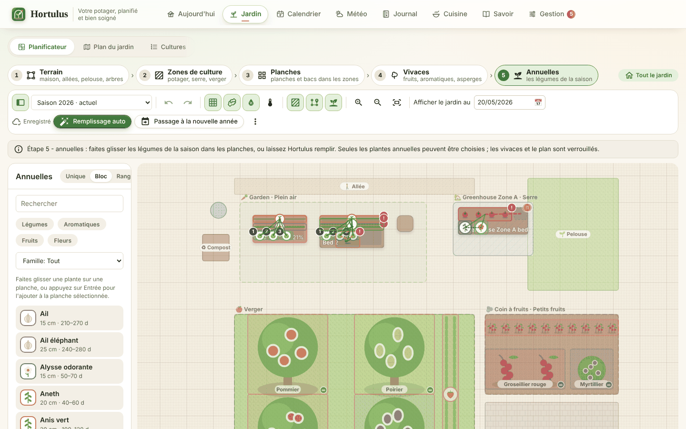</td>
    <td width="50%">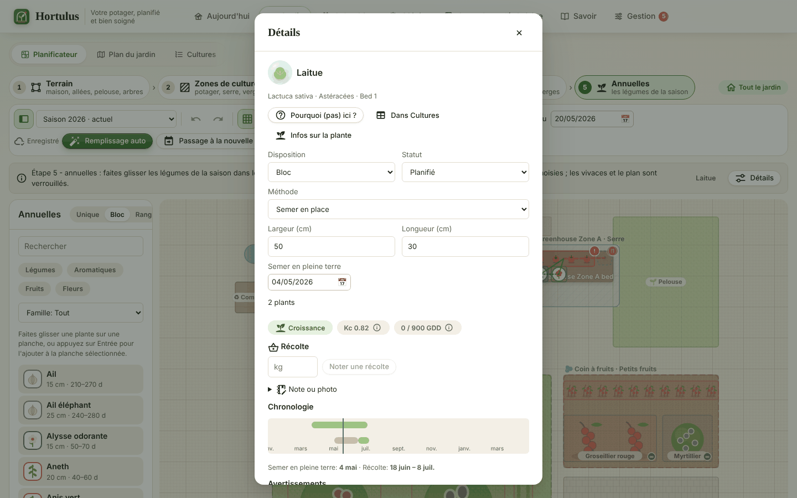</td>
  </tr>
  <tr>
    <td>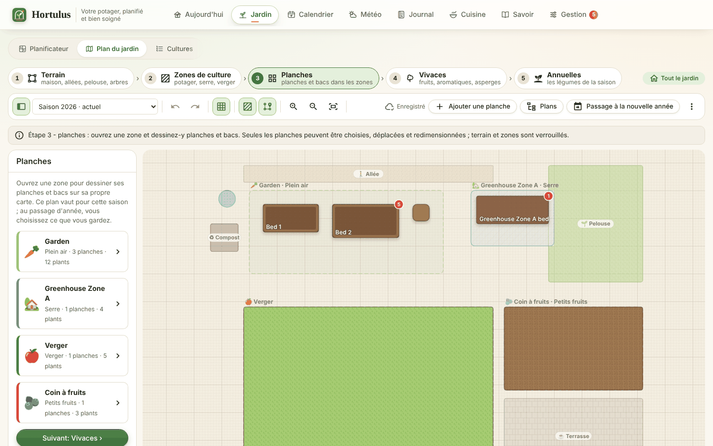</td>
    <td>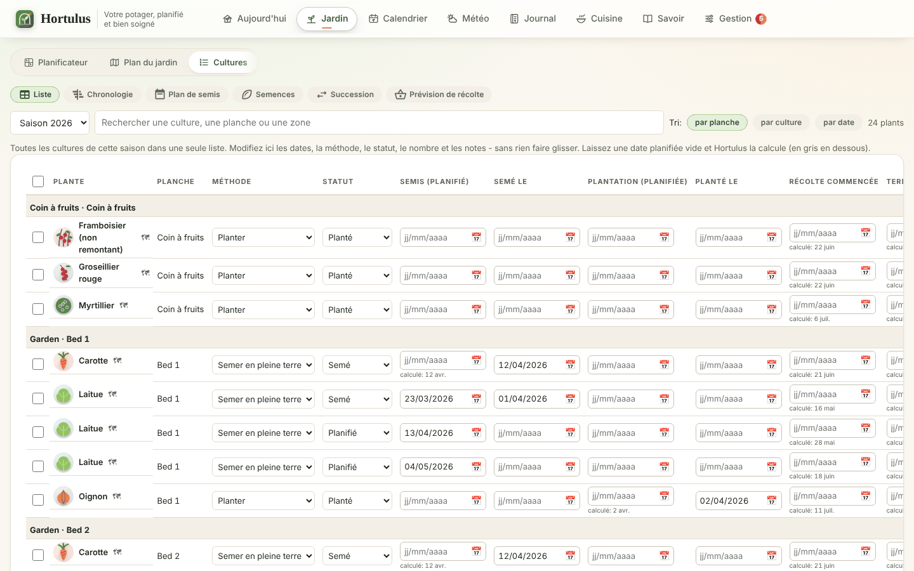</td>
  </tr>
</table>

* **Associations et rotation** – score en direct pendant le glissement : amies et ennemies,
  **répulsion des ravageurs et plantes pièges, allélopathie, concurrence pour les
  nutriments et ombre** (selon l'hémisphère), chaque fois avec une explication, des
  suggestions de meilleures voisines et des planches alternatives en cas de conflit de
  rotation. *« Pourquoi (pas) ici ? »* répond en termes simples, planche par planche.
* **Remplissage automatique** – propose une saison entière à partir de vos planches, de la
  taille du foyer, des heures par semaine, de l'eau et du compost : quantités justes par
  personne, grandes plantes à l'écart du soleil, rotation et associations respectées,
  cultures rapides en semis successifs, cultures frileuses sous verre. Préférences : cultures
  obligatoires et jamais, liberté de choix, fleurs pour pollinisateurs, récolte toute
  l'année, vivaces autorisées, respect du type de zone.
* **Les vivaces restent** – un pommier planté cette année est encore là l'an prochain, avec
  son propre entretien annuel (taille d'hiver et d'été, éclaircissage, filets, bandes
  de glu). Au **passage à la nouvelle année**, vous choisissez ce qui passe dans la nouvelle
  saison ; les anciennes saisons vont dans une archive et restent disponibles pour la
  rotation, les bilans et le livre de saison.
* **Cultures** – toutes les cultures de la saison dans un tableau (dates de semis et de
  plantation, statut, notes), plus **frise**, **plan de semis par semaine**, **besoin en
  graines**, **successions** et **prévision de récolte** ; modifiez plusieurs cultures à la
  fois.

<table>
  <tr>
    <td width="50%">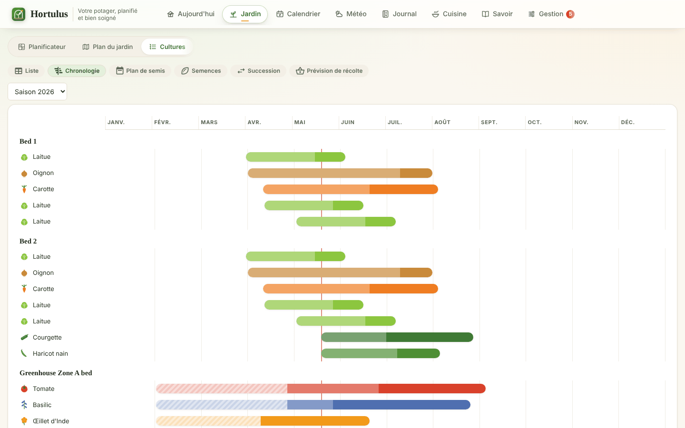</td>
    <td width="50%">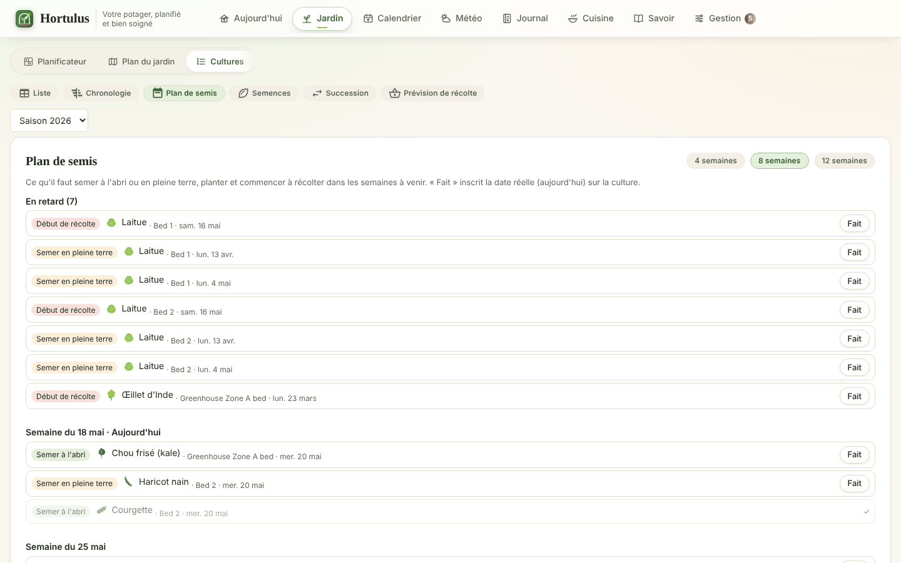</td>
  </tr>
</table>

### Savoir quoi faire – et quand

Un **moteur de tâches** planifie toute la vie de chaque culture – semis, repiquage,
endurcissement, plantation, fertilisation, taille, récolte – et **l'année du jardin** :
préparation du sol (avec les kilos de compost), nettoyage des vitres de la serre, ombrage
mis et retiré, lutte biologique, purin d'ortie et de consoude, gouttières et tonneaux,
nichoirs, récolte de graines, repos hivernal, entretien du verger. Les tâches s'adaptent à
la météo prévue (chaleur, sécheresse, tempête, fortes pluies) comme à celle qui est déjà
passée (suivi après une tempête ou une averse, arrosage en profondeur après une semaine
sèche), attendent un sol chaud et des prévisions sans gel, indiquent les outils nécessaires et vous rappellent poliment quand elles
sont en retard. Vous pouvez les attribuer à des personnes, les cocher depuis n'importe quel
tableau de bord et voir un aperçu de la semaine à venir.

<table>
  <tr>
    <td width="50%">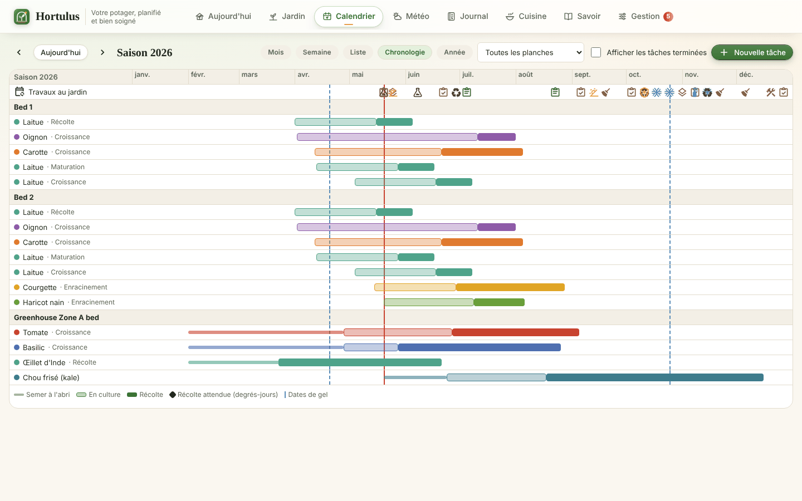</td>
    <td width="50%">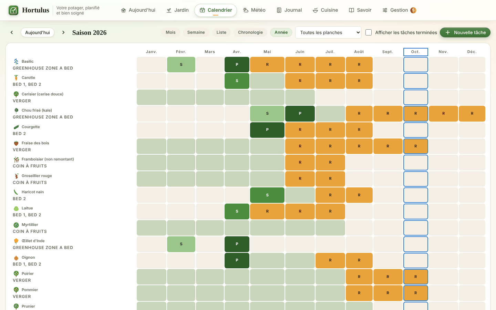</td>
  </tr>
  <tr>
    <td>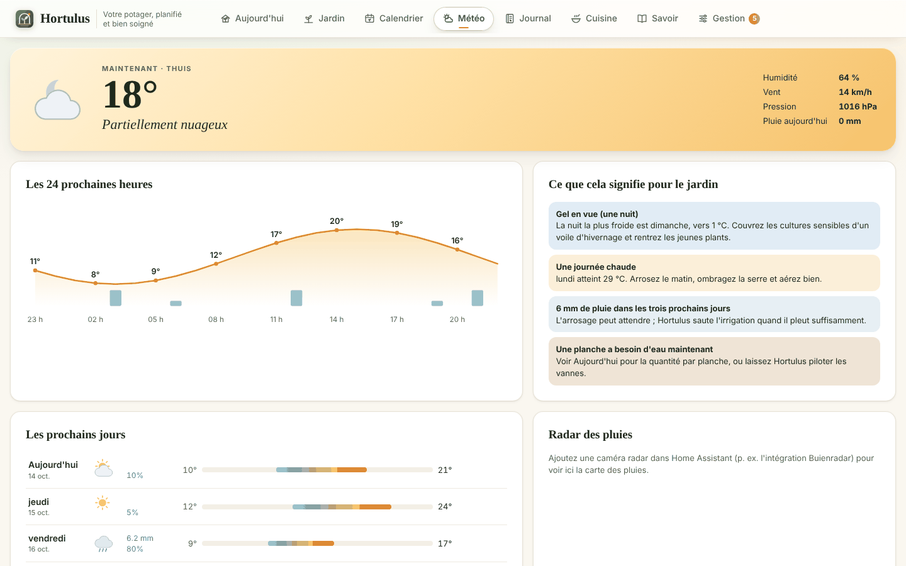</td>
    <td>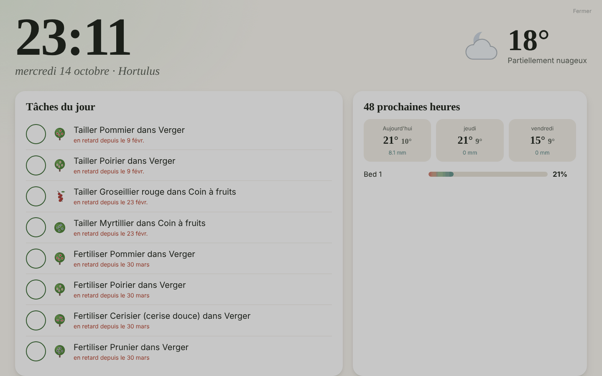</td>
  </tr>
</table>

* **Calendrier** – mois, semaine, liste, frise de saison et vue annuelle, aussi sous forme
  de calendrier et de liste de tâches Home Assistant.
* **Météo** – prévisions horaires et journalières, ce que les prochains jours signifient
  pour *votre* jardin (gel, journée chaude, pluie sur laquelle compter, une planche à
  arroser) et un radar de pluie.
* **Historique du climat** – ce que la météo a vraiment fait chez vous, sous les prévisions
  dans l'onglet Météo (voir ci‑dessous).
* **Écran mural** – une vue de kiosque calme avec l'heure, la météo et les tâches pour une
  tablette dans la cuisine ; s'assombrit la nuit.

### Historique du climat

À chaque mise à jour, Hortulus enregistre la journée à partir de vos capteurs extérieurs –
ou de l'entité météo : températures minimale, maximale et moyenne, humidité, vent et
rafales, pluie, rayonnement et heures d'ensoleillement. **Chaque capteur de température**
associé (air de la serre, sol, air près d'une planche) reçoit lui aussi son minimum, son
maximum et sa moyenne par jour. Les jours où Hortulus ne tournait pas sont complétés une
fois par jour depuis l'**enregistreur** (recorder) de Home Assistant et, si *Open‑Meteo* est
activé, depuis la météo **observée** d'Open‑Meteo. Sous les prévisions, **Météo →
Historique du climat** montre un graphique quotidien (30 jours, 90 jours ou 1 an), les 7 et
30 derniers jours et la saison en cours (avec l'an dernier en regard), les records, un tableau de
tous les capteurs de température, le mois par mois et les **dates de gel mesurées** face au
préréglage régional. Et le moteur s'en sert : croissance, bilan hydrique, risque de maladie
et tâches de suivi reposent sur le temps qu'il a réellement fait.

## Enregistrements, cuisine et savoir

### Journal

Un **carnet de jardin** avec photos par planche ou culture et une frise de photos, un
**registre de récolte** en kilos qui apprend au remplissage automatique **vos propres
rendements**, une **boîte à graines** qui sait quels sachets vieillissent et quelles
cultures manquent encore de graines (et met ce qui manque sur votre liste de courses),
la **consommation d'eau** d'un compteur de jardin et du tonneau de pluie avec un historique
d'arrosage par planche, des **analyses de sol** par planche qui orientent les conseils de
fertilisation et de chaux, les coûts et économies, et un **bilan de saison** – aussi sous
forme de **livre de saison** imprimable. Le *journal système* montre ce qui a changé et
permet de l'annuler.

<table>
  <tr>
    <td width="50%">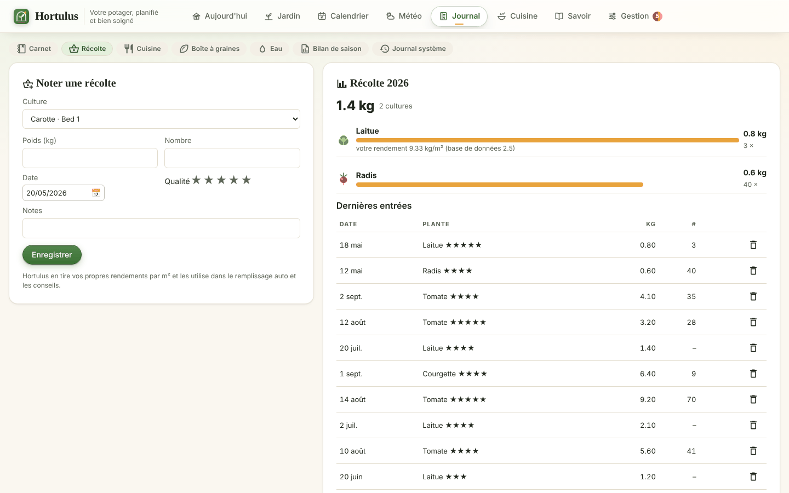</td>
    <td width="50%">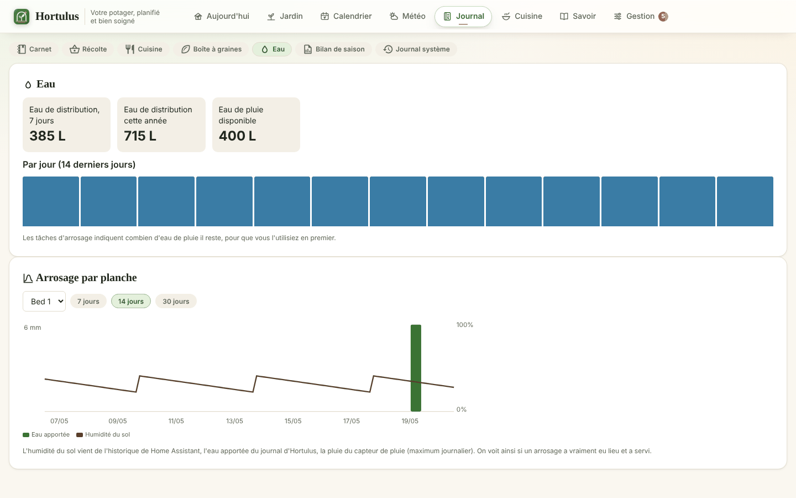</td>
  </tr>
  <tr>
    <td>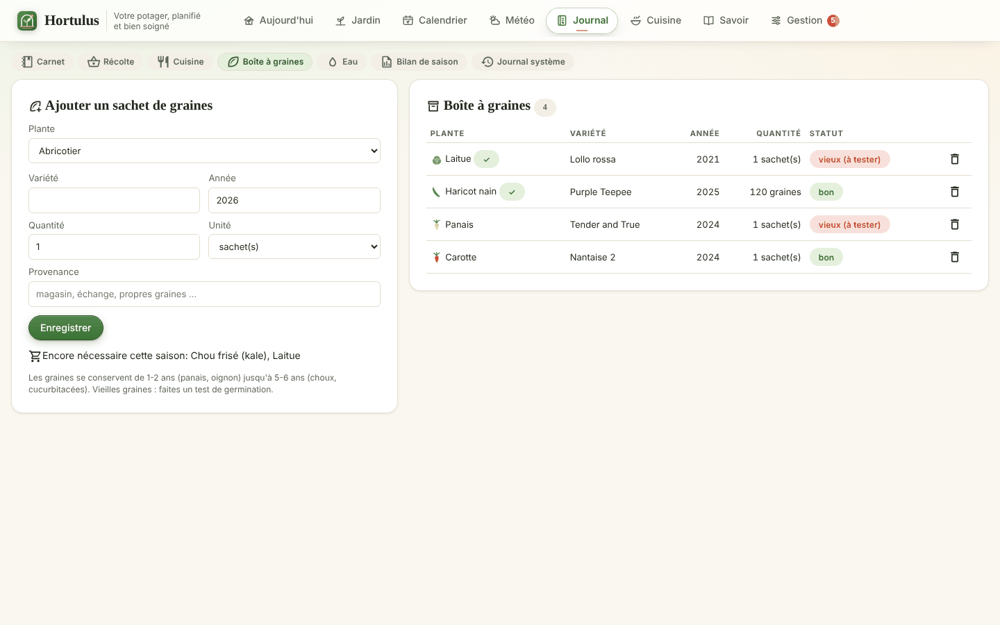</td>
    <td>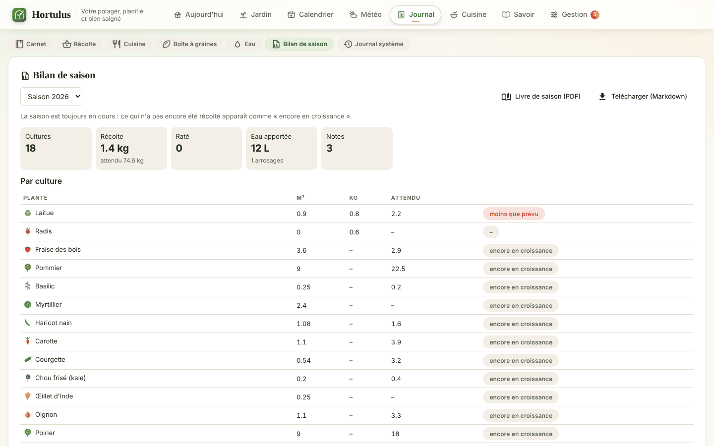</td>
  </tr>
</table>

### Cuisine – à partir de ce qui est prêt à cueillir

Hortulus regarde les cultures dans leur fenêtre de récolte (plus ce que vous ajoutez de la
cave, comme des potirons stockés ou des haricots surgelés) et propose des **plats et des
menus complets** : soupes, plats au four, sautés, pâtes, risotto, salades, gratins, currys,
frittata, stoemp, légumes farcis, pesto, crumbles, ratatouille, tians, shakshuka, waterzooi,
beignets, clafoutis, gâteaux de légumes et plus encore – plus de soixante types de plats –
et un chapitre sur **la conservation du surplus** (pickles express, chutney, passata,
confiture, congélation, choucroute). Sûr par conception : les salades restent crues, les
haricots et les baies de sureau ne sont jamais proposés crus.

* Indiquez ce qu'il y a dans le **frigo** (chaque article est intégré aux plats où il
  convient), ce qui est **toujours à la maison**, un **accompagnement** (pâtes, riz,
  boulgour, couscous, perles de couscous, gnocchis, pommes de terre, frites …) et une sorte
  de **viande, poisson ou protéine végétarienne** (ou aucune).
* Chaque plat reçoit une **image des cultures dans l'assiette**, des quantités par
  personne, et ce qui vient du jardin, ce qui est à la maison et ce qu'il faut acheter.
* **Modifiez n'importe quelle recette** : changez ingrédients et étapes, gardez votre version
  dans **Mon livre de cuisine** avec favoris, notes et la date à laquelle vous l'avez
  cuisinée.
* **Une seule liste de courses** pour la semaine : imprimez-la, enregistrez-la en PDF,
  envoyez-la sur votre téléphone ou dans une liste de tâches Home Assistant. Les recettes et
  tout le livre de cuisine s'exportent en PDF.

<table>
  <tr>
    <td width="50%">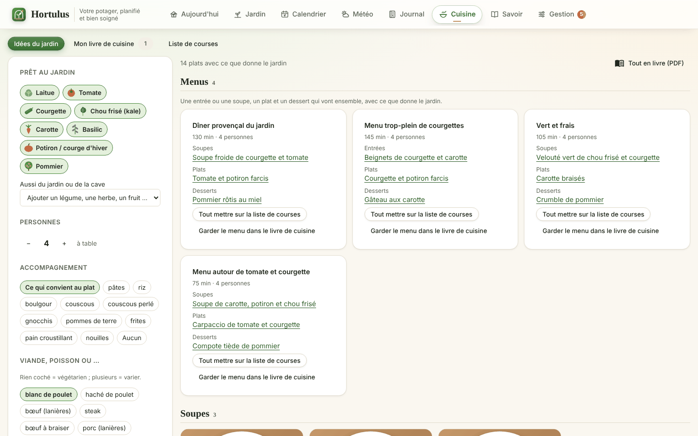</td>
    <td width="50%">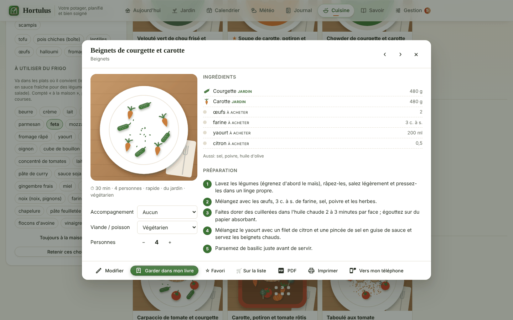</td>
  </tr>
  <tr>
    <td>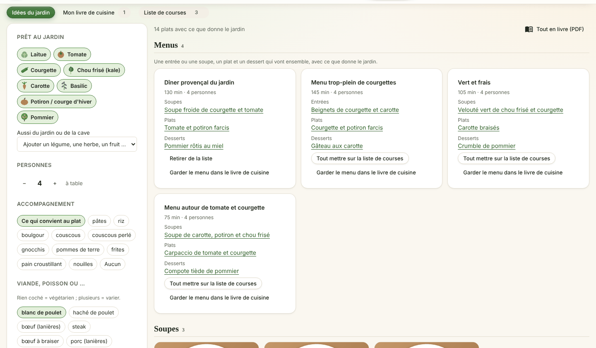</td>
    <td>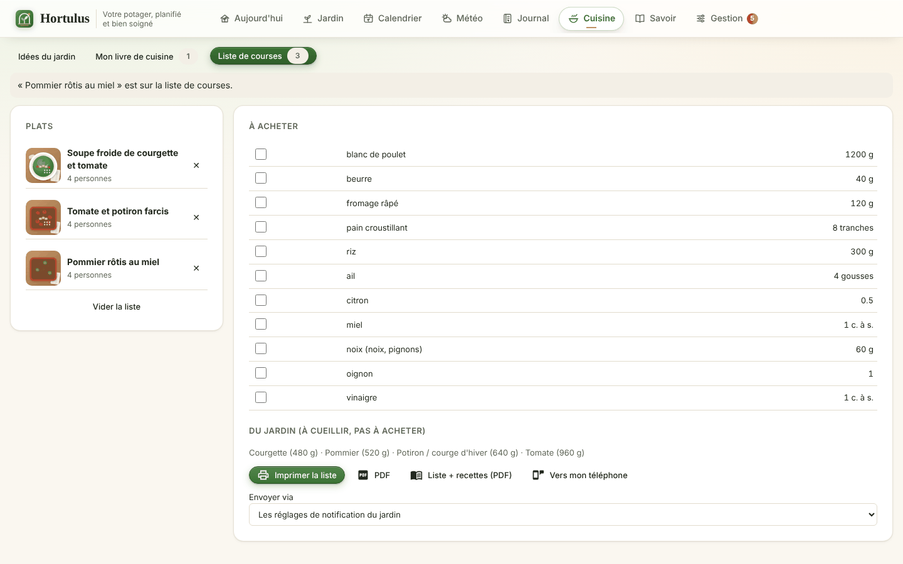</td>
  </tr>
</table>

### Savoir

<table>
  <tr>
    <td width="50%">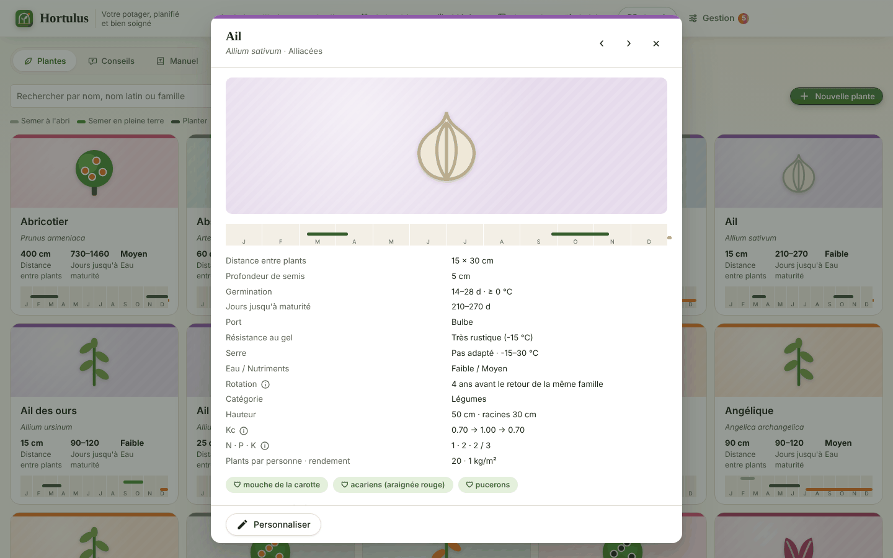</td>
    <td width="50%">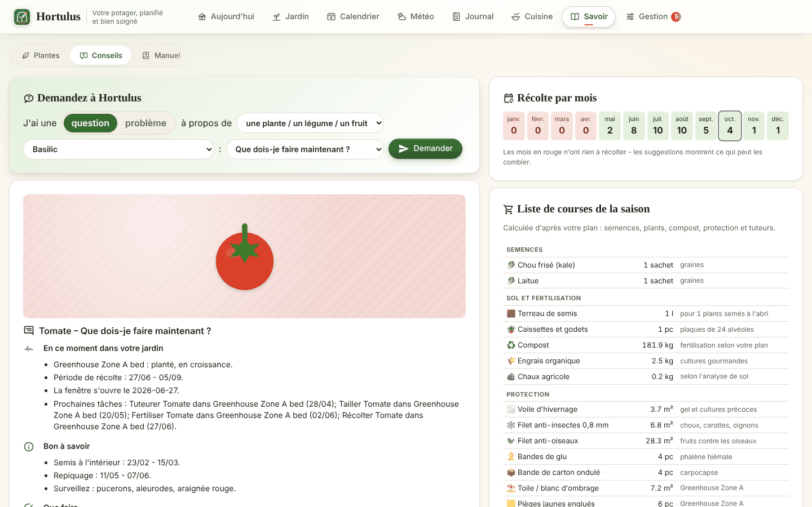</td>
  </tr>
  <tr>
    <td>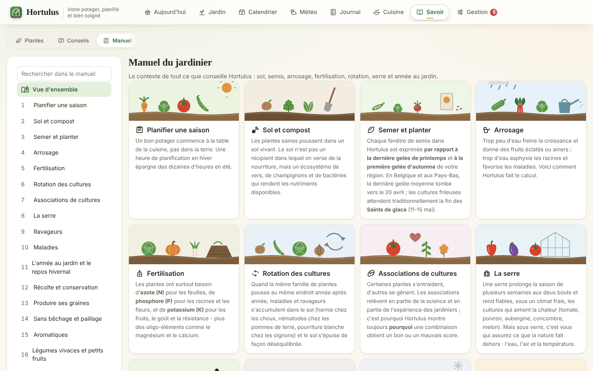</td>
    <td>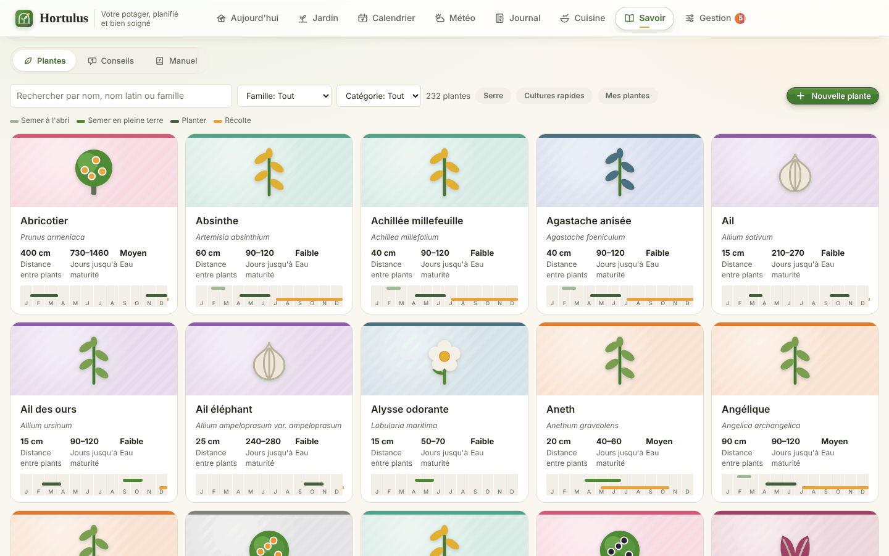</td>
  </tr>
</table>

* **Base de plantes** – **232 cultures** : 100 légumes, 75 aromatiques, 36 fruits et 21
  fleurs et engrais verts, avec Kc par stade de croissance, besoins N‑P‑K, règles d'entretien
  annuelles, pollinisation, conseils écologiques et une icône – entièrement modifiable,
  ajoutez les vôtres.
* **Conseils et questions‑réponses** – posez votre question en une phrase de listes
  déroulantes (*« J'ai un problème avec [tomate] : [taches, moisissure ou pourriture] »*) et
  obtenez l'état en direct, les causes probables, que faire maintenant, des **remèdes
  écologiques et de grand‑mère** et la prévention. Plus des suggestions sur
  l'emplacement, les partenaires de pollinisation, les fleurs pour pollinisateurs, les
  mauvaises voisines, les trous de récolte, les planches vides et l'écologie, applicables
  d'un clic.
* **Manuel** – 23 chapitres sur le sol, les semis, l'arrosage, la fertilisation, la
  rotation, les associations, la serre, les ravageurs, les maladies, l'année du jardin, les
  fruits, les outils et matériaux, les remèdes maison, la récolte toute l'année et le choix
  des capteurs, avec des infobulles ⓘ partout. Une **liste d'achats** calcule graines,
  plants, compost, voile, filet et protections d'après votre plan.

## Eau, nutrition et santé

* **ET₀ Penman‑Monteith** FAO‑56 (Hargreaves en repli), Kc par stade de croissance, un
  **bilan hydrique** de la zone racinaire par planche, un **indice d'équilibre nutritif**
  NPK/EC, le **risque de maladie** (critères de Hutton, humectation des feuilles, humidité
  de la serre, plus les jours chauds et humides déjà passés) et une phénologie en
  degrés‑jours avec des dates de récolte dynamiques – le tout calculé sur la météo
  enregistrée, pas seulement sur les prévisions. Une station météo (vent, rafales,
  rayonnement solaire) rend l'évaporation plus exacte.
* **Pilotage matériel sûr** – vannes et pompe avec **verrouillage de la pompe, durée
  maximale, blocage en cas de gel et saut en cas de pluie** ; une vanne qui ne répond plus
  met fin à l'arrosage et arrête la pompe ; surveillance des fuites et du débit via le
  compteur d'eau ; ouvrants de serre et écrans d'ombrage en mode automatique ; tout aussi en
  simple conseil.
* **Gestion → Analyse** contrôle le plan (chevauchements, conflits, rotation, trous),
  explique *pourquoi une plante ne convient pas*, compare deux plans et propose des
  corrections en un clic.

<table>
  <tr>
    <td width="50%">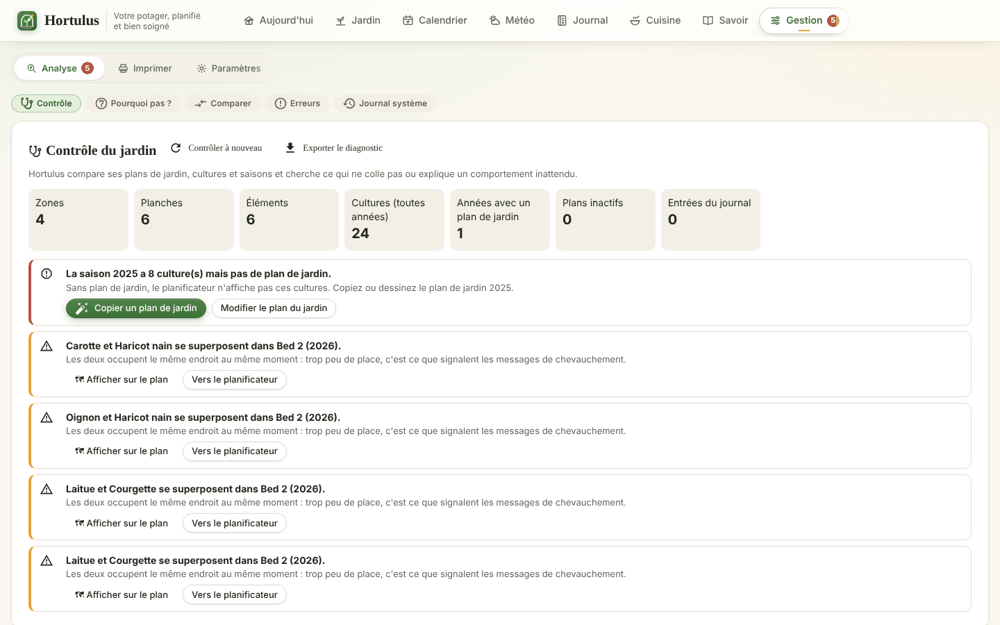</td>
    <td width="50%">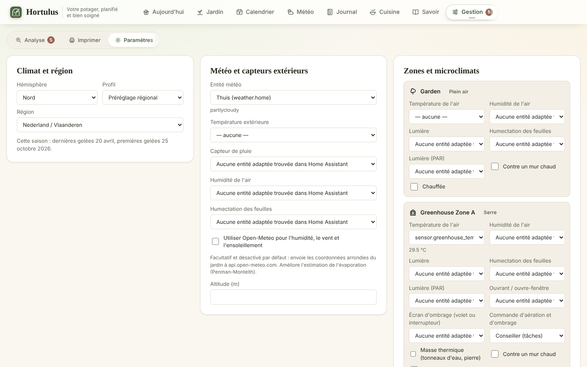</td>
  </tr>
</table>

## Imprimer, papier et reMarkable

L'onglet **Imprimer** montre chaque page avant le téléchargement : plans du jardin et de la
serre avec légende, échelle et rose des vents, fiches de planche avec grille, listes de
contrôle, graphiques de saison, plan de l'année, feuilles de planification vierges, fiches
de plantes et un **livre de saison** complet – en PDF A4, A3, A5, Letter ou pour la
**reMarkable Paper Pro** (179,6 × 239,5 mm, motifs e‑ink avec une hachure par famille de
plantes et zones de notes à points pour dessiner). Les automatisations produisent les mêmes
PDF avec `garden_manager.export_pdf` (enregistrés dans `/config/hortulus/exports/`).

<table>
  <tr>
    <td width="25%">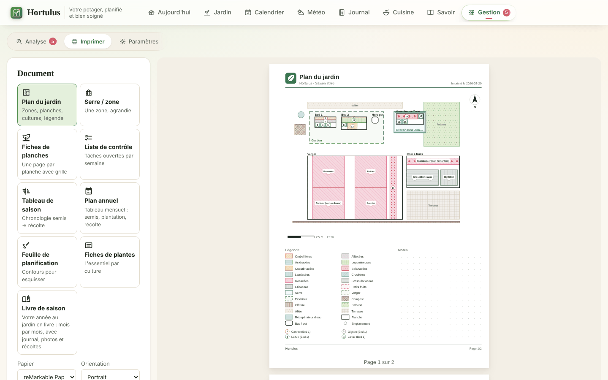</td>
    <td width="25%"></td>
    <td width="25%"></td>
    <td width="25%"></td>
  </tr>
</table>

## Sur tous les écrans

Le panneau s'adapte à votre téléphone, tablette ou ordinateur, en clair ou en sombre, avec
quatre thèmes de couleurs (Classique, Terre, Nuit et un qui suit la saison).

<table>
  <tr>
    <td width="20%">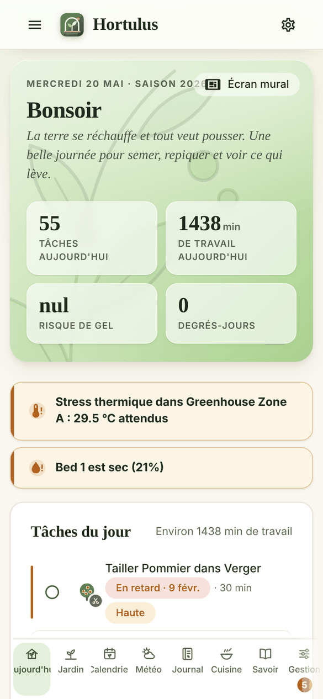</td>
    <td width="20%">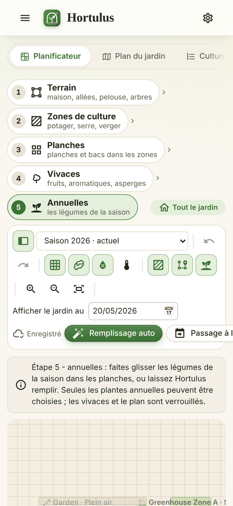</td>
    <td width="20%">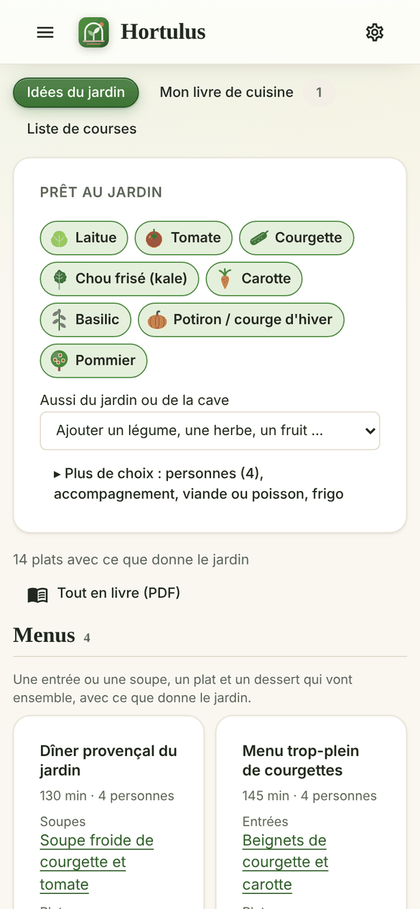</td>
    <td width="40%">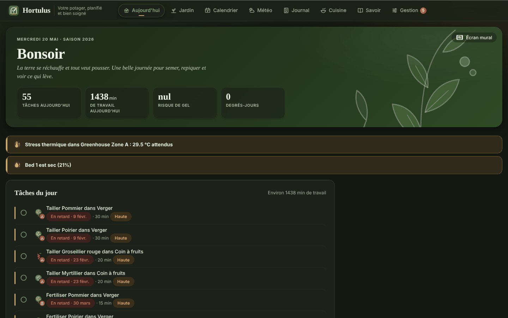</td>
  </tr>
</table>

## Intégré à Home Assistant

* **Entités** – capteurs, capteurs binaires, nombres, sélecteurs, interrupteurs, boutons, un
  calendrier et une liste de tâches, avec diagnostics et traductions en français, anglais et
  néerlandais – dont des capteurs de climat (pluie, température moyenne et ensoleillement
  sur 7 jours, nuits de gel de la saison) avec la valeur de l'an dernier en attribut.
* **Historique du climat** – complété depuis l'**enregistreur** de Home Assistant pour les
  jours où Hortulus ne tournait pas, et consultable par la commande websocket
  `garden_manager/climate/stats`.
* **Services** avec réponses et **événements du bus** pour vos automatisations ; **notifications**
  push, TTS et persistantes, avec des boutons d'action sur votre téléphone (fait, reporter).
* **Foyer** – attribuez des tâches à des personnes avec des règles automatiques et des
  rappels personnels, et cochez les tâches depuis n'importe quel tableau de bord avec la
  **`hortulus-tasks-card`**.
* **Voix** – demandez à Assist *« que dois-je faire au jardin aujourd'hui ? »* (phrases en
  français, anglais et néerlandais).
* **Plusieurs jardins** – une entrée Hortulus par jardin, chacun avec son plan, ses tâches
  et ses enregistrements.
* **Blueprints** – alerte de gel sur une lampe, un bouton ou un tag NFC qui enregistre une
  récolte, arrosage d'une planche sèche au bon moment, annonces vocales des tâches urgentes.

### Hortulus Web – le même jardin sur un site web (facultatif)

Une édition web distincte fait tourner le même moteur et le même panneau dans le
navigateur, avec des comptes, plusieurs jardins par compte et une page d'accueil publique.
Vous pouvez **montrer votre jardin** aux autres – par lien ou publiquement – et choisir
pour chaque partie ce que les visiteurs voient (plan, calendrier, météo, carnet, récolte,
recettes) ; les visiteurs ne voient jamais les détails de Home Assistant. Elle est livrée
séparément de cette intégration et les fichiers de plan peuvent être échangés entre les
deux. Voir [Configuration → Hortulus Web](docs/fr/CONFIGURATION.md#10-hortulus-web-site-web-facultatif).

<table>
  <tr>
    <td width="33%">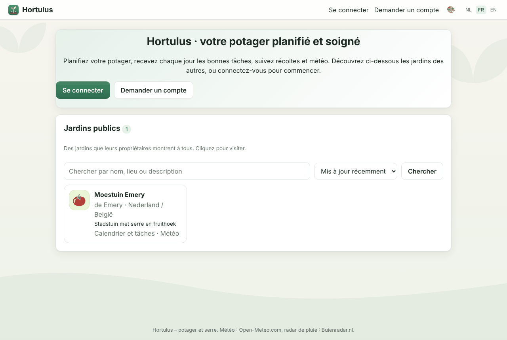</td>
    <td width="33%">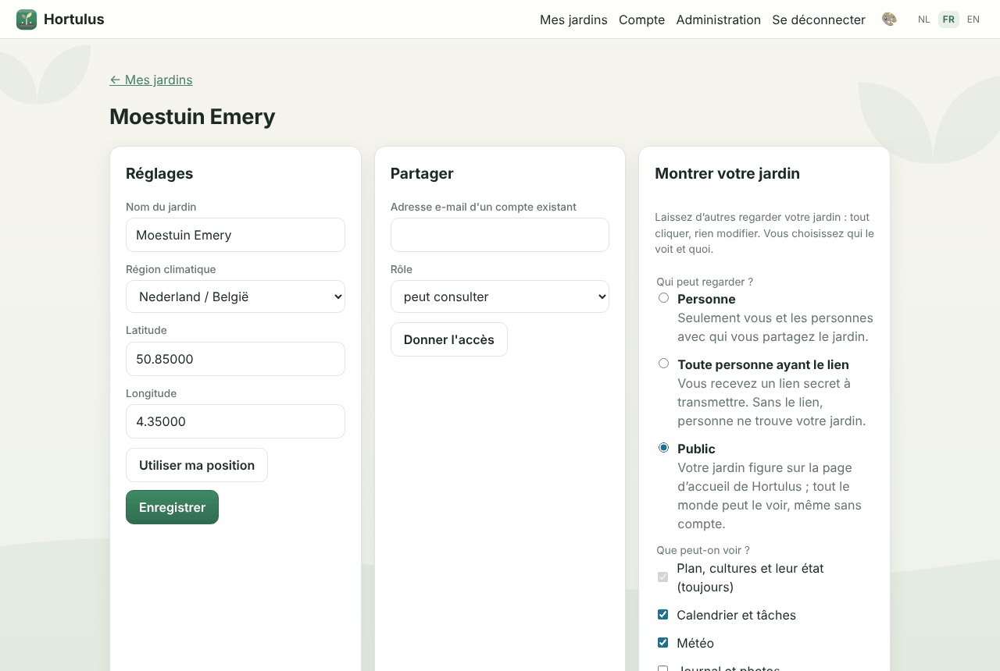</td>
    <td width="33%">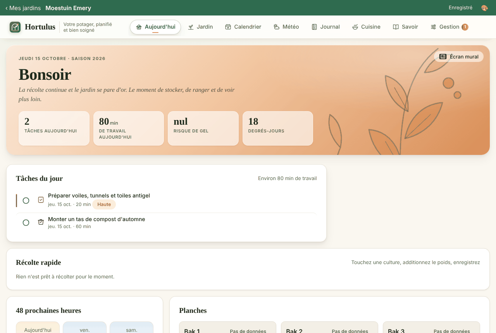</td>
  </tr>
</table>

## Installation

### HACS (recommandé)

1. HACS → ⋮ → **Dépôts personnalisés** → ajoutez `https://github.com/emeryf81/hortulus` comme *Intégration*.
2. Installez **Hortulus Garden Manager** et redémarrez Home Assistant.
3. **Paramètres → Appareils et services → Ajouter une intégration → Hortulus**.

### Manuelle

Copiez `custom_components/garden_manager` dans `<config>/custom_components/` et redémarrez.
Le bundle du panneau (`frontend/hortulus-panel.js`) est dans le dépôt : aucune compilation
Node.js n'est nécessaire.

Prérequis : Home Assistant **2025.10 ou plus récent**. Une entité météo avec prévisions
horaires et/ou journalières (par exemple `weather.home` de Met.no) est recommandée mais
facultative.

## Démarrage rapide

L'assistant de configuration demande :

1. **Profil climatique** – un préréglage régional (p. ex. *Pays‑Bas / Flandre*), une zone de
   rusticité USDA ou vos propres dates moyennes de gel ; plus l'hémisphère.
2. **Météo** – p. ex. `weather.home`, éventuellement un capteur de température extérieure
   et de pluie.
3. **Planches, serres et bacs** – nom, taille, sol, ombre, vent et les capteurs qui s'y
   rattachent (`sensor.soil_moisture_bed_1`, `sensor.soil_temp_bed_1`,
   `sensor.greenhouse_temp`, …) plus une vanne d'arrosage facultative.
4. **Notifications** – notifications persistantes, push mobile, TTS et heure du résumé
   quotidien.
5. **Résumé** – éventuellement un petit plan d'exemple avec de bonnes associations.

Ouvrez ensuite **Hortulus** dans la barre latérale. Détails : [CONFIGURATION](docs/fr/CONFIGURATION.md).

## Ce que vous obtenez dans Home Assistant

| Notion du cahier des charges | Entité / action dans Home Assistant |
|---|---|
| `garden.bed_moisture_status` | `sensor.<bed>_moisture_status` (dry / slightly_dry / optimal / wet) |
| `garden.frost_risk_next_48h` | `sensor.hortulus_frost_risk_next_48h` + `binary_sensor.hortulus_frost_warning` |
| `garden.irrigation_recommendation` | `sensor.<bed>_irrigation_recommendation` (mm ; litres et minutes en attributs) + `binary_sensor.<bed>_needs_water` |
| `garden.growing_degree_days` | `sensor.hortulus_growing_degree_days` |
| conseil serre | `sensor.<zone>_greenhouse_advice`, `binary_sensor.<zone>_heat_stress`, `select.<zone>_shading` |
| évaporation et degrés‑jours | `sensor.hortulus_reference_evapotranspiration_today`, `sensor.hortulus_degree_days_today`, `sensor.<zone>_degree_days_this_season` |
| eau du sol et nutriments | `sensor.<bed>_soil_water_deficit`, `sensor.<bed>_nutrient_balance` |
| maladie et gel par zone | `sensor.<zone>_disease_risk`, `binary_sensor.<zone>_frost_risk_48h` |
| pilotage de l'arrosage | `switch.hortulus_automatic_irrigation`, `select.hortulus_irrigation_mode`, `number.hortulus_irrigation_max_runtime` (+ blocage gel, saut pluie), `button.hortulus_water_now`, `binary_sensor.hortulus_irrigation_frost_lockout`, `binary_sensor.hortulus_irrigation_running` |
| tâches | `calendar.hortulus_garden_tasks`, `todo.hortulus_this_week`, `sensor.hortulus_tasks_due_today`, `sensor.hortulus_next_task` |
| climat enregistré | `sensor.hortulus_rain_7_days`, `sensor.hortulus_mean_temperature_7_days`, `sensor.hortulus_sunshine_7_days`, `sensor.hortulus_frost_nights_this_season` (valeur de l'an dernier en attribut `last_year`) |
| enregistrements | `sensor.hortulus_harvest_this_season`, `sensor.hortulus_garden_water_7_days`, `sensor.hortulus_rain_water_available`, `garden_manager.log_harvest`, `.add_journal_entry`, `.save_soil_test`, `.assign_task` |
| tableau de bord et voix | `type: custom:hortulus-tasks-card` (chargée automatiquement), intents Assist via `garden_manager.install_voice_sentences` |
| `garden.add_task` … | `garden_manager.add_task`, `.complete_task`, `.postpone_task`, `.delete_task`, `.generate_tasks`, `.recalculate_plan`, `.export_plan`, `.import_plan` |
| plan et matériel | `garden_manager.add_planting`, `.update_planting`, `.remove_planting`, `.autofill_plan`, `.run_irrigation_plan` (avec `dry_run`), `.stop_irrigation`, `.set_shading_mode`, `.export_pdf` |

> Home Assistant exige que les services soient dans le domaine propre à l'intégration ; les
> noms `garden.*` du cahier des charges sont donc exposés sous `garden_manager.*`.

Référence complète : [ENTITÉS](docs/fr/ENTITES.md) · Exemples
d'[automatisations](examples/automations.yaml) et de [tableau de bord](examples/dashboard.yaml).

## Blueprints

Automatisations prêtes à l'emploi – cliquez pour les importer dans Home Assistant :

- [**Alerte de gel sur une lampe**](https://my.home-assistant.io/redirect/blueprint_import/?blueprint_url=https%3A%2F%2Fgithub.com%2Femeryf81%2Fhortulus%2Fblob%2Fmain%2Fblueprints%2Fautomation%2Fhortulus%2Ffrost_flash_light.yaml) : une lampe clignote en bleu (et votre téléphone reçoit un message) quand le gel approche.
- [**Enregistrer une récolte avec un bouton**](https://my.home-assistant.io/redirect/blueprint_import/?blueprint_url=https%3A%2F%2Fgithub.com%2Femeryf81%2Fhortulus%2Fblob%2Fmain%2Fblueprints%2Fautomation%2Fhortulus%2Fbutton_log_harvest.yaml) : un bouton ou un tag NFC enregistre une quantité fixe d'une culture.
- [**Arroser une planche sèche au bon moment**](https://my.home-assistant.io/redirect/blueprint_import/?blueprint_url=https%3A%2F%2Fgithub.com%2Femeryf81%2Fhortulus%2Fblob%2Fmain%2Fblueprints%2Fautomation%2Fhortulus%2Fwater_when_dry.yaml) : exécute le plan d'arrosage d'une planche assoiffée à l'heure choisie, jamais pendant un blocage de gel.
- [**Annoncer les tâches urgentes du jardin**](https://my.home-assistant.io/redirect/blueprint_import/?blueprint_url=https%3A%2F%2Fgithub.com%2Femeryf81%2Fhortulus%2Fblob%2Fmain%2Fblueprints%2Fautomation%2Fhortulus%2Furgent_task_announce.yaml) : les tâches urgentes (protection contre le gel, ombrage, vol de ravageurs) sont annoncées sur une enceinte.

## Comment fonctionne la logique horticole (en bref)

* **Les fenêtres** sont stockées en semaines par rapport à la *dernière gelée moyenne de
  printemps* / *première gelée d'automne*, de sorte qu'une seule base sert les deux
  hémisphères et tous les climats. Les serres avancent les fenêtres de printemps d'un nombre
  de semaines propre à chaque culture.
* **Affinements en direct :** le semis direct attend un sol durablement chaud – la plus
  basse entre la mesure actuelle du capteur de sol et la moyenne enregistrée des derniers
  jours, pas un après‑midi chaud –, la plantation des cultures frileuses attend des
  prévisions sans gel.
* **Associations :** l'intensité de l'interaction diminue avec la distance ; les ennemies
  comptent double ; des plantations qui ne partagent jamais le sol en même temps
  (successions !) n'entrent jamais en conflit.
* **Rotation :** historique par planche et famille ; la même famille de retour trop tôt est
  signalée.
* **Arrosage :** bandes d'humidité selon le besoin en eau de la culture et le type de sol ;
  déficit à combler + ET₀ × Kc moins la pluie pondérée par sa probabilité ; les serres ne
  reçoivent aucun crédit de pluie. ET₀ est Penman‑Monteith FAO‑56 d'après la température,
  l'humidité, le vent et la nébulosité (Hargreaves quand ils manquent), Kc suit le stade de
  croissance. Les planches sans capteur d'humidité tiennent un **réservoir de zone
  racinaire** quotidien (eau disponible selon le sol × profondeur d'enracinement) et sont
  arrosées quand la moitié est consommée. Pour les jours passés, ce bilan utilise la pluie
  enregistrée et un Penman‑Monteith calculé sur la journée enregistrée (humidité, vent,
  ensoleillement ou rayonnement) au lieu des seules températures minimale et maximale : un
  jour venteux et ensoleillé assèche les planches plus vite, comme en vrai.
* **Fertilisation :** compost par m² selon la culture suivante la plus gourmande (5 / 3 /
  1,5 kg, légumineuses 0,5), doses d'engrais liquide dans les tâches de fertilisation, et un
  indice d'équilibre nutritif de 0 à 100 à partir de sondes NPK ou EC comparées aux besoins
  N‑P‑K des cultures.
* **Maladie :** deux jours chauds et humides de suite (critères de Hutton) signifient un
  risque élevé de mildiou – qu'ils soient prévus ou **déjà passés** d'après les jours
  enregistrés, car les spores tombées pendant une période humide sont déjà au travail ;
  plusieurs jours humides enregistrés, de longues périodes de feuilles mouillées, un capteur
  d'humectation ou un air de serre humide relèvent le niveau et créent des tâches
  d'inspection pour les cultures sensibles.
* **Phénologie :** les degrés‑jours enregistrés depuis la plantation déplacent la récolte
  attendue (± 3 semaines autour de la date du calendrier). Les cultures sous serre comptent
  les degrés‑jours de leur propre capteur d'air (sinon la journée extérieure avec l'effet
  tampon de la serre) au lieu d'un simple +3 forfaitaire. Les jours de chaleur enregistrés (le
  dernier mois) et une série de jours sombres retardent les cultures fruitières ; les
  cultures sans modèle de degrés‑jours sont retardées par les jours froids enregistrés sous
  leur minimum. La fiche de la culture indique le retard et sa raison.
* **Sécurité de l'arrosage :** une vanne à la fois, pompe seulement si une vanne est ouverte,
  durée maximale, pas d'arrosage extérieur si du gel est prévu dans les 12 h ou si assez de
  pluie arrive ; vannes et pompe sont toujours coupées à la fin, même après des erreurs.
* **Historique du climat :** chaque jour extérieur (min/moy/max, humidité, vent et rafales,
  pluie, rayonnement, ensoleillement) et chaque capteur de température sont enregistrés ;
  les mesures propres priment toujours, l'enregistreur combine les extrêmes et la météo
  observée d'Open‑Meteo ne comble que ce qui n'a pas été bien mesuré. Les jours restent deux
  saisons (extérieur) ou 400 jours (capteurs), puis leurs chiffres mensuels sont gardés pour
  toujours. Les dernières gelées de printemps et premières gelées d'automne sont mesurées
  chaque année et comparées au préréglage. Une tempête (rafales ≥ 60 km/h), une averse ou
  une semaine sèche déjà passée donnent une tâche de suivi ; un gel survenu alors que des
  cultures frileuses étaient dehors donne une alerte.
* **Gel :** prévisions horaires, ajustement par plante pour les nuits claires et calmes,
  tampon de serre, plancher pour les zones chauffées ; repli sur les prévisions
  journalières, puis sur le capteur en direct.
* **Cuisine :** une recette est une *technique* (soupe, plat au four, tian …) remplie avec
  les cultures de saison, l'accompagnement, la protéine et les articles du frigo ; les
  textes sont écrits par langue et le même moteur construit les menus, la liste de courses
  et les PDF.

Le [plan d'architecture](docs/BLUEPRINT.md) (en anglais) documente chaque modèle et chaque
algorithme.

## Développement

```bash
# Python (intégration + moteur)
pip install -r requirements_test.txt
pytest -q && ruff check custom_components tests

# Frontend (Lit + TypeScript)
cd frontend && npm ci
npm run typecheck && npm test && npm run build   # écrit custom_components/garden_manager/frontend/hortulus-panel.js
```

Le panneau fonctionne aussi sans Home Assistant dans un banc d'essai (`frontend/dev`, voir
son README) ; les captures d'écran de ce README sont produites avec
`node frontend/dev/screenshots.mjs`. L'organisation du dépôt et les choix de conception sont
décrits dans le [plan d'architecture](docs/BLUEPRINT.md) ; le langage visuel dans le
[système de design](docs/DESIGN_SYSTEM.md).

## Licence

MIT © 2026 Emery Frijters. Données de plantes compilées d'après les pratiques horticoles
courantes ; vérifiez toujours les sachets de graines et les conseils locaux.
