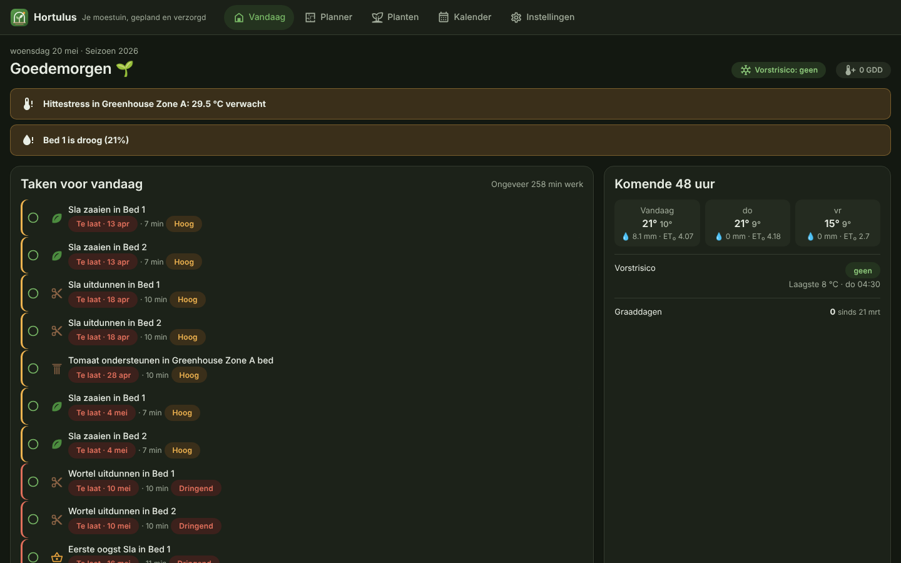

<p align="center">
  
</p>

<p align="center">
  <a href="README.nl.md">🇳🇱 Nederlands</a> ·
  <a href="docs/en/CONFIGURATION.md">Configuration</a> ·
  <a href="docs/en/ENTITY_REFERENCE.md">Entities & services</a> ·
  <a href="docs/en/FAQ.md">FAQ</a> ·
  <a href="docs/BLUEPRINT.md">Architecture blueprint</a> ·
  <a href="docs/DESIGN_SYSTEM.md">Design system</a>
</p>

<p align="center">
  
  
  
  
</p>

# Hortulus — vegetable garden manager for Home Assistant

*Hortulus* (Latin for "little garden", after Walahfrid Strabo's 9th‑century poem about
tending his monastery vegetable plot) turns Home Assistant into a kitchen‑garden
companion: draw your beds and greenhouse, drag crops onto them, and Hortulus works out
**when to sow, plant out, feed, prune and harvest** – then keeps those plans honest with
your **soil sensors and the weather forecast**.

Everything runs locally. No accounts, no cloud, no external APIs.

<p align="center"></p>

## Highlights

| | |
|---|---|
| 🗺️ **Drag‑and‑drop planner** | Beds, greenhouse zones, containers and rows on a centimetre grid. Drop single plants, blocks or rows; plan **succession sowings**; undo/redo, snap‑to‑grid, keyboard shortcuts, import/export (JSON/YAML). |
| 🤝 **Companions & rotation** | Live compatibility scoring while you drag, with an explanation for every friend/enemy pair, spacing overlaps and crop‑rotation conflicts per bed and family. |
| 🌱 **Plant database** | 20 vegetables & herbs built in (EN/NL names), fully editable: spacing, depth, germination, maturity, sowing windows, greenhouse tolerance, frost hardiness, pests & diseases, water & nutrient needs, care rules. Add your own varieties. |
| 📅 **Task engine** | Sowing, hardening off, planting out, thinning, staking, pruning, feeding, weeding, pest checks, watering and harvest – generated automatically, recurring where it makes sense, with priorities, durations, notes & photos, postpone with dependency cascade. |
| ❄️ **Sensors + forecast** | Frost risk for the next 48 h (DST‑safe, radiative ground‑frost aware), greenhouse ventilation/shading advice, rain‑aware irrigation in mm/litres/minutes (Hargreaves ET₀), growing degree days. |
| 🏠 **Real HA citizen** | Sensors, binary sensors, a calendar and a to‑do list, services with responses, bus events for automations, push/TTS/persistent notifications, diagnostics, EN + NL translations. |

<table>
  <tr>
    <td></td>
    <td></td>
  </tr>
  <tr>
    <td></td>
    <td></td>
  </tr>
</table>

## Installation

### HACS (recommended)

1. HACS → ⋮ → **Custom repositories** → add `https://github.com/emeryf81/greenhouse` as *Integration*.
2. Install **Hortulus Garden Manager** and restart Home Assistant.
3. **Settings → Devices & services → Add integration → Hortulus**.

### Manual

Copy `custom_components/garden_manager` into `<config>/custom_components/` and restart.
The panel bundle (`frontend/hortulus-panel.js`) is committed, so no Node.js build is needed.

Requirements: Home Assistant **2025.10 or newer**. A weather entity with an hourly and/or
daily forecast (for example the built‑in Met.no `weather.home`) is recommended but optional.

## Quick start

The setup wizard asks for:

1. **Climate profile** – a regional preset (e.g. *Netherlands / Flanders*), a USDA hardiness
   zone, or your own average frost dates; plus the hemisphere.
2. **Weather** – e.g. `weather.home`, optionally an outdoor temperature and rain sensor.
3. **Beds, greenhouses and containers** – name, size, soil, shade, wind, and the sensors
   that belong to them (`sensor.soil_moisture_bed_1`, `sensor.soil_temp_bed_1`,
   `sensor.greenhouse_temp`, …) plus an optional irrigation valve.
4. **Notifications** – persistent notifications, mobile push, TTS and a daily digest time.
5. **Summary** – optionally seed a small companion‑friendly example plan.

Then open **Hortulus** in the sidebar. Details: [CONFIGURATION](docs/en/CONFIGURATION.md).

## What you get in Home Assistant

| Concept in the brief | Entity / action in Home Assistant |
|---|---|
| `garden.bed_moisture_status` | `sensor.<bed>_moisture_status` (dry / slightly_dry / optimal / wet) |
| `garden.frost_risk_next_48h` | `sensor.hortulus_frost_risk_next_48h` + `binary_sensor.hortulus_frost_warning` |
| `garden.irrigation_recommendation` | `sensor.<bed>_irrigation_recommendation` (mm; litres & minutes as attributes) + `binary_sensor.<bed>_needs_water` |
| `garden.growing_degree_days` | `sensor.hortulus_growing_degree_days` |
| greenhouse advice | `sensor.<zone>_greenhouse_advice`, `binary_sensor.<zone>_heat_stress` |
| tasks | `calendar.hortulus_garden_tasks`, `todo.hortulus_this_week`, `sensor.hortulus_tasks_due_today`, `sensor.hortulus_next_task` |
| `garden.add_task` … | `garden_manager.add_task`, `.complete_task`, `.postpone_task`, `.delete_task`, `.generate_tasks`, `.recalculate_plan`, `.export_plan`, `.import_plan` |

> Home Assistant requires services to live in the integration's own domain, so the
> `garden.*` names from the specification are exposed as `garden_manager.*`.

Full reference: [ENTITY_REFERENCE](docs/en/ENTITY_REFERENCE.md) · Example
[automations](examples/automations.yaml) and [dashboard](examples/dashboard.yaml).

## How the horticultural logic works (short)

* **Windows** are stored as weeks relative to the *average last spring frost* /
  *first autumn frost*, so one database serves both hemispheres and every climate.
  Greenhouses shift spring windows earlier by a per‑crop number of weeks.
* **Live refinements:** direct sowing waits for warm enough soil (soil sensor),
  planting out of tender crops waits for a frost‑free forecast.
* **Companions:** interaction strength decays with distance; enemies weigh double;
  plantings that never share time in the ground (succession!) never conflict.
* **Rotation:** history per bed and family; the same family back too soon is flagged.
* **Watering:** moisture bands per crop water need and soil type; refill deficit + ET₀ × Kc
  minus probability‑weighted rain; greenhouses get no rain credit.
* **Frost:** hourly forecast, plant‑level adjustment for clear calm nights, greenhouse
  buffering, heated‑zone floor; falls back to daily forecast, then to the live sensor.

The [architecture blueprint](docs/BLUEPRINT.md) documents every model and algorithm.

## Development

```bash
# Python (integration + engine)
pip install -r requirements_test.txt
pytest -q && ruff check custom_components tests

# Frontend (Lit + TypeScript)
cd frontend && npm ci
npm run typecheck && npm test && npm run build   # writes custom_components/garden_manager/frontend/hortulus-panel.js
```

Repository layout and design rationale are described in the
[blueprint](docs/BLUEPRINT.md); the visual language in the
[design system](docs/DESIGN_SYSTEM.md).

## License

MIT © 2026 Emery Frijters. Plant data compiled from common horticultural practice;
always check seed packets and local advice.
