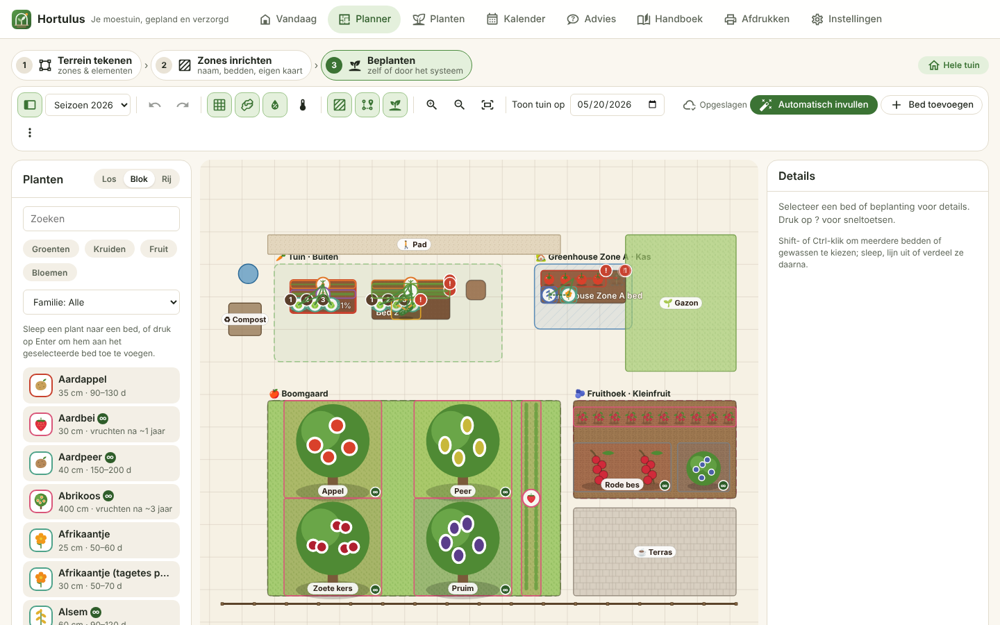
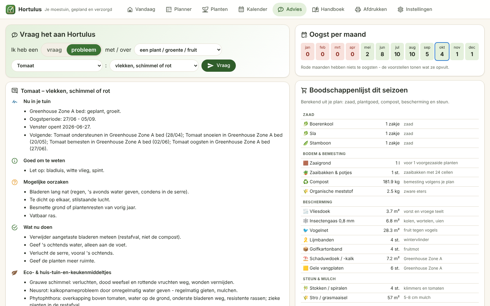
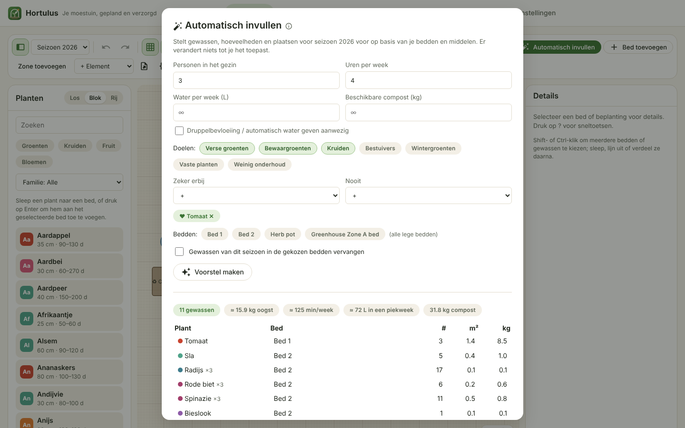
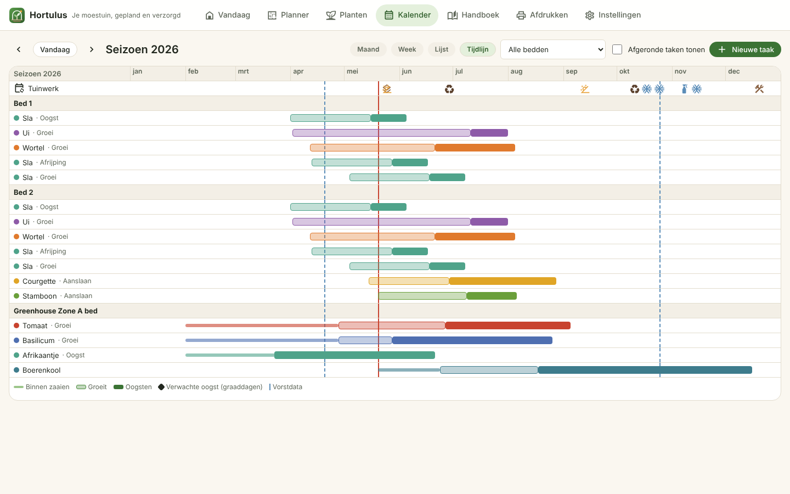
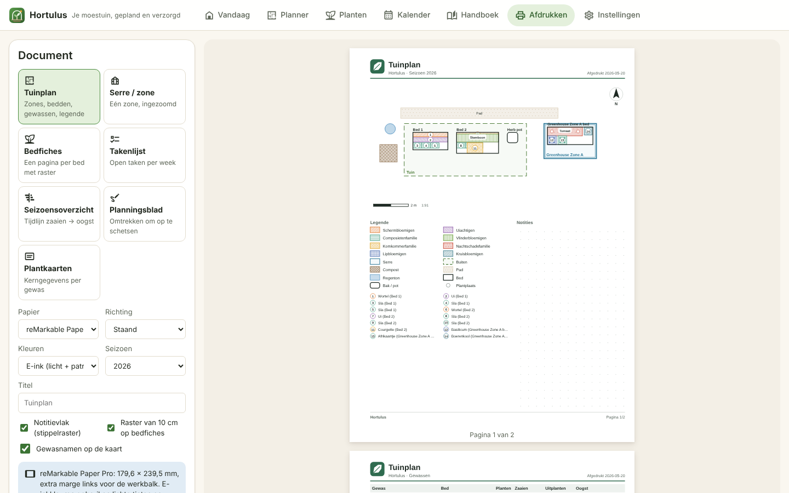
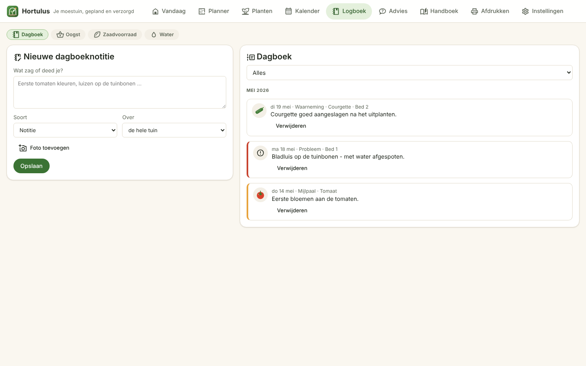
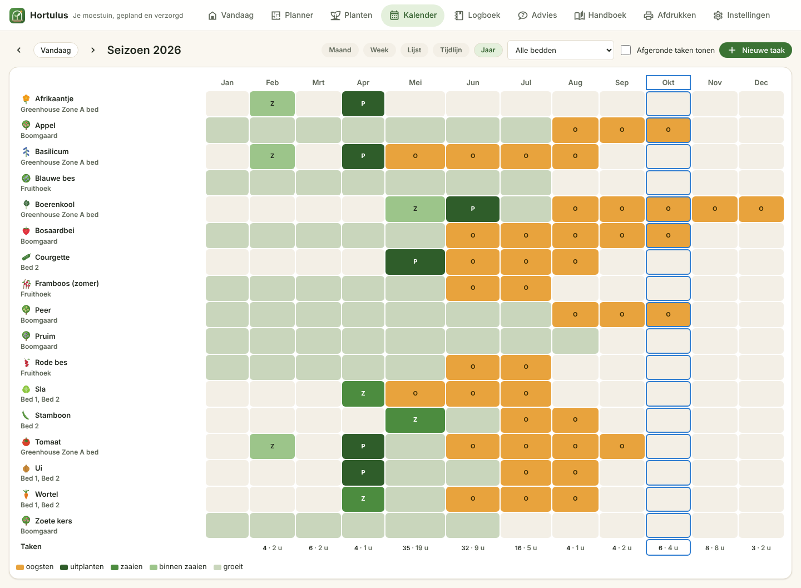
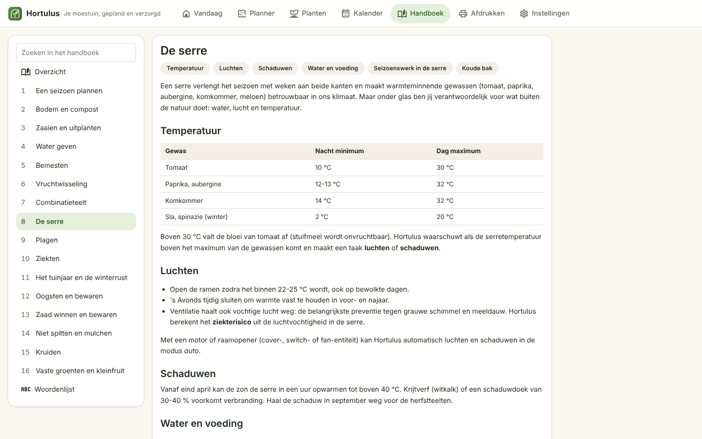
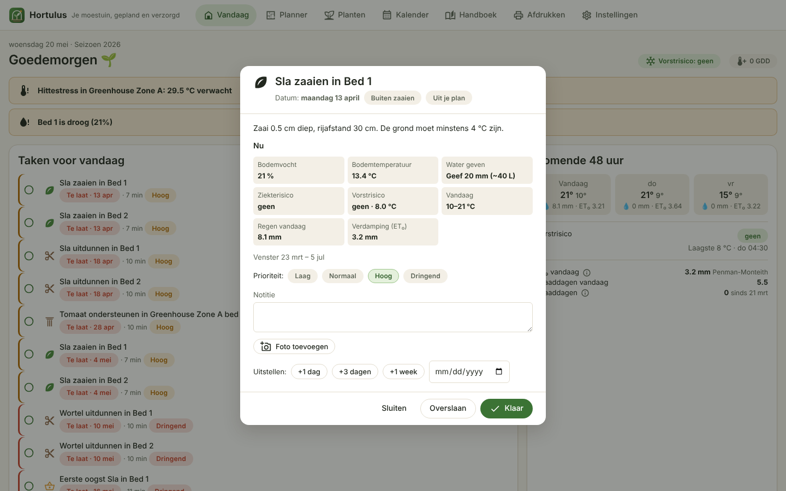

<p align="center">
  
</p>

<p align="center">
  <a href="README.nl.md">🇳🇱 Nederlands</a> ·
  <a href="docs/en/CONFIGURATION.md">Configuration</a> ·
  <a href="docs/en/ENTITY_REFERENCE.md">Entities & services</a> ·
  <a href="docs/en/FAQ.md">FAQ</a> ·
  <a href="docs/BLUEPRINT.md">Architecture blueprint</a> ·
  <a href="docs/DESIGN_SYSTEM.md">Design system</a>
</p>

<p align="center">
  
  
  
  
</p>

# Hortulus — vegetable garden manager for Home Assistant

*Hortulus* (Latin for "little garden", after Walahfrid Strabo's 9th‑century poem about
tending his monastery vegetable plot) turns Home Assistant into a kitchen‑garden
companion: draw your beds and greenhouse, drag crops onto them, and Hortulus works out
**when to sow, plant out, feed, prune and harvest** – then keeps those plans honest with
your **soil sensors and the weather forecast**.

Everything runs locally. No accounts and no cloud – the only optional outside call is
Open‑Meteo for better evaporation estimates, and it is off until you switch it on.

<p align="center"></p>

## Highlights

| | |
|---|---|
| 🗺️ **Garden plan in three steps** | **1 · Draw your site** on a 10 × 10 cm grid: zones (vegetable garden, greenhouse, cold frame, **orchard, soft fruit, herb and flower garden**) and elements (house, driveway, street, terrace, lawn, paths, hedge, fence, trees, pond, shed, compost bin, water butt …). **2 · Arrange each zone** on its own map. **3 · Plant** by hand or let the system fill it. Recognisable **plant icons** (a carrot looks like a carrot), rows of seedlings for dense crops, multi‑select, align, layers, succession sowings, undo/redo, import/export. |
| 🌳 **Perennials that stay** | An apple tree planted this year is still there next year: fruit trees, berries, asparagus and perennial herbs stay with their own yearly care (winter and summer pruning, thinning, netting, grease bands) – you move them into each new year at the year-end transition, and "gone from this season" keeps the history. |
| 💬 **Advice & Q&A** | Ask in a sentence of dropdowns – *"I have a problem with [tomato]: [spots, mould or rot]"* – and get the live status, likely causes, what to do now, **eco & home remedies** and prevention. Suggestions for placement, pollination partners, pollinator flowers, bad neighbours, harvest gaps (vegetables all year), empty beds and ecology, with one‑click apply. |
| ✨ **Autofill** | Proposes a whole season from your beds, household size, weekly hours, water and compost: right amounts per person, tall crops away from the sun, rotation and companions respected, quick crops in successive sowings, tender crops under glass. **Preferences**: must‑have and never crops, freedom of choice, respect neighbours, add pollinator flowers, aim for year‑round harvests, perennials allowed, respect the zone type. |
| 🤝 **Companions & rotation** | Live scoring while you drag: friends/enemies, **pest deterrence and trap crops, allelopathy, nutrient competition and shading** (hemisphere aware) – each with an explanation, better‑neighbour suggestions and alternative beds for rotation conflicts. |
| 🌱 **Plant database** | **232 crops**: 100 vegetables, 75 herbs, 36 fruits (apple, pear, cherry, plum, peach, fig, currants, gooseberry, raspberries, blueberry, grape, kiwi berry …) and 21 flowers & green manures (EN/NL), with Kc per growth stage, N‑P‑K demand, yearly care rules, pollination, eco tips and an icon – fully editable, add your own. |
| 📅 **Task engine & garden year** | Sowing to harvest per crop, plus the **seasonal calendar**: prepare the soil (with compost kg), wash the greenhouse windows, shading on/off, biological control, nettle and comfrey feed, gutters and water butts, nest boxes, seed saving, winter rest and covers, orchard care. **Weather episodes** (heat, dry spell, storm, heavy rain) with eco tips, **weather‑aware rescheduling**, the tools each job needs, **overdue reminders** and a weekly look‑ahead. |
| 📓 **Journal & records** | A **garden diary** with photos per bed or crop, a **harvest log** in kg that teaches Autofill **your own yields**, a **seed box** that knows which packets are getting old and which crops still need seed, **water use** from a garden meter and the rain butt, and **soil analyses** per bed that steer the fertiliser and lime advice. A **year view** shows every crop month by month, also as a printable year plan. |
| 👪 **Household, card & voice** | Assign tasks to people with automatic rules and personal reminders, tick tasks off from any dashboard with the **`hortulus-tasks-card`**, and ask Assist *"what do I need to do in the garden today?"* (English and Dutch). |
| 💧 **Water, feeding, health** | FAO‑56 **Penman‑Monteith ET₀** (Hargreaves fallback), Kc per growth stage, a root‑zone **water balance** per bed, NPK/EC **nutrient balance index**, **disease risk** (Hutton criteria, leaf wetness, greenhouse humidity), degree‑day phenology with dynamic harvest dates. |
| 🚿 **Safe hardware control** | Valves + pump with **pump interlock, max runtime, frost lockout and rain skip**; greenhouse vents and shade screens in auto mode; everything also as advice only. |
| 🖨️ **Print & reMarkable** | Garden and greenhouse maps with legend, scale and north arrow, bed sheets with grid, checklists, season charts, blank planning sheets and plant cards – as PDF in A4/A3/A5/Letter or **reMarkable Paper Pro** with e‑ink patterns and dot‑grid note areas to draw on. |
| 📖 **Handbook** | 21 chapters on soil, sowing, watering, feeding, rotation, companions, the greenhouse, pests, diseases, the garden year, **fruit, tools & materials, home remedies, year‑round harvest and choosing sensors** (EN/NL), plus ⓘ tooltips everywhere. A **shopping list** works out seed, plants, compost, fleece, mesh and nets from your plan. |
| 🏠 **Real HA citizen** | Sensors, binary sensors, numbers, selects, switches, buttons, a calendar and a to‑do list, services with responses, bus events, push/TTS/persistent notifications, diagnostics, EN + NL translations. |

<table>
  <tr>
    <td></td>
    <td></td>
  </tr>
  <tr>
    <td></td>
    <td></td>
  </tr>
  <tr>
    <td></td>
    <td></td>
  </tr>
  <tr>
    <td></td>
    <td></td>
  </tr>
  <tr>
    <td></td>
    <td></td>
  </tr>
</table>

### Printouts for paper and the reMarkable Paper Pro

<table>
  <tr>
    <td width="33%"></td>
    <td width="33%"></td>
    <td width="33%"></td>
  </tr>
</table>

The **Print** tab previews every page before you download it. The reMarkable format is
179.6 × 239.5 mm (the Paper Pro's 4:3 screen) with a wider left margin for the toolbar;
*e‑ink* mode uses light tints plus a hatch pattern per plant family, so beds stay
distinguishable and your pen strokes stay visible. Automations can produce the same PDFs
with `garden_manager.export_pdf` (saved to `/config/hortulus/exports/`).

## Installation

### HACS (recommended)

1. HACS → ⋮ → **Custom repositories** → add `https://github.com/emeryf81/hortulus` as *Integration*.
2. Install **Hortulus Garden Manager** and restart Home Assistant.
3. **Settings → Devices & services → Add integration → Hortulus**.

### Manual

Copy `custom_components/garden_manager` into `<config>/custom_components/` and restart.
The panel bundle (`frontend/hortulus-panel.js`) is committed, so no Node.js build is needed.

Requirements: Home Assistant **2025.10 or newer**. A weather entity with an hourly and/or
daily forecast (for example the built‑in Met.no `weather.home`) is recommended but optional.

## Quick start

The setup wizard asks for:

1. **Climate profile** – a regional preset (e.g. *Netherlands / Flanders*), a USDA hardiness
   zone, or your own average frost dates; plus the hemisphere.
2. **Weather** – e.g. `weather.home`, optionally an outdoor temperature and rain sensor.
3. **Beds, greenhouses and containers** – name, size, soil, shade, wind, and the sensors
   that belong to them (`sensor.soil_moisture_bed_1`, `sensor.soil_temp_bed_1`,
   `sensor.greenhouse_temp`, …) plus an optional irrigation valve.
4. **Notifications** – persistent notifications, mobile push, TTS and a daily digest time.
5. **Summary** – optionally seed a small companion‑friendly example plan.

Then open **Hortulus** in the sidebar. Details: [CONFIGURATION](docs/en/CONFIGURATION.md).

## What you get in Home Assistant

| Concept in the brief | Entity / action in Home Assistant |
|---|---|
| `garden.bed_moisture_status` | `sensor.<bed>_moisture_status` (dry / slightly_dry / optimal / wet) |
| `garden.frost_risk_next_48h` | `sensor.hortulus_frost_risk_next_48h` + `binary_sensor.hortulus_frost_warning` |
| `garden.irrigation_recommendation` | `sensor.<bed>_irrigation_recommendation` (mm; litres & minutes as attributes) + `binary_sensor.<bed>_needs_water` |
| `garden.growing_degree_days` | `sensor.hortulus_growing_degree_days` |
| greenhouse advice | `sensor.<zone>_greenhouse_advice`, `binary_sensor.<zone>_heat_stress`, `select.<zone>_shading` |
| evaporation & degree days | `sensor.hortulus_reference_evapotranspiration_today`, `sensor.hortulus_degree_days_today`, `sensor.<zone>_degree_days_this_season` |
| soil water & nutrients | `sensor.<bed>_soil_water_deficit`, `sensor.<bed>_nutrient_balance` |
| disease & frost per zone | `sensor.<zone>_disease_risk`, `binary_sensor.<zone>_frost_risk_48h` |
| irrigation control | `switch.hortulus_automatic_irrigation`, `select.hortulus_irrigation_mode`, `number.hortulus_irrigation_max_runtime` (+ frost lockout, rain skip), `button.hortulus_water_now`, `binary_sensor.hortulus_irrigation_frost_lockout`, `binary_sensor.hortulus_irrigation_running` |
| tasks | `calendar.hortulus_garden_tasks`, `todo.hortulus_this_week`, `sensor.hortulus_tasks_due_today`, `sensor.hortulus_next_task` |
| records | `sensor.hortulus_harvest_this_season`, `sensor.hortulus_garden_water_7_days`, `sensor.hortulus_rain_water_available`, `garden_manager.log_harvest`, `.add_journal_entry`, `.save_soil_test`, `.assign_task` |
| dashboard & voice | `type: custom:hortulus-tasks-card` (loaded automatically), Assist intents via `garden_manager.install_voice_sentences` |
| `garden.add_task` … | `garden_manager.add_task`, `.complete_task`, `.postpone_task`, `.delete_task`, `.generate_tasks`, `.recalculate_plan`, `.export_plan`, `.import_plan` |
| plan & hardware | `garden_manager.add_planting`, `.update_planting`, `.remove_planting`, `.autofill_plan`, `.run_irrigation_plan` (with `dry_run`), `.stop_irrigation`, `.set_shading_mode`, `.export_pdf` |

> Home Assistant requires services to live in the integration's own domain, so the
> `garden.*` names from the specification are exposed as `garden_manager.*`.

Full reference: [ENTITY_REFERENCE](docs/en/ENTITY_REFERENCE.md) · Example
[automations](examples/automations.yaml) and [dashboard](examples/dashboard.yaml).

## How the horticultural logic works (short)

* **Windows** are stored as weeks relative to the *average last spring frost* /
  *first autumn frost*, so one database serves both hemispheres and every climate.
  Greenhouses shift spring windows earlier by a per‑crop number of weeks.
* **Live refinements:** direct sowing waits for warm enough soil (soil sensor),
  planting out of tender crops waits for a frost‑free forecast.
* **Companions:** interaction strength decays with distance; enemies weigh double;
  plantings that never share time in the ground (succession!) never conflict.
* **Rotation:** history per bed and family; the same family back too soon is flagged.
* **Watering:** moisture bands per crop water need and soil type; refill deficit + ET₀ × Kc
  minus probability‑weighted rain; greenhouses get no rain credit. ET₀ is FAO‑56
  Penman‑Monteith from temperature, humidity, wind and cloud cover (Hargreaves when those
  are missing), Kc follows the growth stage. Beds without a moisture sensor keep a daily
  **root‑zone bucket** (available water by soil type × rooting depth) and are watered when
  half of it is used.
* **Feeding:** compost per m² by the hungriest following crop (5 / 3 / 1.5 kg, legumes
  0.5), liquid‑feed doses in feed tasks, and a 0–100 nutrient balance index from NPK or EC
  probes against the crops' N‑P‑K demand.
* **Disease:** two humid warm days in a row (Hutton criteria) means high late‑blight risk;
  long leaf‑wet spells, a wet‑leaf sensor or humid greenhouse air raise the level and
  create inspection tasks for susceptible crops.
* **Phenology:** degree days since planting move the expected harvest (± 3 weeks around
  the calendar date); heat stress delays fruiting crops.
* **Irrigation safety:** one valve at a time, pump only while a valve is open, max runtime,
  no outdoor watering with frost forecast within 12 h or with enough rain coming; valves
  and pump are always switched off at the end, also after errors.
* **Frost:** hourly forecast, plant‑level adjustment for clear calm nights, greenhouse
  buffering, heated‑zone floor; falls back to daily forecast, then to the live sensor.

The [architecture blueprint](docs/BLUEPRINT.md) documents every model and algorithm.

## Development

```bash
# Python (integration + engine)
pip install -r requirements_test.txt
pytest -q && ruff check custom_components tests

# Frontend (Lit + TypeScript)
cd frontend && npm ci
npm run typecheck && npm test && npm run build   # writes custom_components/garden_manager/frontend/hortulus-panel.js
```

Repository layout and design rationale are described in the
[blueprint](docs/BLUEPRINT.md); the visual language in the
[design system](docs/DESIGN_SYSTEM.md).

## License

MIT © 2026 Emery Frijters. Plant data compiled from common horticultural practice;
always check seed packets and local advice.
