<p align="center">
  
</p>

<p align="center">
  <a href="README.md">🇬🇧 English</a> ·
  <a href="README.fr.md">🇫🇷 Français</a> ·
  <a href="docs/nl/CONFIGURATIE.md">Configuratie</a> ·
  <a href="docs/nl/ENTITEITEN.md">Entiteiten & diensten</a> ·
  <a href="docs/nl/FAQ.md">Veelgestelde vragen</a> ·
  <a href="docs/BLUEPRINT.md">Architectuur (EN)</a> ·
  <a href="docs/DESIGN_SYSTEM.md">Ontwerpsysteem (EN)</a>
</p>

<p align="center">
  
  
  
  
  
</p>

# Hortulus — moestuinplanner voor Home Assistant

*Hortulus* (Latijn voor "tuintje", naar het 9e‑eeuwse gedicht van Walahfrid Strabo over
zijn kloostermoestuin) maakt van Home Assistant een moestuinmaatje. Teken je bedden en
kas, sleep gewassen erop en Hortulus rekent uit **wanneer je zaait, uitplant, bemest,
snoeit en oogst** – en houdt die planning eerlijk met je **bodemsensoren en de
weersverwachting**. Het vertelt wat je vandaag moet doen, houdt je tuindagboek en
oogstlogboek bij en maakt van wat **klaar is om te plukken** **recepten, menu's en een
boodschappenlijst**.

Alles draait lokaal. Geen accounts en geen cloud. De enige externe oproepen zijn
optioneel: Open‑Meteo voor een betere verdampingsberekening (staat uit tot je ze aanzet),
plantenfoto's van Wikipedia in je browser (uit te zetten bij Instellingen) en, zonder radarcamera in
Home Assistant, de openbare Buienradar‑kaart op het tabblad Weer in Nederland en België.
Het hele paneel, de plantendatabase, het handboek en de recepten zijn er in het
**Nederlands, Engels en Frans**.

<table>
  <tr>
    <td width="34%" valign="top">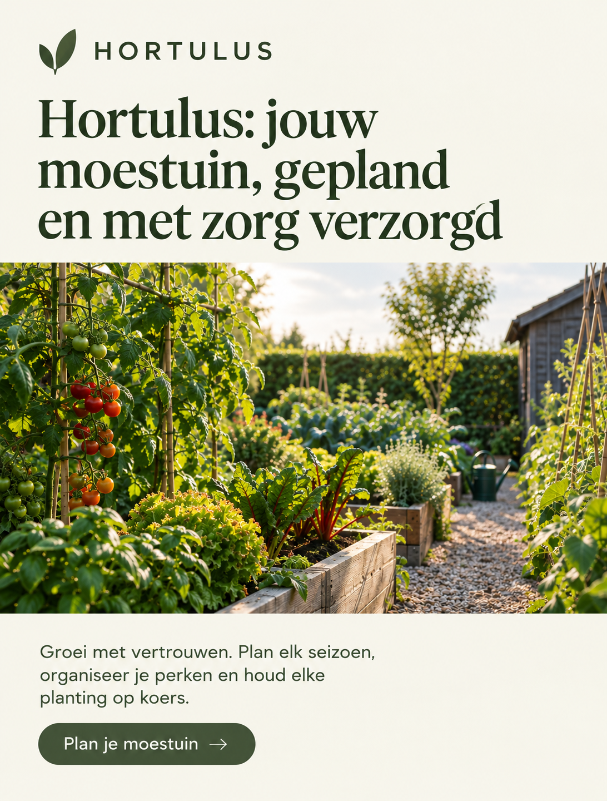</td>
    <td width="66%" valign="top">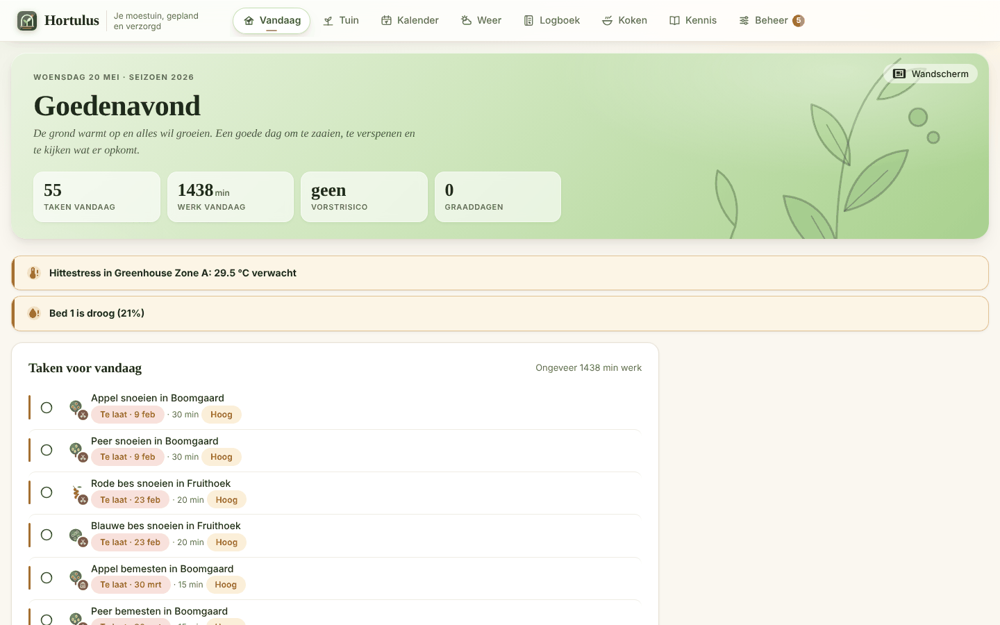</td>
  </tr>
</table>

## Wat zit erin

Hortulus voegt één **paneel** toe aan de zijbalk van Home Assistant, ingedeeld in acht
plaatsen, plus entiteiten, diensten, een dashboardkaart en spraakopdrachten voor de rest
van Home Assistant.

| Plaats | Tabs | Waarvoor |
|---|---|---|
| **Vandaag** | Vandaag · Wandscherm | De dag in één oogopslag: taken, waarschuwingen, weer, snelle oogst, bedden. |
| **Tuin** | Planner · Tuinplan · Teelten | Teken het terrein, rangschik de zones, plant de bedden; elke teelt in één lijst, tijdlijn, zaaiplan, zaden, opvolging en oogstverwachting. |
| **Kalender** | Kalender | Maand, week, lijst, seizoenstijdlijn en jaaroverzicht van alle taken en teelten. |
| **Weer** | Weer | Verwachting, wat het voor je tuin betekent, buienradar. |
| **Logboek** | Dagboek · Oogst · Keuken · Zaaddoos · Water · Seizoensrapport · Systeemlogboek | Alles wat je bijhoudt en wat het oplevert. |
| **Koken** | Ideeën · Mijn kookboek · Boodschappenlijst | Een seizoenskookboek van wat klaar is om te plukken. |
| **Kennis** | Planten · Advies · Handboek | 232 gewassen, vraag en antwoord, een handboek met 23 hoofdstukken. |
| **Beheer** | Analyse · Afdrukken · Instellingen | Plancontrole en diagnose, pdf's voor papier en reMarkable, alle instellingen. |

## De tuin

### Het terrein plannen in vijf stappen

**1 · Terrein** (huis, oprit, straat, terras, gazon, paden, haag, omheining, bomen, vijver,
schuur, compostbak, regenton …) op een raster van 10 × 10 cm, **2 · Groeizones**
(moestuin, kas, koude bak, **boomgaard, kleinfruit, kruiden‑ en bloementuin**),
**3 · Bedden** en bakken in de zones, **4 · Meerjarigen** (fruitbomen, bessen, asperges,
vaste kruiden) en **5 · Eenjarigen** – met de hand, of laat **Automatisch invullen** een
heel seizoen voorstellen. Elke stap past alleen zijn eigen soort dingen aan, dus slepen in
stap 5 verschuift nooit een muur. Planten hebben herkenbare **iconen** (een wortel ziet
eruit als een wortel), dichte gewassen worden als rijen zaailingen getekend en een element
dat op een ander ligt (gazon onder een terras) verkleint het vlak eronder. Meervoudige
selectie, uitlijnen, lagen, opvolgteelten, ongedaan maken/opnieuw en import/export zitten
erin.

<table>
  <tr>
    <td width="50%">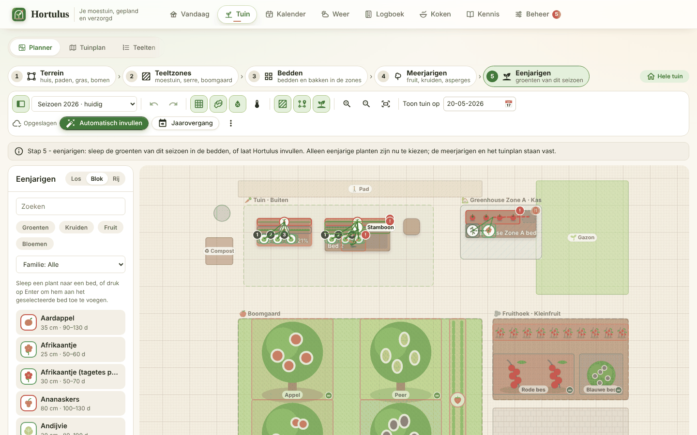</td>
    <td width="50%">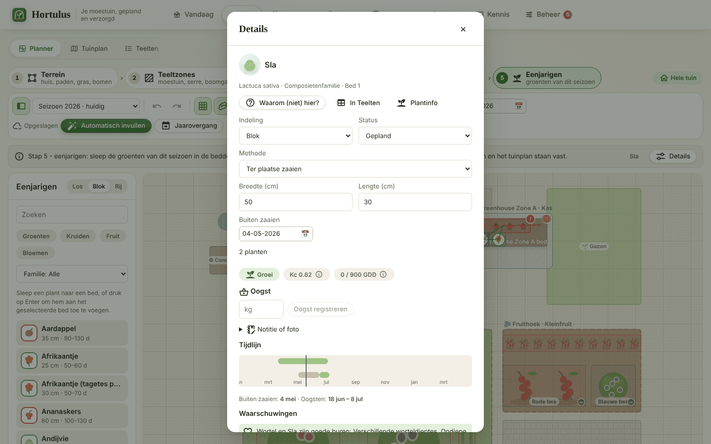</td>
  </tr>
  <tr>
    <td>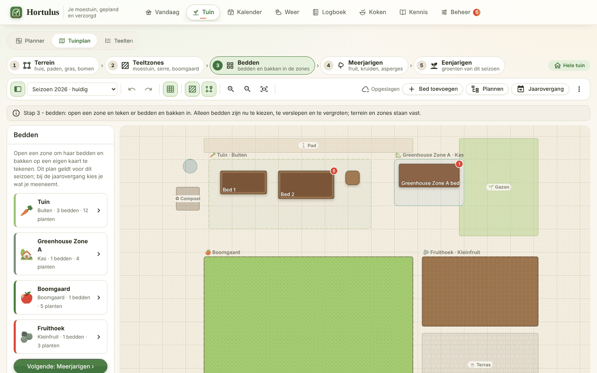</td>
    <td>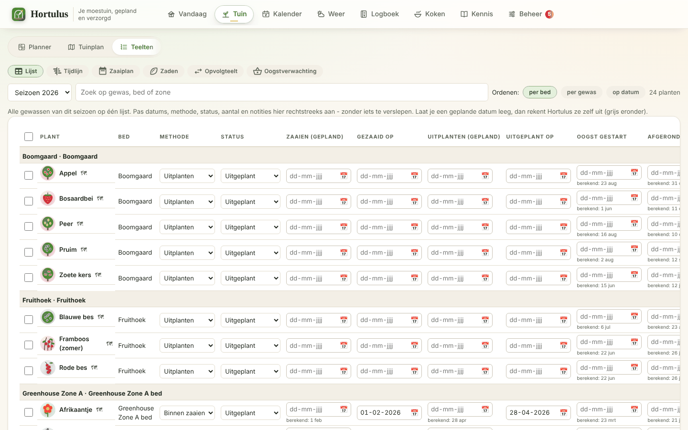</td>
  </tr>
</table>

* **Buren & vruchtwisseling** – live score tijdens het slepen: vrienden en vijanden,
  **plaagwering en lokgewassen, allelopathie, voedingsconcurrentie en schaduw**
  (halfrondbewust), telkens met uitleg, suggesties voor betere buren en alternatieve
  bedden bij vruchtwisselingsconflicten. *"Waarom (niet) hier?"* antwoordt in gewone
  woorden, per bed.
* **Automatisch invullen** – stelt een heel seizoen voor op basis van je bedden,
  gezinsgrootte, uren per week, water en compost: juiste hoeveelheden per persoon, hoge
  gewassen weg van de zon, vruchtwisseling en buren gerespecteerd, snelle gewassen in
  opeenvolgende zaaiingen, tere gewassen onder glas. Voorkeuren: verplichte en uitgesloten gewassen,
  keuzevrijheid, bestuiversbloemen, oogst het hele jaar, meerjarigen toegestaan, het
  zonetype respecteren.
* **Meerjarigen blijven** – een appelboom die dit jaar is geplant staat er volgend jaar
  nog, met eigen jaarlijks onderhoud (winter‑ en zomersnoei, uitdunnen, netten,
  lijmbanden). Bij de **jaarovergang** kies je wat mee naar het nieuwe seizoen gaat; oude
  seizoenen verhuizen naar een archief en blijven beschikbaar voor vruchtwisseling,
  rapporten en het seizoensboek.
* **Teelten** – alle teelten van het seizoen in één tabel (zaai‑ en plantdata, status,
  notities), plus **tijdlijn**, **zaaiplan per week**, **zaadbehoefte**, **opvolging** en
  een **oogstverwachting**; meerdere teelten tegelijk wijzigen.

<table>
  <tr>
    <td width="50%">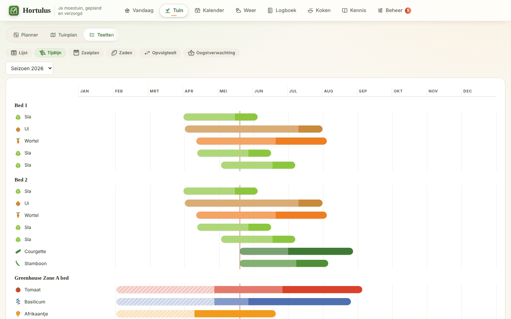</td>
    <td width="50%">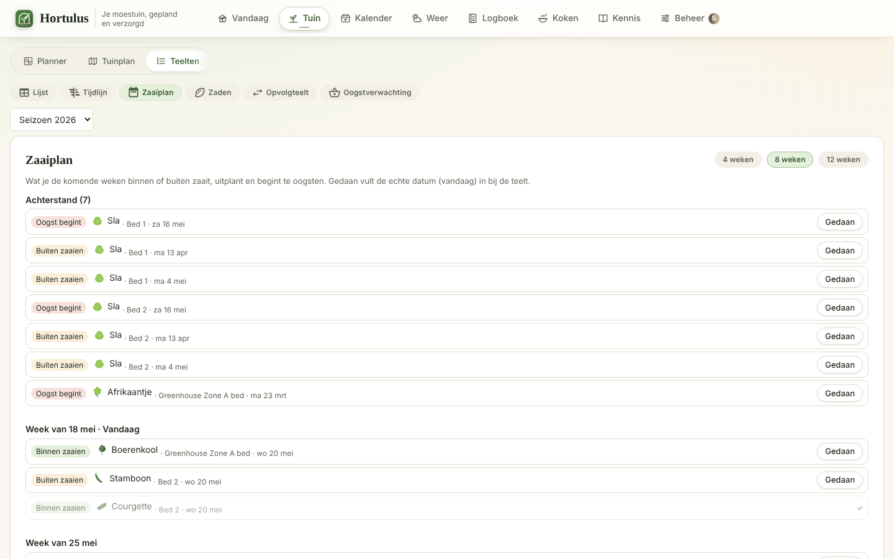</td>
  </tr>
</table>

### Weten wat je wanneer moet doen

Een **taakmotor** plant het hele leven van elke teelt – zaaien, verspenen, harden,
uitplanten, bemesten, snoeien, oogsten – en het **tuinjaar**: grond voorbereiden (met
kilo's compost), de kasramen wassen, schaduw aan en uit, biologische bestrijding,
brandnetel‑ en smeerwortelmest, goten en regentonnen, nestkasten, zaad winnen, winterrust,
boomgaardonderhoud. Taken passen zich aan het weer aan (hitte, droogte, storm, zware
regen), wachten op warme grond en een vorstvrije verwachting, komen met het gereedschap
dat elke klus nodig heeft en herinneren je vriendelijk als ze te laat zijn. Je kunt ze aan
mensen toewijzen, afvinken vanaf elk dashboard en er is een weekoverzicht vooruit.

<table>
  <tr>
    <td width="50%">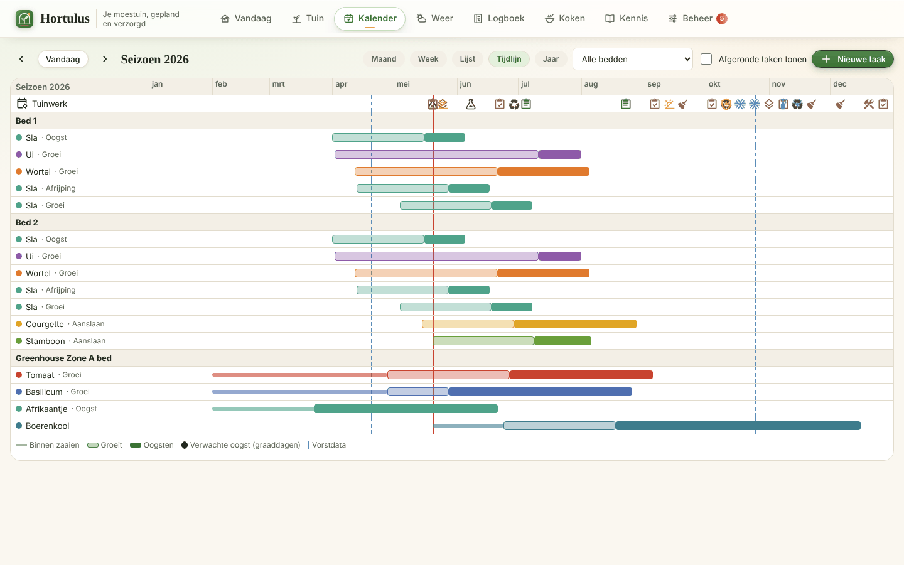</td>
    <td width="50%">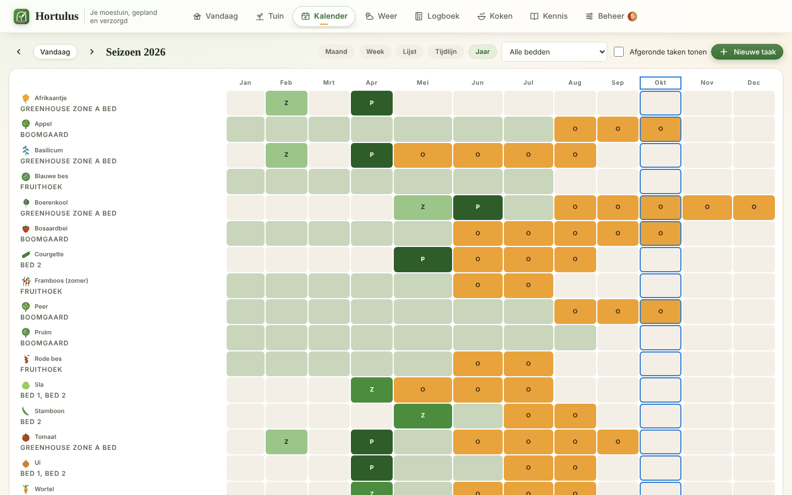</td>
  </tr>
  <tr>
    <td>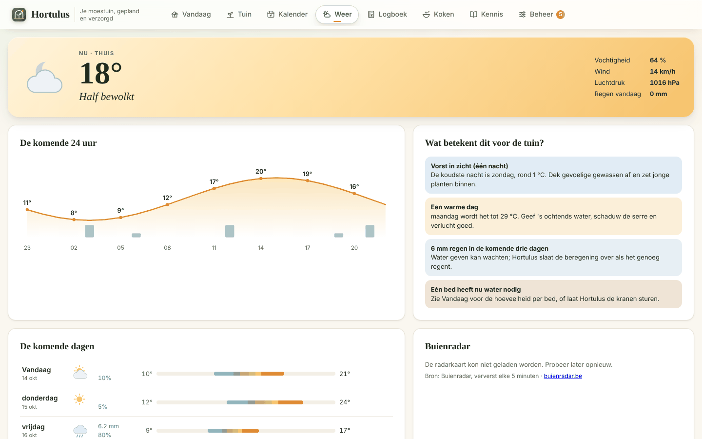</td>
    <td>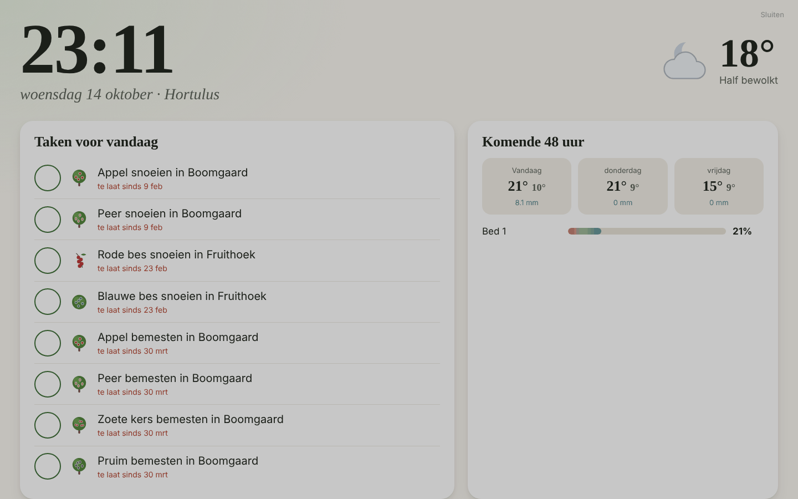</td>
  </tr>
</table>

* **Kalender** – maand, week, lijst, seizoenstijdlijn en jaaroverzicht, ook als Home
  Assistant‑agenda en takenlijst.
* **Weer** – uur‑ en dagverwachting, wat de komende dagen voor *jouw* tuin betekenen
  (vorst, een hete dag, regen waarop je kunt rekenen, een bed dat water nodig heeft) en een
  buienradar.
* **Wandscherm** – een rustig kioskbeeld met tijd, weer en taken voor een tablet in de
  keuken; dimt 's nachts.

## Registraties, keuken en kennis

### Logboek

Een **tuindagboek** met foto's per bed of teelt en een fototijdlijn, een **oogstlogboek** in
kilo's dat Automatisch invullen **jouw eigen opbrengsten** leert, een **zaaddoos** die weet
welke zakjes oud worden en voor welke gewassen nog zaad nodig is (en wat ontbreekt op je
boodschappenlijst zet), **watergebruik** van een tuinmeter en de regenton met een
bewateringsgeschiedenis per bed, **bodemanalyses** per bed die het mest‑ en kalkadvies
sturen, kosten en besparingen en een **seizoensrapport** – ook als afdrukbaar
**seizoensboek**. Het *Systeemlogboek* toont wat er veranderde en laat je het ongedaan maken.

<table>
  <tr>
    <td width="50%">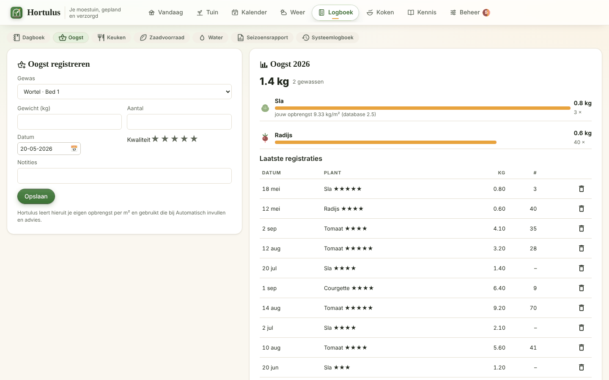</td>
    <td width="50%">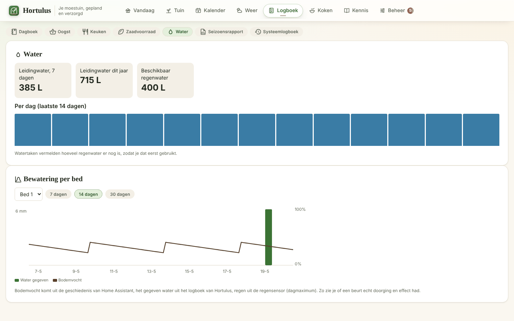</td>
  </tr>
  <tr>
    <td>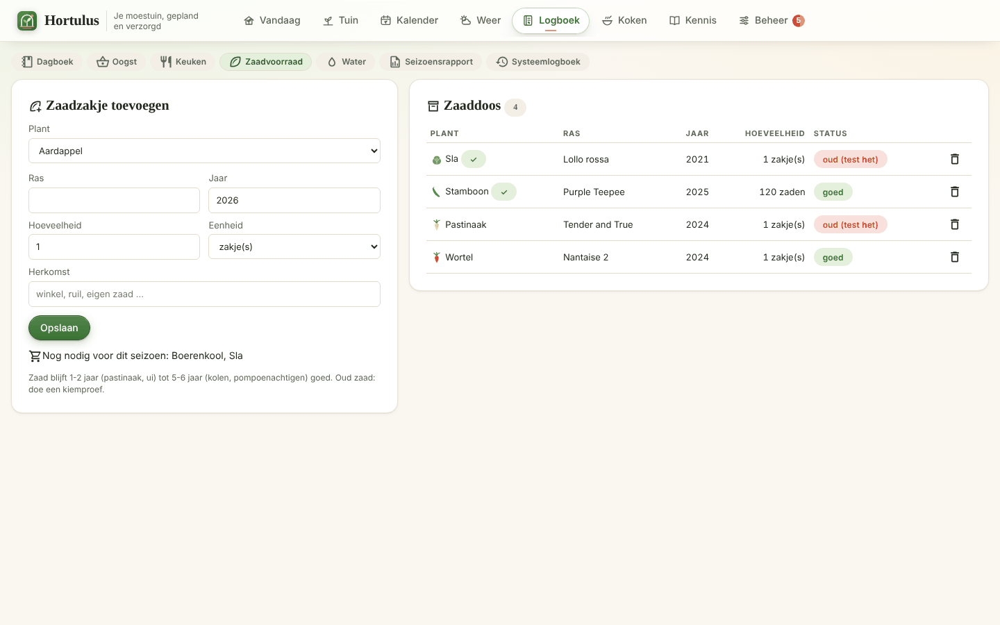</td>
    <td>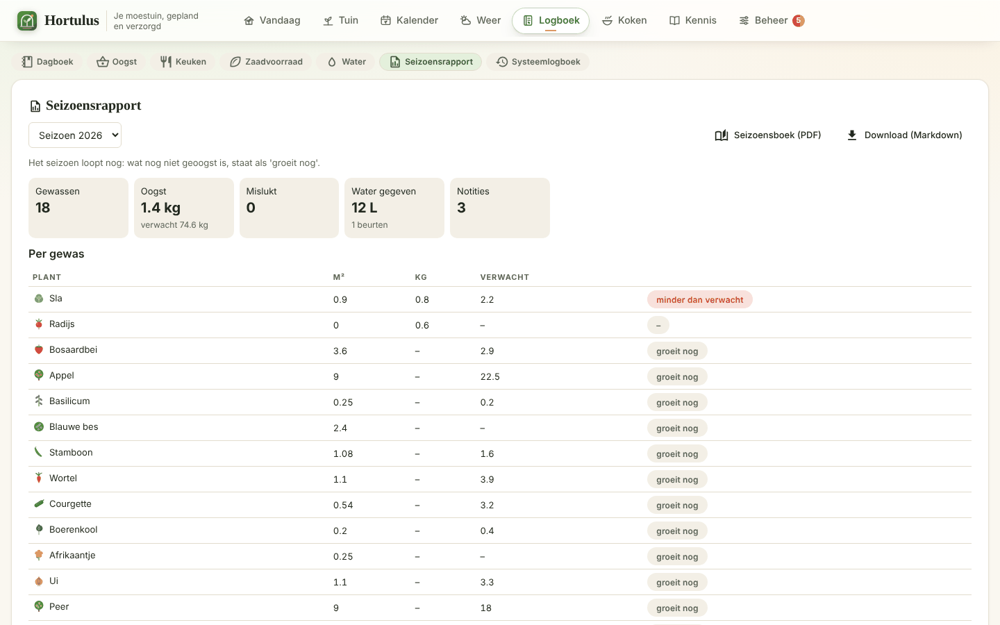</td>
  </tr>
</table>

### Koken – van wat klaar is om te plukken

Hortulus kijkt naar de gewassen binnen hun oogstvenster (plus wat je uit de kelder
toevoegt, zoals bewaarde pompoenen of diepgevroren bonen) en stelt **gerechten en complete
menu's** voor: soepen, ovenschotels, roerbakgerechten, pasta, risotto, salades, gratins,
curry's, frittata, stoemp, gevulde groenten, pesto, crumbles, ratatouille, tians,
shakshuka, waterzooi, beignets, clafoutis, groentetaarten en meer – meer dan zestig soorten
gerechten – en een hoofdstuk over **het overschot bewaren** (snelle pickles, chutney,
passata, jam, invriezen, zuurkool). Veilig ontworpen: slagewassen blijven rauw, bonen en
vlierbessen worden nooit rauw voorgesteld.

* Geef aan wat er in de **ijskast** ligt (elk item wordt verwerkt waar het past), wat
  **altijd in huis** is, een **bijgerecht** (pasta, rijst, bulgur, couscous, parelcouscous,
  gnocchi, aardappelen, frietjes …) en een soort **vlees, vis of vegetarisch eiwit** (of
  geen).
* Elk gerecht krijgt een **plaatje van de gewassen op het bord**, hoeveelheden per persoon
  en wat uit de tuin komt, wat je in huis hebt en wat je moet kopen.
* **Pas elk recept aan**: wijzig ingrediënten en stappen en bewaar je versie in **Mijn
  kookboek** met favorieten, notities en wanneer je het kookte.
* **Eén boodschappenlijst** voor de week: print ze, bewaar ze als pdf, stuur ze naar je
  telefoon of naar een Home Assistant‑takenlijst. Recepten en het hele kookboek exporteer je
  als pdf.

<table>
  <tr>
    <td width="50%">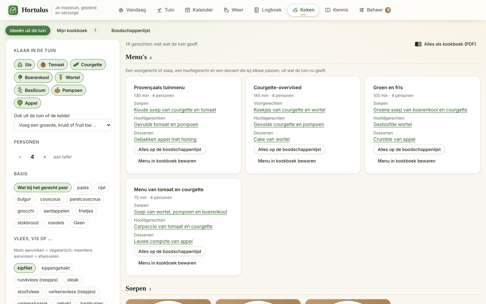</td>
    <td width="50%">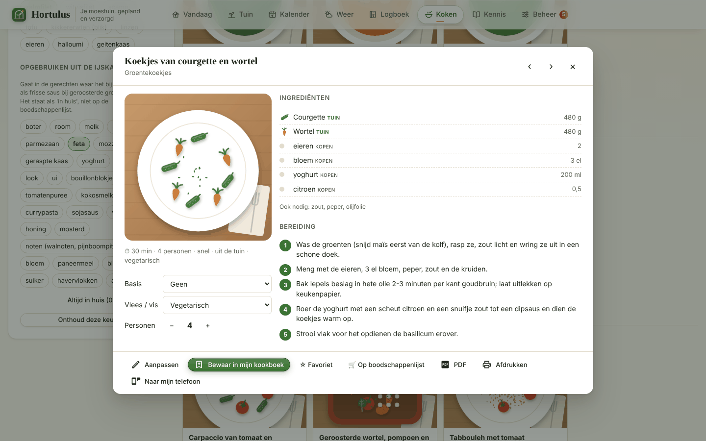</td>
  </tr>
  <tr>
    <td>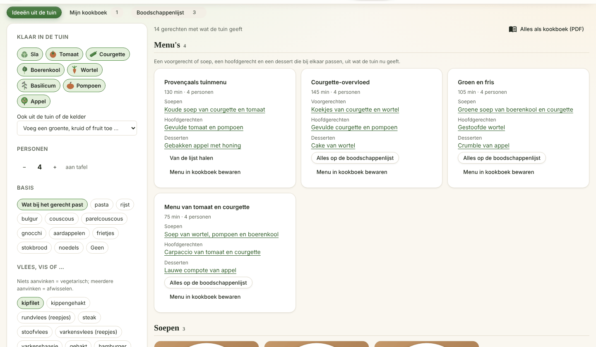</td>
    <td>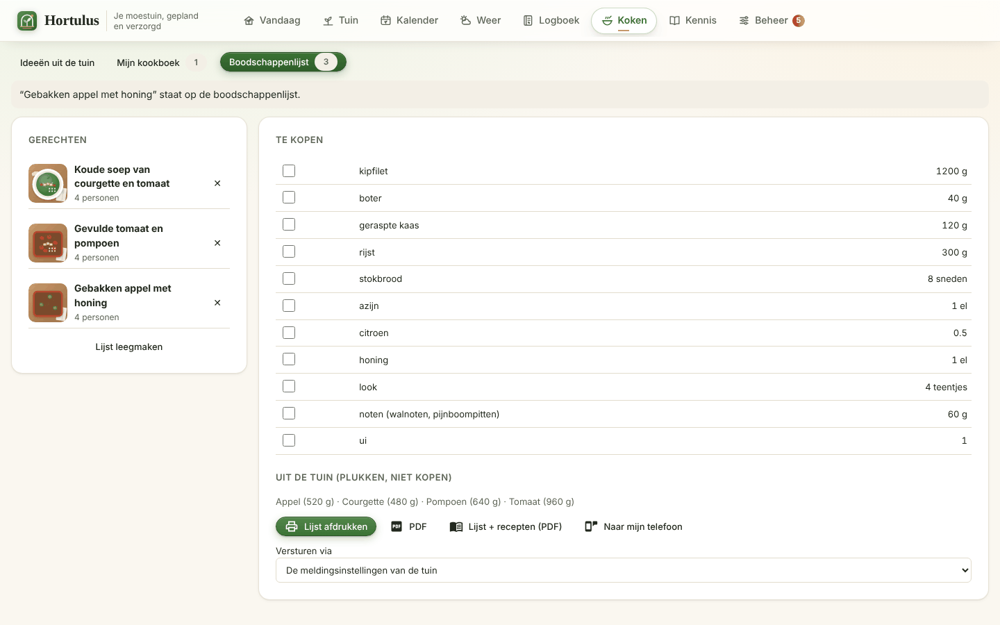</td>
  </tr>
</table>

### Kennis

<table>
  <tr>
    <td width="50%">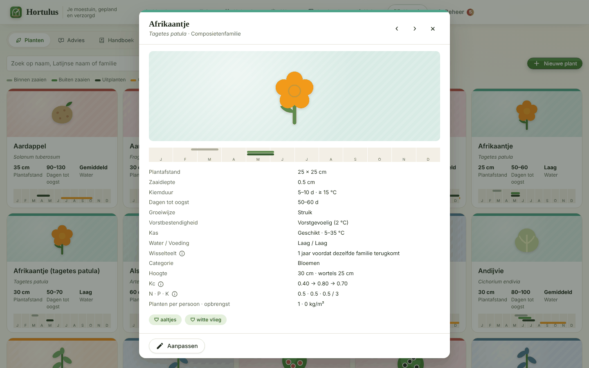</td>
    <td width="50%">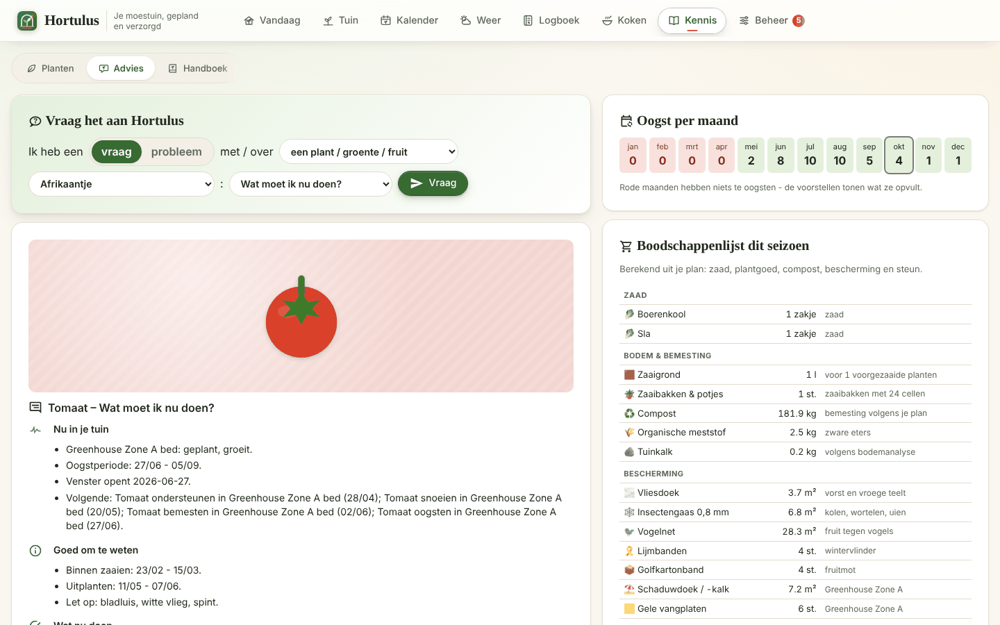</td>
  </tr>
  <tr>
    <td>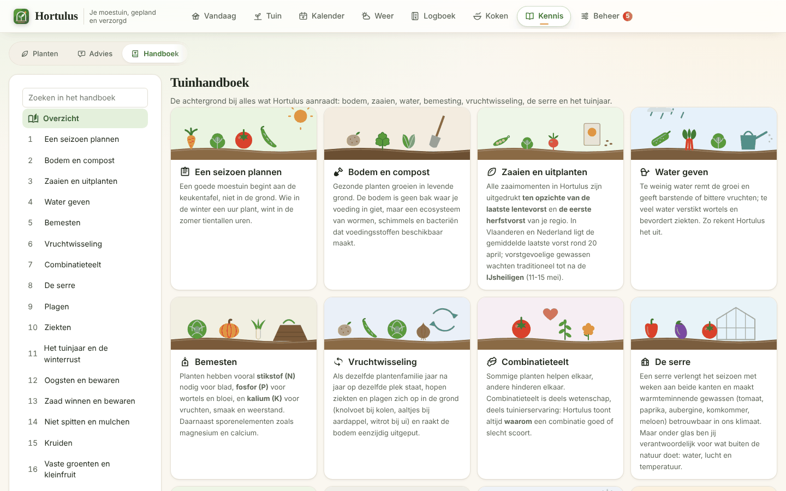</td>
    <td>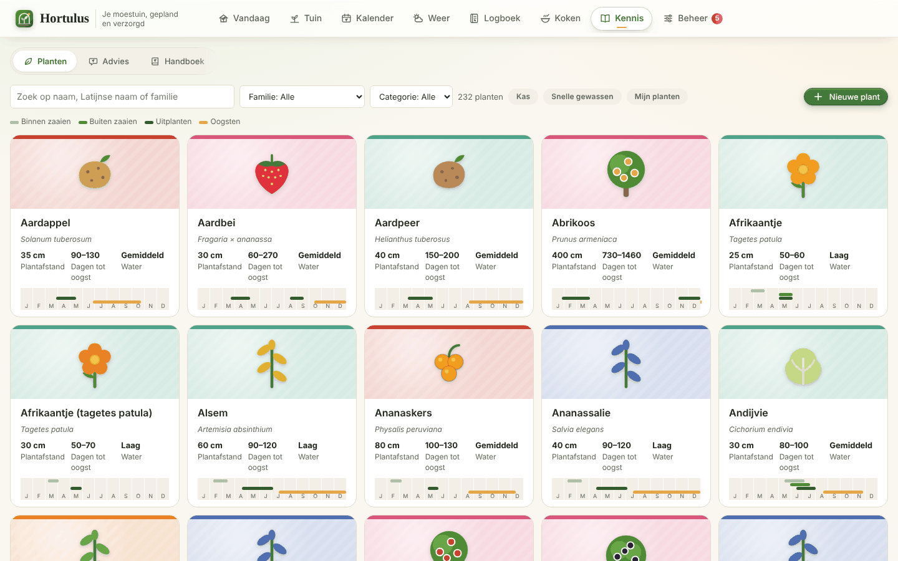</td>
  </tr>
</table>

* **Plantendatabase** – **232 gewassen**: 100 groenten, 75 kruiden, 36 fruitsoorten en 21
  bloemen en groenbemesters, met Kc per groeistadium, N‑P‑K‑behoefte, jaarlijkse
  onderhoudsregels, bestuiving, ecotips en een icoon – volledig aanpasbaar, voeg je eigen
  toe.
* **Advies & vraag en antwoord** – vraag in een zin van keuzelijsten (*"Ik heb een
  probleem met [tomaat]: [vlekken, schimmel of rot]"*) en krijg de live status, mogelijke
  oorzaken, wat je nu kunt doen, **eco‑ en huismiddeltjes** en voorkoming. Plus suggesties
  voor plaatsing, bestuivingspartners, bestuiversbloemen, slechte buren, oogstgaten, lege
  bedden en ecologie, met één klik toe te passen.
* **Handboek** – 23 hoofdstukken over bodem, zaaien, water geven, bemesten,
  vruchtwisseling, buren, de kas, plagen, ziekten, het tuinjaar, fruit, gereedschap en
  materiaal, huismiddeltjes, oogst het hele jaar en sensoren kiezen, met ⓘ‑tooltips
  overal. Een **boodschappenlijst** rekent zaad, planten, compost, vlies, gaas en netten uit
  je plan uit.

## Water, voeding en gezondheid

* FAO‑56 **Penman‑Monteith ET₀** (Hargreaves als terugval), Kc per groeistadium, een
  **waterbalans** in de wortelzone per bed, een NPK/EC‑**voedingsbalansindex**,
  **ziekterisico** (Hutton‑criteria, bladnat, luchtvochtigheid in de kas) en
  graaddagen‑fenologie met dynamische oogstdata.
* **Veilige hardwaresturing** – kranen en een pomp met **pompvergrendeling, maximale
  looptijd, vorstblokkade en regenoverslag**; een kraan die niet meer meldt beëindigt de
  beurt en stopt de pomp; lek‑ en debietbewaking via de watermeter; kasramen en
  schaduwdoeken in automatische stand; alles ook als alleen advies.
* **Beheer → Analyse** controleert het plan (overlap, conflicten, vruchtwisseling, gaten),
  legt uit *waarom een plant niet past*, vergelijkt twee plannen en biedt oplossingen met
  één klik.

<table>
  <tr>
    <td width="50%">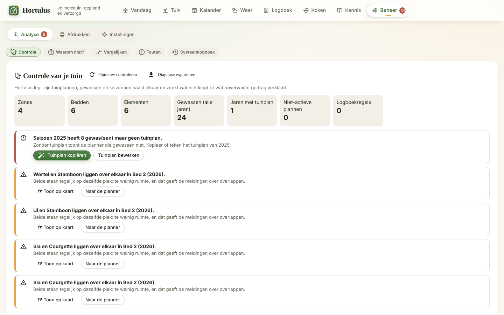</td>
    <td width="50%">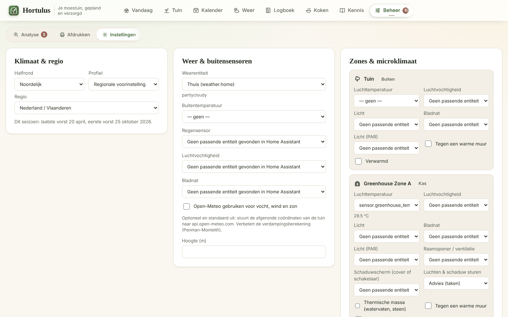</td>
  </tr>
</table>

## Afdrukken, papier en reMarkable

Het tabblad **Afdrukken** toont elke pagina vooraf: tuin‑ en kaskaarten met legenda, schaal
en noordpijl, bedbladen met raster, controlelijsten, seizoensgrafieken, het jaarplan,
lege planbladen, plantenkaarten en een compleet **seizoensboek** – als pdf in A4, A3, A5,
Letter of voor de **reMarkable Paper Pro** (179,6 × 239,5 mm, e‑inkpatronen met een
arcering per plantenfamilie en stippenraster om op te tekenen). Automatiseringen maken
dezelfde pdf's met `garden_manager.export_pdf` (opgeslagen in `/config/hortulus/exports/`).

<table>
  <tr>
    <td width="25%">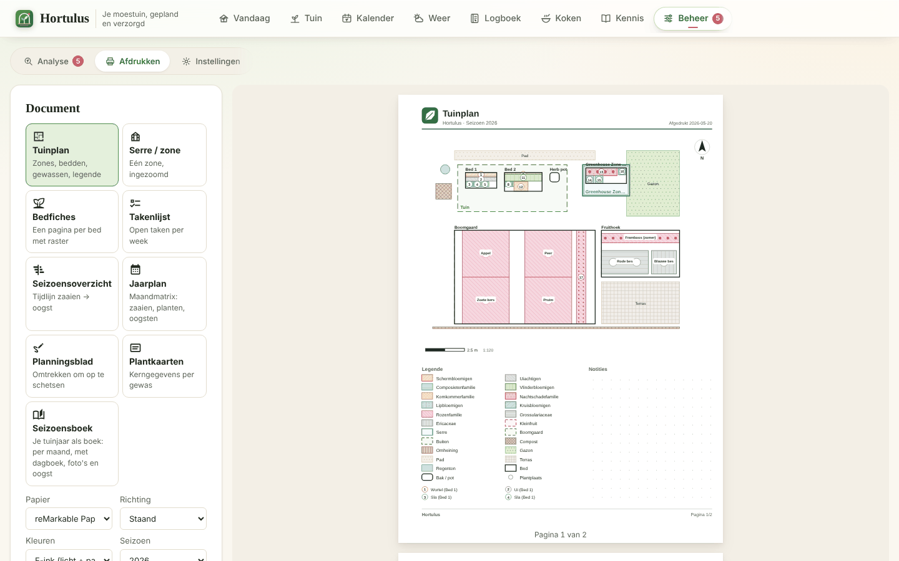</td>
    <td width="25%"></td>
    <td width="25%"></td>
    <td width="25%"></td>
  </tr>
</table>

## Op elk scherm

Het paneel volgt je telefoon, tablet of computer, in licht of donker, met vier kleurthema's
(Klassiek, Aarde, Nacht en één dat het seizoen volgt).

<table>
  <tr>
    <td width="20%">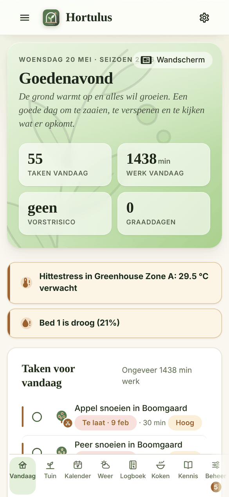</td>
    <td width="20%">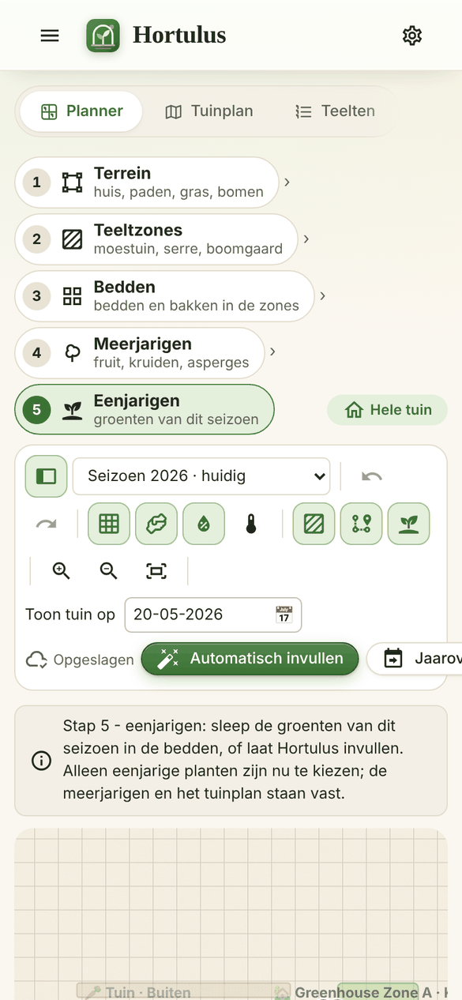</td>
    <td width="20%">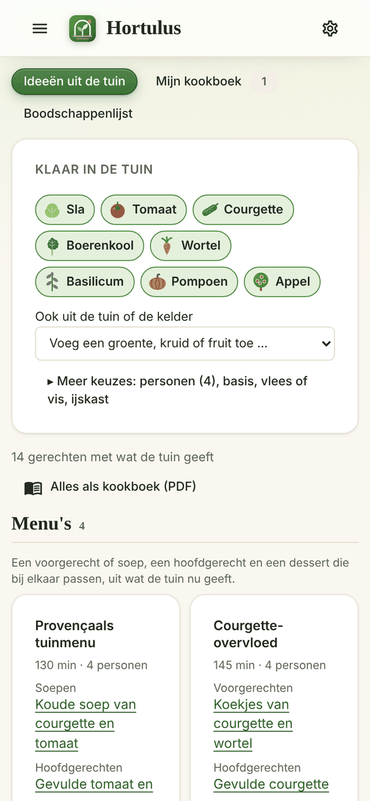</td>
    <td width="40%">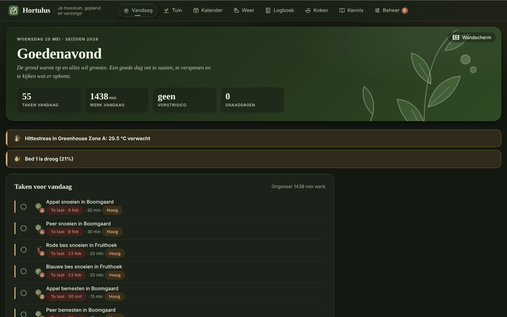</td>
  </tr>
</table>

## Onderdeel van Home Assistant

* **Entiteiten** – sensoren, binaire sensoren, getallen, selecties, schakelaars, knoppen,
  een agenda en een takenlijst, met diagnostiek en vertalingen in het Nederlands, Engels en
  Frans.
* **Diensten** met antwoorden en **bus‑events** voor je automatiseringen; push‑, TTS‑ en
  persistente **meldingen**, met actieknoppen op je telefoon (klaar, uitstellen).
* **Huishouden** – wijs taken toe aan mensen met automatische regels en persoonlijke
  herinneringen, en vink taken af vanaf elk dashboard met de **`hortulus-tasks-card`**.
* **Spraak** – vraag Assist *"wat moet ik vandaag in de tuin doen?"* (zinnen in het
  Nederlands, Engels en Frans).
* **Meerdere tuinen** – één Hortulus‑koppeling per tuin, elk met een eigen plan, taken en
  registraties.
* **Blueprints** – vorstwaarschuwing op een lamp, een knop of NFC‑tag die een oogst
  logt, een droog bed op een goed moment water geven, gesproken meldingen van dringende
  klussen.

### Hortulus Web – dezelfde tuin op een website (optioneel)

Een aparte website‑uitvoering draait dezelfde motor en hetzelfde paneel in de browser, met
accounts, meerdere tuinen per account en een openbare voorpagina. Je kunt je tuin **laten
zien** aan anderen – met een link of openbaar – en per onderdeel kiezen wat bezoekers zien
(plan, kalender, weer, dagboek, oogst, recepten); bezoekers zien nooit Home Assistant‑gegevens.
Ze wordt apart van deze integratie geleverd en de planbestanden kunnen tussen beide
uitgewisseld worden. Zie [Configuratie → Hortulus Web](docs/nl/CONFIGURATIE.md#10-hortulus-web-optionele-website).

<table>
  <tr>
    <td width="33%">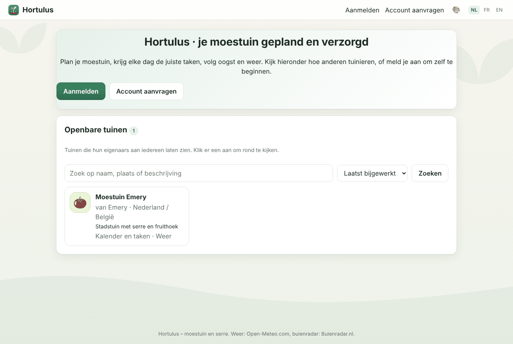</td>
    <td width="33%">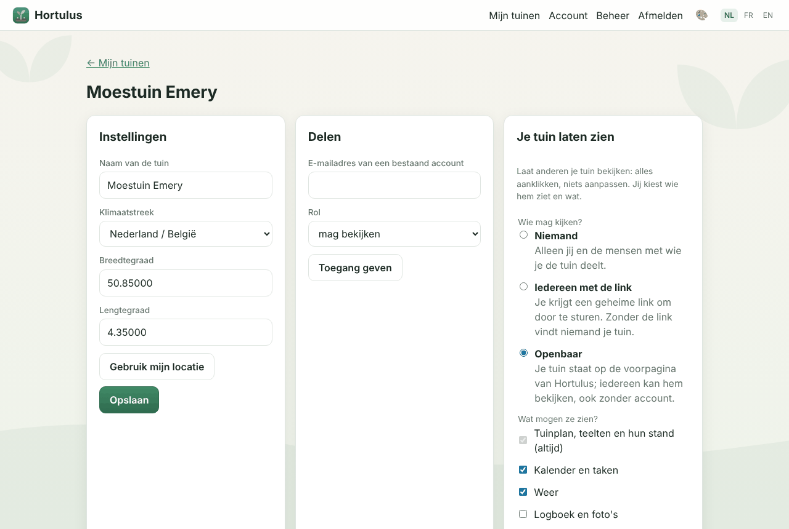</td>
    <td width="33%">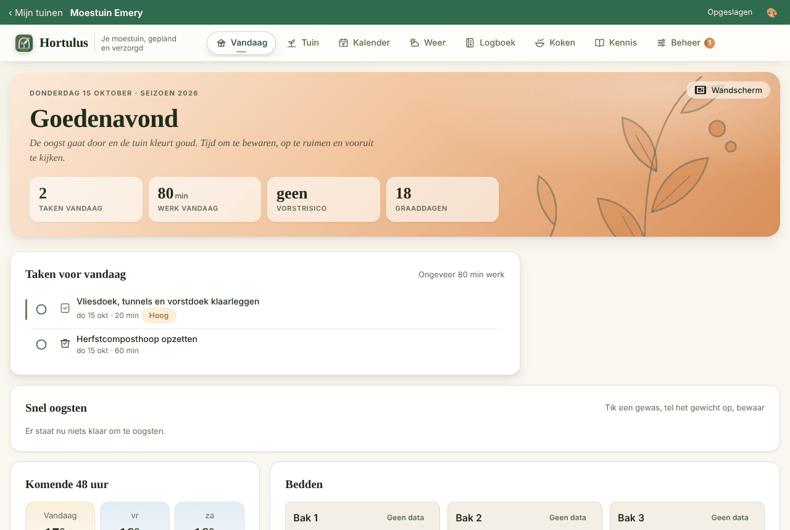</td>
  </tr>
</table>

## Installatie

### HACS (aanbevolen)

1. HACS → ⋮ → **Aangepaste repositories** → voeg `https://github.com/emeryf81/hortulus` toe als *Integratie*.
2. Installeer **Hortulus Garden Manager** en herstart Home Assistant.
3. **Instellingen → Apparaten & diensten → Integratie toevoegen → Hortulus**.

### Handmatig

Kopieer `custom_components/garden_manager` naar `<config>/custom_components/` en herstart.
De paneelbundel (`frontend/hortulus-panel.js`) zit in de repository, dus je hebt geen
Node.js‑build nodig.

Vereisten: Home Assistant **2025.10 of nieuwer**. Een weerentiteit met uur‑ en/of
dagverwachting (bijvoorbeeld de ingebouwde Met.no `weather.home`) is aanbevolen maar
optioneel.

## Snel starten

De installatiewizard vraagt naar:

1. **Klimaatprofiel** – een regionale voorinstelling (bijv. *Nederland / Vlaanderen*), een
   USDA‑winterhardheidszone of je eigen gemiddelde vorstdata; plus het halfrond.
2. **Weer** – bijv. `weather.home`, eventueel een buitentemperatuur‑ en regensensor.
3. **Bedden, kassen en bakken** – naam, grootte, grond, schaduw, wind en de sensoren die
   erbij horen (`sensor.soil_moisture_bed_1`, `sensor.soil_temp_bed_1`,
   `sensor.greenhouse_temp`, …) plus een optionele bewateringskraan.
4. **Meldingen** – persistente meldingen, mobiele push, TTS en een tijdstip voor het
   dagoverzicht.
5. **Samenvatting** – optioneel een klein voorbeeldplan met goede buren als start.

Open daarna **Hortulus** in de zijbalk. Details: [CONFIGURATIE](docs/nl/CONFIGURATIE.md).

## Wat je krijgt in Home Assistant

| Begrip in de opdracht | Entiteit / actie in Home Assistant |
|---|---|
| `garden.bed_moisture_status` | `sensor.<bed>_moisture_status` (dry / slightly_dry / optimal / wet) |
| `garden.frost_risk_next_48h` | `sensor.hortulus_frost_risk_next_48h` + `binary_sensor.hortulus_frost_warning` |
| `garden.irrigation_recommendation` | `sensor.<bed>_irrigation_recommendation` (mm; liters & minuten als attributen) + `binary_sensor.<bed>_needs_water` |
| `garden.growing_degree_days` | `sensor.hortulus_growing_degree_days` |
| kasadvies | `sensor.<zone>_greenhouse_advice`, `binary_sensor.<zone>_heat_stress`, `select.<zone>_shading` |
| verdamping & graaddagen | `sensor.hortulus_reference_evapotranspiration_today`, `sensor.hortulus_degree_days_today`, `sensor.<zone>_degree_days_this_season` |
| bodemwater & voeding | `sensor.<bed>_soil_water_deficit`, `sensor.<bed>_nutrient_balance` |
| ziekte & vorst per zone | `sensor.<zone>_disease_risk`, `binary_sensor.<zone>_frost_risk_48h` |
| bewateringssturing | `switch.hortulus_automatic_irrigation`, `select.hortulus_irrigation_mode`, `number.hortulus_irrigation_max_runtime` (+ vorstblokkade, regenoverslag), `button.hortulus_water_now`, `binary_sensor.hortulus_irrigation_frost_lockout`, `binary_sensor.hortulus_irrigation_running` |
| taken | `calendar.hortulus_garden_tasks`, `todo.hortulus_this_week`, `sensor.hortulus_tasks_due_today`, `sensor.hortulus_next_task` |
| registraties | `sensor.hortulus_harvest_this_season`, `sensor.hortulus_garden_water_7_days`, `sensor.hortulus_rain_water_available`, `garden_manager.log_harvest`, `.add_journal_entry`, `.save_soil_test`, `.assign_task` |
| dashboard & spraak | `type: custom:hortulus-tasks-card` (wordt automatisch geladen), Assist‑intents via `garden_manager.install_voice_sentences` |
| `garden.add_task` … | `garden_manager.add_task`, `.complete_task`, `.postpone_task`, `.delete_task`, `.generate_tasks`, `.recalculate_plan`, `.export_plan`, `.import_plan` |
| plan & hardware | `garden_manager.add_planting`, `.update_planting`, `.remove_planting`, `.autofill_plan`, `.run_irrigation_plan` (met `dry_run`), `.stop_irrigation`, `.set_shading_mode`, `.export_pdf` |

> Home Assistant eist dat diensten in het eigen domein van de integratie staan, dus de
> `garden.*`‑namen uit de specificatie zijn beschikbaar als `garden_manager.*`.

Volledige referentie: [ENTITEITEN](docs/nl/ENTITEITEN.md) · Voorbeeld‑
[automatiseringen](examples/automations.yaml) en [dashboard](examples/dashboard.yaml).

## Blueprints

Kant‑en‑klare automatiseringen – klik om ze in Home Assistant te importeren:

- [**Vorstwaarschuwing op een lamp**](https://my.home-assistant.io/redirect/blueprint_import/?blueprint_url=https%3A%2F%2Fgithub.com%2Femeryf81%2Fhortulus%2Fblob%2Fmain%2Fblueprints%2Fautomation%2Fhortulus%2Ffrost_flash_light.yaml): een lamp knippert blauw (en je telefoon krijgt een bericht) als er vorst op komst is.
- [**Een oogst loggen met een knop**](https://my.home-assistant.io/redirect/blueprint_import/?blueprint_url=https%3A%2F%2Fgithub.com%2Femeryf81%2Fhortulus%2Fblob%2Fmain%2Fblueprints%2Fautomation%2Fhortulus%2Fbutton_log_harvest.yaml): een knop of NFC‑tag logt een vaste hoeveelheid van één gewas.
- [**Een droog bed op een goed moment water geven**](https://my.home-assistant.io/redirect/blueprint_import/?blueprint_url=https%3A%2F%2Fgithub.com%2Femeryf81%2Fhortulus%2Fblob%2Fmain%2Fblueprints%2Fautomation%2Fhortulus%2Fwater_when_dry.yaml): voert het bewateringsplan voor een dorstig bed uit op het uur dat je kiest, nooit tijdens een vorstblokkade.
- [**Dringende tuinklussen omroepen**](https://my.home-assistant.io/redirect/blueprint_import/?blueprint_url=https%3A%2F%2Fgithub.com%2Femeryf81%2Fhortulus%2Fblob%2Fmain%2Fblueprints%2Fautomation%2Fhortulus%2Furgent_task_announce.yaml): dringende klussen (vorstbescherming, schaduw, een plaagvlucht) worden via een speaker uitgesproken.

## Hoe de tuinbouwkundige logica werkt (kort)

* **Vensters** worden opgeslagen als weken ten opzichte van de *gemiddelde laatste
  voorjaarsvorst* / *eerste herfstvorst*, zodat één database beide halfronden en elk klimaat
  bedient. Kassen verschuiven voorjaarsvensters met een aantal weken per gewas vroeger.
* **Live verfijningen:** direct zaaien wacht op warm genoeg grond (bodemsensor), uitplanten
  van tere gewassen wacht op een vorstvrije verwachting.
* **Buren:** de sterkte van de wisselwerking neemt af met de afstand; vijanden wegen dubbel;
  plantingen die nooit tegelijk in de grond staan (opvolging!) botsen nooit.
* **Vruchtwisseling:** geschiedenis per bed en familie; dezelfde familie te snel terug wordt
  gemarkeerd.
* **Water geven:** vochtbanden per waterbehoefte van het gewas en grondsoort; tekort
  aanvullen + ET₀ × Kc min kansgewogen regen; kassen krijgen geen regenkrediet. ET₀ is
  FAO‑56 Penman‑Monteith uit temperatuur, luchtvochtigheid, wind en bewolking (Hargreaves
  als die ontbreken), Kc volgt het groeistadium. Bedden zonder vochtsensor houden een
  dagelijkse **wortelzone‑emmer** bij (beschikbaar water naar grondsoort × worteldiepte) en
  krijgen water als de helft is opgebruikt.
* **Bemesten:** compost per m² naar het hongerigste volggewas (5 / 3 / 1,5 kg, vlinderbloemigen
  0,5), doses vloeibare voeding in voedertaken en een voedingsbalansindex van 0–100 uit
  NPK‑ of EC‑metingen tegen de N‑P‑K‑behoefte van de gewassen.
* **Ziekte:** twee vochtige warme dagen achter elkaar (Hutton‑criteria) betekent een hoog
  risico op aardappelziekte; lange natte bladperiodes, een bladnatsensor of vochtige kaslucht
  verhogen het niveau en maken inspectietaken voor gevoelige gewassen.
* **Fenologie:** graaddagen sinds het planten verschuiven de verwachte oogst (± 3 weken
  rond de kalenderdatum); hittestress vertraagt vruchtgewassen.
* **Bewateringsveiligheid:** één kraan tegelijk, pomp alleen als een kraan open is, maximale
  looptijd, geen buitenbewatering bij vorstverwachting binnen 12 u of bij genoeg regen op
  komst; kranen en pomp gaan op het einde altijd uit, ook na fouten.
* **Vorst:** uurverwachting, aanpassing per plant voor heldere windstille nachten,
  kasbuffering, vloer voor verwarmde zones; valt terug op de dagverwachting en dan op de
  live sensor.
* **Koken:** een recept is een *techniek* (soep, ovenschotel, tian …) gevuld met de gewassen
  van het seizoen, het bijgerecht, het eiwit en de ijskastitems; de teksten zijn per taal
  geschreven en dezelfde motor bouwt de menu's, de boodschappenlijst en de pdf's.

De [architectuurblauwdruk](docs/BLUEPRINT.md) (Engels) beschrijft elk model en elk algoritme.

## Ontwikkeling

```bash
# Python (integratie + motor)
pip install -r requirements_test.txt
pytest -q && ruff check custom_components tests

# Frontend (Lit + TypeScript)
cd frontend && npm ci
npm run typecheck && npm test && npm run build   # schrijft custom_components/garden_manager/frontend/hortulus-panel.js
```

Het paneel draait ook zonder Home Assistant in een ontwikkelomgeving (`frontend/dev`, zie de
README daar); de schermafbeeldingen in deze README maak je met
`node frontend/dev/screenshots.mjs`. Opbouw van de repository en ontwerpkeuzes staan in de
[blauwdruk](docs/BLUEPRINT.md); de visuele taal in het [ontwerpsysteem](docs/DESIGN_SYSTEM.md).

## Licentie

MIT © 2026 Emery Frijters. Plantgegevens samengesteld uit gangbare tuinbouwpraktijk;
controleer altijd zaadzakjes en lokaal advies.
