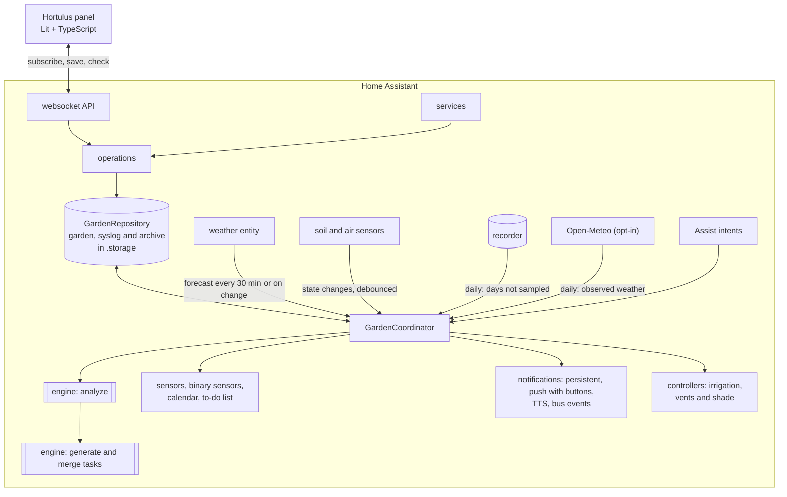

<!-- Generated from the sources by a script: code excerpts below are verbatim. -->
<p align="center"></p>

# Hortulus — architecture blueprint

> **Hortulus** (`garden_manager`) is a Home Assistant custom integration plus a sidebar
> panel for planning and running a vegetable garden. This blueprint is the single
> technical reference: architecture, data model, algorithms, APIs, UI and tests. It describes
> **integration version 1.8.0** (storage schema 1.8). All code excerpts are copied verbatim
> from the repository; follow the file links for the full implementation.
> Nederlandstalige gebruikersdocumentatie staat in [`docs/nl`](nl/).

**Contents**

1. [Overview](#1-overview)
2. [Architecture & Folder Tree](#2-architecture--folder-tree)
3. [Data Model](#3-data-model)
4. [Backend (Python)](#4-backend-python)
5. [Frontend (TypeScript)](#5-frontend-typescript)
6. [Services, Entities, and Events](#6-services-entities-and-events)
7. [Scheduling, Compatibility, and Watering Algorithms](#7-scheduling-compatibility-and-watering-algorithms)
8. [Example HA Automations & Dashboards](#8-example-ha-automations--dashboards)
9. [Tests](#9-tests)
10. [Documentation Files (README etc.)](#10-documentation-files-readme-etc)
11. [Version 1.1 additions and release map](#11-version-11-additions-and-release-map)

---

## 1. Overview

| Requirement | Where it lives |
|---|---|
| Drag‑and‑drop planner in five steps (site, growing zones, beds, perennials, annuals; single/block/row; succession; companion overlay; import/export; undo/redo, snap, tooltips, shortcuts) and the per‑year garden plan | `frontend/src/views/planner-view.ts` (mode `planner` / `layout`), `frontend/src/planner/*` |
| Read‑only "look at a garden" view (used by the separate Hortulus website) | `frontend/src/views/garden-viewer.ts`, `panel.config.tabs` |
| Plant database (232 crops, EN/NL/FR, user overrides & custom plants) | `custom_components/garden_manager/data/plants.json`, `engine/plantdb.py` |
| Companion scoring, rotation, greenhouse suitability, coverage (what covers what on the site plan) | `engine/compatibility.py`, `engine/schedule.py`, `engine/weather.py`, `engine/coverage.py` |
| Task engine (generation, recurrence, completion, postpone cascade, priorities, durations, notes, photos, seasonal work, weather episodes, pest calendar, eco tips) | `engine/tasks.py`, `engine/maintenance.py`, `engine/weather_tasks.py`, `engine/pests.py`, `engine/eco.py`, `operations.py` |
| Sensors + forecast (frost, heat, irrigation, GDD, water balance learning from moisture sensors) | `engine/weather.py`, `engine/watering.py`, `engine/waterbalance.py`, `coordinator.py` |
| Climate history and statistics (daily log of outdoor weather and every temperature sensor, gap filling from the recorder and Open‑Meteo, months kept for good, measured frost dates; used by growth, water, disease and tasks) | `engine/climate.py`, `climate_history.py`, `coordinator.py`, `frontend/src/components/climate-history.ts` |
| Hardware: irrigation (pump interlock, valve timers, lost‑valve and leak detection, valve test), greenhouse vent/shade | `controllers.py`, `engine/irrigation.py` |
| HA entities, services, events, notifications (digest, reminders, phone buttons), Assist | `sensor.py`, `binary_sensor.py`, `calendar.py`, `todo.py`, `button.py`, `number.py`, `select.py`, `switch.py`, `services.py`, `notifications.py`, `actions.py`, `voice.py` |
| Config flow + options flow, more than one garden | `config_flow.py`, `options.py`, `seed.py`, `gardens.py` |
| Storage with versioning & migrations, system log (undo), season archive | `storage.py`, `engine/migrations.py`, `engine/syslog.py`, `engine/archive.py`, `engine/seasons.py` |
| Records, kitchen, cost and harvest, planning help, season report, analysis (diagnosis, "why not here?", plan compare) | `engine/records.py`, `engine/kitchen.py`, `engine/planning.py`, `engine/diagnose.py` |
| Cooking: seasonal cookbook, menus, fridge ideas, own recipes, shopping list, PDFs | `engine/cooking.py`, `engine/cooking_dishes.py`, `engine/cooking_extras.py`, `frontend/src/views/cooking-view.ts` |
| Advice, Q&A assistant, handbook, glossary, supplies | `engine/advisor.py`, `engine/qa.py`, `engine/qa_kb.py`, `engine/handbook.py`, `engine/supplies.py` |
| Printing: maps, sheets, plant cards, year plan, season book (PDF/SVG) | `engine/pdf.py`, `engine/printout.py`, `engine/seasonbook.py`, `printing.py` |
| Plan import/export | `engine/planio.py` |
| Trilingual (EN/NL/FR) | `translations/*.json`, `strings.json`, `engine/i18n.py`, `engine/texts_garden.py`, `frontend/src/i18n/*`, `data/handbook/{en,nl,fr}`, `data/sentences/{en,nl,fr}` |
| Brand (name, logo, icon, banner) & design system | `assets/brand/*`, [`DESIGN_SYSTEM.md`](DESIGN_SYSTEM.md) |

**Design tenets**

* **Pure engine, thin HA shell.** All horticultural logic lives in
  `engine/` – plain Python on the standard library only, no Home Assistant imports, no
  network or hardware I/O (the only file reads are the bundled plant database and
  handbook) – so it is fast to test and identical whether triggered by a sensor, a service
  call or the panel. The same engine also runs outside Home Assistant (see
  [2.2](#22-one-engine-two-hosts-home-assistant-and-the-browser)).
* **Event‑driven.** Sensors are never polled: the coordinator listens to state changes of
  exactly the mapped entities (debounced 10 s). Only the forecast is fetched on a timer
  (30 min) or when the weather entity updates (≥ 10 min apart).
* **Explainable advice.** Every warning, wait and task carries an i18n key + parameters
  so both the backend (notifications, calendar) and the panel can explain *why*.
* **Idempotent tasks.** Generated tasks have stable keys; regeneration never duplicates
  work or loses user decisions.
* **Local only.** No external services by default (Open‑Meteo enrichment – forecast and observed
  daily history – is opt‑in; the
  browser may fetch Wikipedia photos, on by default, switchable per browser); data in
  `.storage/garden_manager.garden` (+ `.syslog`, `.archive`), one set per garden.
* **Everything is undoable and explainable.** Every change to the garden document is
  diffed into the system log and can be reverted per entry; refused actions are logged
  with their reason.

<p align="center"></p>

---

## 2. Architecture & Folder Tree

```
greenhouse/                                  ← repository (brand: Hortulus)
├── README.md · README.nl.md · README.fr.md · CHANGELOG.md · CONTRIBUTING.md · LICENSE · hacs.json · pyproject.toml · requirements_test.txt
├── .github/workflows/ci.yml                 ← 5 jobs: ruff + pytest, tsc + node:test + bundle check, Playwright click‑through, hassfest, HACS
├── assets/brand/                            ← icon, logo, dark logo, banner (SVG sources + PNG renders)
├── blueprints/automation/hortulus/          ← HA automation blueprints: frost_flash_light, button_log_harvest, water_when_dry, urgent_task_announce
├── custom_components/garden_manager/
│   ├── __init__.py          setup/unload per config entry (= per garden), GardenRuntime, daily rollover, digest / reminder / irrigation schedules
│   ├── manifest.json        domain, version 1.8.0, deps (http, frontend, panel_custom, websocket_api, persistent_notification, image_upload)
│   ├── const.py             constants, events, service names
│   ├── config_flow.py       guided setup (region → weather → areas+sensors → notifications → summary) + options; a second entry = a second garden
│   ├── options.py           options ⇄ stored settings
│   ├── seed.py              build the first garden (+ example plan) from the wizard answers
│   ├── gardens.py           more than one garden: storage key per entry, `pick()` by entry id / title, switcher listing
│   ├── coordinator.py       DataUpdateCoordinator: forecast fetch, state tracking, analysis, task merge, climate history (sampling + daily gap filling), archive trigger
│   ├── climate_history.py   recorder states → daily min / max / time‑weighted mean per entity (°C, km/h) for the climate history
│   ├── storage.py           versioned Store + repository (debounced saves, revision, system log, season archive)
│   ├── operations.py        write operations shared by services, websocket, calendar & todo (validation, undo, cookbook, plans)
│   ├── services.py · services.yaml          21 services; admin‑only set; optional `garden:` on every call
│   ├── websocket_api.py     panel API (67 commands under `garden_manager/`: subscribe, plan/*, plants/*, records/*, cooking/*, climate/stats, …)
│   ├── notifications.py     persistent / push / TTS / bus events, de‑duplicated, with phone action buttons
│   ├── actions.py           handler for `mobile_app_notification_action` (Done / Tomorrow / Water now / Close valve)
│   ├── voice.py             six Assist intents + `install_voice_sentences`
│   ├── panel.py             static path + sidebar panel + Lovelace card registration (content‑hashed URLs)
│   ├── printing.py          authenticated PDF/SVG view, private export folder with signed links, photo loader for the season book
│   ├── entity.py            base entities, per‑bed/zone devices, dynamic entity creation
│   ├── sensor.py · binary_sensor.py · calendar.py · todo.py · button.py · diagnostics.py
│   ├── number.py · select.py · switch.py   irrigation limits/mode, shading mode, auto irrigation
│   ├── controllers.py       IrrigationController (pump interlock, valve timers, lost‑valve + leak watch, valve test) and ClimateController (vent/shade)
│   ├── api.py               optional Open‑Meteo client (opt‑in): forecast and observed daily history
│   ├── strings.json · translations/{en,nl,fr}.json · icons.json
│   ├── data/plants.json     plant database (232 crops, names/tips EN/NL/FR; built by scripts/build_plantdb.py + plantdb_extra.py)
│   ├── data/handbook/{en,nl,fr}/NN-<id>.md · glossary.json   23 handbook chapters per language + tooltip glossary
│   ├── data/sentences/{en,nl,fr}/hortulus.yaml   Assist sentences (copied to /config/custom_sentences by a service)
│   ├── frontend/hortulus-panel.js · hortulus-card.js   built bundles (committed): panel and Lovelace tasks card
│   └── engine/              ← pure Python (standard library only), no HA imports – see 4.14 for the module catalogue
│       ├── models.py serde.py region.py plantdb.py geometry.py coverage.py        data model and geometry
│       ├── schedule.py compatibility.py succession.py phenology.py                 timing, companions, rotation
│       ├── weather.py watering.py waterbalance.py irrigation.py                    forecast, ET₀, moisture, plans
│       ├── climate.py                                                              climate history, statistics, frost dates
│       ├── tasks.py maintenance.py weather_tasks.py pests.py eco.py fertilizer.py   tasks and seasonal work
│       ├── analysis.py diagnose.py advisor.py qa.py qa_kb.py supplies.py           orchestration, explanation, advice
│       ├── records.py kitchen.py planning.py                                        journal, harvest, costs, seeds, forecasts
│       ├── seasons.py archive.py syslog.py migrations.py planio.py                  per‑season plans, archive, undo, versions, import/export
│       ├── cooking.py cooking_dishes.py cooking_extras.py                           seasonal cookbook
│       ├── pdf.py printout.py seasonbook.py handbook.py                             documents
│       └── i18n.py texts_garden.py                                                  backend message catalogue (EN/NL/FR)
├── frontend/                ← Lit + TypeScript sources (esbuild), dev harness, tests
│   ├── build.mjs · package.json · tsconfig.json
│   ├── src/hortulus-panel.ts            root element, menu (places + tabs), routing, subscription, garden switcher, theme, toasts
│   ├── src/api.ts · src/types.ts        typed websocket client (garden_id aware) mirroring engine/models.py
│   ├── src/views/                       dashboard, planner (also the garden‑plan mode), crops (+ planning), library, calendar, weather,
│   │                                    journal, cooking, advice, analysis, handbook, print, settings, wall, garden‑viewer (read‑only)
│   ├── src/components/                  hl-modal, task-ui, plant-detail, plant-image, year-transition, plan-compare, season-report,
│   │                                    crop-gantt, harvest-years, quick-harvest, quick-note, photo-timeline, water-chart,
│   │                                    kitchen-economy, dish-picture, chapter-art, garden-icons, date-input, info, markdown,
│   │                                    climate-history
│   ├── src/planner/{garden-canvas,geometry,history,coverage,plant-glyphs}.ts
│   ├── src/card/                        Lovelace card `custom:hortulus-tasks-card`
│   ├── src/styles/{tokens,palettes}.ts  design tokens (light/dark) + colour themes + shared component styles
│   ├── src/util/                        dates, entities (drop‑downs), people, photos, reasons, theme, tools, celebrate, garden
│   ├── src/i18n/{en,nl,fr,index}.ts     catalogues (keys shared with the backend)
│   ├── test/*.test.ts                   node:test unit tests (11 files)
│   ├── test-ui/smoke.mjs                Playwright click‑through of the real panel
│   └── dev/                             browser harness with a mock `hass` fed by the real engine (make_snapshot.py, data‑{en,nl}.json)
├── tests/                   ← pytest (+ pytest-homeassistant-custom-component)
│   ├── conftest.py · fixtures/{forecast_hourly_dst_frost,forecast_hourly_rain,forecast_daily,sensors}.json
│   ├── engine/test_*.py     26 engine suites (tasks, frost, compatibility, agronomy, climate, planning, cooking, seasons, archive, syslog, …)
│   └── test_config_flow.py · test_init.py · test_phase2.py · test_blueprints.py
├── scripts/                 build_plantdb.py · plantdb_extra.py (plant database), render_blueprint.py (this document)
├── examples/{automations,dashboard}.yaml
└── docs/  BLUEPRINT.md · _blueprint.template.md · DESIGN_SYSTEM.md · en/{CONFIGURATION,ENTITY_REFERENCE,FAQ}.md · nl/{CONFIGURATIE,ENTITEITEN,FAQ}.md · images/
```

### 2.1 Runtime architecture



One config entry is one garden: each has its own repository, coordinator, notifier and
controllers (`GardenRuntime`). Services, websocket commands, the print view and the Assist
intents are registered once per Home Assistant and find the garden through `gardens.pick`
(`garden_id` in websocket commands, `garden:` in services; the first garden without either).

### 2.2 One engine, two hosts: Home Assistant and the browser

The engine is plain Python on the standard library, and the data layer around it is kept
thin on purpose, so the **separate Hortulus website** can run the same code in the browser
(Pyodide) next to the same `hortulus-panel` bundle. Three modules form the boundary:

| Module | May import from `homeassistant` | Why |
|---|---|---|
| `engine/*` | nothing | pure rules, shared by every host |
| `storage.py`, `operations.py`, `websocket_api.py` | only `homeassistant.components`, `.core`, `.exceptions`, `.helpers`, `.helpers.dispatcher`, `.helpers.storage`, `.util` | the website supplies stand‑ins for exactly these modules (a `Store`, a websocket connection, `dt_util`, …) and runs the real command handlers and write operations against them |

`tests/test_init.py::test_the_website_runtime_gets_the_homeassistant_modules_it_has_stubs_for`
parses those three files and fails on any other `homeassistant.*` import, because a new import
there would break the web app and not Home Assistant's own tests. Consequences for the code:

* anything the web runtime cannot offer is passed in or guarded (for example
  `POLICY_CONTROL = "control"` is a local constant because the website has no
  `homeassistant.auth`; `cooking/send` has a `dry_run` that only returns the text because
  the website mails it itself);
* the panel is host‑agnostic: `panel.config` may carry `tabs` (the subset to show; an empty list
  shows nothing), `viewer` and `web`; Home Assistant passes none of them and gets every tab;
* the plan file format (`engine/planio.py`) is the exchange format: an export from the
  website imports into Home Assistant and back, including site elements and season layouts.

The website itself (accounts, sharing, hosting) is not part of this repository.

### 2.3 Why Lit (and not React)

Home Assistant's frontend is built from Lit web components. A Lit panel receives the same
`hass` object, inherits HA theme variables through CSS custom properties, can use
`ha-icon`, and ships without a second framework runtime (the panel bundle is ≈ 0.9 MB
minified, ≈ 250 kB gzipped – most of it the three text catalogues, plant glyphs and
illustrations; the Lovelace card is a separate 27 kB file).
Drag‑and‑drop uses **pointer events with pointer capture** rather than HTML5 DnD, because
HTML5 DnD does not work on touch devices and offers poor keyboard accessibility; a full
keyboard path (Enter to place, arrows to move, Alt+arrows to resize) complements it.

---

## 3. Data Model

All models are dataclasses in [`engine/models.py`](../custom_components/garden_manager/engine/models.py)
serialised by [`engine/serde.py`](../custom_components/garden_manager/engine/serde.py)
(unknown keys ignored, missing keys defaulted, enums/dates as ISO strings). The frontend
mirrors them in [`frontend/src/types.ts`](../frontend/src/types.ts).

Conventions: lengths in **cm**, temperatures **°C**, rain **mm**; canvas origin top‑left;
planting coordinates relative to their bed; calendar dates local, timestamps tz‑aware; a
*season* is named after the year its spring falls in (southern hemisphere: July → June).

### 3.1 Layout: `Zone`, `GardenBed`, sensor mapping

```python
@dataclass(slots=True)
class SensorMapping:
    """Entity ids feeding a bed or zone.  ``None`` means "not available"."""

    soil_moisture: str | None = None
    soil_temperature: str | None = None
    air_temperature: str | None = None
    air_humidity: str | None = None
    light: str | None = None
    rain: str | None = None
    # Advanced probes (all optional)
    par: str | None = None  # PAR/PPFD in µmol/m²/s
    ec: str | None = None  # electrical conductivity in mS/cm
    npk_n: str | None = None  # mg/kg
    npk_p: str | None = None
    npk_k: str | None = None
    leaf_wetness: str | None = None  # binary or %
    # Outdoor weather station (optional): wind, gusts and global radiation
    wind_speed: str | None = None  # km/h, m/s, mph or kn
    wind_gust: str | None = None
    radiation: str | None = None  # W/m² (solar / global radiation)

    def merged_with(self, fallback: SensorMapping) -> SensorMapping:
        """Bed sensors fall back to the sensors of their zone."""
        return SensorMapping(**{k: getattr(self, k) or getattr(fallback, k) for k in SENSOR_KEYS})

    def entity_ids(self) -> list[str]:
        return [e for e in (getattr(self, k) for k in SENSOR_KEYS) if e]


@dataclass(slots=True)
class Microclimate:
    shade_pct: int = 0
    wind: WindExposure = WindExposure.MODERATE
    heated: bool = False
    # Against a sun-facing wall (re-radiates heat at night).
    wall_heat: bool = False
    # Water barrels / stone floor in an enclosure buffer night temperatures.
    thermal_mass: bool = False
    min_heating_temp_c: float | None = None
    # Night-time buffering of an enclosure versus outside (°C).  ``None`` means
    # "use the default for the zone type" (greenhouse +3, cold frame +2).
    night_offset_c: float | None = None
    # Extra daytime warming in full sun (°C).  ``None`` = default for type.
    solar_gain_c: float | None = None


@dataclass(slots=True)
class Zone:
    id: str
    name: str
    type: ZoneType = ZoneType.OUTDOOR
    x_cm: float = 0
    y_cm: float = 0
    width_cm: float = 400
    length_cm: float = 300
    microclimate: Microclimate = field(default_factory=Microclimate)
    sensors: SensorMapping = field(default_factory=SensorMapping)
    vent_entity: str | None = None
    shade_entity: str | None = None
    # off = ignore, advise = tasks only, auto = drive vent/shade entities
    climate_control: Literal["off", "advise", "auto"] = "advise"
    # Shade screen override for enclosed zones: auto follows the advice.
    shading_mode: Literal["auto", "on", "off"] = "auto"

    @property
    def is_enclosed(self) -> bool:
        return self.type in (ZoneType.GREENHOUSE, ZoneType.COLD_FRAME)


@dataclass(slots=True)
class GardenBed:
    id: str
    name: str
    zone_id: str
    kind: BedKind = BedKind.RAISED
    x_cm: float = 0
    y_cm: float = 0
    width_cm: float = 200
    length_cm: float = 100
    # Compass bearing of the rows (0 = rows run north-south).
    orientation_deg: int = 0
    soil: SoilType = SoilType.LOAM
    shade_pct: int | None = None  # overrides zone microclimate when set
    sensors: SensorMapping = field(default_factory=SensorMapping)
    irrigation_entity: str | None = None
    irrigation_flow_lpm: float | None = None
    # Learned from the water meter during watering runs (used when no flow is entered).
    measured_flow_lpm: float | None = None
    # The valve's own safety timer (it closes by itself after this many minutes):
    # longer runs are split so the valve never shuts mid-run.
    valve_max_min: float | None = None
    notes: str = ""
    soil_tests: list[SoilTest] = field(default_factory=list)

    @property
    def flow_lpm(self) -> float | None:
        """Flow through the bed's valve: what was entered, else what the meter measured."""
        for value in (self.irrigation_flow_lpm, self.measured_flow_lpm):
            if value and value > 0:
                return value
        return None

    @property
    def latest_soil_test(self) -> SoilTest | None:
        return max(self.soil_tests, key=lambda s: s.date, default=None)

    @property
    def area_m2(self) -> float:
        return (self.width_cm * self.length_cm) / 10_000
```

Zone types: `outdoor`, `greenhouse`, `cold_frame` (the two *enclosed* types have their own
climate and sensors), `orchard`, `fruit`, `herbs`, `flowers`, `garden` (ornamental),
`containers` (planters & pots) and `food_forest` (seven layers, see `engine/eco.py`).
Beds in the non‑enclosed types use the outdoor sensors. Bed kinds: `in_ground`, `raised`,
`container` (potting mix). Besides the sensor and shade fields shown above, a bed holds the
valve data the controller needs: `irrigation_entity`, `irrigation_flow_lpm` (entered),
`measured_flow_lpm` (learned from the water meter; `flow_lpm` prefers the entered value) and
`valve_max_min` (the valve's own safety timer: longer runs are split into openings that stay inside it).

Non‑growing **elements** are `Feature`s (`id`, `name`, `type`, position, size, notes) with 29
types, grouped in the planner as buildings & paving (house, carport, shed, driveway, parking,
street, terrace, decking, wall), paths (gravel `path`, stone, wood, bark, stepping stones),
green (lawn, flowerbed, hedge, shrub, tree, pond) and outdoor living (seating, pool, play,
fence, trellis, compost, water butt, beehive, other). `engine/coverage.py` (mirrored by
`frontend/src/planner/coverage.ts`) decides what covers what: solid elements and growing zones
take their area away from a ground cover underneath (lawn, terrace, border …) in the map, the
print and the m² shown; a tree or shrub takes nothing.

**Plans per season.** The garden plan (zones, beds, elements – no plants) is stored per
season. The plan of `layout_season` lives in `GardenData.zones/beds/features` and is the garden
as it is now (entities, tasks and irrigation work with it); other seasons are
`GardenLayout`s in `GardenData.layouts` (`{season: layout}`). Plans set aside with *start a new
plan* are `ArchivedPlan`s (layout + the plantings it held). Nothing carries into a new
year by itself: a `Planting` belongs to its own `season` and to the seasons it was moved into
at the year‑end transition (`last_season`), see 4.16.

### 3.2 `Plant`

Sowing windows are **weeks relative to a frost anchor**, which makes one database work on
both hemispheres and in every climate.

```python
@dataclass(slots=True)
class Window:
    """A sowing/planting window in *weeks* relative to a frost anchor.

    ``start_week=-8, end_week=-6, anchor="last_frost"`` means "between 8 and 6
    weeks before the average last spring frost".  Anchoring on frost dates makes
    the database hemisphere- and climate-independent.
    """

    start_week: int
    end_week: int
    anchor: WindowAnchor = "last_frost"


@dataclass(slots=True)
class GreenhouseProfile:
    suitability: Suitability = Suitability.NO
    min_night_c: float = 5.0
    max_day_c: float = 30.0
    # How many weeks earlier sowing/transplanting may start under glass.
    season_extension_weeks: int = 0
    notes: dict[str, str] = field(default_factory=dict)


@dataclass(slots=True)
class CompanionLink:
    plant: str
    relation: Relation
    reason: dict[str, str] = field(default_factory=dict)
    strength: int = 2  # 1 = folklore / weak … 3 = well documented


@dataclass(slots=True)
class CareRule:
    """Data-driven care task, e.g. "prune side shoots weekly from day 14"."""

    task: TaskType
    start_day: int = 0
    interval_days: int | None = None
    end_day: int | None = None
    anchor: CareAnchor = "planting"
    minutes: int = 10
    notes: dict[str, str] = field(default_factory=dict)


@dataclass(slots=True)
class Plant:
    id: str
    names: dict[str, str]
    scientific_name: str
    family: str
    variety: str | None = None
    habit: GrowthHabit = GrowthHabit.BUSH
    perennial: bool = False
    spacing_cm: float = 30.0
    row_spacing_cm: float = 30.0
    sowing_depth_cm: float = 1.0
    germination_days: list[int] = field(default_factory=lambda: [7, 14])
    min_soil_temp_c: float = 7.0
    optimal_soil_temp_c: float = 18.0
    max_soil_temp_c: float | None = None
    days_to_maturity: list[int] = field(default_factory=lambda: [60, 80])
    maturity_from: Literal["sow", "transplant"] = "sow"
    harvest_duration_days: int = 14
    # False for companion flowers / green manures: no harvest tasks.
    harvestable: bool = True
    continuous_harvest: bool = False
    harvest_interval_days: int | None = None
    transplant_age_days: list[int] = field(default_factory=lambda: [35, 49])
    sowing: SowingCalendar = field(default_factory=SowingCalendar)
    greenhouse: GreenhouseProfile = field(default_factory=GreenhouseProfile)
    frost_tolerance: FrostTolerance = FrostTolerance.HALF_HARDY
    min_temp_c: float = 0.0
    max_temp_c: float = 32.0
    companions: list[CompanionLink] = field(default_factory=list)
    rotation_years: int = 3
    pests: list[str] = field(default_factory=list)
    diseases: list[str] = field(default_factory=list)
    water_needs: Level = Level.MEDIUM
    nutrient_needs: Level = Level.MEDIUM
    feeding_interval_days: int | None = None
    care: list[CareRule] = field(default_factory=list)
    pruning_notes: dict[str, str] = field(default_factory=dict)
    thinning: bool = False
    succession_interval_days: int | None = None
    gdd_base_c: float = 10.0
    gdd_to_maturity: int | None = None
    tags: list[str] = field(default_factory=list)
    category: PlantCategory = PlantCategory.VEGETABLE
    # FAO-56 crop coefficients: initial, mid-season, late season.
    kc: list[float] = field(default_factory=lambda: [0.5, 1.0, 0.8])
    # Relative nitrogen / phosphorus / potassium demand (0 = none ... 3 = high).
    npk: list[float] = field(default_factory=lambda: [1.0, 1.0, 1.0])
    height_cm: int = 50
    root_depth_cm: int = 30
    plants_per_person: float = 2.0
    yield_kg_m2: float = 2.0
    # Pests this plant deters (scent, root exudates) or lures away (trap crop).
    deters: list[str] = field(default_factory=list)
    trap_for: list[str] = field(default_factory=list)
    allelopathic: bool = False
    shade_tolerant: bool = False
    # Perennials: harvest each year in these windows once bearing.
    harvest_windows: list[Window] = field(default_factory=list)
    years_to_bearing: int = 0
    emoji: str = ""
    icon: str = ""  # vector glyph drawn on the planner map (see frontend plant-glyphs)
    color: str = ""  # glyph colour (the crop's own colour, not the family colour)
    # Short ecological growing tips and home remedies (per language).
    tips: dict[str, list[str]] = field(default_factory=dict)
    pollination: Literal["self", "insects", "wind", "partner", "none"] = "self"
    source: Literal["builtin", "custom", "override"] = "builtin"

    def name(self, lang: str = "en") -> str:
        return self.names.get(lang) or self.names.get("en") or self.id
```

The built‑in database (`data/plants.json`, ≈ 600 kB, generated by `scripts/build_plantdb.py`
from compact profile rows plus `scripts/plantdb_extra.py`) holds **232 crops** –
vegetables, herbs, fruit (trees, soft, cane and vine fruit), companion flowers and green
manures – with `names`, `tips` and companion `reason`s in **EN, NL and FR**, Kc per stage,
N‑P‑K demand, height, root depth, yield and plants per person, pollination, harvest windows,
icon/colour/emoji and 178 companion relations. Relations are stored once and made symmetric at load
(*enemy wins* when two sources disagree), with a family‑level fallback. User data layers on top:
`custom_plants` (full `Plant`s, `source: "custom"`) and `plant_overrides` (a sparse patch per
built‑in plant, deep‑merged, `source: "override"`; language dictionaries add up per language and
extra sowing windows are kept).

A database entry (excerpt of `data/plants.json`):

```json
  {
   "habit": "bush",
   "category": "fruit",
   "perennial": true,
   "spacing_cm": 25,
   "row_spacing_cm": 25,
   "sowing_depth_cm": 0.5,
   "germination_days": [
    10,
    21
   ],
   "min_soil_temp_c": 12,
   "optimal_soil_temp_c": 20,
   "days_to_maturity": [
    90,
    120
   ],
   "maturity_from": "sow",
   "harvest_duration_days": 150,
   "continuous_harvest": true,
   "harvest_interval_days": 4,
   "transplant_age_days": [
    56,
    84
   ],
   "sowing": {
    "indoor_sow": [
    …
```

### 3.3 `Planting`

```python
@dataclass(slots=True)
class Planting:
    id: str
    plant_id: str
    bed_id: str
    season: int
    layout: LayoutMode = LayoutMode.SINGLE
    x_cm: float = 0
    y_cm: float = 0
    width_cm: float = 30
    length_cm: float = 30
    count: int | None = None  # ``None`` = derive from spacing
    method: SowMethod = SowMethod.DIRECT_SOW
    status: PlantingStatus = PlantingStatus.PLANNED
    # User overrides for the planned dates (otherwise the scheduler decides).
    sow_date: date | None = None
    transplant_date: date | None = None
    # What actually happened.
    sown_on: date | None = None
    transplanted_on: date | None = None
    harvest_started_on: date | None = None
    finished_on: date | None = None
    succession_group: str | None = None
    succession_index: int = 0
    notes: str = ""
    # Nothing carries into the next year by itself: the year-end transition
    # extends ``last_season`` explicitly for perennials and overwintering crops
    # (None = only its own season).
    last_season: int | None = None
    # Removed from the plan "from this season on" (history kept).
    removed_season: int | None = None
```

### 3.4 `Task`

```python
@dataclass(slots=True)
class Recurrence:
    interval_days: int
    until: date | None = None


@dataclass(slots=True)
class Task:
    id: str
    type: TaskType
    title: str
    due: date
    # Stable key for generated tasks so regeneration is idempotent.
    key: str | None = None
    title_key: str | None = None
    title_params: dict[str, Any] = field(default_factory=dict)
    description: str = ""
    window_start: date | None = None
    window_end: date | None = None
    priority: TaskPriority = TaskPriority.NORMAL
    estimated_minutes: int = 10
    status: TaskStatus = TaskStatus.OPEN
    source: TaskSource = TaskSource.USER
    planting_id: str | None = None
    bed_id: str | None = None
    zone_id: str | None = None
    recurrence: Recurrence | None = None
    depends_on: list[str] = field(default_factory=list)
    completed_at: datetime | None = None
    notes: list[TaskNote] = field(default_factory=list)
    photos: list[str] = field(default_factory=list)
    postponed_count: int = 0
    original_due: date | None = None
    user_modified: bool = False
    text_modified: bool = False  # the cook rewrote the title or description: recalculation leaves them
    created_at: datetime | None = None
    updated_at: datetime | None = None
    # Household member doing it: a person.* entity id (or None = anyone).
    assignee: str | None = None

    @property
    def is_open(self) -> bool:
        return self.status is TaskStatus.OPEN
```

### 3.5 Runtime snapshots: `WeatherSnapshot`, `SensorSnapshot`

```python
@dataclass(slots=True)
class ForecastPoint:
    at: datetime
    temperature: float | None = None
    templow: float | None = None
    precipitation: float | None = None
    precipitation_probability: float | None = None
    humidity: float | None = None
    wind_speed: float | None = None  # km/h, HA default for metric
    cloud_coverage: float | None = None
    condition: str | None = None
    dew_point: float | None = None
    # Daily sums from Open-Meteo (optional): MJ/m²/day
    shortwave_radiation: float | None = None


@dataclass(slots=True)
class WeatherSnapshot:
    available: bool = False
    fetched_at: datetime | None = None
    temperature: float | None = None
    humidity: float | None = None
    condition: str | None = None
    hourly: list[ForecastPoint] = field(default_factory=list)
    daily: list[ForecastPoint] = field(default_factory=list)
    error: str | None = None


@dataclass(slots=True)
class SensorReading:
    entity_id: str
    value: float | None
    last_updated: datetime | None = None
    stale: bool = False

    @property
    def usable(self) -> float | None:
        return None if self.stale else self.value


@dataclass(slots=True)
class SensorSnapshot:
    """Resolved sensor values for a bed (zone fallbacks already applied)."""

    soil_moisture: SensorReading | None = None
    soil_temperature: SensorReading | None = None
    air_temperature: SensorReading | None = None
    air_humidity: SensorReading | None = None
    light: SensorReading | None = None
    rain: SensorReading | None = None
    par: SensorReading | None = None
    ec: SensorReading | None = None
    npk_n: SensorReading | None = None
    npk_p: SensorReading | None = None
    npk_k: SensorReading | None = None
    leaf_wetness: SensorReading | None = None
    wind_speed: SensorReading | None = None
    wind_gust: SensorReading | None = None
    radiation: SensorReading | None = None

    @staticmethod
    def value(reading: SensorReading | None) -> float | None:
        return reading.usable if reading else None
```

### 3.6 Root document, versioning & migrations

```python
@dataclass(slots=True)
class GardenData:
    """Root document persisted with ``homeassistant.helpers.storage.Store``."""

    revision: int = 0
    settings: GardenSettings = field(default_factory=GardenSettings)
    zones: list[Zone] = field(default_factory=list)
    beds: list[GardenBed] = field(default_factory=list)
    plantings: list[Planting] = field(default_factory=list)
    tasks: list[Task] = field(default_factory=list)
    custom_plants: list[Plant] = field(default_factory=list)
    plant_overrides: dict[str, dict[str, Any]] = field(default_factory=dict)
    rotation_history: list[RotationRecord] = field(default_factory=list)
    climate_log: list[ClimateDay] = field(default_factory=list)
    # Daily min/max/mean of every measured temperature, months kept for good, frost dates.
    sensor_log: list[SensorDay] = field(default_factory=list)
    climate_months: list[ClimateMonth] = field(default_factory=list)
    frost_years: dict[str, FrostYear] = field(default_factory=dict)
    # Dedupe keys of notifications already sent -> ISO date sent.
    notified: dict[str, str] = field(default_factory=dict)
    features: list[Feature] = field(default_factory=list)
    water_balance: dict[str, WaterBalance] = field(default_factory=dict)
    irrigation_log: list[IrrigationEvent] = field(default_factory=list)
    harvest_log: list[HarvestEntry] = field(default_factory=list)
    journal: list[JournalEntry] = field(default_factory=list)
    seed_stock: list[SeedPacket] = field(default_factory=list)
    water_log: list[WaterReading] = field(default_factory=list)
    expenses: list[Expense] = field(default_factory=list)
    # Garden plans per season.  ``zones``/``beds``/``features`` above are the
    # plan of ``layout_season`` - the garden as it is now; ``layouts`` holds the
    # plans of other seasons (archived years, next year's draft).  A new year
    # only gets a plan through the explicit year-end transition (or by
    # designing it); None = not yet adopted (set on first load).
    layout_season: int | None = None
    layouts: dict[str, GardenLayout] = field(default_factory=dict)
    # Plans set aside with "start a new plan"; one can be made active again.
    archived_plans: list[ArchivedPlan] = field(default_factory=list)
    # The kitchen: saved recipes and what the cook usually has in the house.
    cookbook: list[CookbookRecipe] = field(default_factory=list)
    cooking_prefs: dict[str, Any] = field(default_factory=dict)

    # -- lookups ---------------------------------------------------------- #
    def zone(self, zone_id: str | None) -> Zone | None:
        return next((z for z in self.zones if z.id == zone_id), None)

    def bed(self, bed_id: str | None) -> GardenBed | None:
        return next((b for b in self.beds if b.id == bed_id), None)

    def planting(self, planting_id: str | None) -> Planting | None:
        return next((p for p in self.plantings if p.id == planting_id), None)

    def task(self, task_id: str) -> Task | None:
        return next((t for t in self.tasks if t.id == task_id), None)

    def zone_of_bed(self, bed: GardenBed) -> Zone | None:
        return self.zone(bed.zone_id)

    def bed_sensors(self, bed: GardenBed) -> SensorMapping:
        zone = self.zone_of_bed(bed)
        merged = bed.sensors.merged_with(zone.sensors) if zone else bed.sensors
        if zone is None or not zone.is_enclosed:
            merged = merged.merged_with(self.settings.outdoor_sensors)
        return merged
```

The document is persisted with `homeassistant.helpers.storage.Store` at
`(version=1, minor_version=8)`. Minor versions are additive; HA calls our migration on load,
and the plan importer reuses the same chain for files exported by older releases. Each step is
a pure `dict → dict` function in `engine/migrations.py`:

| Minor | Introduced | Change |
|---|---|---|
| 1.2 | 1.0 | `plantings[].succession_group/succession_index`; `beds[].shape` replaced by `kind` |
| 1.3 | 1.0 | `tasks[].photos`; `tasks[].notes` become objects; `settings.notifications` block |
| 1.4 | 1.0 | `climate_log`, `notified` (GDD, notification de‑duplication) |
| 1.5 | 1.1 | `features`, `water_balance`, `irrigation_log`, `settings.irrigation/resources` |
| 1.6 | 1.4 | plans per season (`layout_season`, `layouts`) and explicit carry‑over (`plantings[].last_season`); the date‑dependent part (which year the plan is, which perennials stay) runs in `seasons.adopt` after loading |
| 1.7 | 1.4 | `archived_plans` (plans set aside) |
| 1.8 | 1.8 | `sensor_log`, `climate_months`, `frost_years` (climate history and statistics); the new optional `ClimateDay` fields are defaulted by `serde` |

Records added later (harvest log, journal, seed stock, water log, expenses, cookbook,
`cooking_prefs`, economy settings, soil tests …) are new optional keys: `serde` defaults missing
keys, so they need no step.

```python
def _v1_2_to_1_3(doc: Doc) -> Doc:
    for task in doc.get("tasks", []):
        task.setdefault("photos", [])
        notes = task.get("notes", [])
        if notes and isinstance(notes[0], str):
            stamp = task.get("updated_at") or task.get("created_at") or "1970-01-01T00:00:00+00:00"
            task["notes"] = [{"at": stamp, "text": text, "author": None} for text in notes]
    settings = doc.setdefault("settings", {})
    legacy = settings.pop("notify_service", None)
    notifications = settings.setdefault("notifications", {})
    if legacy and not notifications.get("notify_services"):
        notifications["notify_services"] = [legacy]
    return doc


def migrate(doc: Doc, major: int, minor: int) -> Doc:
    """Bring ``doc`` from ``major.minor`` to the current version."""
    if major > STORAGE_VERSION:
        raise MigrationError(f"Data version {major}.{minor} is newer than supported")
    out = copy.deepcopy(doc)
    current = max(minor, 1)
    while current < STORAGE_MINOR_VERSION:
        out = MIGRATIONS[current](out)
        current += 1
    return out
```

```python
class GardenStore(Store[dict[str, Any]]):
    """Store with Hortulus migrations."""

    async def _async_migrate_func(
        self, old_major_version: int, old_minor_version: int, old_data: dict[str, Any]
    ) -> dict[str, Any]:
        _LOGGER.info(
            "Migrating Hortulus data from %s.%s to %s.%s",
            old_major_version,
            old_minor_version,
            STORAGE_VERSION,
            STORAGE_MINOR_VERSION,
        )
        return migrate(old_data, old_major_version, old_minor_version)
```

The *revision* counter guards the plan for optimistic concurrency (the planner sends
`base_revision`); task edits do not bump it, so ticking off a chore never invalidates an
open editor.

### 3.7 Settings, records and cooking data

All in `GardenData` next to the plan (see `engine/models.py`):

| Dataclass | Holds |
|---|---|
| `GardenSettings` | `region` (`RegionProfile`: hemisphere, preset/custom/USDA mode, frost dates, `frost_free`, latitude, time zone), `weather_entity`, `outdoor_sensors`, `language`, `notifications` (persistent, notify services, TTS, digest/overdue/weekly times), `irrigation` (mode, pump, start time, max runtime, frost lockout, rain skip, pump lead), `resources` (household, hours, water, compost, goals, wanted/excluded, autofill preferences), `water` (meter, butt level + capacity, leak alerts), `economy` (currency, water price, own prices per crop), `assignment`, `person_notify`, `open_meteo`, `elevation_m`, `maintenance_tasks`, `eco_tips`, `weather_aware_scheduling`, `sensor_stale_minutes`, `companion_radius_cm`, `root_zone_depth_mm`, `max_irrigation_mm`, `gdd_base_c`, `snap_cm` |
| Task data | `Task`, `TaskNote`, `Recurrence`; `RotationRecord` (manual + implied (bed, season, family) records) |
| Climate & water | `ClimateDay` (one outdoor day: temperature, humidity, wind, gusts, radiation, sunshine, rain, sources), `SensorDay` (daily min / max / mean per temperature sensor), `ClimateMonth` (a month kept for good per series), `FrostYear` (measured frost dates per year), `WaterBalance` per bed (depletion, `et_factor` learned from the moisture sensor, calibration), `IrrigationEvent` (run log), `WaterReading` (meter m³, butt %) |
| Records | `HarvestEntry`, `JournalEntry` (text, photos, links to bed/crop/plant), `SeedPacket`, `SoilTest` (per bed), `Expense` |
| Cooking | `CookbookRecipe` (a small *spec* + title, favourite, `shared`, note, dates cooked, optional own `ingredients` / `steps`), `cooking_prefs` (what the cook has at home, uses up, likes, side, servings) |
| Plans | `GardenLayout`, `ArchivedPlan`, `layout_season` |

Photos are stored as references to Home Assistant's `image_upload` store (the dependency in
the manifest), never as bytes in the garden document.

The climate history (4.22) lives in four collections of `GardenData`: `climate_log`
(`ClimateDay`, outdoor, 800 days), `sensor_log` (`SensorDay`, 400 days), `climate_months`
(`ClimateMonth`, kept for good; `series` is `"outdoor"` or an entity id) and `frost_years`
(`FrostYear` by year):

```python
@dataclass(slots=True)
class ClimateDay:
    """One local day of outdoor weather, as measured here or filled in afterwards.

    Own samples (a sensor, otherwise the weather entity) are folded in through the day;
    ``hours`` is how much of the day they cover.  Days the garden was not watched are
    filled from the recorder history of the same sensors (``source`` "history") or from
    Open-Meteo's observed weather ("model"); see :mod:`.climate`.
    """

    day: date
    tmin: float | None = None
    tmax: float | None = None
    rain_mm: float | None = None
    tmean: float | None = None
    t_n: int = 0  # samples behind tmean
    rh_min: float | None = None  # relative humidity %
    rh_max: float | None = None
    rh_mean: float | None = None
    rh_n: int = 0
    wind_mean: float | None = None  # km/h at 10 m
    wind_max: float | None = None
    gust_max: float | None = None
    w_n: int = 0
    rs_mj: float | None = None  # global (shortwave) radiation, MJ/m²
    sun_h: float | None = None  # sunshine hours (>= 120 W/m²)
    et0_mm: float | None = None  # reference evaporation given by the source (Open-Meteo)
    hours: float = 0.0  # hours of the day covered by own samples
    source: str = ""  # sensor | history | model, "+"-joined when mixed
    rain_src: str = ""  # gauge | forecast | history | model


@dataclass(slots=True)
class SensorDay:
    """Daily statistics of one measured temperature (outdoor, greenhouse air, soil ...)."""

    entity_id: str
    day: date
    tmin: float | None = None
    tmax: float | None = None
    tmean: float | None = None
    n: int = 0
    source: str = "sensor"  # sensor | history


@dataclass(slots=True)
class ClimateMonth:
    """A month of a series kept for good once its days leave the daily logs.

    ``series`` is ``"outdoor"`` or a sensor's entity id.
    """

    series: str
    month: str  # YYYY-MM
    days: int = 0
    tmin: float | None = None  # lowest
    tmax: float | None = None  # highest
    tmean: float | None = None  # mean of the daily means
    rain_mm: float = 0.0
    frost_days: int = 0  # minimum below 0 °C
    hot_days: int = 0  # maximum >= 25 °C
    sun_h: float = 0.0
    wind_max: float | None = None


@dataclass(slots=True)
class FrostYear:
    """Measured frost dates of one year (outdoor): the local truth behind the regional preset."""

    last_spring: date | None = None
    first_autumn: date | None = None
    spring_complete: bool = False  # the whole frost season was logged
    autumn_complete: bool = False
```

### 3.8 Stored documents per garden

Each garden (config entry) owns up to four `Store` keys; the first garden keeps the original
keys, later ones get `garden_manager.garden_<8 hex>` (kept in the entry's data as `storage_key`).

| Key | Content | Notes |
|---|---|---|
| `garden_manager.garden` | the `GardenData` document | schema 1.8, debounced save (5 s), done tasks pruned after 400 days |
| `garden_manager.garden.syslog` | the system log (last 500 entries, diffs with `before`/`after`) | version 1 store of its own, so the garden document needs no migration for it |
| `garden_manager.garden.archive` | plantings and plans of seasons older than the last three | see 4.16 |
| `garden_manager.garden.corrupt` / `.backup` | a document that failed to load (kept, a fresh garden starts) / a copy kept when the entry is removed | recovery only |

`serde` is deliberately forgiving on read: unknown keys are ignored, missing keys defaulted, and
an empty JSON object that came back as an empty list (a PHP `json_decode` round trip) loads
as `{}`. Numeric input from the panel is validated in `operations.py` (NaN and infinity are refused
for sizes, positions and weights; `null` for a required field is refused).

---

## 4. Backend (Python)

### 4.1 Setup

```python
async def async_setup_entry(hass: HomeAssistant, entry: GardenConfigEntry) -> bool:
    builtin = await hass.async_add_executor_job(load_builtin_json)
    repo = GardenRepository(hass, builtin, storage_key(entry))
    if await repo.async_load():
        _LOGGER.info("Creating initial Hortulus garden from setup answers")
        repo.data = build_initial_data(
            {**entry.data, **entry.options},
            latitude=hass.config.latitude,
            time_zone=hass.config.time_zone,
            language=normalize_lang(hass.config.language),
            today=dt_util.now().date(),
            db=PlantDatabase(builtin),
        )
        await repo.async_flush()

    repo.adopt_seasons()
    coordinator = GardenCoordinator(hass, entry, repo)
    notifier = GardenNotifier(hass, repo)
    irrigation = IrrigationController(hass, coordinator)
    climate = ClimateController(hass, coordinator)
    entry.runtime_data = GardenRuntime(repo, coordinator, notifier, irrigation, climate)
    entry.async_on_unload(coordinator.async_add_post_compute_hook(notifier.async_process))
    entry.async_on_unload(coordinator.async_add_listener(climate.async_apply))
    entry.async_on_unload(irrigation.async_stop_on_unload)
    irrigation.notifier = notifier
    notifier.actions.runtime = entry.runtime_data
    entry.async_on_unload(hass.bus.async_listen(ACTION_EVENT, notifier.actions.handle))
    entry.async_on_unload(async_track_time_interval(hass, irrigation.async_watch, timedelta(minutes=1)))

    await coordinator.async_config_entry_first_refresh()
    await hass.config_entries.async_forward_entry_setups(entry, PLATFORMS)
    await async_register_panel(hass)

    @callback
    def _midnight(now: datetime) -> None:
        """New day: expire yesterday's sensor tasks, roll windows forward."""
        hass.async_create_task(coordinator.async_request_refresh())

    entry.async_on_unload(async_track_time_change(hass, _midnight, hour=0, minute=5, second=0))
    _schedule_digest(hass, entry)
    _schedule_reminders(hass, entry)
    _schedule_irrigation(hass, entry)
    entry.async_on_unload(entry.add_update_listener(_async_update_listener))
    return True
```

Setup is split in two. `async_setup` runs once per Home Assistant and registers what is
shared by all gardens: the services, the websocket commands, the Assist intents and the print
view. `async_setup_entry` runs per garden (config entry) and builds one `GardenRuntime`:
repository, coordinator, notifier, `IrrigationController` and `ClimateController`. The
panel and the Lovelace card are registered with the first garden and removed when the last one
unloads. Time hooks: the midnight rollover (00:05), the daily digest, the overdue
reminder and weekly look‑ahead (checked every 15 minutes, the day key prevents repeats), the
automatic irrigation start time (mode `auto` only) and a one‑minute hardware watch. Removing
a garden keeps one `.backup` copy of its document.

### 4.2 Coordinator – event‑driven updates

```python
@callback
def _on_state_changed(self, event: Event[EventStateChangedData]) -> None:
    if event.data["entity_id"] == self.repo.data.settings.weather_entity:
        # New observation from the weather integration -> forecast may
        # have changed too.  Rate limited inside _forecast_due().
        self.hass.async_create_task(self.async_request_refresh())
        return
    self.hass.async_create_task(self._recompute_debouncer.async_call())


async def _async_update_data(self) -> GardenAnalysis:
    if self._forecast_due():
        await self.async_fetch_forecast()
    await self._async_archive_old_seasons()
    await self._async_backfill_climate()
    return self._compute()


async def async_fetch_forecast(self) -> None:
    await self._async_fetch_entity_forecast()
    if self.repo.data.settings.open_meteo:
        await self._async_enrich_open_meteo()


def _compute(self) -> GardenAnalysis:
    repo = self.repo
    data = repo.data
    now = dt_util.now()
    readings = self.read_sensors()
    analysis = analyze(
        data,
        repo.db,
        self.weather,
        readings,
        now=now,
        tz=dt_util.get_default_time_zone(),
        latitude=data.settings.region.latitude or self.hass.config.latitude,
        lang=self.lang,
    )
    changed = False
    changed |= self._record_climate(data, readings, analysis, now)
    changed |= advance_water_balance(
        data,
        repo.db,
        analysis.timelines,
        analysis.today,
        latitude=data.settings.region.latitude or self.hass.config.latitude,
        tz=dt_util.get_default_time_zone(),
        moisture={bed_id: b.irrigation.moisture for bed_id, b in analysis.beds.items()},
    )

    # Garden water: one meter / water-butt reading per day.
    water = data.settings.water
    changed |= record_water(
        data,
        analysis.today,
        self._state_float(water.meter_entity, m3=True),
        self._state_float(water.butt_level_entity),
    )
    ctx = analysis.task_context(data, repo.db)
    ctx.rain_water_l = water_stats(data, analysis.today).rain_available_l
    merge = merge_tasks(data.tasks, generate_specs(ctx), today=analysis.today, now=now, lang=self.lang)
    if auto_assign(merge.created, data.settings.assignment):
        changed = True
    self.last_merge = merge
    if merge.changed:
        data.tasks = merge.tasks
        changed = True
    if changed:
        repo.async_schedule_save()
    for hook in self._post_compute_hooks:
        hook(analysis, merge)
    return analysis
```

On top of the excerpt, every recompute books the day's climate through `_record_climate`
(outdoor temperature, humidity, wind, gusts and radiation from the outdoor sensors, else the
weather entity; lux × 0.0079 as radiation without a radiation sensor; every mapped temperature
sensor into `sensor_log`; rain from the gauge, or the forecast's rain when there is no gauge,
never lowered during the day), advances the
water balance (4.4), records the water meter / butt reading, merges the generated tasks
(auto‑assigning new ones to household members), calls the post‑compute hooks (notifications,
climate controller, entity updates) and triggers the season archive (4.16). A sensor state
change schedules a debounced recompute; a change of the weather entity itself refetches the
forecast, at most once per 10 minutes; plan edits recompute through the repository listener.

Once a day (and at start‑up) `_async_update_data` also runs `_async_backfill_climate`: the
recorder (`climate_history.async_daily_history`, only when the `recorder` component is loaded
and `climate.history_days_needed` or missing sensor days show gaps in the last 30 days) and,
with *Use Open‑Meteo* on, `api.async_fetch_open_meteo_history` (observed daily weather of the
last 31 days) fill the climate history; failures are logged at debug level and never stop an
update. `merge_climate_history` / `merge_sensor_history` are the same entry points for a host
that brings its own history (the website).

```python
async def _async_backfill_climate(self) -> None:
    """Once a day (and at start-up): fill the days nobody watched.

    The recorder holds what the garden's own sensors measured while Hortulus was
    not running; Open-Meteo (when switched on) gives the observed weather for days
    without any sensor.  Both only fill gaps - own samples stay.
    """
    today = dt_util.now().date()
    if self._backfilled_on == today:
        return
    self._backfilled_on = today
    data = self.repo.data
    changed = False
    try:
        changed |= await self._async_backfill_recorder(today)
    except Exception:  # history is a bonus: never stop the garden from updating
        _LOGGER.debug("Filling climate history from the recorder failed", exc_info=True)
    if data.settings.open_meteo:
        from .api import async_fetch_open_meteo_history

        settings = data.settings
        try:
            payload = await async_fetch_open_meteo_history(
                self.hass, settings.region.latitude or self.hass.config.latitude, self.hass.config.longitude
            )
        except Exception as err:  # history is a bonus, never a reason to stop
            _LOGGER.debug("Open-Meteo history unavailable: %s", err)
        else:
            changed |= climate.merge_history(data, climate.open_meteo_daily(payload), "model", today)
    if changed:
        self.repo.async_schedule_save()
```

### 4.3 Storage repository

```python
@callback
def async_changed(self, reason: str, *, bump_revision: bool = True, source: str = "user") -> None:
    """Persist and notify.  ``reason`` is e.g. ``plan``, ``tasks``, ``settings``."""
    self.record(reason, source=source)
    # The revision guards the *plan* (optimistic concurrency for the
    # planner); ticking off a task must not invalidate an open editor.
    if bump_revision and reason in PLAN_REASONS:
        self.data.revision += 1
    if reason in ("plants", "plan", "import"):
        self.invalidate_db()
    self.async_schedule_save()
    for listener in list(self._listeners):
        listener(reason)
```

`GardenRepository` (`storage.py`) owns the in‑memory `GardenData` and three more stores
(system log, season archive, and a `.corrupt` backup when a document fails to load).
`async_changed(reason)` is the single door for writes: it records what changed in the system log,
bumps the revision for plan reasons (`plan`, `import`), invalidates the plant database for
`plants`/`plan`/`import`, schedules the debounced save (5 s) and notifies listeners. The
log works by diffing the serialised document against the previous state
(`engine/syslog.py`): item‑level `before`/`after` pairs per collection, an undo writes the
`before` values back only for items that still look as the entry left them (otherwise the
caller must confirm with `force`), and an undo is itself logged, so it can be undone (redo).
Sensor bookkeeping (climate history, water balance, meter readings, notification keys) and the
revision are not actions and are not tracked. `record_error` writes refused actions (a
refused plan, a conflict, a hardware problem) to the same log as `error` entries. The log is capped
at 500 entries and ≈ 4 MB.

### 4.4 Scheduling engine

```python
def planting_timeline(
    planting: Planting,
    plant: Plant,
    anchors: SeasonAnchors,
    zone: Zone | None = None,
    today: date | None = None,
) -> PlantingTimeline:
    """Absolute dates for a planting.

    Priority for every date: what actually happened > user override >
    computed from the window (clamped to ``today`` when the window is open and
    nothing has been done yet, so overdue plans move forward sensibly).
    """
    windows = plant_windows(plant, anchors, zone)
    method = resolve_method(plant, planting.method)
    # Only "live" seasons move planned dates forward; past/future seasons are
    # shown exactly as planned.
    in_season = today is not None and anchors.last_frost - timedelta(
        days=200
    ) <= today <= anchors.first_frost + timedelta(days=60)
    ref = today if in_season else None
    late = False

    sow_window: DateWindow | None = None
    sow_date: date | None = None
    transplant_window: DateWindow | None = None
    transplant_date: date | None = None

    if method is SowMethod.TRANSPLANT:
        transplant_window = (
            _pick_containing(windows.transplant, planting.transplant_date)
            if planting.transplant_date
            else _pick(windows.transplant, ref)
        )
        transplant_date = planting.transplanted_on or planting.transplant_date
        if transplant_date is None and transplant_window:
            transplant_date = transplant_window.start
            if ref and ref > transplant_date:
                transplant_date = ref
    else:
        options = windows.indoor_sow if method is SowMethod.INDOOR_SOW else windows.direct_sow
        sow_window = _pick_containing(options, planting.sow_date) if planting.sow_date else _pick(options, ref)
        sow_date = planting.sown_on or planting.sow_date
        if sow_date is None and sow_window:
            sow_date = sow_window.start
            if ref and ref > sow_date:
                sow_date = ref
        if sow_window and sow_date and sow_date > sow_window.end:
            late = True
        if method is SowMethod.INDOOR_SOW and sow_date:
            earliest = sow_date + timedelta(days=plant.transplant_age_days[0])
            transplant_window = _pick(windows.transplant, earliest) or DateWindow(
                earliest, earliest + timedelta(days=14)
            )
            transplant_date = planting.transplanted_on or planting.transplant_date
            if transplant_date is None:
                transplant_date = max(earliest, transplant_window.start)

    if transplant_window and transplant_date and transplant_date > transplant_window.end:
        late = True

    in_ground = transplant_date or sow_date or anchors.last_frost
    if plant.maturity_from == "transplant":
        if transplant_date is not None:
            base = transplant_date
        else:  # direct sown crop whose maturity is quoted from transplanting
            base = in_ground + timedelta(days=plant.germination_days[1] + 14)
    else:
        base = sow_date or in_ground

    harvest_start = planting.harvest_started_on or base + timedelta(days=plant.days_to_maturity[0])
    natural_end = max(
        base + timedelta(days=plant.days_to_maturity[1]),
        harvest_start + timedelta(days=plant.harvest_duration_days),
    )
    harvest_end = natural_end
    # Tender crops outdoors die with the first frost.
    if plant.frost_tolerance is FrostTolerance.TENDER and not anchors.frost_free and not plant.perennial:
        frost_limit = anchors.first_frost + timedelta(weeks=windows.extension_weeks)
        if harvest_start < frost_limit < harvest_end:
            harvest_end = frost_limit
    bearing = True
    if plant.perennial and plant.harvest_windows:
        # Perennials crop in fixed seasonal windows, not "days after planting".
        bearing = plant.years_to_bearing <= 0
        win = _perennial_harvest(plant, anchors, in_ground)
        if win:
            harvest_start, harvest_end = win
    if planting.finished_on:
        harvest_end = planting.finished_on

    harden = None
    if method is SowMethod.INDOOR_SOW and transplant_date and not zone_is_enclosed(zone):
        harden = transplant_date - timedelta(days=10)

    return PlantingTimeline(
        method=method,
        sow_window=sow_window,
        sow_date=sow_date,
        transplant_window=transplant_window,
        transplant_date=transplant_date,
        harden_off_date=harden,
        in_ground=in_ground,
        harvest_start=harvest_start,
        harvest_end=harvest_end,
        late=late,
        bearing=bearing,
    )
```

Besides the excerpt, `engine/schedule.py` turns the relative windows into absolute
dates per season and zone (greenhouse and cold frame extend the season by
`season_extension_weeks`), then refines them with live data (soil too cold or hot for sowing,
a frost forecast delaying frost‑tender transplants, dependants lagging behind an overdue
prerequisite; the soil temperature for sowing is the lower of the reading now and the mean of
the last three days in `sensor_log`); `engine/phenology.py` adds growth stage, stage Kc and a
degree‑day harvest projection over the crop's **zone series** (`climate.zone_log`: a greenhouse's
own air sensor, else the outdoor day + 2 °C at night / + 4 °C by day), blended with the forecast;
heat days (logged in the last 30 days plus forecast, at most 10 days) and dull days (a day per
three, at most 5, `climate.dull_days`) delay fruiting crops, and crops without a degree‑day model
are held back by logged cold days below `min_temp_c` (a day per two, at most 10);
`weather_delay_days` and the logged counts go to the crop popup; `engine/succession.py`
expands one drag into several dated sowings; `engine/waterbalance.py` keeps a FAO‑56 root‑zone
bucket per bed, booked once per completed day (ET₀ of the logged day – `climate.daily_et0`:
Penman‑Monteith with its humidity, wind and sunshine or radiation, Hargreaves with only min/max,
Open‑Meteo's FAO ET₀ for a day it filled – × stage Kc, effective rain and logged irrigation in). When a bed has a moisture sensor the bucket is set from the reading once a
day and the bed learns how fast it really dries out (`et_factor`), so the advice stays right on
days the sensor is offline.

### 4.5 Compatibility engine

```python
def evaluate_pair(
    pa: Planting,
    ra: Rect,
    plant_a: Plant,
    pb: Planting,
    rb: Rect,
    plant_b: Plant,
    db: PlantDatabase,
    *,
    radius_cm: float,
    lang: str = "en",
    hemisphere: Hemisphere = Hemisphere.NORTH,
) -> list[PairFinding]:
    findings: list[PairFinding] = []
    gap = ra.gap(rb)
    reach = max(radius_cm, (plant_a.spacing_cm + plant_b.spacing_cm) / 2)
    if gap > reach:
        return findings
    influence = max(0.0, 1.0 - gap / reach) if reach else 1.0
    name_a, name_b = plant_a.name(lang), plant_b.name(lang)

    overlap = ra.intersection_area(rb)
    if overlap > 0:
        frac = overlap / max(1.0, min(ra.w * ra.h, rb.w * rb.h))
        if frac > 0.05:
            findings.append(
                PairFinding(
                    pa.id,
                    pb.id,
                    "overlap",
                    "error" if frac > 0.25 else "warning",
                    -30 * min(frac, 1.0),
                    gap,
                    "compat.overlap",
                    {"a": name_a, "b": name_b},
                )
            )

    if pa.plant_id != pb.plant_id:
        rel = db.relation(pa.plant_id, pb.plant_id)
        if rel.relation is Relation.FRIEND:
            findings.append(
                PairFinding(
                    pa.id,
                    pb.id,
                    "friend",
                    "info",
                    10 * rel.strength * influence,
                    gap,
                    "compat.friend",
                    {"a": name_a, "b": name_b, "reason": rel.reasons.get(lang) or rel.reasons.get("en", "")},
                )
            )
        elif rel.relation is Relation.ENEMY:
            findings.append(
                PairFinding(
                    pa.id,
                    pb.id,
                    "enemy",
                    "error" if rel.strength >= 2 and influence > 0.5 else "warning",
                    -20 * rel.strength * influence,
                    gap,
                    "compat.enemy",
                    {"a": name_a, "b": name_b, "reason": rel.reasons.get(lang) or rel.reasons.get("en", "")},
                )
            )
        elif plant_a.family == plant_b.family and gap <= 1.0:
            findings.append(
                PairFinding(
                    pa.id,
                    pb.id,
                    "same_family",
                    "info",
                    -3,
                    gap,
                    "compat.same_family_adjacent",
                    {"a": name_a, "b": name_b},
                )
            )
        if rel.relation is Relation.NEUTRAL or rel.source == "family":
            findings.extend(_secondary_factors(pa, ra, plant_a, pb, rb, plant_b, influence, gap, lang, hemisphere, rel))
    return findings


def check_rotation(
    planting: Planting,
    bed: GardenBed,
    history: Iterable[RotationRecord],
    db: PlantDatabase,
    *,
    lang: str = "en",
) -> list[RotationFinding]:
    """Flag the same family in the same bed within ``rotation_years``.

    A family that returns *one* season early is a warning, sooner is an error.
    Perennials and plants with ``rotation_years <= 1`` are exempt.
    """
    plant = db.get(planting.plant_id)
    if plant is None or plant.perennial or plant.rotation_years <= 1:
        return []
    findings: list[RotationFinding] = []
    for rec in history:
        if rec.bed_id != bed.id or rec.family != plant.family:
            continue
        gap = planting.season - rec.season
        if 0 < gap < plant.rotation_years:
            findings.append(
                RotationFinding(
                    planting=planting.id,
                    bed_id=bed.id,
                    family=plant.family,
                    conflicting_season=rec.season,
                    years_required=plant.rotation_years,
                    severity="warning" if gap == plant.rotation_years - 1 else "error",
                    params={
                        "family": plant.family,
                        "bed": bed.name,
                        "season": rec.season,
                        "years": plant.rotation_years,
                        "plant": plant.name(lang),
                    },
                )
            )
    findings.sort(key=lambda f: -f.conflicting_season)
    return findings[:1]  # most recent conflict is the one that matters
```

### 4.6 Task engine

```python
def _apply_dependency_lag(specs: list[TaskSpec], today: date) -> None:
    """Push dependants back while a prerequisite is still overdue.

    If "sow lettuce" is 10 days overdue, "thin lettuce" cannot be due before
    its own offset after the (future) sowing - so it moves 10 days too.
    Specs are emitted in lifecycle order, so one pass handles chains
    (sow -> harden off -> plant out -> care).
    """
    by_key = {s.key: s for s in specs}
    for spec in specs:
        lag = 0
        for dep_key in spec.depends_on:
            dep = by_key.get(dep_key)
            if dep is not None and dep.due < today:
                lag = max(lag, (today - dep.due).days)
            elif dep is not None and dep.due > spec.due:
                lag = max(lag, (dep.due - spec.due).days)
        if lag:
            delta = timedelta(days=lag)
            spec.due += delta
            if spec.window_start:
                spec.window_start += delta
            if spec.window_end and spec.recurrence is None:
                spec.window_end += delta


def merge_tasks(
    existing: Sequence[Task],
    specs: Sequence[TaskSpec],
    *,
    today: date,
    now: datetime,
    lang: str = "en",
    id_factory: Callable[[], str] = new_id,
) -> MergeResult:
    result = MergeResult(tasks=[])
    open_by_key = {t_.key: t_ for t_ in existing if t_.key and t_.is_open}
    closed_keys = {t_.key for t_ in existing if t_.key and not t_.is_open}
    progressed = {k.split("@")[0] for k in closed_keys if k and "@" in k}
    spec_keys = {s.key for s in specs}
    out: list[Task] = []

    for task in existing:
        if task.source is TaskSource.USER or not task.key or not task.is_open:
            out.append(task)
            continue
        if task.key in spec_keys:
            out.append(task)
            continue
        # The reason for this open task disappeared.
        if task.source in (TaskSource.SENSOR, TaskSource.WEATHER):
            closed = replace(
                task,
                status=TaskStatus.SKIPPED if task.due < today else TaskStatus.DONE,
                completed_at=now,
                updated_at=now,
            )
            closed.notes = [*task.notes, TaskNote(now, "auto: expired" if task.due < today else "auto: resolved")]
            out.append(closed)
            result.auto_closed.append(closed)
        elif task.notes or task.photos:
            skipped = replace(task, status=TaskStatus.SKIPPED, completed_at=now, updated_at=now)
            out.append(skipped)
            result.auto_closed.append(skipped)
        else:
            result.removed.append(task)

    index = {id(t_): i for i, t_ in enumerate(out)}
    for spec in specs:
        current = open_by_key.get(spec.key)
        if current is not None and id(current) in index:
            updated = _apply_spec(current, spec, lang, now, progressed=spec.key in progressed)
            if updated is not current:
                out[index[id(current)]] = updated
                result.updated.append(updated)
            continue
        if spec.key in closed_keys and spec.recurrence is None:
            continue  # one-off task already done/skipped
        if spec.recurrence is not None:
            last = _series_progress(existing, spec.key)
            if last is not None or spec.key in closed_keys:
                base_day = last.completed_at.date() if last and last.completed_at else (last.due if last else today)
                nxt = base_day + timedelta(days=spec.recurrence.interval_days)
                if spec.recurrence.until and nxt > spec.recurrence.until:
                    continue
                spec = replace(spec, due=max(nxt, spec.due))
            elif spec.due < today:
                # First occurrence of a routine that should have started
                # already: start today instead of showing it months overdue.
                spec = replace(spec, due=today)
        task = spec_to_task(spec, lang, now, id_factory)
        out.append(task)
        result.created.append(task)

    result.tasks = out
    return result


def postpone_task(
    data: GardenData,
    task_id: str,
    *,
    now: datetime,
    days: int | None = None,
    to: date | None = None,
    reason: str | None = None,
    cascade: bool = True,
) -> PostponeResult:
    """Move a task; dependants of the same planting shift by the same delta.

    Example: postponing *sow tomato indoors* by a week also moves *harden off*
    and *plant out* - unless the gardener already moved those by hand.
    """
    task = data.task(task_id)
    if task is None:
        raise KeyError(task_id)
    if to is None:
        to = task.due + timedelta(days=days if days is not None else 1)
    delta = to - task.due
    result = PostponeResult(task)
    if delta.days == 0:
        return result
    task.original_due = task.original_due or task.due
    task.due = to
    task.postponed_count += 1
    task.user_modified = True
    task.updated_at = now
    if reason:
        task.notes.append(TaskNote(now, reason))
    if task.window_end and to > task.window_end:
        result.warnings.append("beyond_window")

    if cascade and task.key and delta.days > 0:
        queue = [task.key.split("@")[0]]
        seen = set(queue)
        while queue:
            key = queue.pop()
            for other in data.tasks:
                if (
                    other.is_open
                    and other is not task
                    and other.key
                    and key in other.depends_on
                    and other.key not in seen
                    and not other.user_modified
                ):
                    other.due = other.due + delta
                    other.updated_at = now
                    result.shifted.append(other)
                    seen.add(other.key)
                    queue.append(other.key)
                    if other.window_end and other.due > other.window_end:
                        result.warnings.append(f"dependant_beyond_window:{other.id}")
    return result
```

Task keys decide idempotence: `p:<planting>:…` (from a planting and its plant), `b:<bed>:…`
(bed routines), `s:water:…` (sensor driven, one day), `w:<kind>:…` (weather driven, one day) and
`m:<rule>:…` (seasonal garden work). Recurring series keep exactly one open task; completing it
archives it as `<key>@<due>` and schedules the next one after the completion date. Sources:
`generated`, `sensor`, `weather`, `user`. A task whose title or description the gardener rewrote
(`text_modified`) keeps its text when tasks are recalculated, and one the user moved by hand
(`user_modified`) is not shifted by a cascade. The generators beyond the planting lifecycle:
`maintenance.py` (garden, greenhouse and perennial work anchored on the frost dates, plus the
ecological work of `eco.py`), `weather_tasks.py` (heat, dry spell, storm, heavy rain),
`pests.py` (pest calendar from degree‑days, tasks for insect mesh before a flight, weekly checks,
an evening slug round) and `fertilizer.py` (base dressing, feed doses, lime advice from the
latest soil test).

### 4.7 Config flow (excerpt)

```python
async def async_step_area_sensors(self, user_input: dict[str, Any] | None = None) -> ConfigFlowResult:
    if user_input is not None:
        self._data[CONF_AREAS].append(
            {**self._area, **{k: v for k, v in user_input.items() if v not in (None, "")}}
        )
        return await self.async_step_area_menu()
    enclosed = self._area.get(CONF_AREA_TYPE) == AREA_GREENHOUSE
    fields: dict[Any, Any] = {
        vol.Optional(CONF_MOISTURE): _entity("sensor", "moisture"),
        vol.Optional(CONF_SOIL_TEMP): _entity("sensor", "temperature"),
    }
    if enclosed:
        fields[vol.Optional(CONF_AIR_TEMP)] = _entity("sensor", "temperature")
        fields[vol.Optional(CONF_HUMIDITY)] = _entity("sensor", "humidity")
        fields[vol.Optional(CONF_LIGHT)] = _entity("sensor", "illuminance")
    fields[vol.Optional(CONF_IRRIGATION)] = _entity([Platform.SWITCH, Platform.VALVE])
    fields[vol.Optional(CONF_FLOW_LPM)] = _number(0.1, 200, 0.1, "L/min")
    return self.async_show_form(
        step_id="area_sensors",
        data_schema=vol.Schema(fields),
        description_placeholders={"name": self._area.get(CONF_AREA_NAME, "")},
    )
```

The wizard has no single‑instance limit: the first entry is titled *Hortulus* and uses the
original storage key; every further entry (an allotment, a second plot) is titled *Hortulus 2*,
*Hortulus 3* … and gets its own storage key (`gardens.CONF_STORAGE_KEY`). The options flow
edits region, weather, notifications and advanced limits, and `options.apply_options` copies
them into the stored settings before the entry reloads.

### 4.8 Websocket API (excerpt: live draft check used while dragging)

```python
@websocket_api.websocket_command(
    {
        vol.Required("type"): f"{DOMAIN}/plan/check",
        vol.Optional("garden_id"): str,
        vol.Required("bed"): dict,
        vol.Required("plantings"): list,
    }
)
@callback
def ws_plan_check(hass: HomeAssistant, connection: websocket_api.ActiveConnection, msg: dict[str, Any]) -> None:
    """Live feedback for a *draft* bed while dragging (nothing is saved)."""
    runtime = _require_runtime(hass, connection, msg)
    if runtime is None:
        return
    data = runtime.repo.data
    db = runtime.repo.db
    lang = runtime.coordinator.lang
    try:
        bed = from_dict(GardenBed, msg["bed"])
        plantings = [from_dict(Planting, p) for p in msg["plantings"]]
    except (TypeError, ValueError, KeyError) as err:
        connection.send_error(msg["id"], "invalid_format", str(err))
        return
    today = dt_util.now().date()
    zone = data.zone(bed.zone_id)
    timelines = {}
    planned = {}
    for p in plantings:
        plant = db.get(p.plant_id)
        if plant is not None:
            anchors = season_anchors(data.settings.region, p.season)
            timelines[p.id] = planting_timeline(p, plant, anchors, zone, today)
            planned[p.id] = planting_timeline(p, plant, anchors, zone, None).occupancy
    report = check_bed(
        bed,
        plantings,
        db,
        timelines={k: v.occupancy for k, v in timelines.items()},
        planned=planned,
        radius_cm=data.settings.companion_radius_cm,
        lang=lang,
        hemisphere=resolve_profile(data.settings.region).hemisphere,
    )
    others = [p for p in data.plantings if p.id not in {d.id for d in plantings}]
    history = rotation_history(data.rotation_history, others, db)
    rotation = [f.to_dict() for p in plantings for f in check_rotation(p, bed, history, db, lang=lang)]
    connection.send_result(
        msg["id"],
        {
            **report.to_dict(),
            "rotation": rotation,
            "timelines": {k: v.to_dict() for k, v in timelines.items()},
        },
    )
```

All commands live under `garden_manager/` and take an optional `garden_id` (config entry id; the
first garden without it). Reads are open to every authenticated user; writes that change the plan,
the plant database, settings or hardware require an administrator (`@require_admin`); task
actions and the personal records are open, because family members tick off chores and log
harvests too. The 67 commands, by area:

| Area | Commands | Who |
|---|---|---|
| State | `subscribe` (live snapshot: analysis, weather, tasks, settings, layouts, set‑aside plans, diagnosis summary, irrigation status incl. stuck valves and leak, recent logs, gardens list …), `plants`, `plants/windows`, `analysis`, `analysis/explain` ("why not here?"), `analysis/still_possible`, `plantings/season`, `planning`, `plan/compare`, `report/season`, `advice`, `supplies`, `qa/options`, `qa/ask`, `handbook/index\|chapter\|search`, `records/overview`, `irrigation/plan`, `syslog/list`, `print/render` (SVG preview), `year/preview`, `climate/stats` (climate history and statistics; optional `days` 7–800, default 400) | any user |
| Plan | `plan/check` (draft check while dragging), `plan/succession`, `plan/export`, `plan/autofill` (proposal) | any user |
| Plan writes | `plan/save` (revision guarded), `plan/import`, `plan/autofill/apply`, `plan/new`, `plan/activate`, `plan/delete`, `layout/delete`, `year/apply`, `planting/update`, `plantings/update_many`, `garden/starter`, `analysis/fix` (one‑click repairs) | admin |
| Plant database | `plants/save`, `plants/delete` | admin |
| Settings | `settings/save` (validated: impossible frost dates or times are refused) | admin |
| Tasks | `tasks/add`, `tasks/action` (complete, skip, postpone, update, delete, reopen) | any user |
| Records | `records/harvest/add`, `records/journal/save`, `records/seeds/save`, `records/expense/save`, `records/soil/save`, `records/soil/delete`, `records/delete` | any user |
| Cooking | `cooking/suggest` (ideas + menus), `cooking/render`, `cooking/book/save\|update\|delete`, `cooking/prefs`, `cooking/pdf`, `cooking/send`, `cooking/to_todo` | any user (`to_todo` needs control of the to‑do entity) |
| To‑do export | `seeds/to_todo` | any user, but only on a to‑do entity the user may control |
| Hardware | `irrigation/run`, `irrigation/stop`, `irrigation/test`, `irrigation/close` | admin |
| System log | `syslog/entry` (full diff), `syslog/undo` | admin |

A revision conflict (`plan/save`, `plan/autofill/apply`) answers `revision_conflict` and the
panel reloads; validation errors become websocket errors with a translation key and are also
written to the system log as `error` entries (Analysis → Errors).

### 4.9 Edge cases handled

| Edge case | Handling |
|---|---|
| Southern hemisphere | season July→June, first frost in the next calendar year (`region.season_anchors`), USDA dates shifted 6 months |
| Leap years | `parse_mmdd(2026, "02-29")` → 28 Feb; ET₀ day‑of‑year uses 366 in leap years |
| DST | hourly forecast handled as instants; durations from instant differences; local day aggregation via `astimezone` |
| Missing / stale sensors | `unknown`/`unavailable` → `None`; `last_reported` older than *stale minutes* → ignored + alert |
| Forecast unavailable | frost: hourly → daily → current sensor → `unknown`; irrigation: sensor only, confidence lowered |
| Imperial units | forecast and sensor temperatures/precip/wind converted with HA unit converters |
| Frost‑free climates | synthetic anchors keep windows sensible; no frost limits on harvests |
| Late plans | open windows roll forward to *today*; dependants lag behind overdue prerequisites |
| Concurrent edits | revision check → `revision_conflict` → panel reloads |
| Corrupt storage | backup to `garden_manager.garden.corrupt`, start fresh, log error |
| Refused import | the whole file is checked (format, zones, beds, plantings, archived plans, `plant_overrides` type) before the first change; a refused file changes nothing |
| Impossible input | NaN / infinity for sizes, positions and weights, `null` for a required field, a frost date of `13-01`, a time of `25:00` and a soil test without a date are refused; a refused task change changes nothing |
| Second garden | own storage key, own entities and devices; a remembered garden that was removed falls back to the first one (`not_loaded`) |
| Old seasons | copied to the archive first; they leave the garden document only after the archive was read back from disk at a later start‑up |
| Valve that does not obey | never opens → run ends (pump stays off); goes silent for 60 s while the pump runs → run ends and the pump stops; shuts by itself → only the seen time is booked and it is reported; stays open > max runtime + 10 min → reported with a *Close valve* button |
| Failed climate command | a vent/shade command that raised is forgotten and tried again at the next update |


### 4.10 Operations layer

`operations.py` holds every write the garden accepts, as plain functions on a `GardenRuntime`
(`op_add_task`, `op_complete_task`, `op_save_plan`, `op_import_plan`, `op_save_settings`,
`op_add_planting`, `op_log_harvest`, `op_year_transition`, `op_new_plan`, `op_cookbook_save`,
`op_undo`, …). Services, websocket commands, the calendar and to‑do entities and the phone
buttons all call them, so validation is written once:

* sizes, positions and weights must be finite numbers; plantings must name a bed and a plant that
  exist; a bed must sit in a zone of its own plan; settings are validated as a whole
  (`_validate_settings`: real `MM-DD` frost dates, `HH:MM` for every `*_time`, finite numbers);
* plan saves are guarded by the **revision** (`RevisionConflict` → the panel reloads) and go to the
  garden and season they were made for, one request at a time (a draft opened before the first
  harvest cannot undo it);
* a custom plant that a set‑aside plan still uses cannot be deleted; a bed removed from a plan
  loses its Home Assistant device (`_sync_devices`);
* every operation ends in `repo.async_changed(reason)`, which writes the system log entry, so
  anything done through any door can be undone with `op_undo`;
* a refused action raises `ServiceValidationError` with a translation key (shown in the user's
  language) and is logged as an `error` entry.

### 4.11 Hardware controllers

`controllers.py` is the only code that switches real hardware.

**`IrrigationController`.** `engine/irrigation.py` builds a pure plan (which valves, how long,
and when not: frost lockout on the plant‑level minimum of the next 12 hours or the current
outdoor temperature, rain skip, `max_runtime_min`, one valve at a time); the controller re‑checks and
executes it under a lock (one run at a time):

* *Pump interlock*: valve open → wait until it reports open → settle → pump on … pump off →
  `pump_lead_s` → valve closed. The pump never runs against a valve that did not report open.
* *Always clean up*: a `finally` switches the pump off first and then every touched valve, also on
  errors, cancellation (`stop`, shutdown) and start‑up failures.
* *Valve timers*: a bed's `valve_max_min` splits a long run into openings (`_chunks`) with a short pause.
* *Lost, early‑closed and stuck valves*: while the pump runs a valve that reports nothing for 60 s
  ends the run and stops the pump; a valve that shuts by itself books only the time it was seen
  open and is reported; every run is followed by a `valve_not_closed` check; a once‑a‑minute
  `async_watch` reports a valve or pump left open longer than `max_runtime_min + 10` minutes
  (system log, notification with a *Close valve* button, red banner in the panel, `irrigation/close`).
* *Valve test* (`irrigation/test`): opens a valve for 5 s in the safe order and checks that it reports
  open and closed again.
* *Water meter*: litres booked per run come from the meter when there is one, each bed learns its
  real flow (`measured_flow_lpm`, smoothed), and water counted for 15 minutes while every valve is
  closed (≥ 5 L) is reported as a leak (banner + notification; `leak_alerts` switches it off).
* Every run is written to `irrigation_log` (feeds the water balance) and fired as
  `garden_manager_irrigation_run`. `run_irrigation_plan` accepts `only_if_needed`, so an automation
  picks the moment and Hortulus still decides whether the bed needs water.

**`ClimateController`.** For enclosed zones in `auto` mode it drives the vent and the shade entity
from the greenhouse advice (humidity ≥ 90 % above 12 °C also opens the vent). A shade `cover.*` is
deployed by closing it. It acts only when the wanted state changes, the zone's shading select
(`auto`/`on`/`off`) wins over the advice, and a failed command is retried at the next update.

### 4.12 Notifications, phone actions and Assist

`notifications.py` turns the analysis into persistent notifications, `notify.*` pushes, optional
`tts.speak` (frost) and bus events (`garden_manager_frost_warning`, `_heat_warning`,
`_disease_warning`, `_task_due`, `_irrigation_recommended`), de‑duplicated by keys in
`GardenData.notified` (pruned after 14 days). The daily digest, the evening overdue reminder
(with a verdict per task: still possible / too late / do now) and the weekly look‑ahead go to
the configured services and to each household member's personal notify service. `actions.py`
adds buttons to these phone notifications (companion app): *Done* and *Tomorrow* on the digest
and reminders, *Water now* when beds need water, *Close valve* on a valve left open; the action
names carry a short token (at most 60 are remembered) and the handler listens to
`mobile_app_notification_action`.

`voice.py` answers six Assist intents (`HortulusTasksToday`, `HortulusOverdue`, `HortulusHarvest`,
`HortulusGreenhouse`, `HortulusWater`, `HortulusFrost`) from the live analysis; the sentences
ship per language in `data/sentences/{en,nl,fr}/hortulus.yaml` and the service
`install_voice_sentences` copies them to `<config>/custom_sentences` (files the user edited are kept
unless `overwrite`).

### 4.13 More than one garden

One config entry is one garden (`gardens.py`). The first keeps the original storage key
`garden_manager.garden`; later ones store theirs in the entry data, so an existing install is
untouched. `pick(hass, ref)` resolves an entry id or a title (case‑insensitive) and returns the
first garden without a reference. Websocket commands take `garden_id`, services `garden:`
(through a `ContextVar`, so operations stay unaware of it), the tasks card `garden:`, the print
view `garden_id`. Entities and devices are per entry. The panel's snapshot lists all gardens
(`gardens`) for the switcher, and the browser remembers the chosen one
(`localStorage["hortulus.garden"]`).

### 4.14 Engine module catalogue

All in `custom_components/garden_manager/engine/` – pure Python, standard library only.

| Area | Module | Role |
|---|---|---|
| Model | `models` | dataclasses and enums (section 3) |
| | `serde` | forgiving (de)serialisation; `migrations` – storage versions (3.6) |
| | `region`, `geometry`, `coverage` | frost dates and hemispheres; footprints, plant counts, snapping; what covers what on the site plan |
| | `plantdb` | built‑in database + custom plants + overrides, symmetric relations, search |
| Timing | `schedule`, `succession`, `phenology` | windows and live advice, succession sowings, growth stage / Kc / degree‑day harvest |
| | `compatibility` | companion scoring, overlaps, rotation (7.3, 7.4) |
| Weather & water | `weather` | forecast parsing, frost, heat, greenhouse climate, ET₀, GDD, disease risk (forecast + `recent=` logged days) |
| | `climate` | climate history: sampling, gap filling, months, frost dates, statistics, and the logged series that growth, water, disease and tasks use (4.22) |
| | `watering`, `waterbalance`, `irrigation` | moisture bands and recommendation, FAO‑56 bucket with sensor learning, the safe plan |
| Tasks | `tasks` | generation, merge, recurrence, postpone cascade, digest and overdue reports |
| | `maintenance`, `weather_tasks`, `pests`, `eco`, `fertilizer` | seasonal work, weather episodes (forecast and logged), pest calendar, ecological gardening and food forest, compost / feed / lime |
| Insight | `analysis` | `analyze()` orchestrates everything into `GardenAnalysis` |
| | `diagnose` | consistency check, "why not here?", one‑click repairs, plan compare, what can still go in |
| | `advisor`, `qa`, `qa_kb`, `supplies` | garden suggestions, Q&A assistant and its knowledge base, tools and shopping list |
| Records | `records`, `kitchen`, `planning` | harvest, seeds, water, expenses and year overview; ready to pick, surplus, cost and harvest; seeds to buy, successions, harvest forecast, season report |
| Plans | `autoplan` | Autofill: greedy, explainable season proposal |
| | `seasons`, `archive`, `syslog`, `planio` | per‑season plans and year‑end transition, season archive, undo log, import/export |
| Cooking | `cooking`, `cooking_dishes`, `cooking_extras` | see 4.15 |
| Documents | `pdf`, `printout`, `seasonbook`, `handbook` | drawing surfaces, printable documents, the season book, handbook and glossary |
| Text | `i18n`, `texts_garden` | backend message catalogue (EN/NL/FR); maintenance and weather texts registered on import |

### 4.15 Cooking engine

A seasonal cookbook from what the garden gives right now, split over three modules with one
data flow: **garden produce → technique → spec → recipe**.

* **Produce.** `ready_produce` takes the kitchen report's crops that are ready to pick and classifies each plant into a
  *kind* (`leafy`, `brassica`, `root`, `allium`, `fruiting`, `squash`, `legume`, `potato`, `corn`,
  `asparagus`, `herb`, `fruit`) by plant id and family. Lettuce, cucumber and radish only go in salads
  (`RAW_ONLY`); elderberries and beans (also chickpeas, edamame) are never offered raw or half‑cooked
  (`COOK_FIRST`: no elderberry sorbet, no raw bean salad – a dish refuses them even when the spec is written
  by hand); a chili is a spice, never the main vegetable.
* **Techniques** (`Technique`, 53 in all). 17 in `cooking.py` (soup, roast tray, stir‑fry, pasta, risotto,
  salad, gratin, stew/curry, frittata, stoemp, stuffed vegetables, plate with meat and fries, pesto, fruit
  dessert, chilled soup, crostini, compote) plus 36 in `cooking_dishes.py` (`SPECS`, collected from
  home‑cooking sources on the seasonal kitchen garden and written in our own words: ratatouille, tian,
  shakshuka, waterzooi, caponata, clafoutis, panna cotta, preserving …). A technique declares which kinds
  (or exact plants) it suits, its sides and proteins, the pantry items it needs and flags: `raw`,
  `strict` / `no_side` / `must_side`, `side_in_method` (the method cooks the rice or potatoes itself),
  `needs_main` (not herbs alone: no caprese of basil), `herbs_in_pool`, `hearty` (a starter that becomes a main
  with meat), `batch` (preserving amounts are a batch, not a plate), `scale`. Every dish belongs to one
  **course** (`soup`, `starter`, `main`, `dessert`, plus `preserve` for the surplus: quick pickles, chutney,
  passata, pesto cubes, jam, blanching and freezing, sauerkraut), worked out by `course_of` when not fixed.
* **Texts per language.** Titles, names and the method steps are tables per technique in Dutch, English
  and French (`_TITLE`, `_STEPS` in `cooking.py`; `TITLE`, `NAME`, `STEPS`, `PROTEIN_STEP` in
  `cooking_dishes.py`, merged on import), with `{veg}`, `{side}`, `{prep}` placeholders; protein and side
  steps are inserted at the right moment (chicken poached in the waterzooi, ham next to the asparagus).
  Units and labels are localised in `render`.
* **Spec and render.** A recipe is stored as a small **spec** `{technique, produce[], side, protein,
  extras[], servings}`; `render(spec, db, lang, garden_herbs, pantry)` rebuilds the full recipe (title,
  course, ingredients with `source` = `garden` / `pantry` / `shop` / `basic`, steps, shopping rows,
  tags, minutes, `garden_share`, and a `picture` description) in the user's language, or returns `None`
  when the spec no longer makes sense (plant removed, dish not allowed for these plants). The recipe id is
  a hash of the spec, so the same dish twice stays one entry. The panel draws the dish picture (crops on a
  plate or bowl, side underneath, meat in the middle) from `picture` in `dish-picture.ts`.
* **Suggest, menus, courses.** `suggest` loops techniques over the produce at hand
  (`_suggest_all`: variety first – one of each kind – then the same kinds fill the places left; a second
  round varies the main vegetable), picks sides and proteins from the cook's preferences (`Prefs`), and
  interleaves the courses so none is crowded out, plus up to two preserving ideas. `menus` builds a soup or
  starter, a main course and a dessert that belong together: the themed menus of the season first
  (`MENU_THEMES`, 11 – a Provençal dinner, a Flemish spring menu, courgette glut …), then menus around a main course,
  each dish in one menu only and the plants shared between courses kept low (`_overlap`).
* **Fridge ideas** (`cooking_extras`). What the cook ticks to *use up* is worked into dishes by
  per‑item preparations instead of being spooned on top: `USES[technique][item]` lists the preparations
  that suit a dish (as keys of `PREP`), `PREP[key]` = (where the step goes – `early` / `mid` / `during` / `late` –
  and the text in nl, en, fr), and `DEPENDS[key]` the pantry items a preparation also needs (honey, mustard,
  garlic, lemon … they join the ingredients and the shopping list unless the cook has them at home). Which
  preparation a dish gets depends on its produce (a stable seed from the plant ids), so two dishes rarely get
  the same idea; fresh garden herbs (dill, mint, parsley, chives, coriander) go into sauces when the garden
  has them, else `HERB` names what to use. Rules keep dishes sane: at most `MAX_PER_DISH` = 3 things from the
  fridge, one preparation per `GROUP` (one dressing, one pasta sauce, one crunchy topping, one bed), no
  second cheese on top of a cheese (except those that go *inside*, `INSIDE`), pan sauces only with meat or fish
  (`NEEDS_PROTEIN`).
* **The cook's own recipes.** A cookbook entry (`CookbookRecipe`) keeps the spec plus favourite, note, dates
  cooked, `shared` (the website shows shared recipes to whoever may see the garden) and optionally the cook's own
  `ingredients` and `steps`. `apply_custom` layers them on the generated recipe (name, amount, unit, source
  garden / home / shop per ingredient; at most 40 ingredients and 30 steps, refused rather than cut off; a new
  ingredient gets an id from its name so recipes never merge on the shopping list by row position; "back to the
  original" clears them). The shopping list follows the own version.
* **Outputs.** `shopping_list` adds up one list for several recipes (garden produce listed apart),
  `shopping_text` / `recipe_text` are the plain texts for a phone, and `recipes_pdf` writes a recipe, the
  cookbook (a chapter page per course, a long recipe continues on another page, up to 200 recipes) or the shopping
  list with the dish pictures the panel sends as base64 JPEG. The list can also go to a Home Assistant
  to‑do list (`cooking/to_todo`, needs control of that entity) or a `notify.*` service (`cooking/send`).

### 4.16 Seasons, year‑end transition and archive

* **Plan per season** (`seasons.py`): see 3.1. `adopt` runs once after upgrading from schema 1.5: the
  existing garden becomes the plan of the current season and the perennials growing now are carried into it.
  `pending_transition` tells the panel when the calendar moved past `layout_season`.
* **Year‑end transition** (`preview` / `apply`, `year/preview` / `year/apply`). Nothing carries into a new
  year by itself. The preview offers the zones and elements of the plan, the perennials (pre‑selected unless
  finished or failed) and overwintering annuals whose occupancy runs past the season end (garlic, winter
  leeks); `apply` builds next year's plan from this year's (`layout="copy"`, ids kept so rotation and devices
  follow the beds) or keeps the draft already designed (`"keep"`), extends `last_season` of the chosen
  plantings and, with `activate`, makes the new plan the live garden. The planner's *New season* dialog
  offers "keep everything" or a tick per element, zone and perennial.
* **Start over** (`start_new_plan`, `activate_plan`, `delete_plan`): the current plan becomes an
  `ArchivedPlan` (inactive, with its beds and crops), from scratch, with the same zones but empty, or
  zones and beds without crops; it can be activated again (swapping places) or deleted (undoable, and it
  travels with plan export/import).
* **Archive** (`archive.py`, `storage.py`): every planting stays in the document otherwise, and every analysis
  computes a timeline for each, so seasons older than the current one and the two before it
  (`KEEP_SEASONS = 3`) are copied to `garden_manager.garden.archive` (plantings + layout; crops still
  standing, such as carried‑over perennials, stay). The garden document releases a season only when
  `prune_archived` finds the same content (`_fingerprint`) in the archive as *read back from disk* at start‑up
  – a failed write cannot lose a season, and an item edited after it was copied stays until archived
  again. Rotation history gets a `(bed, season, family)` record per removed planting, so crop rotation
  keeps working. `with_season` merges a season back in for one request (season report, season book,
  printouts, compare).
* **System log** (`syslog.py`, 4.3) records every one of these steps; each can be undone.

### 4.17 Plan import and export

`planio.py` defines the `hortulus-plan` format (JSON‑ or YAML‑friendly): `format`, `version`
(`1.<minor>`), `exported_at`, `zones`, `beds`, `features`, `layouts`, `layout_season`,
`archived_plans`, `plantings`, `custom_plants`, `plant_overrides`, `rotation_history` and optionally
`tasks` (only those of the exported plantings plus garden‑wide ones). `import_plan(mode)` first runs
the migration chain for files from older releases, then **validates everything before the first
change** (format marker, every dataclass, each bed inside a zone of its own plan, each planting on a
known bed – plantings of other seasons may refer to that season's plan – archived plans on their own
beds, `plant_overrides` and `archived_plans` of the right type); a refused file changes nothing.
`replace` swaps layout and plantings (tasks of removed plantings drop out on the next generation);
`merge` upserts by id and never deletes (a season in both files keeps its stored items and the file's
win by id; the active season stays). Soil tests are records: a file without them keeps the stored ones; plans
set aside and exported tasks come back. The service `export_plan` returns the document as response data;
the panel's export/import and `plan/export` / `plan/import` use the same functions, and the same file is
the exchange format with the website.

### 4.18 Printing pipeline

```
PrintOptions ──► Renderer / SeasonBook ──► Surface API (mm, origin top‑left) ──► PdfPage  (print, reMarkable)
(document, page,                                                              └► SvgPage  (panel preview)
 colour, season …)
```

* `engine/pdf.py` is a dependency‑free writer with one drawing API (`Surface`) implemented twice:
  `PdfPage` (the 14 standard fonts – Helvetica and Times, Times italic for the book – with WinAnsi, Flate
  streams, clipping for hatch patterns, embedded JPEG photos, justified text, outlines/bookmarks) and `SvgPage`.
* `engine/printout.py` lays out each document once in millimetres: `garden`, `zone`, `beds`, `tasks`,
  `season`, `year` (year plan), `blank` (planning sheet), `plants` (plant cards) and `book`. Papers A4, A3, A5,
  Letter and **reMarkable Paper Pro** (179.6 × 239.5 mm, wider left margin for the toolbar), portrait or landscape;
  colour modes `color`, `eink` (lighter tints + hatch pattern per family) and `grayscale`; legend, scale bar,
  north arrow, dot‑grid notes area. Maps use the plan of the chosen season and subtract overlaps (3.1).
* `engine/seasonbook.py` composes the **season book** from the season's own data: cover, epigraph, title page,
  the season's garden plan, contents with page numbers, an introduction written from the season's figures, one
  chapter per month (sown, planted, done; the journal with the user's photos; harvest, water, weather), the year
  in numbers, glossary, colophon and back cover. A5 by default, chapters open on a right‑hand page, the page
  count is a multiple of four (signatures), Dutch, English and French. Archived seasons are merged back in.
* `printing.py` is the Home Assistant side: `PrintView` (`GET /api/garden_manager/print`, PDF or SVG
  pages, login required), `async_export_pdf` (the `export_pdf` service writes into the private
  `<config>/hortulus/exports/` and returns a **signed link valid for 7 days** to `ExportView`, which only serves
  `[A-Za-z0-9_.-]+.pdf`), and the photo loader (EXIF‑upright, at most 1600 px, grey for e‑ink; Pillow
  optional – without it JPEGs are used as they are).
* Cooking PDFs (`recipes_pdf`) use the same writer and are returned as base64 by `cooking/pdf`.

### 4.19 Security and permissions

* **Websocket**: admin for everything that changes the plan, plants, settings, hardware or the log
  (4.8); task actions and personal records are open to every authenticated user.
* **Services**: `ADMIN_SERVICES` (`import_plan`, `add/update/remove_planting`, `run_irrigation_plan`,
  `stop_irrigation`, `set_shading_mode`, `autofill_plan`, `export_pdf`, `generate_tasks`,
  `recalculate_plan`, `install_voice_sentences`) need an administrator when the call carries a user;
  automations and scripts run without one. The read/record services (`add_task`, `complete_task`,
  `postpone_task`, `delete_task`, `export_plan`, `log_harvest`, `add_journal_entry`, `assign_task`,
  `save_soil_test`) are open.
* **Exports to other entities** (`seeds/to_todo`, `cooking/to_todo`) act with the user's own rights:
  `connection.user.permissions.check_entity(entity_id, POLICY_CONTROL)` must hold for the chosen to‑do
  entity, and the call is made with the user's context. `POLICY_CONTROL` is a local constant
  (`"control"`) because the website's runtime has no `homeassistant.auth`.
* **Files**: PDFs live outside `www` (which is public) and are served only through authenticated views or a
  signed, expiring link; file names are whitelisted.
* **Hardware**: every safety rule is enforced in the controller, not only the UI; a manual run obeys the same
  frost lockout, rain skip and maximum runtime.
* **Input**: finite numbers only, `null` refused for required fields, impossible dates/times refused, imports
  validated before applying, text rendered by the panel through a safe Markdown renderer (no raw HTML).
* **Privacy**: no data leaves the installation unless opted in (Open‑Meteo); the browser's Wikipedia photo
  lookup (scientific name only, licence‑filtered, credited, cached 30 days) is switchable per browser.

### 4.20 Internationalisation (EN / NL / FR)

Three languages everywhere, chosen from Home Assistant's language (`normalize_lang`: `nl`, `fr`, else `en`).

| Layer | Where | Mechanism |
|---|---|---|
| Home Assistant screens, entity names, services | `strings.json`, `translations/{en,nl,fr}.json` | HA's own translation system |
| Backend messages (tasks, alerts, notifications, calendar, voice) | `engine/i18n.py` (+ `texts_garden.py`) | `t(key, lang, **params)` over `MESSAGES[lang]`; fallback English; every task, alert and warning stores a key + parameters so the text is rendered in the reader's language |
| Panel | `frontend/src/i18n/{en,nl,fr}.ts` | `makeTranslator(lang)`; keys shared with the backend; fallback English, then the key |
| Plant data | `plants.json` (`names`, `tips`, companion `reason`s, care notes per language), `FAMILIES` | language dictionaries; user customisations add up per language |
| Handbook, glossary | `data/handbook/{en,nl,fr}/NN-<id>.md`, `glossary.json` | 23 chapters per language |
| Cooking, season book, print labels, Q&A knowledge base, supplies | tables per language inside the modules | e.g. `_TITLE[lang]`, `TEXT[lang]`, `PROBLEMS`, `TOOLS_FR` |
| Assist | `data/sentences/{en,nl,fr}` | one YAML per language |
| Formats | `frontend/src/util/dates.ts`, `util/garden.ts` | dates read day‑month‑year in the panel's language whatever the browser's locale; numbers and times in Belgian formats (nl‑BE, fr‑BE; en‑GB for English) |

Tests keep the layers honest: the frontend catalogs must have identical keys and placeholders
(`i18n.test.ts`, `i18n-fr.test.ts`), the backend French catalogue must cover every English message with the
same placeholders, and so must the tables of the season book, pests, families and tools
(`tests/engine/test_i18n_fr.py`); the plant database test requires EN/NL/FR names.

### 4.21 Records, kitchen, planning, analysis and advice

* **Records** (`records.py`): harvest totals per crop and season, *learned yields* (kg/m² from the user's own
  harvests, used by Autofill and the advice once there is enough data), harvest over the years, seed stock
  with use‑by years per family and the crops that still need seed, garden water (meter and butt readings →
  use per week, rain water available), the year overview and the year matrix (crop × month).
* **Kitchen** (`kitchen.py`): crops ready to pick with how to keep them, a surplus warning when more was
  picked in a week than the household eats, and **cost and harvest** – the harvest at rounded Belgian/Dutch shop
  prices (own prices per crop in settings) against logged expenses and garden water.
* **Planning** (`planning.py`): seeds the plan needs against the stock (and a one‑click export to a to‑do list),
  per‑bed successions (what frees up this season and what can follow without repeating the family), harvest
  forecast per week, and the **season report** (crops, harvest against expectation, failures, journal problems,
  water; Markdown download).
* **Analysis** (`analysis.py`, `diagnose.py`): `analyze` is O(plantings² per bed) and pure; `check_garden`
  explains inconsistencies (a year with crops but no plan, crops whose bed is not on their season's plan, a bed outside
  its zone, overlaps, late crops, a missed year‑end transition) with the ids involved so the panel can link
  to the right place; `explain_plant` answers "why (not) here?" per bed; `fix_issue` applies one‑click, logged,
  undoable repairs; `compare_plans` diffs two plans; `still_possible` lists what can still be sown or planted.
  The summary is part of the snapshot (badge on the Analysis tab); the full diagnosis can be exported as one JSON
  file for a bug report.
* **Advice** (`advisor.py`, `qa.py`, `qa_kb.py`): placement, pollination partners, pollinator flowers, bad
  neighbours, shading, harvest gaps, empty beds, ecology and food‑forest layers, each with an optional
  one‑click action; the Q&A builder ("subject › target › question/problem") combines live status, plant facts
  and the knowledge base (causes, actions, home remedies, prevention, eco control per pest or disease).
* **Pests and ecology** (`pests.py`, `eco.py`): pest windows are growing degree‑days from 1 January (1 July in
  the south) over a pest‑specific base (calendar months while the climate log is short; slugs follow a mild, damp
  spell), only for crops in or about to be in the ground; with *Ecological tips* on, every pest warning and
  disease check gets an organic answer, the calendar gets work for a living garden, and the advice an eco tip of
  the month and food‑forest layers (canopy, sub‑canopy, shrub, herb, ground cover, root, climber – the missing ones are
  suggested).

### 4.22 Climate history (`engine/climate.py`)

The forecast says what is coming; `engine/climate.py` keeps what came, as pure functions that the
coordinator (Home Assistant) and the website feed. Three sources, in order of trust:

| Source | `source` | How it is merged |
|---|---|---|
| own samples | `sensor` | `ClimateRecorder.sample` folds every update into today's `ClimateDay` (min / max on every reading; means, radiation sum and sunshine hours at most every 4 minutes per series, a silence counts as at most half an hour) and into a `SensorDay` per mapped temperature sensor (`temperature_sensors`: outdoor air and soil, zone air, bed soil and air); `hours` records the coverage |
| recorder history | `history` | `merge_sensor_history` and `merge_history(…, "history")` with `outdoor_records` (temperature, humidity, wind, gusts): extremes are combined; a recorded mean replaces its own only when the day has < 20 h of own samples |
| observed weather | `model` | `open_meteo_daily` → `merge_history(…, "model")`: replaces temperature and the station fields only when own samples covered < 12 h, otherwise fills what is missing |

Rain ranks gauge > history > model > forecast; today is always left to the own samples. A new
day triggers `roll_up` (days older than 800 / 400 days fold into `ClimateMonth`: lowest,
highest, mean of the daily means, rain, frost days < 0 °C, hot days ≥ 25 °C, sunshine, strongest
wind) and `update_frost_years` (last spring and first autumn frost per year, per hemisphere; a
half‑year is *complete* once over and ≥ 80 % logged). `local_frost` averages the complete years
against the regional preset; the measured dates are shown, the calendar keeps the configured ones.

```python
def merge_history(data: GardenData, records: Iterable[Mapping[str, Any]], source: str, today: date) -> bool:
    """Fill outdoor days from recorded or observed daily weather.

    ``source``: "history" (the same sensors, from the recorder: extremes are combined)
    or "model" (Open-Meteo: only fills what own samples did not measure well).
    Today is left to the own samples.
    """
    changed = False
    for rec in records:
        try:
            day = rec["day"] if isinstance(rec["day"], date) else date.fromisoformat(str(rec["day"])[:10])
        except (KeyError, TypeError, ValueError):
            continue
        if day >= today or day < today - timedelta(days=KEEP_DAYS):
            continue
        tmin, tmax, tmean = _f(rec.get("tmin")), _f(rec.get("tmax")), _f(rec.get("tmean"))
        if tmin is not None and tmax is not None and tmin > tmax:
            tmin, tmax = tmax, tmin
        entry, new = _day(data.climate_log, day)
        before = (entry.tmin, entry.tmax, entry.tmean, entry.rain_mm, *(getattr(entry, k) for k in _FIELDS))
        complete = entry.hours >= FULL_DAY_H
        # measured days (own samples or recorder history) keep their values: the model only fills gaps
        measured = entry.hours >= MODEL_BEATS_H or "history" in entry.source
        if source == "history":
            if tmin is not None:
                entry.tmin = tmin if entry.tmin is None else min(entry.tmin, tmin)
            if tmax is not None:
                entry.tmax = tmax if entry.tmax is None else max(entry.tmax, tmax)
            if tmean is not None and not complete:
                entry.tmean = tmean
        elif not measured:
            entry.tmin = tmin if tmin is not None else entry.tmin
            entry.tmax = tmax if tmax is not None else entry.tmax
            entry.tmean = tmean if tmean is not None else entry.tmean
        else:
            entry.tmin = entry.tmin if entry.tmin is not None else tmin
            entry.tmax = entry.tmax if entry.tmax is not None else tmax
            entry.tmean = entry.tmean if entry.tmean is not None else tmean
        rain = _f(rec.get("rain_mm"))
        rank = {"": 0, "forecast": 1, "model": 2, "history": 3, "gauge": 4}
        if rain is not None and rank.get(source, 0) >= rank.get(entry.rain_src, 0):
            entry.rain_mm, entry.rain_src = round(rain, 1), source
        for key in _FIELDS:
            value = _f(rec.get(key))
            if value is not None and (getattr(entry, key) is None or (source == "model" and not measured)):
                setattr(entry, key, round(value, 2))
        after = (entry.tmin, entry.tmax, entry.tmean, entry.rain_mm, *(getattr(entry, k) for k in _FIELDS))
        if new or after != before:
            entry.source = _src(entry.source, source)
            changed = True
    return changed
```

What the rest of the engine reads from it:

| Function | Used by | Purpose |
|---|---|---|
| `daily_et0` | `waterbalance`, statistics | ET₀ of a past day: Penman‑Monteith from the logged humidity, wind (mean, or 0.6 × max) and radiation or sunshine fraction; Open‑Meteo's ET₀ for a day it filled; Hargreaves with only min / max |
| `zone_log` | `analysis` → `phenology`, zone GDD | the temperature series a zone's crops grow in (`zone_sensor` / `outdoor_buffered` / `outdoor`) |
| `stress_days`, `dull_days` | `phenology` | hot days above `max_temp_c`, cold days below `min_temp_c`; days below 40 % of clear‑sky radiation (or with sun < 15 % of the day length) |
| `recent_wetness` | `analysis` → `weather.assess_disease(recent=…)` | the last three days: rain, wet days (≥ 5 mm or mean RH ≥ 90 %), the Hutton criteria from daily data (two days in a row with min ≥ 10 °C and mean RH ≥ 90 %) → `hutton_logged` (high), `wet_days_logged` (one step up); outdoor zones only |
| `recent_mean` | `analysis` | soil temperature for sowing: the lower of now and the 3‑day mean |
| `last_night` | `analysis` | `alert.frost_logged` (kind `frost`) when the last logged minimum went below 0 °C and active outdoor crops cannot take it |
| `stormy` | `weather_tasks.logged_weather_specs` | `w:after_storm` (gusts ≥ 60 km/h or wind ≥ 45 km/h yesterday); the same function adds `w:rain` for ≥ 15 mm logged yesterday (same key as the forecast task) and `w:dry_logged` after a dry week (≥ 6 days known, < 3 mm, ≥ 4 days ≥ 20 °C; not next to a forecast `w:dry`) |
| `summarize`, `period`, `season_so_far` | `sensor.py` (`ClimateSensor`) | the four climate sensors and their last‑year attribute |
| `climate_stats`, `sensor_stats` | `climate/stats` | periods (7 / 30 days, season, 365 days and last year's), records, the daily series, months, frost dates, per‑sensor statistics, coverage |

The panel shows it in **Weather → Climate history** (`components/climate-history.ts`). The website
fills the same log from Open‑Meteo for every garden and from a linked Home Assistant's recorder
through the garden's token, through the same `merge_*` functions.

---

## 5. Frontend (TypeScript)

Lit 3 + TypeScript, bundled by esbuild (`frontend/build.mjs`) into two ES modules in
`custom_components/garden_manager/frontend/`, both committed so HACS users need no Node.js (CI fails when
the committed bundles are out of date): the panel, served from
`/garden_manager_static/hortulus-panel.js?v=<sha256>`, and the Lovelace card `hortulus-card.js`, which the
integration adds to every dashboard by itself (no resource to register). `src/types.ts` mirrors
`engine/models.py` and the snapshot; `src/api.ts` wraps the websocket commands and adds the current
`garden_id` to each.

### 5.1 Root panel – subscription

```ts
private async connect(retried = false): Promise<void> {
  if (this.api && !this.api.gardenId && !retried) {
    try {
      this.api.gardenId = localStorage.getItem("hortulus.garden") ?? "";
    } catch {
      /* private mode */
    }
  }
  try {
    await this.loadPlants();
    void this.loadGlossary();
    this.unsubscribe = await this.api!.subscribe((snap) => {
      this.snapshot = snap;
      this.applyTheme();
      const lang = normalizeLang(snap.lang);
      if (lang !== this.uiLang) {
        this.uiLang = lang;
        this.t = makeTranslator(lang);
        void this.loadGlossary();
      }
      if (this.openTask) this.openTask = snap.tasks.find((t) => t.id === this.openTask!.id) ?? null;
    });
  } catch (err) {
    const notLoaded = (err as { code?: string }).code === "not_loaded";
    if (notLoaded && this.api?.gardenId && !retried) {
      // the remembered garden was removed: forget it and show the first garden instead
      this.api.gardenId = "";
      try {
        localStorage.removeItem("hortulus.garden");
      } catch {
        /* private mode */
      }
      await this.connect(true);
      return;
    }
    this.error = notLoaded ? this.t("common.not_loaded") : String((err as Error).message ?? err);
  }
}
```

### 5.2 Planner – palette drag & drop with live companion feedback

```ts
private onPalettePointerDown(ev: PointerEvent, plant: Plant): void {
  if (!this.admin || (ev.pointerType === "mouse" && ev.button !== 0)) return;
  (ev.currentTarget as HTMLElement).setPointerCapture(ev.pointerId);
  this.paletteDrag = { plant, pointerId: ev.pointerId, bedId: null, rect: null };
  this.ghostReport = null;
}

private onPalettePointerMove(ev: PointerEvent): void {
  const drag = this.paletteDrag;
  if (!drag || drag.pointerId !== ev.pointerId) return;
  const pt = this.canvas.clientToCanvas(ev.clientX, ev.clientY);
  if (!pt) {
    this.paletteDrag = { ...drag, bedId: null, rect: null };
    return;
  }
  const bed = bedAt(this.draft.beds, pt.x, pt.y);
  if (!bed) {
    const size = { w: drag.plant.spacing_cm, h: drag.plant.spacing_cm };
    this.paletteDrag = { ...drag, bedId: null, rect: { x: pt.x - size.w / 2, y: pt.y - size.h / 2, ...size } };
    return;
  }
  const size = defaultFootprint(drag.plant, this.layoutMode, bed);
  const step = this.snapOn ? this.snapshot.settings.snap_cm : 1;
  let local = { x: snap(pt.x - bed.x_cm - size.w / 2, step), y: snap(pt.y - bed.y_cm - size.h / 2, step), ...size };
  if (this.layoutMode === "row") local = bed.width_cm >= bed.length_cm ? { ...local, x: 0 } : { ...local, y: 0 };
  local = clampInto(local, { x: 0, y: 0, w: bed.width_cm, h: bed.length_cm });
  this.paletteDrag = { ...drag, bedId: bed.id, rect: { ...local, x: local.x + bed.x_cm, y: local.y + bed.y_cm } };
  // Live companion feedback while hovering - throttled.
  const now = performance.now();
  if (now - this.ghostCheckAt > 220) {
    this.ghostCheckAt = now;
    const ghost = this.newPlanting(drag.plant, bed, local);
    ghost.id = "__ghost__";
    this.api.checkBed(bed, [...this.bedPlantings(bed.id), ghost]).then((r) => {
      if (this.paletteDrag) this.ghostReport = r;
    }).catch(() => undefined);
  }
}

private onPalettePointerUp(ev: PointerEvent): void {
  const drag = this.paletteDrag;
  if (!drag || drag.pointerId !== ev.pointerId) return;
  this.paletteDrag = null;
  this.ghostReport = null;
  if (!drag.bedId || !drag.rect) {
    if (drag.rect) this.announce(this.t("planner.no_bed_here"));
    return;
  }
  const doc = clone(this.draft);
  const bed = doc.beds.find((b) => b.id === drag.bedId)!;
  const planting = this.newPlanting(drag.plant, bed, { ...drag.rect, x: drag.rect.x - bed.x_cm, y: drag.rect.y - bed.y_cm });
  doc.plantings.push(planting);
  this.selection = { kind: "planting", id: planting.id };
  this.commit(doc, this.t("planner.placed", { plant: plantName(drag.plant, this.lang), bed: bed.name }), [bed.id]);
  this.dropWarning = null;
  void this.checkDrop(planting);
}
```

### 5.3 Canvas – move / resize with snapping (pointer capture)

```ts
private onPointerMove(ev: PointerEvent): void {
  const d = this.drag;
  if (!d || d.pointerId !== ev.pointerId) return;
  if (Math.hypot(ev.clientX - d.clientX, ev.clientY - d.clientY) > 3) d.moved = true;
  if (d.mode === "pan") {
    this.tx = d.startTx + (ev.clientX - d.clientX);
    this.ty = d.startTy + (ev.clientY - d.clientY);
    return;
  }
  const pt = this.clientToCanvas(ev.clientX, ev.clientY);
  if (d.mode === "draw") {
    if (!pt) return;
    const step = this.snapOn ? this.snapStep : 1;
    const x2 = snap(pt.x, step);
    const y2 = snap(pt.y, step);
    this.drawRect = { x: Math.min(d.startX, x2), y: Math.min(d.startY, y2), w: Math.abs(x2 - d.startX), h: Math.abs(y2 - d.startY) };
    return;
  }
  if (!pt || !d.kind || !d.id) return;
  const dx = pt.x - d.startX;
  const dy = pt.y - d.startY;
  const step = this.snapOn ? this.snapStep : 1;
  let rect: Rect;
  if (d.mode === "move") {
    rect = { ...d.origin, x: d.origin.x + dx, y: d.origin.y + dy };
    if (d.kind === "planting") {
      // snap relative to the bed so rows line up with bed edges
      const bed = this.beds.find((b) => b.id === this.plantings.find((p) => p.id === d.id)?.bed_id);
      if (bed) {
        rect.x = bed.x_cm + snap(rect.x - bed.x_cm, step);
        rect.y = bed.y_cm + snap(rect.y - bed.y_cm, step);
      }
    } else {
      rect.x = snap(rect.x, step);
      rect.y = snap(rect.y, step);
    }
  } else {
    rect = { ...d.origin, w: Math.max(step, snap(d.origin.w + dx, step)), h: Math.max(step, snap(d.origin.h + dy, step)) };
    if (d.kind === "planting") {
      const bed = this.beds.find((b) => b.id === this.plantings.find((p) => p.id === d.id)?.bed_id);
      if (bed) rect = clampInto(rect, bedRect(bed));
    }
  }
  this.preview = { kind: d.kind, id: d.id, rect };
}
```

### 5.4 Undo/redo & autosave with revision guard

```ts
// Snapshot-based undo/redo. A "commit" happens once per finished gesture
// (drop, resize end, form change), never during pointer moves.

export class History<T> {
  private past: T[] = [];
  private future: T[] = [];

  constructor(private present: T, private readonly limit = 100) {}

  get current(): T {
    return this.present;
  }

  get canUndo(): boolean {
    return this.past.length > 0;
  }

  get canRedo(): boolean {
    return this.future.length > 0;
  }

  /** Record a new state; clears the redo stack. */
  commit(next: T): T {
    this.past.push(this.present);
    if (this.past.length > this.limit) this.past.shift();
    this.present = next;
    this.future = [];
    return next;
  }

  undo(): T {
    const prev = this.past.pop();
    if (prev === undefined) return this.present;
    this.future.push(this.present);
    this.present = prev;
    return prev;
  }

  redo(): T {
    const next = this.future.pop();
    if (next === undefined) return this.present;
    this.past.push(this.present);
    this.present = next;
    return next;
  }

  /** Replace everything (e.g. after a server reload). */
  reset(state: T): void {
    this.past = [];
    this.future = [];
    this.present = state;
  }
}
```

```ts
private scheduleSave(): void {
  window.clearTimeout(this.saveTimer);
  this.saveTimer = window.setTimeout(() => this.save(), 1200);
}

private saving = false;

private async save(): Promise<void> {
  if (this.saveState !== "dirty") return;
  // one request at a time: an edit made meanwhile is saved right after, on the new revision
  if (this.saving) return;
  const doc = this.draft;
  const garden = this.draftGarden;
  this.saving = true;
  this.saveState = "saving";
  try {
    const res = await this.api.savePlan(doc, this.baseRevision, this.season, garden || undefined);
    if (garden !== this.draftGarden) return; // another garden is shown meanwhile
    this.baseRevision = res.revision;
    this.saveState = this.draft === doc ? "saved" : "dirty";
  } catch (err) {
    if (garden !== this.draftGarden) {
      void this.saveDetached(doc, this.baseRevision, this.season, garden);
      return;
    }
    const code = (err as { code?: string }).code;
    if (code === "revision_conflict") {
      this.saveState = "saved";
      this.history = null;
      this.syncFromSnapshot();
      this.toast(this.t("common.conflict"));
    } else {
      this.saveState = "error";
      this.toast(this.t("common.error", { message: (err as Error).message ?? String(err) }));
    }
  } finally {
    this.saving = false;
    // also after an early return: an edit made meanwhile (in this or another garden) still goes out
    if (this.saveState === "dirty") void this.save();
  }
}

/** Edits of a garden no longer shown: saved to that garden, retried a few times, never lost silently. */
private async saveDetached(doc: PlanDoc, revision: number | null, season: number, garden: string, attempt = 1): Promise<void> {
  try {
    await this.api.savePlan(doc, revision, season, garden || undefined);
  } catch (err) {
    if ((err as { code?: string }).code !== "revision_conflict" && attempt < 3) {
      await new Promise((r) => window.setTimeout(r, 1500 * attempt));
      return this.saveDetached(doc, revision, season, garden, attempt + 1);
    }
    this.toast(this.t("common.error", { message: (err as Error).message ?? String(err) }));
  }
}

/** Switch the season shown: finish saving first, then load that season's garden plan. */
private async setSeason(season: number): Promise<void> {
  window.clearTimeout(this.saveTimer);
  if (this.saveState === "dirty") await this.save();
  if (this.saveState !== "saved") {
    // Saving failed or conflicted: stay on this season rather than drop the edits.
    this.toast(this.t("layout.save_first"));
    this.requestUpdate();
    return;
  }
  this.seasonChosen = true;
  this.season = season;
  this.dispatchEvent(new CustomEvent("season-changed", { detail: season, bubbles: true, composed: true }));
  this.selection = null;
  this.multi = [];
  this.focusZone = "";
  this.syncFromSnapshot(true);
  if (!this.plantStep && !this.draft.zones.length) this.step = this.draft.features.length ? "zones" : "site";
  requestAnimationFrame(() => this.canvas?.fit());
}

/** Start this season's garden plan as a copy of another season's (or empty). */
private startLayout(from: number | null): void {
  const src = from == null ? null : layoutOf(this.snapshot, from);
  const doc: PlanDoc = { ...clone(this.draft), zones: clone(src?.zones ?? []), beds: clone(src?.beds ?? []), features: clone(src?.features ?? []) };
  this.commit(doc, this.t("layout.started", { season: this.season }));
  this.step = doc.zones.length ? "beds" : "site";
  requestAnimationFrame(() => this.canvas?.fit());
}
```

### 5.5 Keyboard shortcuts (accessible drag‑and‑drop alternative)

```ts
private onKeyDown(ev: KeyboardEvent): void {
  const target = ev.composedPath()[0] as HTMLElement;
  if (["INPUT", "SELECT", "TEXTAREA"].includes(target?.tagName)) return;
  const mod = ev.ctrlKey || ev.metaKey;
  const step = (this.snapOn ? this.snapshot.settings.snap_cm : 1) * (ev.shiftKey ? 10 : 1);
  const key = ev.key;
  const handled = (): void => { ev.preventDefault(); ev.stopPropagation(); };
  if (mod && key.toLowerCase() === "z" && !ev.shiftKey) { this.undo(); return handled(); }
  if ((mod && key.toLowerCase() === "y") || (mod && ev.shiftKey && key.toLowerCase() === "z")) { this.redo(); return handled(); }
  if (mod && key.toLowerCase() === "d") { this.duplicateSelected(); return handled(); }
  if (mod) return;
  const arrows: Record<string, [number, number]> = { ArrowLeft: [-step, 0], ArrowRight: [step, 0], ArrowUp: [0, -step], ArrowDown: [0, step] };
  if (arrows[key] && this.selection) { this.nudge(...arrows[key], ev.altKey); return handled(); }
  switch (key) {
    case "Delete":
    case "Backspace": this.removeSelected(); return handled();
    case "Enter": if (this.selection && this.findItem(this.selection)) this.popupOpen = true; return handled();
    case "Escape": this.selection = null; this.multi = []; this.paletteDrag = null; this.dialog = null; return handled();
    case "g": this.snapOn = !this.snapOn; return handled();
    case "c": this.showCompanions = !this.showCompanions; return handled();
    case "m": this.showMoisture = !this.showMoisture; return handled();
    case "t": this.showTemperature = !this.showTemperature; return handled();
    case "+": case "=": this.canvas.zoom(1.2); return handled();
    case "-": this.canvas.zoom(1 / 1.2); return handled();
    case "0": this.canvas.fit(); return handled();
    case "?": this.dialog = "shortcuts"; return handled();
    case "]": case "[": this.cycleSelection(key === "]" ? 1 : -1); return handled();
    default:
  }
}
```

### 5.6 Plant library – sowing calendar for *your* frost dates

```ts
export function renderPlantCalendar(plant: Plant, snapshot: Snapshot, lang: string, t: Translate): TemplateResult {
  const anchors = snapshot.analysis?.anchors ?? { last_frost: `${new Date().getFullYear()}-04-20`, first_frost: `${new Date().getFullYear()}-10-25` };
  const lf = anchors.last_frost;
  const start = snapshot.settings.region.hemisphere === "south" ? `${lf.slice(0, 4)}-07-01` : `${lf.slice(0, 4)}-01-01`;
  const pos = (iso: string) => Math.max(0, Math.min(100, (daysBetween(start, iso) / 365) * 100));
  const bars: TemplateResult[] = [];
  const add = (wins: Window[], top: number, color: string) => {
    for (const w of wins) {
      const [a, b] = windowDates(w, anchors);
      bars.push(html`<div class="b" style=${`left:${pos(a)}%;width:${Math.max(pos(b) - pos(a), 1)}%;top:${top}px;background:${color}`}></div>`);
    }
  };
  add(plant.sowing.indoor_sow, 2, "var(--hl-leaf-300)");
  add(plant.sowing.direct_sow, 8, "var(--hl-leaf-500)");
  add(plant.sowing.transplant, 14, "var(--hl-leaf-700)");
  const ground = [...plant.sowing.direct_sow, ...plant.sowing.transplant][0];
  if (ground && plant.harvestable) {
    const [a, b] = windowDates(ground, anchors);
    const offset = plant.maturity_from === "transplant" && !plant.sowing.transplant.length ? plant.germination_days[1] + 14 : 0;
    bars.push(html`<div class="b" style=${`left:${pos(addDays(a, plant.days_to_maturity[0] + offset))}%;width:${Math.max(
      pos(addDays(b, plant.days_to_maturity[1] + offset + plant.harvest_duration_days)) - pos(addDays(a, plant.days_to_maturity[0] + offset)), 1)}%;top:20px;background:var(--hl-sun-500)`}></div>`);
  }
  const months = Array.from({ length: 12 }, (_, i) => formatDate(addDays(start, Math.round(i * 30.5 + 10)), lang, { month: "narrow" }));
  return html`<div class="cal" role="img" aria-label=${t("lib.calendar")}>${months.map((m) => html`<div class="m">${m}</div>`)}${bars}</div>`;
}

import "./photo-timeline";
```

### 5.7 Task calendar – overdue tasks surface on today

```ts
private byDay(): Map<string, Task[]> {
  const map = new Map<string, Task[]>();
  for (const task of sortTasks(this.tasks)) {
    // Overdue open tasks are shown on today so nothing gets lost in the past.
    const day = task.status === "open" && task.due < this.today ? this.today : task.due;
    map.set(day, [...(map.get(day) ?? []), task]);
  }
  return map;
}
```

### 5.8 Design tokens (excerpt)

```ts
export const tokens = css`
  :host {
    /* -- brand palette ------------------------------------------------ */
    --hl-leaf-900: #1f3d1c;
    --hl-leaf-700: #2f5d2a;
    --hl-leaf-600: #3b7334;
    --hl-leaf-500: #4c8c3f;
    --hl-leaf-300: #9cc58a;
    --hl-leaf-100: #e4f0dc;
    --hl-leaf-50: #f3f8ef;
    --hl-soil-900: #2e2118;
    --hl-soil-700: #5a3f2b;
    --hl-soil-500: #8b6446;
    --hl-soil-300: #c4a587;
    --hl-soil-100: #efe4d6;
    --hl-sun-500: #e8a33d;
    --hl-sun-100: #fbefd9;
    --hl-tomato-600: #a8331f;
    --hl-tomato-500: #c8432f;
    --hl-tomato-100: #f8e1dc;
    --hl-frost-600: #2f6690;
    --hl-frost-500: #5b8db8;
    --hl-frost-100: #e1ecf5;
    --hl-water-500: #3a7ca5;

    /* -- semantic (light) --------------------------------------------- */
    --hl-bg: #faf7f0;
    --hl-surface: #ffffff;
    --hl-surface-2: #f3efe6;
    --hl-surface-3: #e9e3d6;
    --hl-text: #22281f;
    --hl-text-muted: #5e6658;
    --hl-border: #e2dccd;
    --hl-primary: var(--hl-leaf-600);
    --hl-primary-hover: var(--hl-leaf-700);
    --hl-on-primary: #ffffff;
    --hl-accent: var(--hl-sun-500);
    --hl-danger: var(--hl-tomato-500);
    --hl-warning: #b26b00;
    --hl-info: var(--hl-frost-600);
    --hl-success: var(--hl-leaf-600);
    --hl-focus: #2f7dd1;
    --hl-canvas-bg: #f6f1e4;
    --hl-grid-line: rgba(90, 63, 43, 0.12);
    --hl-grid-line-strong: rgba(90, 63, 43, 0.25);
    --hl-bed-fill: #8b6446;
    --hl-bed-fill-raised: #7a5539;
    --hl-container-fill: #a07b5a;
    --hl-zone-outdoor: rgba(76, 140, 63, 0.08);
    --hl-zone-greenhouse: rgba(91, 141, 184, 0.12);

    /* … typography, spacing, radii, shadows, family colours … */
  }`;
```

### 5.9 Menu, views and components

Eight *places* (Today, Garden, Calendar, Weather, Journal, Cooking, Knowledge, Manage; the website adds a ninth, the read‑only view) with the related tabs of a place in a row underneath (a place reopens on the tab last
used; URLs of the tabs never changed):

| Place | Tabs (`src/views/`) |
|---|---|
| Today | `dashboard-view` (plus the wall screen `wall-view`, `/hortulus/wall`: a calm kiosk view with big tick‑boxes) |
| Garden | `planner-view` in two modes – *Garden plan* (`layout`: site, growing zones, beds) and *Planner* (`plant`: perennials, annuals) – and `crops-view` (+ `crops-planning`: sowing plan, seeds, succession, harvest forecast, timeline) |
| Calendar | `calendar-view` (month, year view, task dialog) |
| Weather | `weather-view` (now, 24 h chart, ten days, what it means for the garden, rain radar) with `climate-history` (daily chart for 30 / 90 / 365 days, periods against last year, records, every temperature sensor, months, measured frost dates) |
| Journal | `journal-view` sections: diary (photos per bed or crop), harvest (incl. harvest over the years), kitchen (ready to pick, surplus, cost and harvest), seeds, water, season report, system log (every change, with undo) |
| Kitchen | `cooking-view` (ideas, menus, own cookbook, shopping list, PDFs) |
| Knowledge | `library-view`, `advice-view`, `handbook-view` |
| Manage | `analysis-view` (check, why not?, errors, compare), `print-view`, `settings-view` |
| (website only) | `garden-viewer`: read‑only look at the plan, click for details, pick the year |

The planner works in five steps – site, growing zones, beds, perennials, annuals – and each item can only be
selected, moved and edited in its own step (the rest is dimmed and locked); a click selects, a second click
(or *Details*, or Enter) opens the details popup. Shared building blocks live in `src/components/`:
`hl-modal` (one popup everywhere: header, close, backdrop, Escape, arrow keys between neighbours),
`hl-plant-detail`, `hl-task-dialog` + task rows with swipe actions, `hl-year-transition`, `hl-plan-compare`,
`hl-season-report`, `hl-crop-gantt`, `hl-harvest-years`, `hl-quick-harvest`, `hl-quick-note`,
`hl-photo-timeline`, `hl-water-chart`, `hl-kitchen-economy`, `hl-dish-picture` and illustrations
(`chapter-art`, `garden-icons`, `plant-glyphs`). Visibility of tabs is decided by `panel.config.tabs`
(2.2). Entity pickers in the settings list only the entities that fit (`util/entities.ts`: valve, pump,
sensors, weather, TTS, speakers, notify services, vent, shade, water meter).

**Lovelace card** (`src/card/`, `custom:hortulus-tasks-card`): today's and overdue tasks with a tick box,
`days`, `assignee`, `max`, `water` and `garden` options, watering today, a run in progress, a valve left open
(with *Close*) and leaks; it reads the same snapshot subscription.

**Theme.** `styles/tokens.ts` holds the design tokens (5.8); `styles/palettes.ts` the four colour themes
(classic green, earth, night, follows the season) and `util/theme.ts` the choice plus *Light / dark /
automatic*. Themes and the dark palette are applied as inline colours on the panel element (no
`:host([theme])` rules, no `:host-context`: both fail in Safari / the iOS app); the choice is kept per
browser and, inside Home Assistant, in the user's data (`frontend/set_user_data`, key `hortulus_look`) so it
follows the user to every device. All motion is off with *reduce motion*.

**Pictures.** Every plant and handbook chapter has an illustration built from the plant glyph stickers (works
offline); on top, the browser may show a Wikipedia photo looked up by scientific name (CC BY, CC BY‑SA, CC0 or
public domain only, credited and linked, cached 30 days, switchable per browser).

**Planner internals worth knowing.** Saves go to the garden and season they were made for, one request at a
time, with the revision guard (5.4); `coverage.ts` mirrors `engine/coverage.py` so the map, the m² and the
print agree; companion and rotation feedback while dragging comes from `plan/check`; the crop timeline
(drag a planned crop sideways to move its sowing and planting out) and the *Why (not) here?* popup call the
planning and analysis commands.

Screens (English and Dutch, light and dark):

| | |
|---|---|
|  |  |
|  |  |
|  |  |

---

## 6. Services, Entities, and Events

**Entities** (English install; see [ENTITY_REFERENCE](en/ENTITY_REFERENCE.md)):

| Spec name | Entity | States / unit |
|---|---|---|
| `garden.bed_moisture_status` | `sensor.<bed>_moisture_status` | `dry`, `slightly_dry`, `optimal`, `wet`, `unknown` |
| `garden.frost_risk_next_48h` | `sensor.hortulus_frost_risk_next_48h` | `none`, `low`, `moderate`, `high`, `unknown` |
| `garden.irrigation_recommendation` | `sensor.<bed>_irrigation_recommendation` | mm (+ litres, minutes, action) |
| `garden.growing_degree_days` | `sensor.hortulus_growing_degree_days` | °C·d |
| – | `sensor.<zone>_greenhouse_advice` | `none`, `ventilate`, `shade`, `close_up`, `heat` |
| – | `sensor.hortulus_tasks_due_today`, `sensor.hortulus_next_task`, `sensor.<bed>_companion_score` (disabled by default) | count / text / % |
| – | `sensor.hortulus_reference_evapotranspiration_today`, `sensor.hortulus_degree_days_today`, `sensor.<zone>_degree_days_this_season` (disabled by default), `sensor.<bed>_nutrient_balance`, `sensor.<bed>_soil_water_deficit` (disabled by default), `sensor.<zone>_disease_risk` | mm / °C·d / °C·d / index / mm / `none`…`high` |
| – | `sensor.hortulus_harvest_this_season`, `sensor.hortulus_garden_water_7_days`, `sensor.hortulus_rain_water_available` | kg / L / L |
| – | `sensor.hortulus_rain_7_days`, `sensor.hortulus_mean_temperature_7_days`, `sensor.hortulus_sunshine_7_days`, `sensor.hortulus_frost_nights_this_season` (climate history; `last_year` and period totals as attributes) | mm / °C / h / count |
| – | `binary_sensor.hortulus_frost_warning`, `binary_sensor.<bed>_needs_water`, `binary_sensor.<zone>_heat_stress`, `binary_sensor.<zone>_frost_risk_48h`, `binary_sensor.hortulus_irrigation_frost_lockout`, `binary_sensor.hortulus_irrigation_running` | on/off |
| – | `calendar.hortulus_garden_tasks`, `todo.hortulus_this_week` | editable |
| – | `button.hortulus_generate_tasks`, `button.hortulus_refresh_forecast`, `button.hortulus_water_now`, `button.hortulus_stop_watering` | |
| – | `select.hortulus_irrigation_mode`, `select.<zone>_shading`, `switch.hortulus_automatic_irrigation`, `number.hortulus_irrigation_max_runtime`, `number.hortulus_irrigation_frost_lockout_temperature`, `number.hortulus_skip_irrigation_above_rain` | controls (configuration entities) |

Each bed and zone is a Home Assistant device (created and removed live as the plan changes);
every further garden has its own set, titled *Hortulus 2*, … . Sensors are set up per platform
(`sensor.py` … `todo.py`); the Lovelace card and the panel read the same snapshot, not the entities.

**Services** (`garden.*` in the brief → `garden_manager.*`, HA requires the integration domain). All accept an optional
`garden:` (entry id or title). *Admin* = needs an administrator when the call carries a user (automations and scripts run
without one, 4.19).

| Service | Purpose | Response |
|---|---|---|
| `garden_manager.add_task` | user task, optional recurrence | `task_id` |
| `garden_manager.complete_task` | done/skip, notes, photos; updates planting; rolls recurrence | `status`, `next_task_id`, `next_due` |
| `garden_manager.postpone_task` | move by days or to a date; dependants cascade | `due`, `shifted`, `warnings` |
| `garden_manager.delete_task` | delete user task / skip generated | – |
| `garden_manager.assign_task` | give a task to a `person.*` (or anyone) | – |
| `garden_manager.generate_tasks` *(admin)* | idempotent regeneration | counts |
| `garden_manager.recalculate_plan` *(admin)* | refetch forecast + recompute | frost, alerts, season |
| `garden_manager.export_plan` | plan document | plan (response only) |
| `garden_manager.import_plan` *(admin)* | merge / replace | counts |
| `garden_manager.add_planting` / `update_planting` / `remove_planting` *(admin)* | edit crops (bed by id or name; must sit on a bed of the season's plan) | `planting_id`, `planting` |
| `garden_manager.run_irrigation_plan` / `stop_irrigation` *(admin)* | run the safe plan (`dry_run`, `beds`, `amount_mm`, `only_if_needed`), stop a run | the plan (`runs`, `skipped`, `lockout`, `started`) |
| `garden_manager.set_shading_mode` *(admin)* | `auto` / `on` / `off` for a zone | `zone_id`, `mode` |
| `garden_manager.autofill_plan` *(admin)* | propose a season plan, store it with `apply` | `plantings`, `placements`, `skipped`, `warnings`, `summary` |
| `garden_manager.export_pdf` *(admin)* | printout (any of the 9 documents) into `/config/hortulus/exports` | `path`, signed `url`, `filename`, `bytes` |
| `garden_manager.log_harvest` | kg / pieces; `plant` may be a name (`Tomaat`) – handy for an NFC tag or button | entry |
| `garden_manager.add_journal_entry`, `save_soil_test` | diary entry (photos), soil analysis per bed | – |
| `garden_manager.install_voice_sentences` *(admin)* | copy the Assist sentences to `custom_sentences` | files |

**Events:** `garden_manager_task_due`, `garden_manager_task_completed`,
`garden_manager_frost_warning`, `garden_manager_heat_warning`, `garden_manager_disease_warning`,
`garden_manager_irrigation_recommended` (once per bed per day), `garden_manager_irrigation_run`
(after every run: bed, minutes, litres, mm, source) and `garden_manager_plan_updated`.
The companion app fires `mobile_app_notification_action`, which `actions.py` answers.

**Blueprints** (`blueprints/automation/hortulus/`, importable from the README): frost warning on a lamp
(which returns to how it was), log a harvest with a button or an NFC tag, water a dry bed at a good moment,
announce urgent garden jobs. `tests/test_blueprints.py` validates each and instantiates it.

**Notifications:** persistent notifications (`garden_manager_frost`, `_heat`, `_digest`, valve and leak
problems), any `notify.*` service with a deep link to `/hortulus` and action buttons, optional `tts.speak` for
frost. De‑duplication keys live in `GardenData.notified` (pruned after 14 days).

**Websocket:** 67 commands under `garden_manager/`, grouped and with their permissions in 4.8.

**Assist:** six intents (tasks today, overdue, harvest, greenhouse, water, frost) in English, Dutch and French.

---

## 7. Scheduling, Compatibility, and Watering Algorithms

### 7.1 Frost anchors and seasons

```python
def parse_mmdd(year: int, mmdd: str) -> date:
    """``"02-29"`` -> Feb 29 in leap years, Feb 28 otherwise."""
    month_s, day_s = mmdd.strip().split("-")
    month, day = int(month_s), int(day_s)
    last = calendar.monthrange(year, month)[1]
    return date(year, month, min(day, last))


def season_anchors(profile: RegionProfile, season: int) -> SeasonAnchors:
    """Absolute frost dates for ``season`` (hemisphere aware)."""
    resolved = resolve_profile(profile)
    last = parse_mmdd(season, resolved.last_frost)
    first = parse_mmdd(season, resolved.first_frost)
    if first <= last:  # southern hemisphere (or odd custom dates): next year
        first = parse_mmdd(season + 1, resolved.first_frost)
    return SeasonAnchors(season, last, first, resolved.frost_free)


def season_for_date(profile: RegionProfile, day: date) -> int:
    """Season that ``day`` belongs to.

    Northern hemisphere: the calendar year.  Southern hemisphere: seasons start
    on 1 July so that a whole growing season (Sep-May) shares one number.
    """
    if profile.hemisphere is Hemisphere.SOUTH:
        return day.year if day.month >= 7 else day.year - 1
    return day.year
```

### 7.2 Windows → timeline → live advice

1. **Window dates**: `anchor + start_week·7d … anchor + end_week·7d + 6d`.
2. **Greenhouse extension**: if the zone is enclosed and the crop is not unsuitable,
   spring windows start `season_extension_weeks` earlier (cold frame: half; heated: +2),
   autumn windows may run longer.
3. **Timeline**: actual dates > user overrides > computed; open windows roll forward to
   today; indoor sowing → transplant ≥ sow + `transplant_age_days[0]`; harvest from
   `days_to_maturity`; tender crops end at the (extended) first frost.
4. **Advice** for the next action: `not_yet` / `go` / `late`, downgraded to `wait` when
   *soil < min germination temperature* (or above `max_soil_temp_c`) or a frost below the
   crop's `min_temp_c` is forecast before planting out.

```python
def timing_advice(
    plant: Plant,
    planting: Planting,
    timeline: PlantingTimeline,
    today: date,
    *,
    soil_temp: float | None,
    frost: FrostAssessment | None,
    lang_name: str,
) -> TimingAdvice:
    """What should happen next for this planting and is *now* a good time?"""
    if planting.status.value in ("finished", "failed"):
        return TimingAdvice("none", "done")

    sown = planting.sown_on is not None or planting.status.value in (
        "sown",
        "sown_indoors",
        "transplanted",
        "harvesting",
    )
    planted = planting.transplanted_on is not None or planting.status.value in (
        "transplanted",
        "harvesting",
    )
    needs_sow = timeline.method is not SowMethod.TRANSPLANT and not sown
    needs_transplant = timeline.method is not SowMethod.DIRECT_SOW and not planted

    if needs_sow:
        action: Literal["sow", "transplant", "harvest", "none"] = "sow"
        window = timeline.sow_window
    elif needs_transplant:
        action, window = "transplant", timeline.transplant_window
    else:
        action = "harvest"
        window = DateWindow(timeline.harvest_start, timeline.harvest_end)

    if window is None:
        return TimingAdvice(action, "go")
    if today < window.start:
        return TimingAdvice(action, "not_yet", [("reason.window_not_yet", {"date": window.start.isoformat()})])

    advice = TimingAdvice(action, "go", [("reason.window_open", {})])
    if today > window.end:
        advice.status = "late"
        advice.reasons = [("reason.window_closed", {"date": window.end.isoformat()})]

    outdoor_sow = action == "sow" and timeline.method is SowMethod.DIRECT_SOW
    if outdoor_sow and soil_temp is not None:
        if soil_temp < plant.min_soil_temp_c:
            advice.status = "wait"
            advice.reasons.append(
                (
                    "reason.soil_too_cold",
                    {"soil": round(soil_temp, 1), "min": plant.min_soil_temp_c, "plant": lang_name},
                )
            )
        elif plant.max_soil_temp_c is not None and soil_temp > plant.max_soil_temp_c:
            advice.status = "wait"
            advice.reasons.append(
                ("reason.soil_too_hot", {"soil": round(soil_temp, 1), "max": plant.max_soil_temp_c, "plant": lang_name})
            )

    goes_outside = action == "transplant" or outdoor_sow
    if (
        goes_outside
        and frost is not None
        and frost.plant_level_min_c is not None
        and frost.plant_level_min_c < plant.min_temp_c
        and frost.min_at is not None
    ):
        advice.status = "wait"
        advice.reasons.append(
            (
                "reason.frost_forecast",
                {
                    "temp": frost.plant_level_min_c,
                    "date": frost.min_at.date().isoformat(),
                    "plant": lang_name,
                },
            )
        )
    return advice
```

### 7.3 Companion scoring

For plantings that share time in the ground:

* `reach = max(companion_radius, (spacing_a + spacing_b)/2)`; no interaction beyond it.
* `influence = 1 − gap / reach` (gap = shortest edge distance between footprints).
* friend `+10·strength·influence`; enemy `−20·strength·influence` (*error* when strength ≥ 2
  and influence > 0.5); overlap `−30·overlap_fraction`; same family touching `−3`.
* Bed score `clamp(50 + Σ, 0, 100)`; relations are symmetric and *enemy wins* when two
  sources disagree.

### 7.4 Crop rotation

History = manual records + one record per (bed, season, family) implied by plantings.
A family returning after `gap < rotation_years` seasons is flagged: one season short →
*warning*, sooner → *error*. Perennials and `rotation_years ≤ 1` are exempt.

### 7.5 Frost risk

```python
def radiative_adjustment(point: ForecastPoint, local_hour: int) -> float:
    """Extra cooling at plant height on calm, clear nights (°C, <= 0).

    Forecast temperatures are for 2 m.  On clear, calm nights the surface can
    be 2-4 °C colder ("ground frost").  We apply a conservative estimate.
    """
    if 9 <= local_hour < 18:
        return 0.0
    clouds = _cloud_fraction(point)
    wind = point.wind_speed if point.wind_speed is not None else 10.0
    if clouds < 0.3 and wind < 8:
        return -2.0
    if clouds < 0.6 and wind < 15:
        return -1.0
    return -0.3


def classify_frost(plant_level_min: float | None) -> RiskLevel:
    if plant_level_min is None:
        return RiskLevel.UNKNOWN
    if plant_level_min <= 0.0:
        return RiskLevel.HIGH
    if plant_level_min <= 2.0:
        return RiskLevel.MODERATE
    if plant_level_min <= 4.0:
        return RiskLevel.LOW
    return RiskLevel.NONE
```

Enclosures add a night offset (greenhouse +3 °C, cold frame +2 °C, configurable; exposed
outdoor sites −0.5 °C, sheltered +0.5 °C); heated zones never go below their heating floor.

### 7.6 Greenhouse climate

Inside estimate per forecast hour: `T_out + solar_gain·(1 − cloud)·(1 − shade)` by day,
`T_out + night_offset` by night. The most sensitive *active* crop sets the limits.

```python
def greenhouse_advice(
    zone: Zone,
    weather: WeatherSnapshot,
    now: datetime,
    inside_now: float | None,
    plants: Sequence[tuple[str, float, float]],
) -> GreenhouseAdvice:
    """Ventilation / shading / closing advice for an enclosed zone.

    ``plants`` are ``(name, min_night_c, max_day_c)`` of crops currently in
    the zone; the most sensitive plant sets the limits.  Without crops the
    generic limits 5 °C / 30 °C are used.
    """
    if not plants:
        # Empty enclosure: report the estimates but don't nag.
        fmax, fmin = estimate_inside(weather, zone, now)
        return GreenhouseAdvice(inside_now_c=inside_now, forecast_max_c=fmax, forecast_min_c=fmin)
    limit_max = min((p[2] for p in plants), default=30.0)
    limit_min = max((p[1] for p in plants), default=5.0)
    hot = [p[0] for p in plants if p[2] <= limit_max + 0.01]
    cold = [p[0] for p in plants if p[1] >= limit_min - 0.01]
    fmax, fmin = estimate_inside(weather, zone, now)
    advice = GreenhouseAdvice(
        inside_now_c=inside_now,
        forecast_max_c=fmax,
        forecast_min_c=fmin,
        limit_max_c=limit_max,
        limit_min_c=limit_min,
    )
    current = inside_now
    if current is not None and current >= limit_max + 3:
        advice.action = GreenhouseAction.SHADE
        advice.reasons.append("inside_hot_now")
        advice.limiting_plants = hot
    elif current is not None and current >= limit_max - 3:
        advice.action = GreenhouseAction.VENTILATE
        advice.reasons.append("inside_warm_now")
        advice.limiting_plants = hot
    elif fmax is not None and fmax >= limit_max + 4:
        advice.action = GreenhouseAction.SHADE
        advice.reasons.append("forecast_hot")
        advice.limiting_plants = hot
    elif fmax is not None and fmax >= limit_max - 2:
        advice.action = GreenhouseAction.VENTILATE
        advice.reasons.append("forecast_warm")
        advice.limiting_plants = hot
    elif fmin is not None and fmin < limit_min:
        advice.action = GreenhouseAction.HEAT if zone.microclimate.heated else GreenhouseAction.CLOSE_UP
        advice.reasons.append("forecast_cold_night")
        advice.limiting_plants = cold
    return advice
```

### 7.7 Evapotranspiration & watering

Hargreaves–Samani (FAO‑56 eq. 52) with extraterrestrial radiation from latitude and day
of year (eq. 21):

```python
def et0_hargreaves(tmin: float, tmax: float, latitude_deg: float, day: date) -> float:
    """Reference evapotranspiration in mm/day."""
    if tmax < tmin:
        tmin, tmax = tmax, tmin
    tmean = (tmin + tmax) / 2
    ra = extraterrestrial_radiation(latitude_deg, day)
    et0 = 0.0023 * (tmean + 17.8) * math.sqrt(tmax - tmin) * ra * 0.408
    return max(round(et0, 2), 0.0)
```

For a past day the water balance prefers FAO‑56 Penman‑Monteith from what was logged
(`climate.daily_et0`: humidity, wind, radiation or sunshine fraction), so windy, sunny days dry beds
faster; Hargreaves is the fallback when only min / max are known:

```python
def daily_et0(day: ClimateDay, latitude: float, elevation_m: float = 0.0) -> tuple[float | None, str | None]:
    """Reference evaporation of a past day: Penman-Monteith from what was logged, else Hargreaves."""
    if day.tmin is None or day.tmax is None:
        return day.et0_mm, ("model" if day.et0_mm is not None else None)
    if day.et0_mm is not None and day.hours < MODEL_BEATS_H and "model" in day.source:
        return day.et0_mm, "model"
    sunshine = None
    if day.rs_mj is None and day.sun_h is not None:
        sunshine = day.sun_h / max(daylight_hours(latitude, day.day), 1.0)
    pm = et0_penman_monteith(
        day.tmin, day.tmax, latitude, day.day,
        rh_min=day.rh_min, rh_max=day.rh_max, rh_mean=day.rh_mean,
        wind_kmh_10m=day.wind_mean if day.wind_mean is not None else (day.wind_max * 0.6 if day.wind_max else None),
        rs=day.rs_mj, sunshine_fraction=sunshine, elevation_m=elevation_m,
    )  # fmt: skip
    if pm is not None:
        return pm, "penman_monteith"
    return et0_hargreaves(day.tmin, day.tmax, latitude, day.day), "hargreaves"
```

```python
def recommend_irrigation(
    bed: GardenBed,
    zone: Zone | None,
    moisture: float | None,
    active_needs: Sequence[Level],
    outlook: Sequence[DailyOutlook],
    *,
    root_zone_depth_mm: float = 200.0,
    max_irrigation_mm: float = 20.0,
    kc: float | None = None,
    depletion: tuple[float, float] | None = None,
) -> IrrigationRecommendation:
    """Irrigation advice for one bed.

    ``kc`` is the growth-stage crop coefficient of the thirstiest active crop
    (falls back to a coefficient per water-need class).  ``depletion`` is the
    ``(depletion_mm, taw_mm)`` water-balance bucket used when no moisture sensor
    is mapped.
    """
    need = dominant_need(active_needs)
    band = band_for(need or Level.MEDIUM, bed.soil)
    rec = IrrigationRecommendation(
        bed_id=bed.id,
        moisture=moisture,
        band=band,
        water_need=need,
        status=classify_moisture(moisture, band),
    )
    enclosed = bool(zone and zone.is_enclosed)
    shade = bed.shade_pct if bed.shade_pct is not None else (zone.microclimate.shade_pct if zone else 0)
    crop_kc = kc if kc is not None and kc > 0 else CROP_KC[need or Level.MEDIUM]

    today = outlook[0] if outlook else None
    tomorrow = outlook[1] if len(outlook) > 1 else None
    if not enclosed:
        rec.rain_24h_mm = round(today.rain_mm if today else 0.0, 1)
        rec.rain_48h_mm = round(rec.rain_24h_mm + (tomorrow.rain_mm if tomorrow else 0.0), 1)
    if today and today.et0_mm is not None:
        factor = crop_kc * (ENCLOSED_ET_FACTOR if enclosed else 1.0)
        factor *= 1 - shade / 200  # 50 % shade -> 25 % less demand
        rec.etc_24h_mm = round(today.et0_mm * factor, 1)

    if need is None:
        rec.reasons.append("no_active_crops")
        return rec

    if moisture is None and depletion is not None:
        # Water-balance bucket: water when depletion exceeds the readily
        # available water (p x TAW); refill to field capacity.
        depleted, taw = depletion
        rec.confidence = "medium"
        raw = ALLOWED_DEPLETION * taw
        credited = 0.0 if enclosed else RAIN_EFFICIENCY * rec.rain_24h_mm
        rec.status = (
            MoistureStatus.DRY
            if depleted >= raw
            else MoistureStatus.SLIGHTLY_DRY
            if depleted >= 0.7 * raw
            else MoistureStatus.OPTIMAL
        )
        if depleted >= raw:
            if credited >= 0.8 * depleted:
                rec.action = IrrigationAction.SKIP_RAIN_EXPECTED
                rec.reasons.append("rain_expected")
                return rec
            rec.action = IrrigationAction.WATER
            rec.amount_mm = round(min(max(depleted - credited, 2.0), max_irrigation_mm), 1)
            rec.priority = TaskPriority.HIGH if depleted >= 0.9 * taw else TaskPriority.NORMAL
            rec.reasons.append("water_balance_depleted")
            _finish(rec, bed)
        else:
            rec.reasons.append("water_balance_ok")
        return rec

    if moisture is None:
        # No sensor, no bucket yet: forecast water balance only.
        rec.confidence = "low"
        demand = sum((o.et0_mm or 0.0) * crop_kc * (ENCLOSED_ET_FACTOR if enclosed else 1.0) for o in outlook[:2])
        rain = 0.0 if enclosed else RAIN_EFFICIENCY * rec.rain_48h_mm
        if demand - rain > 6.0 or (enclosed and demand > 4.0):
            rec.action = IrrigationAction.CHECK_MANUALLY
            rec.amount_mm = round(min(max(demand - rain, 0.0), max_irrigation_mm), 1)
            rec.reasons.append("no_sensor_water_balance_negative")
        else:
            rec.reasons.append("no_sensor_water_balance_ok")
        _finish(rec, bed)
        return rec

    rec.confidence = "high" if outlook else "medium"
    if rec.status in (MoistureStatus.OPTIMAL, MoistureStatus.WET):
        rec.reasons.append("moisture_ok" if rec.status is MoistureStatus.OPTIMAL else "moisture_wet")
        return rec

    # Dry: refill to the middle of the band.  Slightly dry: the crop is not
    # stressed yet, only bring it back to the lower edge of the optimum.
    target = band.target_mid if rec.status is MoistureStatus.DRY else band.target_low
    deficit = max(0.0, (target - moisture) / 100 * root_zone_depth_mm)
    need_mm = deficit + (rec.etc_24h_mm or 0.0)
    credited = RAIN_EFFICIENCY * (
        rec.rain_24h_mm
        + (0.5 * (rec.rain_48h_mm - rec.rain_24h_mm) if rec.status is MoistureStatus.SLIGHTLY_DRY else 0.0)
    )
    if not enclosed and credited >= 0.8 * need_mm:
        rec.action = IrrigationAction.SKIP_RAIN_EXPECTED
        rec.reasons.append("rain_expected")
        rec.priority = TaskPriority.LOW
        return rec

    rec.action = IrrigationAction.WATER
    rec.amount_mm = round(min(max(need_mm - credited, 2.0), max_irrigation_mm), 1)
    rec.priority = TaskPriority.HIGH if rec.status is MoistureStatus.DRY else TaskPriority.NORMAL
    rec.reasons.append("moisture_below_target")
    if credited > 0:
        rec.reasons.append("rain_partially_credited")
    _finish(rec, bed)
    return rec
```

`litres = mm × bed area (m²)`; `minutes = litres / flow (L/min)`.

### 7.8 Growing degree days

`GDD = max(0, (min(max(Tmax, base), 30) + min(max(Tmin, base), 30))/2 − base)`, accumulated
from the daily min/max log the coordinator keeps (outdoor sensor or weather temperature, gaps filled
from the recorder or Open‑Meteo). Greenhouses and cold frames use `climate.zone_log`: their own air
sensor where it logged the day, otherwise the outdoor day + 2 °C (min) / + 4 °C (max).

---

## 8. Example HA Automations & Dashboards

Full files: [`examples/automations.yaml`](../examples/automations.yaml) ·
[`examples/dashboard.yaml`](../examples/dashboard.yaml). The same ideas as importable
blueprints (frost warning on a lamp, harvest by button or NFC tag, water a dry bed at a good
moment, announce urgent jobs) live in `blueprints/automation/hortulus/`.

```yaml
# 1) Irrigate Bed 1 in the morning when Hortulus recommends it.
#    run_irrigation_plan opens the valve through Hortulus' controller: pump interlock,
#    maximum runtime, frost lockout and a guaranteed shut-off even if this automation
#    is reloaded or stopped halfway (a plain open/delay/close would leave the valve open).
- id: hortulus_irrigate_bed_1
  alias: "Hortulus · Irrigate Bed 1 when recommended"
  mode: single
  triggers:
    - trigger: time
      at: "06:30:00"
    - trigger: state
      entity_id: binary_sensor.bed_1_needs_water
      to: "on"
      for: "00:15:00"
  conditions:
    - condition: state
      entity_id: binary_sensor.bed_1_needs_water
      state: "on"
    - condition: time
      after: "05:30:00"
      before: "10:00:00"
    # never water right before a frost night
    - condition: state
      entity_id: binary_sensor.hortulus_frost_warning
      state: "off"
  actions:
    - action: garden_manager.run_irrigation_plan
      data:
        beds: ["Bed 1"]
      response_variable: run
    - action: logbook.log
      data:
        name: Hortulus
        message: "Irrigation Bed 1: {{ run.runs | map(attribute='minutes') | sum | round(0) }} min"

# 2) Generic version: one automation for every bed, driven by the
#    garden_manager_irrigation_recommended event (fired once per bed per day).
#    The bed needs an irrigation entity (Planner → bed → Irrigation); Hortulus then
#    runs it safely with the same limits as above.
- id: hortulus_irrigate_any_bed
  alias: "Hortulus · Irrigate any bed with a mapped valve"
  mode: queued
  triggers:
    - trigger: event
      event_type: garden_manager_irrigation_recommended
  conditions:
    - condition: time
```

```yaml
  alias: "Hortulus · Greenhouse vent follows advice"
  mode: restart
  triggers:
    - trigger: state
      entity_id: sensor.greenhouse_zone_a_greenhouse_advice
  actions:
    - choose:
        - conditions:
            - condition: state
              entity_id: sensor.greenhouse_zone_a_greenhouse_advice
              state: ["ventilate", "shade"]
          sequence:
            - action: cover.open_cover
              target:
                entity_id: cover.greenhouse_vent
        - conditions:
            - condition: state
              entity_id: sensor.greenhouse_zone_a_greenhouse_advice
              state: ["close_up", "heat"]
          sequence:
```

```yaml
          actions:
            - action: "HORTULUS_DONE_{{ trigger.event.data.task_id }}"
              title: "Done"
            - action: "HORTULUS_LATER_{{ trigger.event.data.task_id }}"
              title: "Tomorrow"

- id: hortulus_task_push_reply
  alias: "Hortulus · Handle task notification buttons"
  mode: queued
  triggers:
    - trigger: event
      event_type: mobile_app_notification_action
  conditions:
    - "{{ trigger.event.data.action is match('HORTULUS_(DONE|LATER)_') }}"
  actions:
    - variables:
        task_id: "{{ trigger.event.data.action.split('_')[-1] }}"
    - if: "{{ trigger.event.data.action.startswith('HORTULUS_DONE_') }}"
      then:
        - action: garden_manager.complete_task
          data:
            task_id: "{{ task_id }}"
      else:
        - action: garden_manager.postpone_task
          data:
            task_id: "{{ task_id }}"
            days: 1
            reason: "Snoozed from phone"

# 6) Weekly pest round as a recurring user task (created once).
- id: hortulus_create_pest_round
  alias: "Hortulus · Create a weekly slug patrol in spring"
  triggers:
    - trigger: time
      at: "08:00:00"
  conditions:
    - condition: template
      value_template: "{{ now().month == 4 and now().day == 1 }}"
  actions:
    - action: garden_manager.add_task
      data:
        title: "Slug patrol after dusk"
        type: pest_check
        priority: normal
        estimated_minutes: 15
```

Dashboard (sections view, built‑in cards only):

```yaml
# which the integration loads by itself (no resource to add).
title: Garden
path: garden
icon: mdi:sprout
type: sections
sections:
  - title: Today
    cards:
      - type: tile
        entity: sensor.hortulus_tasks_due_today
        name: Tasks today
        icon: mdi:clipboard-check-outline
      - type: tile
        entity: sensor.hortulus_frost_risk_next_48h
        name: Frost risk (48 h)
        color: blue
      - type: tile
        entity: sensor.hortulus_next_task
        name: Next task
      - type: custom:hortulus-tasks-card
        title: Garden today
        days: 0
      - type: custom:hortulus-tasks-card
        title: My tasks this week
        days: 7
        assignee: me
        max: 6
      - type: todo-list
        entity: todo.hortulus_this_week
        title: This week in the garden
      - type: conditional
        conditions:
          - condition: state
```

---

## 9. Tests

```
pip install -r requirements_test.txt
pytest -q                          # 348 tests: pure engine + config flow + full HA setup + blueprints
ruff check custom_components tests scripts frontend/dev && ruff format --check custom_components tests

cd frontend
npm ci
npm run typecheck                  # tsc --noEmit
npm test                           # esbuild --test, then node --test on 11 spec files (≈ 40 tests)
npm run build                      # the committed bundles must equal the sources (CI diffs them)
npm run test:ui                    # Playwright click‑through of the real panel
```

**Strategy.** The engine is pure, so most tests are plain Python on dataclasses and fixtures with no Home
Assistant at all; every rule that changes gets a test. Four layers sit on top:

| Layer | Where | What it proves |
|---|---|---|
| Engine units | `tests/engine/test_*.py` (26 suites) | tasks and merge, frost/DST, compatibility and rotation, agronomy (ET₀ against FAO example 18, GDD), watering and water balance, climate history (`test_climate.py`: sampling, recorder and Open‑Meteo merges, roll‑up, frost dates, zone series, logged stress, disease and tasks), regions and hemispheres, migrations and plan import/export, perennials, seasons and year‑end transition, archive, system log, diagnosis, planning, records, kitchen, pests, eco, coverage, cooking, season book, printing and handbook, Q&A and advice, French parity, and `test_review_findings.py` (regressions from whole‑repository reviews) |
| Home Assistant integration | `tests/test_init.py`, `test_config_flow.py`, `test_phase2.py` (with `pytest-homeassistant-custom-component`, pinned to the HA release used in CI) | setup, entities, services and their responses and permissions, websocket API, options flow, unload; irrigation with pump interlock, lockout, valve timers, lost/stuck valves, leaks and the valve test; phone notification buttons; voice; PDF view and signed exports; two gardens side by side; archive write failures; to‑do exports under the user's own rights |
| Boundary guards | `tests/test_init.py` | the website guard (2.2): `websocket_api.py`, `operations.py` and `storage.py` may import only the stubbed `homeassistant.*` modules; admin‑only services refuse a non‑admin user |
| Blueprints | `tests/test_blueprints.py` | every shipped automation blueprint is valid and produces a valid automation (two instances on different lamps keep separate state) |
| Frontend units | `frontend/test/*.test.ts` (node:test) | geometry, history (undo/redo), planner logic, coverage, dates, entity fitting, photos, themes, the tasks card, and **i18n parity**: EN/NL/FR catalogs have identical keys and placeholders |
| Click‑through | `frontend/test-ui/smoke.mjs` (Playwright, Chromium) | every tab renders without errors in Dutch and English; popups open and close; links between tabs work (plant popup, "why here?", crops bulk edit and "show on map", analysis badge, plan comparison) |

**Dev harness.** `frontend/dev/index.html` runs the real panel in a browser *without* Home Assistant, with a mock
`hass` whose websocket answers from `data-{en,nl}.json`; `frontend/dev/make_snapshot.py` produces those files by
running the **real Python engine** over a demo garden, so the UI test sees genuine engine output (CI regenerates
them in the `ui` job). Query parameters select the tab, language, dark mode and narrow layout.

**CI** (`.github/workflows/ci.yml`, on push to `main` and every pull request, read‑only token): `lint-and-test`
(Python 3.13: ruff check + format check + pytest), `frontend` (Node 22: typecheck, unit tests, build, committed
bundles up to date), `ui` (demo data from the engine, Playwright), `hassfest` and HACS validation.

Fixtures (`tests/fixtures/`): an hourly forecast with a clear, calm frost night **across
the 29 March 2026 DST switch**, a rainy late‑spring hourly forecast, a 7‑day daily
forecast, and sensor states (`sensor.soil_moisture_bed_1`, `sensor.soil_temp_bed_1`,
`sensor.greenhouse_temp`, an outdoor sensor in °F, `weather.home`).

### 9.1 Task generation from a planting plan

```python
def test_indoor_tomato_generates_full_lifecycle(garden, db, make_planting, ids):
    """Sow indoors -> plant out -> stake -> prune weekly -> feed -> harvest."""
    garden.plantings = [
        make_planting(
            "tomato", "gh_bed", 2026, method=SowMethod.INDOOR_SOW, layout=LayoutMode.ROW, width_cm=200, length_cm=50
        )
    ]
    now = datetime(2026, 2, 1, 9, 0, tzinfo=TZ)
    analysis, merge = run(garden, db, now, ids=ids)
    keys = {t.key.split(":", 2)[2] for t in merge.created if t.key and t.key.startswith("p:")}
    assert {"sow_indoor", "transplant", "care:0:stake", "care:1:prune", "care:2:feed", "harvest"} <= keys
    # Greenhouse: no hardening off (the plants never leave the glass).
    assert "harden_off" not in keys

    sow = by_key(merge.tasks, ":sow_indoor")
    plant_out = by_key(merge.tasks, ":transplant")
    # NL: last frost 20 April; tomato sown 8-6 weeks before, greenhouse +4 weeks earlier.
    assert sow.window_start == date(2026, 4, 20) - timedelta(weeks=8 + 4)
    # The window is already open on 1 Feb, so the task is due today.
    assert sow.due == max(sow.window_start, now.date())
    # transplant >= sow + 42 days (transplant age) and inside its window
    assert plant_out.due >= sow.due + timedelta(days=42)
    assert plant_out.window_start <= plant_out.due <= plant_out.window_end
    assert ":p1:sow_indoor" in plant_out.depends_on[-1] or "p:p1:sow_indoor" in plant_out.depends_on

    prune = by_key(merge.tasks, ":prune")
    assert prune.recurrence and prune.recurrence.interval_days == 7
    assert prune.due == plant_out.due + timedelta(days=14)

    harvest = by_key(merge.tasks, ":harvest")
    assert harvest.recurrence and harvest.recurrence.interval_days == 3  # continuous picking
    assert harvest.due == analysis.timelines["p1"].harvest_start
    # The 2 x 0.5 m row holds 4 plants at 50 cm.
    assert plant_out.estimated_minutes == 5 + round(4 * 1.5)


def test_postpone_cascades_to_dependants(garden, db, make_planting):
    garden.plantings = [make_planting("cabbage", "bed_1", method=SowMethod.INDOOR_SOW, width_cm=45, length_cm=45)]
    now = datetime(2026, 1, 15, 9, tzinfo=TZ)
    run(garden, db, now)
    sow = by_key(garden.tasks, ":sow_indoor")
    harden = by_key(garden.tasks, ":harden_off")
    plant_out = by_key(garden.tasks, ":transplant")
    before = (harden.due, plant_out.due)

    result = postpone_task(garden, sow.id, now=now, days=7, reason="seeds not delivered")
    assert sow.due - sow.original_due == timedelta(days=7)
    assert {t.id for t in result.shifted} >= {harden.id, plant_out.id}
    assert (harden.due, plant_out.due) == (before[0] + timedelta(days=7), before[1] + timedelta(days=7))
    assert sow.notes[-1].text == "seeds not delivered"

    # A user decision survives regeneration.
    run(garden, db, now)
    assert by_key(garden.tasks, ":sow_indoor").due == sow.original_due + timedelta(days=7)
```

### 9.2 Frost warning computation from forecast

```python
def test_hourly_frost_across_dst_switch():
    """Clear, calm night of 28->29 March 2026 (clocks jump 02:00 -> 03:00)."""
    snap = weather(hourly="forecast_hourly_dst_frost.json")
    now = datetime(2026, 3, 28, 12, 0, tzinfo=UTC)
    frost = assess_frost(snap, now, AMS)
    assert frost.source == "hourly"
    assert frost.min_temp_c == -2.0
    # radiative cooling on a clear calm night: 2 °C colder at plant height
    assert frost.plant_level_min_c == -4.0
    assert frost.level is RiskLevel.HIGH
    # minimum at 04:00 UTC == 06:00 CEST (summer time already active)
    local_min = frost.min_at.astimezone(AMS)
    assert (local_min.date().isoformat(), local_min.hour) == ("2026-03-29", 6)
    assert local_min.utcoffset().total_seconds() == 7200
    # Hours below zero are measured between instants, not by counting local
    # wall-clock hours, so the "missing" 02:00 hour cannot break it.
    assert frost.hours_below_zero > 0
    assert (
        frost.hours_below_zero
        == len(
            [
                p
                for p in snap.hourly
                if p.temperature is not None
                and now <= p.at
                and p.temperature - (2.0 if (p.at.astimezone(AMS).hour >= 18 or p.at.astimezone(AMS).hour < 9) else 0)
                <= 0
            ]
        )
        * 1.0
    )


def test_forecast_unavailable_uses_sensor_or_unknown():
    now = datetime(2026, 4, 25, 5, 0, tzinfo=UTC)
    unavailable = WeatherSnapshot(available=False)
    assert assess_frost(unavailable, now, AMS).level is RiskLevel.UNKNOWN
    cold_now = assess_frost(unavailable, now, AMS, current_temp=1.5)
    assert (cold_now.source, cold_now.level) == ("sensor", RiskLevel.MODERATE)
    mild_now = assess_frost(unavailable, now, AMS, current_temp=12)
    assert mild_now.level is RiskLevel.UNKNOWN  # can't claim "no frost" without a forecast
```

### 9.3 Companion conflict detection

```python
def test_enemies_close_together_are_flagged_with_explanation(garden, db, make_planting):
    tomato = make_planting("tomato", x_cm=0, y_cm=0, width_cm=50, length_cm=50)
    kale = make_planting("kale", x_cm=55, y_cm=0, width_cm=45, length_cm=45)
    report = check_bed(bed(garden), [tomato, kale], db, radius_cm=60, lang="nl")
    assert report.score < 50
    conflict = report.conflicts[0]
    assert (conflict.kind, conflict.severity) == ("enemy", "error")
    assert conflict.key == "compat.enemy"
    assert conflict.params["a"] == "Tomaat" and "voeding" in conflict.params["reason"]


def test_overlap_only_conflicts_when_sharing_time(garden, db, make_planting):
    """Succession: radish then beans in the same spot is fine, together it is not."""
    radish = make_planting("radish", x_cm=0, y_cm=0, width_cm=60, length_cm=30)
    beans = make_planting("bush_bean", x_cm=0, y_cm=0, width_cm=60, length_cm=30)
    sequential = {
        radish.id: DateWindow(date(2026, 3, 20), date(2026, 5, 1)),
        beans.id: DateWindow(date(2026, 5, 10), date(2026, 8, 1)),
    }
    assert check_bed(bed(garden), [radish, beans], db, timelines=sequential).pairs == []
    together = {**sequential, beans.id: DateWindow(date(2026, 4, 15), date(2026, 8, 1))}
    report = check_bed(bed(garden), [radish, beans], db, timelines=together)
    assert any(p.kind == "overlap" and p.severity == "error" for p in report.pairs)
```

### 9.4 End‑to‑end in Home Assistant

```python
async def test_setup_creates_entities_and_frost_warning(hass: HomeAssistant, setup_garden) -> None:
    entry, pushes = setup_garden
    assert entry.state is ConfigEntryState.LOADED

    frost = hass.states.get("sensor.hortulus_frost_risk_next_48h")
    assert frost.state == "high"
    assert frost.attributes["min_temperature"] == -2.0
    assert frost.attributes["source"] == "hourly"
    assert hass.states.get("binary_sensor.hortulus_frost_warning").state == "on"

    moisture = hass.states.get("sensor.bed_1_moisture_status")
    assert moisture.state in ("optimal", "slightly_dry", "dry")
    assert moisture.attributes["moisture"] == 22.5
    assert hass.states.get("sensor.bed_1_irrigation_recommendation") is not None
    assert hass.states.get("binary_sensor.bed_1_needs_water") is not None
    assert hass.states.get("sensor.greenhouse_zone_a_greenhouse_advice") is not None
    assert hass.states.get("calendar.hortulus_garden_tasks") is not None
    assert hass.states.get("todo.hortulus_this_week") is not None
    assert int(hass.states.get("sensor.hortulus_tasks_due_today").state) >= 1

    # Fahrenheit outdoor sensor converted to °C for the climate log (GDD).
    repo = entry.runtime_data.repo
    assert repo.data.climate_log[-1].tmax == 12.5
    # Example plan was seeded: tomatoes/basil/marigold under glass, carrots+onions+lettuce outside.
    assert {p.plant_id for p in repo.data.plantings} >= {"tomato", "basil", "marigold", "carrot", "onion", "lettuce"}
    # Persistent notification + push for frost (onions are planted out and frost-hardy,
    # so the alert is the general "high" risk alert).
    assert any(c.data["title"].startswith("Hortulus") for c in pushes)
    registry = er.async_get(hass)
    assert registry.async_get("sensor.bed_1_companion_score").disabled_by is not None
```

Other suites cover hemispheres/leap days/frost‑free zones, watering (rain credit,
greenhouse, soil shift, no‑sensor balance), ET₀ plausibility incl. polar night,
migrations, import/export (including refused files that must change nothing), succession,
database integrity (EN/NL/FR names, companion references), the config flow (validation, a
second garden gets its own storage), services with responses, the websocket API (revision
conflicts, draft checks, YAML export, permissions) and the options flow.

---

## 10. Documentation Files (README etc.)

| File | Language | Content |
|---|---|---|
| [`README.md`](../README.md) | EN | overview, screenshots, install, quick start, entity mapping |
| [`README.nl.md`](../README.nl.md) | NL | idem, incl. IJsheiligen tip |
| [`docs/en/CONFIGURATION.md`](en/CONFIGURATION.md) | EN | wizard, presets, sensor rules, options, panel, shortcuts, import/export format |
| [`docs/en/ENTITY_REFERENCE.md`](en/ENTITY_REFERENCE.md) | EN | every entity, attribute, service, event, websocket command |
| [`docs/en/FAQ.md`](en/FAQ.md) | EN | FAQ + troubleshooting |
| [`docs/nl/CONFIGURATIE.md`](nl/CONFIGURATIE.md) | NL | configuratie |
| [`docs/nl/ENTITEITEN.md`](nl/ENTITEITEN.md) | NL | entiteiten, diensten, events (incl. Dutch entity ids) |
| [`docs/nl/FAQ.md`](nl/FAQ.md) | NL | veelgestelde vragen |
| [`docs/DESIGN_SYSTEM.md`](DESIGN_SYSTEM.md) | EN | UX principles, personas, IA, tokens, components & states, brand, accessibility, decision log |
| [`docs/BLUEPRINT.md`](BLUEPRINT.md) | EN | this document; code excerpts are rendered from the sources by `scripts/render_blueprint.py` using [`docs/_blueprint.template.md`](_blueprint.template.md) |
| [`frontend/dev/README.md`](../frontend/dev/README.md) | EN | the browser dev harness and the click‑through test |
| [`CHANGELOG.md`](../CHANGELOG.md) · [`CONTRIBUTING.md`](../CONTRIBUTING.md) | EN | history per release, how to contribute (plant data and every user‑facing string in EN, NL and FR; storage changes need a migration) |

---

## 11. Version 1.1 additions and release map

### 11.1 Agronomy

FAO‑56 Penman‑Monteith (eq. 6) with radiation from cloud cover via Angström; verified
against FAO example 18 (Brussels, 6 July → 3.9 mm/day). Hargreaves‑Samani is the
fallback when humidity or wind are missing.

```python
def et0_penman_monteith(
    tmin: float,
    tmax: float,
    latitude_deg: float,
    day: date,
    *,
    rh_min: float | None = None,
    rh_max: float | None = None,
    rh_mean: float | None = None,
    u2: float | None = None,
    wind_kmh_10m: float | None = None,
    rs: float | None = None,
    sunshine_fraction: float | None = None,
    elevation_m: float = 0.0,
) -> float | None:
    """FAO-56 Penman-Monteith reference ET (mm/day), eq. 6.

    Needs humidity and wind; solar radiation comes from ``rs`` (MJ/m²/day, e.g.
    Open-Meteo) or is estimated with the Angström formula from the sunshine
    fraction n/N - which an HA forecast gives us via cloud cover (n/N ≈ 1 -
    clouds).  Returns ``None`` when inputs are insufficient; callers then fall
    back to Hargreaves-Samani.
    """
    if tmax < tmin:
        tmin, tmax = tmax, tmin
    if u2 is None and wind_kmh_10m is not None:
        u2 = wind_kmh_10m / 3.6 * 4.87 / math.log(67.8 * 10 - 5.42)  # eq. 47, measured at 10 m
    if u2 is None or (rh_min is None and rh_mean is None):
        return None
    ra, _daylight = _solar(latitude_deg, day)
    if rs is None:
        if sunshine_fraction is None:
            return None
        rs = (0.25 + 0.50 * max(0.0, min(1.0, sunshine_fraction))) * ra  # eq. 35
    tmean = (tmax + tmin) / 2
    delta = 4098 * _svp(tmean) / (tmean + 237.3) ** 2  # eq. 13
    pressure = 101.3 * ((293 - 0.0065 * elevation_m) / 293) ** 5.26  # eq. 7
    gamma = 0.000665 * pressure  # eq. 8
    es = (_svp(tmax) + _svp(tmin)) / 2  # eq. 12
    if rh_min is not None and rh_max is not None:
        ea = (_svp(tmin) * rh_max / 100 + _svp(tmax) * rh_min / 100) / 2  # eq. 17
    else:
        rh = rh_mean if rh_mean is not None else rh_min
        ea = (rh or 70.0) / 100 * es  # eq. 19
    rso = (0.75 + 2e-5 * elevation_m) * ra  # eq. 37
    rns = 0.77 * rs  # eq. 38 (albedo 0.23)
    rel_shortwave = min(rs / rso, 1.0) if rso > 0 else 0.0
    rnl = (
        4.903e-9
        * (((tmax + 273.16) ** 4 + (tmin + 273.16) ** 4) / 2)
        * (0.34 - 0.14 * math.sqrt(max(ea, 0.0)))
        * (1.35 * rel_shortwave - 0.35)
    )  # eq. 39
    rn = rns - rnl
    num = 0.408 * delta * rn + gamma * 900 / (tmean + 273) * u2 * (es - ea)
    return max(round(num / (delta + gamma * (1 + 0.34 * u2)), 2), 0.0)
```

Crop coefficient by growth stage (FAO‑56 stage lengths 15/25/40/20 %):

```python
def stage_kc(plant: Plant, tl: PlantingTimeline, today: date) -> float:
    """Interpolated FAO-56 Kc for ``today`` (perennials: mid-season value)."""
    kc_ini, kc_mid, kc_end = (plant.kc + [0.5, 1.0, 0.8])[:3]
    if plant.perennial:
        return kc_mid
    total = max((tl.harvest_end - tl.in_ground).days, 1)
    elapsed = (today - tl.in_ground).days
    if elapsed < 0:
        return 0.0
    f = elapsed / total
    ini, dev, mid, _late = STAGE_FRACTIONS
    if f <= ini:
        return kc_ini
    if f <= ini + dev:
        return kc_ini + (kc_mid - kc_ini) * (f - ini) / dev
    if f <= ini + dev + mid:
        return kc_mid
    if f <= 1.0:
        return kc_mid + (kc_end - kc_mid) * (f - ini - dev - mid) / (1 - ini - dev - mid)
    return kc_end
```

Root‑zone bucket (FAO‑56 eq. 85, no capillary rise); TAW = available water per metre of
soil × rooting depth; water when depletion ≥ 0.5 × TAW:

```python
def update_water_balance(
    depletion_mm: float,
    *,
    et0_mm: float,
    kc: float,
    rain_mm: float,
    irrigation_mm: float,
    taw_mm: float,
    enclosed: bool = False,
) -> float:
    """One day of the root-zone bucket (FAO-56 eq. 85, no capillary rise).

    Depletion grows with crop ET and shrinks with effective rain and
    irrigation; it never drops below 0 (field capacity - excess drains) nor
    rises above TAW (wilting point).
    """
    effective_rain = 0.0 if enclosed else RAIN_EFFICIENCY * rain_mm
    depletion = depletion_mm + et0_mm * kc * (ENCLOSED_ET_FACTOR if enclosed else 1.0)
    depletion -= effective_rain + irrigation_mm
    return round(max(0.0, min(taw_mm, depletion)), 1)
```

Disease pressure (Hutton criteria, wet hours, greenhouse humidity, leaf wetness):

```python
def assess_disease(
    weather: WeatherSnapshot,
    now: datetime,
    tz: tzinfo,
    *,
    humidity_now: float | None = None,
    leaf_wetness_now: float | None = None,
    enclosed: bool = False,
    horizon_hours: int = 48,
    recent: dict[str, Any] | None = None,
) -> DiseaseAssessment:
    """Fungal disease pressure from humidity, temperature and leaf wetness.

    * **Hutton period** (late blight): two consecutive days with a minimum of
      at least 10 °C and at least 6 hours of RH >= 90 %.
    * **Wet hours**: RH >= 90 % at 10-25 °C - when spores of downy mildew,
      botrytis and blight germinate.
    * A wet leaf right now (sensor) or stagnant greenhouse air (RH >= 85 %)
      raises the level.
    * ``recent`` - the logged last days (:func:`.climate.recent_wetness`): spores
      that landed in a wet spell are already at work, so a Hutton period that just
      happened counts as high pressure and wet days raise the level.
    """
    out = DiseaseAssessment(humidity_now=humidity_now)
    if leaf_wetness_now is not None:
        out.leaf_wet_now = leaf_wetness_now >= 50 or leaf_wetness_now == 1.0
    horizon = now + timedelta(hours=horizon_hours)
    pts = [p for p in weather.hourly if now - timedelta(hours=1) <= p.at <= horizon and p.temperature is not None]
    has_forecast = weather.available and any(p.humidity is not None for p in pts)
    if has_forecast and not enclosed:
        per_day: dict[date, list[float]] = {}  # day -> [tmin, humid hours]
        for idx, p in enumerate(pts):
            nxt = pts[idx + 1].at if idx + 1 < len(pts) else p.at + timedelta(hours=1)
            hours = min((nxt - p.at).total_seconds() / 3600, 3.0)
            temp = float(p.temperature)  # type: ignore[arg-type]
            day = per_day.setdefault(p.at.astimezone(tz).date(), [99.0, 0.0])
            day[0] = min(day[0], temp)
            if p.humidity is not None and p.humidity >= 90:
                day[1] += hours
                if 10 <= temp <= 25:
                    out.wet_hours += hours
        days = sorted(per_day)
        for a, b in itertools.pairwise(days):
            if min(per_day[a][0], per_day[b][0]) >= 10 and min(per_day[a][1], per_day[b][1]) >= 6:
                out.hutton_period = True
        out.wet_hours = round(out.wet_hours, 1)
    elif (
        not has_forecast
        and humidity_now is None
        and out.leaf_wet_now is None
        and (enclosed or not (recent and recent.get("days")))
    ):
        return out  # unknown (the outdoor log says nothing about an enclosed zone)

    order = ["none", "low", "moderate", "high"]
    level = 0
    if out.hutton_period:
        level = 3
        out.reasons.append("hutton_period")
    elif out.wet_hours >= 10:
        level = 2
        out.reasons.append("long_wet_period")
    elif out.wet_hours >= 4:
        level = 1
        out.reasons.append("wet_hours")
    if recent and not enclosed:
        if recent.get("hutton") and level < 3:
            level = 3
            out.reasons.append("hutton_logged")
        elif recent.get("wet_days", 0) >= 2:
            level = max(level, 1) + (1 if level >= 1 else 0)
            out.reasons.append("wet_days_logged")
    if enclosed and humidity_now is not None and humidity_now >= 85:
        level = max(level, 1) + (1 if humidity_now >= 92 else 0)
        out.reasons.append("humid_greenhouse_air")
    if out.leaf_wet_now:
        level += 1
        out.reasons.append("leaf_wet_now")
    out.level = order[min(level, 3)]
    return out
```

### 11.2 Companion factors beyond the relation table

```python
def _secondary_factors(
    pa: Planting,
    ra: Rect,
    plant_a: Plant,
    pb: Planting,
    rb: Rect,
    plant_b: Plant,
    influence: float,
    gap: float,
    lang: str,
    hemisphere: Hemisphere,
    rel: Any,
) -> list[PairFinding]:
    """Factors derived from plant traits rather than explicit relations."""
    out: list[PairFinding] = []
    name_a, name_b = plant_a.name(lang), plant_b.name(lang)

    # -- pest deterrence / trap crops ------------------------------------ #
    for helper, helper_p, target, target_p in ((plant_a, pa, plant_b, pb), (plant_b, pb, plant_a, pa)):
        deterred = sorted(set(helper.deters) & set(target.pests))
        trapped = sorted(set(helper.trap_for) & set(target.pests))
        if deterred or trapped:
            pests = ", ".join(pest_label(p, lang) for p in (deterred or trapped))
            out.append(
                PairFinding(
                    helper_p.id, target_p.id, "pest_synergy", "info", 6 * influence, gap,
                    "compat.deters" if deterred else "compat.trap",
                    {"a": helper.name(lang), "b": target.name(lang), "pests": pests},
                )
            )  # fmt: skip

    if rel.relation is Relation.FRIEND:
        return out

    # -- allelopathy ------------------------------------------------------ #
    for culprit, culprit_p, victim, victim_p in ((plant_a, pa, plant_b, pb), (plant_b, pb, plant_a, pa)):
        if culprit.allelopathic and not victim.allelopathic:
            out.append(
                PairFinding(
                    culprit_p.id, victim_p.id, "allelopathy", "warning", -10 * influence, gap,
                    "compat.allelopathy", {"a": culprit.name(lang), "b": victim.name(lang)},
                )
            )  # fmt: skip
            break

    # -- nutrient competition -------------------------------------------- #
    if plant_a.nutrient_needs is Level.HIGH and plant_b.nutrient_needs is Level.HIGH and influence > 0.5:
        out.append(
            PairFinding(
                pa.id, pb.id, "competition", "info", -4 * influence, gap,
                "compat.competition", {"a": name_a, "b": name_b},
            )
        )  # fmt: skip

    # -- shading (canvas y grows to the south; sun from the equator side) -- #
    tall, short = (plant_a, plant_b) if plant_a.height_cm >= plant_b.height_cm else (plant_b, plant_a)
    tall_r, short_r = (ra, rb) if tall is plant_a else (rb, ra)
    tall_p, short_p = (pa, pb) if tall is plant_a else (pb, pa)
    if tall.height_cm >= 80 and tall.height_cm >= 1.6 * short.height_cm:
        sun_side = (
            tall_r.center[1] > short_r.center[1]
            if hemisphere is Hemisphere.NORTH
            else tall_r.center[1] < short_r.center[1]
        )
        x_overlap = min(tall_r.x2, short_r.x2) - max(tall_r.x, short_r.x)
        dy = abs(tall_r.center[1] - short_r.center[1])
        if sun_side and x_overlap > -20 and dy <= tall.height_cm:
            if short.shade_tolerant:
                out.append(
                    PairFinding(
                        tall_p.id, short_p.id, "shading", "info", 3 * influence, gap,
                        "compat.shade_benefit", {"a": tall.name(lang), "b": short.name(lang)},
                    )
                )  # fmt: skip
            else:
                out.append(
                    PairFinding(
                        tall_p.id, short_p.id, "shading", "warning", -8 * influence, gap,
                        "compat.shading", {"a": tall.name(lang), "b": short.name(lang), "height": tall.height_cm},
                    )
                )  # fmt: skip
    return out
```

### 11.3 Seasonal work and fertiliser

```python
def bed_fertilizer_plan(
    area_m2: float, plants: Sequence[Plant], lang: str = "en", soil: SoilTest | None = None
) -> BedFertilizerPlan:
    """Base dressing for a bed before the given crops go in.

    With a soil test the rates are adjusted: little organic matter means more
    compost, high P/K means less fertiliser, a low pH gives a lime dose.
    """
    demand = dominant_demand(plants)
    only_legumes = bool(plants) and all(is_legume(p) for p in plants)
    compost = 0.5 if only_legumes else COMPOST_KG_M2[demand]
    fert = BASE_FERTILIZER_G_M2[demand]
    brassicas = any("brassica" in p.tags or p.family == "Brassicaceae" for p in plants)
    lime = 0.0
    adjustments: list[str] = []
    if soil is not None:
        if soil.organic_matter_pct is not None:
            if soil.organic_matter_pct < 2.0:
                compost *= 1.5
                adjustments.append("om_low")
            elif soil.organic_matter_pct > 6.0:
                compost *= 0.6
                adjustments.append("om_high")
        high_p = soil.p_mg is not None and soil.p_mg > P_HIGH
        high_k = soil.k_mg is not None and soil.k_mg > K_HIGH
        if high_p and high_k:
            fert *= 0.5
            adjustments.append("pk_high")
        elif (soil.p_mg is not None and soil.p_mg < P_LOW) or (soil.k_mg is not None and soil.k_mg < K_LOW):
            fert = max(fert, 30.0) * 1.3
            adjustments.append("pk_low")
        if soil.ph is not None:
            target = 7.0 if brassicas else 6.5
            if soil.ph < target - 0.2:
                lime = (target - soil.ph) * LIME_G_PER_PH_M2 * area_m2
                adjustments.append("lime")
            elif soil.ph > 7.5:
                adjustments.append("ph_high")
    return BedFertilizerPlan(
        compost_kg=round(compost * area_m2, 1),
        base_fertilizer_g=round(fert * area_m2),
        lime_check=brassicas and (soil is None or soil.ph is None),
        demand=demand,
        crops=sorted({p.name(lang) for p in plants}),
        lime_g=round(lime),
        adjustments=adjustments,
    )
```

Maintenance rules are anchored on frost dates (`GARDEN_RULES`, `GREENHOUSE_RULES`,
`PERENNIAL_RULES` in `engine/maintenance.py`); bed turnover adds *prepare soil* two
weeks before the next crop and *green manure* / *cover for winter* when a bed falls empty.

### 11.4 Irrigation safety

```python
def plan_irrigation(
    data: GardenData,
    recommendations: Mapping[str, IrrigationRecommendation],
    *,
    now: datetime,
    frost_by_zone: Mapping[str, FrostAssessment],
    outdoor_frost: FrostAssessment | None,
    outdoor_temp: float | None,
    zone_air: Mapping[str, float | None] | None = None,
    force: bool = False,
    bed_ids: set[str] | None = None,
    override_mm: float | None = None,
    only_if_needed: bool = False,
) -> IrrigationPlan:
    """Build today's run list.

    ``force`` (a manual run) ignores the mode switch and the "no water needed"
    check - never the safety rules.  ``only_if_needed`` keeps that check for a
    forced run (an automation that picks the moment, not the amount).
    ``override_mm`` waters a fixed depth.
    """
    cfg = data.settings.irrigation
    plan = IrrigationPlan()
    locked, lock_temp = frost_lockout(outdoor_frost, outdoor_temp, cfg.frost_lockout_c, now)
    plan.lockout, plan.lockout_temp = locked, lock_temp
    zone_air = zone_air or {}

    for bed in data.beds:
        if bed_ids is not None and bed.id not in bed_ids:
            continue
        rec = recommendations.get(bed.id)
        zone = data.zone(bed.zone_id)
        enclosed = bool(zone and zone.is_enclosed)
        if cfg.mode != "auto" and not force:
            plan.skipped[bed.id] = ("irrigation.skip.disabled", {})
            continue
        if not bed.irrigation_entity:
            plan.skipped[bed.id] = ("irrigation.skip.no_valve", {})
            continue
        flow = bed.flow_lpm
        if flow is None:
            plan.skipped[bed.id] = ("irrigation.skip.no_flow", {})
            continue
        # -- safety ------------------------------------------------------- #
        if enclosed:
            air = zone_air.get(bed.zone_id)
            if air is not None and air <= cfg.frost_lockout_c:
                plan.skipped[bed.id] = ("irrigation.skip.frost", {"temp": air, "limit": cfg.frost_lockout_c})
                continue
        else:
            z_locked, z_temp = frost_lockout(frost_by_zone.get(bed.zone_id), outdoor_temp, cfg.frost_lockout_c, now)
            if locked or z_locked:
                temp = z_temp if z_locked else lock_temp
                plan.skipped[bed.id] = ("irrigation.skip.frost", {"temp": temp, "limit": cfg.frost_lockout_c})
                continue
            rain = rec.rain_24h_mm if rec else 0.0
            if rain >= cfg.rain_skip_mm:
                plan.skipped[bed.id] = ("irrigation.skip.rain", {"mm": rain, "limit": cfg.rain_skip_mm})
                continue
        # -- amount ------------------------------------------------------- #
        if override_mm is not None:
            mm = override_mm
        elif rec is not None and rec.action is IrrigationAction.WATER and rec.amount_mm > 0:
            mm = rec.amount_mm
        elif force and not only_if_needed and rec is not None and rec.etc_24h_mm:
            mm = rec.etc_24h_mm  # manual run without need: replace one day of ET
        else:
            plan.skipped[bed.id] = ("irrigation.skip.not_needed", {})
            continue
        liters = round(mm * bed.area_m2, 1)
        minutes = liters / flow
        capped = minutes > cfg.max_runtime_min
        minutes = round(min(minutes, cfg.max_runtime_min), 1)
        if capped:
            liters = round(minutes * flow, 1)
            mm = round(liters / bed.area_m2, 1) if bed.area_m2 else mm
        plan.runs.append(IrrigationRun(bed.id, bed.irrigation_entity, minutes, round(mm, 1), liters, capped))
    return plan
```

The controller (`controllers.py`) executes a plan under an `asyncio.Lock`: valve open →
(reports open) → settle → pump on → hold in 30 s steps (watching the valve) → pump off → lead
time → valve closed, and a `finally` block switches off every touched valve and the pump
(errors, cancellation, unload). Valve timers, lost/early‑closed/stuck valves, the valve test
and the leak watch were added in 1.4 – see 4.11.

### 11.5 Autofill

Greedy and explainable: crop demand from goals and plants per person, scaled to the
available area; bed score from rotation, glass need, companions, shade and containers;
shelf packing with tall crops away from the sun; neighbours trimmed by whole rows when a
crop does not fit; time, water and compost budgets; quick crops are split into three successive
sowings; a crop that is not placed gets its reason (too late, zone type, glass, frost, rotation,
bad neighbour, no room); the plan of the season being filled is used (the latest earlier plan,
copied on apply); learned yields (`records.learned_yields`) replace the generic yield once there is data.
A proposal is never stored until applied (`autofill_plan` with `apply`, `plan/autofill/apply`).

```python
def _bed_score(
    demand: CropDemand,
    bed: GardenBed,
    zone: Zone | None,
    placed: Sequence[CropDemand],
    db: PlantDatabase,
    history: list[Any],
    season: int,
    respect: bool = True,
    why: list[dict[str, Any]] | None = None,
) -> float | None:
    plant = demand.plant
    enclosed = bool(zone and zone.is_enclosed)
    score = 0.0
    if _prefers_glass(plant):
        score += 40 if enclosed else -10
    elif enclosed:
        score -= 25  # keep greenhouse space for crops that need it
    probe = Planting("probe", plant.id, bed.id, season)
    for finding in check_rotation(probe, bed, history, db):
        if finding.severity == "error":
            if why is not None:
                why.append({"code": "rotation", "params": {"family": finding.family, "season": finding.conflicting_season,
                                                           "years": finding.years_required}})  # fmt: skip
            return None
        score -= 20
    for other in placed:
        rel = db.relation(plant.id, other.plant.id)
        if rel.relation is Relation.ENEMY and respect:
            if rel.strength >= 2:
                if why is not None:
                    why.append({"code": "bad_neighbour", "params": {"plant_id": other.plant.id}})
                return None
            score -= 15
        elif rel.relation is Relation.FRIEND:
            score += 6 * rel.strength
        if other.plant.family == plant.family:
            score -= 2  # monoculture beds spread pests
    shade = bed.shade_pct if bed.shade_pct is not None else (zone.microclimate.shade_pct if zone else 0)
    if shade >= 30:
        score += 5 if plant.shade_tolerant else -15
    if bed.kind is BedKind.CONTAINER:
        score += 10 if "container" in plant.tags or plant.category is PlantCategory.HERB else -20
    if plant.perennial and bed.kind is not BedKind.CONTAINER:
        score -= 3  # perennials block a bed for years; prefer an edge bed
    return score
```

### 11.6 Printouts

`engine/pdf.py` implements one drawing API (`Surface`) twice: `PdfPage` (Helvetica and, since 1.4,
Times with WinAnsi, justified text, embedded JPEG photos and outlines; Flate streams, clipping
for hatch patterns, round‑cap dots) and `SvgPage` (panel preview). `engine/printout.py` lays out
each document once in millimetres; the full pipeline, the documents and the season book are in 4.18.

| Format | Size (mm) | Margins |
|---|---|---|
| A4 / A3 / A5 / Letter | ISO / US | 12 mm |
| reMarkable Paper Pro | 179.6 × 239.5 (4:3, 2160 × 1620 px @ 229 ppi) | left 13 mm (toolbar), others 6–7 mm |

Colour modes: *color* (family tints), *eink* (lighter tints + pattern per family),
*grayscale* (luminance conversion in the surface, patterns carry meaning).

### 11.7 Tests added in 1.1

ET₀ against FAO example 18 and the Hargreaves fallback, GDD accumulation and degree‑day
harvest shifts, stage Kc, water balance, fertiliser and nutrient index, Hutton/greenhouse
disease risk, irrigation frost lockout / rain skip / max runtime / advise mode, seasonal
and greenhouse tasks, soil prep with compost amount, green manure vs. winter cover,
perennial care, autofill (bounds, glass for tender crops, tall crops north, rotation,
budgets, containers), new companion factors, rotation alternatives, PDF validity
(xref offsets, operators, page sizes incl. reMarkable), e‑ink/grayscale rendering,
handbook EN/NL parity and glossary links; HA tests for every new service, the pump
interlock order, the frost lockout entity, shading control, autofill, the PDF view and the
new websocket commands.

```python
async def test_irrigation_dry_run_and_run_with_pump_interlock(
    hass: HomeAssistant, garden, monkeypatch: pytest.MonkeyPatch
) -> None:
    entry, calls = garden
    repo = entry.runtime_data.repo
    repo.data.settings.irrigation.pump_entity = "switch.pump"
    repo.data.settings.irrigation.max_runtime_min = 2
    sleeps: list[float] = []
    real_sleep = asyncio.sleep

    async def fast_sleep(seconds: float) -> None:
        sleeps.append(seconds)
        await real_sleep(0)

    monkeypatch.setattr(controllers.asyncio, "sleep", fast_sleep)
    switched: list[tuple[str, bool]] = []

    async def fake_switch(hass_: HomeAssistant, entity_id: str, on: bool) -> None:
        # The switch domain belongs to Hortulus' own platform in this test,
        # so record at the controller boundary instead of mocking services.
        switched.append((entity_id, on))
        hass.states.async_set(entity_id, "on" if on else "off")  # the valve reports open: the pump may start

    monkeypatch.setattr(controllers, "_switch", fake_switch)

    dry = await hass.services.async_call(
        DOMAIN, "run_irrigation_plan", {"dry_run": True, "amount_mm": 10}, blocking=True, return_response=True
    )
    assert dry["started"] is False and len(dry["runs"]) == 2
    assert all(run["minutes"] <= 2 for run in dry["runs"]) and any(run["capped"] for run in dry["runs"])
    assert calls == []

    run = await hass.services.async_call(
        DOMAIN, "run_irrigation_plan", {"beds": ["Bed 1"], "amount_mm": 1}, blocking=True, return_response=True
    )
    assert run["started"] is True
    await hass.async_block_till_done(wait_background_tasks=True)
    # valve open -> pump on -> pump off -> valve closed, and nothing left on.
    assert switched[:4] == [
        ("switch.valve_bed_1", True),
        ("switch.pump", True),
        ("switch.pump", False),
        ("switch.valve_bed_1", False),
    ]
    assert switched[-1] == ("switch.pump", False)  # final safety sweep
    assert 0.5 * 60 in sleeps  # 1 mm x 2 m² = 2 L at 4 L/min = 0.5 min
    event = repo.data.irrigation_log[-1]
    assert event.source == "service" and event.liters == 2.0
    assert not entry.runtime_data.irrigation.running
```

### 11.8 New entities, services and storage

See [ENTITY_REFERENCE](en/ENTITY_REFERENCE.md). Storage schema 1.5 added `features`,
`water_balance`, `irrigation_log`, `settings.irrigation` and `settings.resources`
(migration `_v1_4_to_1_5`); later minors are listed in 3.6 (current: 1.8).

### 11.9 Release map 1.0 → 1.8.0

Where each release put its code (details per release in [`CHANGELOG.md`](../CHANGELOG.md)).

| Release | Theme | Main code |
|---|---|---|
| 1.0 | planner, plant database, task engine, frost / greenhouse / irrigation advice, calendar, to‑do, notifications, EN/NL | `engine/{models,schedule,compatibility,weather,watering,tasks}`, `coordinator`, panel |
| 1.1 | print module, handbook, Autofill, seasonal calendar, 140 crops, agronomy (Penman‑Monteith, Kc, water balance, phenology), companion factors, irrigation controller, vent / shade control | `engine/{pdf,printout,handbook,autoplan,maintenance,phenology,waterbalance,fertilizer,irrigation}`, `controllers.py`, `printing.py` |
| 1.2 | three‑step garden plan, perennials across seasons, 232 crops, Advice tab and Q&A, 21 yearly rules, weather episodes, reminders | `engine/{advisor,qa,qa_kb,supplies,weather_tasks}` |
| 1.3 | Journal (diary, harvest, seeds, water), year view, Lovelace card, household assignment, soil analysis, Assist, private PDF exports | `engine/records`, `voice.py`, `frontend/src/card`, `printing.ExportView` |
| 1.4 | season book, more than one garden, water meter and leaks, valve timers / test / left‑open watch, phone buttons, quick harvest, photo timeline, seeds to buy, weather tab, wall screen, colour themes, crops tab + planning, season report, analysis and one‑click repairs, plan per year + year‑end transition, system log with undo, plan compare, new elements | `engine/{seasonbook,planning,diagnose,seasons,syslog}`, `gardens.py`, `actions.py`, storage schema 1.6 and 1.7 |
| 1.5 | French, pest calendar, Kitchen (ready to pick, surplus, cost and harvest), sensor‑taught water balance, blueprints, starter garden, season archive | `engine/{pests,kitchen,archive}`, `engine/texts_garden`, `blueprints/`, `op_starter_garden` |
| 1.6 | planner in five steps, overlap (coverage), ecological gardening and food forest, entity drop‑downs, new‑season choices | `engine/{eco,coverage}`, `util/entities.ts` |
| 1.6.1 | `panel.config.tabs` for a read‑only subset of the panel | `hortulus-panel.ts`, `garden-viewer.ts` |
| 1.7 | Cooking (cookbook, own recipes, shopping list, PDFs), "look at a garden", whole‑code review fixes (admin‑only services, valve safety, input checks) | `engine/{cooking,cooking_dishes,cooking_extras}`, `cooking-view.ts` |
| 1.7.1 | per‑item fridge ideas, 36 more dishes in four courses plus menus and a preserving chapter, light/dark appearance, own version of a recipe, review findings (food safety, imports, permissions) | `cooking_extras.py` (`USES` / `PREP` / `DEPENDS`), `cooking_dishes.py`, `util/theme.ts` |
| 1.8.0 | climate history and statistics (every temperature sensor, recorder and Open‑Meteo gap filling, months kept for good, measured frost dates), weather station sensors, four climate sensors; growth, water balance, disease and tasks follow the logged weather | `engine/climate.py`, `climate_history.py`, `components/climate-history.ts`, storage schema 1.8 |
