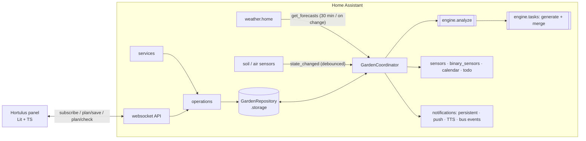

<!-- Generated from the sources by a script: code excerpts below are verbatim. -->
<p align="center"></p>

# Hortulus — architecture blueprint

> **Hortulus** (`garden_manager`) is a Home Assistant custom integration plus a sidebar
> panel for planning and running a vegetable garden. This blueprint is the single
> technical reference: architecture, data model, algorithms, APIs, UI and tests. All code
> excerpts are copied verbatim from the repository; follow the file links for the full
> implementation. Nederlandstalige gebruikersdocumentatie staat in [`docs/nl`](nl/).

**Contents**

1. [Overview](#1-overview)
2. [Architecture & Folder Tree](#2-architecture--folder-tree)
3. [Data Model](#3-data-model)
4. [Backend (Python)](#4-backend-python)
5. [Frontend (TypeScript)](#5-frontend-typescript)
6. [Services, Entities, and Events](#6-services-entities-and-events)
7. [Scheduling, Compatibility, and Watering Algorithms](#7-scheduling-compatibility-and-watering-algorithms)
8. [Example HA Automations & Dashboards](#8-example-ha-automations--dashboards)
9. [Tests](#9-tests)
10. [Documentation Files (README etc.)](#10-documentation-files-readme-etc)

---

## 1. Overview

| Requirement | Where it lives |
|---|---|
| Drag‑and‑drop planner (beds, greenhouse zones, containers, rows; single/block/row; succession; companion overlay; import/export; undo/redo, snap, tooltips, shortcuts) | `frontend/src/views/planner-view.ts`, `frontend/src/planner/*` |
| Plant database (140 crops, EN/NL, user overrides & custom plants) | `custom_components/garden_manager/data/plants.json`, `engine/plantdb.py` |
| Companion scoring, rotation, greenhouse suitability | `engine/compatibility.py`, `engine/schedule.py`, `engine/weather.py` |
| Task engine (generation, recurrence, completion, postpone cascade, priorities, durations, notes, photos) | `engine/tasks.py`, `operations.py` |
| Sensors + forecast (frost, heat, irrigation, GDD) | `engine/weather.py`, `engine/watering.py`, `coordinator.py` |
| HA entities, services, events, notifications | `sensor.py`, `binary_sensor.py`, `calendar.py`, `todo.py`, `button.py`, `services.py`, `notifications.py` |
| Config flow + options flow | `config_flow.py`, `options.py`, `seed.py` |
| Storage with versioning & migrations | `storage.py`, `engine/migrations.py` |
| Bilingual (EN/NL) | `translations/*.json`, `engine/i18n.py`, `frontend/src/i18n/*` |
| Brand (name, logo, icon, banner) & design system | `assets/brand/*`, [`DESIGN_SYSTEM.md`](DESIGN_SYSTEM.md) |

**Design tenets**

* **Pure engine, thin HA shell.** All horticultural logic lives in
  `engine/` – plain Python, no Home Assistant imports, no I/O – so it is fast to test
  and identical whether triggered by a sensor, a service call or the panel.
* **Event‑driven.** Sensors are never polled: the coordinator listens to state changes of
  exactly the mapped entities (debounced 10 s). Only the forecast is fetched on a timer
  (30 min) or when the weather entity updates (≥ 10 min apart).
* **Explainable advice.** Every warning, wait and task carries an i18n key + parameters
  so both the backend (notifications, calendar) and the panel can explain *why*.
* **Idempotent tasks.** Generated tasks have stable keys; regeneration never duplicates
  work or loses user decisions.
* **Local only.** No external services; data in `.storage/garden_manager.garden`.

<p align="center"></p>

---

## 2. Architecture & Folder Tree

```
greenhouse/                                  ← repository (brand: Hortulus)
├── README.md · README.nl.md · LICENSE · hacs.json · pyproject.toml · requirements_test.txt
├── .github/workflows/ci.yml                 ← ruff, pytest, tsc, node:test, bundle check, hassfest, HACS
├── assets/brand/                            ← icon, logo, dark logo, banner (SVG sources + PNG renders)
├── custom_components/garden_manager/
│   ├── __init__.py          setup/unload, runtime data, daily rollover & digest scheduling
│   ├── manifest.json        domain, deps (http, frontend, panel_custom, websocket_api, image_upload)
│   ├── const.py             constants, events, service names
│   ├── config_flow.py       guided setup (region → weather → areas+sensors → notifications → summary) + options
│   ├── options.py           options ⇄ stored settings
│   ├── seed.py              build the first garden (+ example plan) from the wizard answers
│   ├── coordinator.py       DataUpdateCoordinator: forecast fetch, state tracking, analysis, task merge
│   ├── storage.py           versioned Store + repository (debounced saves, revision)
│   ├── operations.py        write operations shared by services, websocket, calendar & todo
│   ├── services.py · services.yaml
│   ├── websocket_api.py     panel API (subscribe, plan/save, plan/check, plants, tasks …)
│   ├── notifications.py     persistent / push / TTS / bus events, de‑duplicated
│   ├── panel.py             static path + sidebar panel registration (content‑hashed URL)
│   ├── entity.py            base entities, per‑bed/zone devices, dynamic entity creation
│   ├── sensor.py · binary_sensor.py · calendar.py · todo.py · button.py · diagnostics.py
│   ├── number.py · select.py · switch.py   irrigation limits/mode, shading mode, auto irrigation
│   ├── controllers.py      irrigation (pump interlock, max runtime, safe shut-off) + greenhouse climate
│   ├── printing.py          authenticated PDF view + private export with signed links
│   ├── api.py               optional Open-Meteo client (opt-in)
│   ├── strings.json · translations/{en,nl}.json · icons.json
│   ├── data/plants.json     plant database (140 crops, EN/NL; built by scripts/build_plantdb.py)
│   ├── data/handbook/{en,nl}/NN-<id>.md · glossary.json   gardening handbook + tooltip glossary
│   ├── frontend/hortulus-panel.js   built panel bundle (committed)
│   └── engine/              ← pure Python, no HA imports
│       ├── models.py        dataclasses (Plant, Zone, GardenBed, Planting, Task, snapshots …)
│       ├── serde.py         lossless (de)serialisation, forward/backward compatible
│       ├── region.py        frost dates, hemispheres, seasons, leap years
│       ├── plantdb.py       database, overrides, symmetric companion relations, search
│       ├── geometry.py      footprints, plant positions, snapping
│       ├── schedule.py      windows, timelines, live timing advice
│       ├── compatibility.py companion scoring, overlaps, rotation
│       ├── weather.py       forecast parsing, frost, greenhouse climate, ET₀, GDD
│       ├── watering.py      moisture bands, irrigation recommendation
│       ├── tasks.py         generation, merge, recurrence, postpone cascade
│       ├── analysis.py      orchestrates everything into GardenAnalysis
│       ├── succession.py · planio.py · migrations.py · i18n.py
│       ├── phenology.py     growth stage, stage Kc, degree-day harvest estimate
│       ├── waterbalance.py  daily root-zone bucket per bed
│       ├── fertilizer.py    compost/fertiliser per bed, feed doses, nutrient balance index
│       ├── maintenance.py   seasonal garden & greenhouse work, bed turnover, perennial care
│       ├── irrigation.py    pure irrigation plan with the safety rules
│       ├── autoplan.py      autofill from area + resources
│       ├── handbook.py      chapters, glossary, search
│       ├── pdf.py           PDF writer + SVG surface (same drawing API)
│       └── printout.py      printable documents and page formats (incl. reMarkable)
├── frontend/                ← Lit + TypeScript sources (esbuild)
│   ├── src/hortulus-panel.ts            root element, routing, subscription, toasts
│   ├── src/api.ts · src/types.ts        typed websocket client mirroring engine/models.py
│   ├── src/views/{dashboard,planner,library,calendar,handbook,print,settings}-view.ts
│   ├── src/planner/{garden-canvas,geometry,history}.ts
│   ├── src/components/task-ui.ts        task row (swipe actions) + task dialog (live context)
│   ├── src/components/{info,markdown}.ts glossary tooltips, safe Markdown renderer
│   ├── src/styles/tokens.ts             design tokens (light/dark) + shared component styles
│   ├── src/i18n/{en,nl,index}.ts        catalogs (keys shared with the backend)
│   └── test/*.test.ts                   node:test unit tests
├── tests/                   ← pytest (+ pytest-homeassistant-custom-component)
│   ├── engine/test_{tasks,frost,compatibility,region_watering_data,agronomy,planning,print_handbook}.py
│   ├── test_config_flow.py · test_init.py · test_phase2.py
│   └── fixtures/{forecast_hourly_dst_frost,forecast_hourly_rain,forecast_daily,sensors}.json
├── examples/{automations,dashboard}.yaml
└── docs/  BLUEPRINT.md · DESIGN_SYSTEM.md · en/{CONFIGURATION,ENTITY_REFERENCE,FAQ}.md · nl/{CONFIGURATIE,ENTITEITEN,FAQ}.md · images/
```

### Runtime architecture



### Why Lit (and not React)

Home Assistant's frontend is built from Lit web components. A Lit panel receives the same
`hass` object, inherits HA theme variables through CSS custom properties, can use
`ha-icon`, and ships without a second framework runtime (whole panel ≈ 55 kB gzipped).
Drag‑and‑drop uses **pointer events with pointer capture** rather than HTML5 DnD, because
HTML5 DnD does not work on touch devices and offers poor keyboard accessibility; a full
keyboard path (Enter to place, arrows to move, Alt+arrows to resize) complements it.

---

## 3. Data Model

All models are dataclasses in [`engine/models.py`](../custom_components/garden_manager/engine/models.py)
serialised by [`engine/serde.py`](../custom_components/garden_manager/engine/serde.py)
(unknown keys ignored, missing keys defaulted, enums/dates as ISO strings). The frontend
mirrors them in [`frontend/src/types.ts`](../frontend/src/types.ts).

Conventions: lengths in **cm**, temperatures **°C**, rain **mm**; canvas origin top‑left;
planting coordinates relative to their bed; calendar dates local, timestamps tz‑aware; a
*season* is named after the year its spring falls in (southern hemisphere: July → June).

### 3.1 Layout: `Zone`, `GardenBed`, sensor mapping

```python
@dataclass(slots=True)
class SensorMapping:
    """Entity ids feeding a bed or zone.  ``None`` means "not available"."""

    soil_moisture: str | None = None
    soil_temperature: str | None = None
    air_temperature: str | None = None
    air_humidity: str | None = None
    light: str | None = None
    rain: str | None = None
    # Advanced probes (all optional)
    par: str | None = None  # PAR/PPFD in µmol/m²/s
    ec: str | None = None  # electrical conductivity in mS/cm
    npk_n: str | None = None  # mg/kg
    npk_p: str | None = None
    npk_k: str | None = None
    leaf_wetness: str | None = None  # binary or %

    def merged_with(self, fallback: SensorMapping) -> SensorMapping:
        """Bed sensors fall back to the sensors of their zone."""
        return SensorMapping(**{k: getattr(self, k) or getattr(fallback, k) for k in SENSOR_KEYS})

    def entity_ids(self) -> list[str]:
        return [e for e in (getattr(self, k) for k in SENSOR_KEYS) if e]


@dataclass(slots=True)
class Microclimate:
    shade_pct: int = 0
    wind: WindExposure = WindExposure.MODERATE
    heated: bool = False
    # Against a sun-facing wall (re-radiates heat at night).
    wall_heat: bool = False
    # Water barrels / stone floor in an enclosure buffer night temperatures.
    thermal_mass: bool = False
    min_heating_temp_c: float | None = None
    # Night-time buffering of an enclosure versus outside (°C).  ``None`` means
    # "use the default for the zone type" (greenhouse +3, cold frame +2).
    night_offset_c: float | None = None
    # Extra daytime warming in full sun (°C).  ``None`` = default for type.
    solar_gain_c: float | None = None


@dataclass(slots=True)
class Zone:
    id: str
    name: str
    type: ZoneType = ZoneType.OUTDOOR
    x_cm: float = 0
    y_cm: float = 0
    width_cm: float = 400
    length_cm: float = 300
    microclimate: Microclimate = field(default_factory=Microclimate)
    sensors: SensorMapping = field(default_factory=SensorMapping)
    vent_entity: str | None = None
    shade_entity: str | None = None
    # off = ignore, advise = tasks only, auto = drive vent/shade entities
    climate_control: Literal["off", "advise", "auto"] = "advise"
    # Shade screen override for enclosed zones: auto follows the advice.
    shading_mode: Literal["auto", "on", "off"] = "auto"

    @property
    def is_enclosed(self) -> bool:
        return self.type in (ZoneType.GREENHOUSE, ZoneType.COLD_FRAME)


@dataclass(slots=True)
class GardenBed:
    id: str
    name: str
    zone_id: str
    kind: BedKind = BedKind.RAISED
    x_cm: float = 0
    y_cm: float = 0
    width_cm: float = 200
    length_cm: float = 100
    # Compass bearing of the rows (0 = rows run north-south).
    orientation_deg: int = 0
    soil: SoilType = SoilType.LOAM
    shade_pct: int | None = None  # overrides zone microclimate when set
    sensors: SensorMapping = field(default_factory=SensorMapping)
    irrigation_entity: str | None = None
    irrigation_flow_lpm: float | None = None
    notes: str = ""
    soil_tests: list[SoilTest] = field(default_factory=list)

    @property
    def latest_soil_test(self) -> SoilTest | None:
        return max(self.soil_tests, key=lambda s: s.date, default=None)

    @property
    def area_m2(self) -> float:
        return (self.width_cm * self.length_cm) / 10_000
```

### 3.2 `Plant`

Sowing windows are **weeks relative to a frost anchor**, which makes one database work on
both hemispheres and in every climate.

```python
@dataclass(slots=True)
class Window:
    """A sowing/planting window in *weeks* relative to a frost anchor.

    ``start_week=-8, end_week=-6, anchor="last_frost"`` means "between 8 and 6
    weeks before the average last spring frost".  Anchoring on frost dates makes
    the database hemisphere- and climate-independent.
    """

    start_week: int
    end_week: int
    anchor: WindowAnchor = "last_frost"


@dataclass(slots=True)
class GreenhouseProfile:
    suitability: Suitability = Suitability.NO
    min_night_c: float = 5.0
    max_day_c: float = 30.0
    # How many weeks earlier sowing/transplanting may start under glass.
    season_extension_weeks: int = 0
    notes: dict[str, str] = field(default_factory=dict)


@dataclass(slots=True)
class CompanionLink:
    plant: str
    relation: Relation
    reason: dict[str, str] = field(default_factory=dict)
    strength: int = 2  # 1 = folklore / weak … 3 = well documented


@dataclass(slots=True)
class CareRule:
    """Data-driven care task, e.g. "prune side shoots weekly from day 14"."""

    task: TaskType
    start_day: int = 0
    interval_days: int | None = None
    end_day: int | None = None
    anchor: CareAnchor = "planting"
    minutes: int = 10
    notes: dict[str, str] = field(default_factory=dict)


@dataclass(slots=True)
class Plant:
    id: str
    names: dict[str, str]
    scientific_name: str
    family: str
    variety: str | None = None
    habit: GrowthHabit = GrowthHabit.BUSH
    perennial: bool = False
    spacing_cm: float = 30.0
    row_spacing_cm: float = 30.0
    sowing_depth_cm: float = 1.0
    germination_days: list[int] = field(default_factory=lambda: [7, 14])
    min_soil_temp_c: float = 7.0
    optimal_soil_temp_c: float = 18.0
    max_soil_temp_c: float | None = None
    days_to_maturity: list[int] = field(default_factory=lambda: [60, 80])
    maturity_from: Literal["sow", "transplant"] = "sow"
    harvest_duration_days: int = 14
    # False for companion flowers / green manures: no harvest tasks.
    harvestable: bool = True
    continuous_harvest: bool = False
    harvest_interval_days: int | None = None
    transplant_age_days: list[int] = field(default_factory=lambda: [35, 49])
    sowing: SowingCalendar = field(default_factory=SowingCalendar)
    greenhouse: GreenhouseProfile = field(default_factory=GreenhouseProfile)
    frost_tolerance: FrostTolerance = FrostTolerance.HALF_HARDY
    min_temp_c: float = 0.0
    max_temp_c: float = 32.0
    companions: list[CompanionLink] = field(default_factory=list)
    rotation_years: int = 3
    pests: list[str] = field(default_factory=list)
    diseases: list[str] = field(default_factory=list)
    water_needs: Level = Level.MEDIUM
    nutrient_needs: Level = Level.MEDIUM
    feeding_interval_days: int | None = None
    care: list[CareRule] = field(default_factory=list)
    pruning_notes: dict[str, str] = field(default_factory=dict)
    thinning: bool = False
    succession_interval_days: int | None = None
    gdd_base_c: float = 10.0
    gdd_to_maturity: int | None = None
    tags: list[str] = field(default_factory=list)
    category: PlantCategory = PlantCategory.VEGETABLE
    # FAO-56 crop coefficients: initial, mid-season, late season.
    kc: list[float] = field(default_factory=lambda: [0.5, 1.0, 0.8])
    # Relative nitrogen / phosphorus / potassium demand (0 = none ... 3 = high).
    npk: list[float] = field(default_factory=lambda: [1.0, 1.0, 1.0])
    height_cm: int = 50
    root_depth_cm: int = 30
    plants_per_person: float = 2.0
    yield_kg_m2: float = 2.0
    # Pests this plant deters (scent, root exudates) or lures away (trap crop).
    deters: list[str] = field(default_factory=list)
    trap_for: list[str] = field(default_factory=list)
    allelopathic: bool = False
    shade_tolerant: bool = False
    # Perennials: harvest each year in these windows once bearing.
    harvest_windows: list[Window] = field(default_factory=list)
    years_to_bearing: int = 0
    emoji: str = ""
    icon: str = ""  # vector glyph drawn on the planner map (see frontend plant-glyphs)
    color: str = ""  # glyph colour (the crop's own colour, not the family colour)
    # Short ecological growing tips and home remedies (per language).
    tips: dict[str, list[str]] = field(default_factory=dict)
    pollination: Literal["self", "insects", "wind", "partner", "none"] = "self"
    source: Literal["builtin", "custom", "override"] = "builtin"

    def name(self, lang: str = "en") -> str:
        return self.names.get(lang) or self.names.get("en") or self.id
```

A database entry (excerpt of `data/plants.json`):

```json
  {
   "habit": "bush",
   "category": "fruit",
   "perennial": true,
   "spacing_cm": 25,
   "row_spacing_cm": 25,
   "sowing_depth_cm": 0.5,
   "germination_days": [
    10,
    21
   ],
   "min_soil_temp_c": 12,
   "optimal_soil_temp_c": 20,
   "days_to_maturity": [
    90,
    120
   ],
   "maturity_from": "sow",
   "harvest_duration_days": 150,
   "continuous_harvest": true,
   "harvest_interval_days": 4,
   "transplant_age_days": [
    56,
    84
   ],
   "sowing": {
    "indoor_sow": [
    …
```

### 3.3 `Planting`

```python
@dataclass(slots=True)
class Planting:
    id: str
    plant_id: str
    bed_id: str
    season: int
    layout: LayoutMode = LayoutMode.SINGLE
    x_cm: float = 0
    y_cm: float = 0
    width_cm: float = 30
    length_cm: float = 30
    count: int | None = None  # ``None`` = derive from spacing
    method: SowMethod = SowMethod.DIRECT_SOW
    status: PlantingStatus = PlantingStatus.PLANNED
    # User overrides for the planned dates (otherwise the scheduler decides).
    sow_date: date | None = None
    transplant_date: date | None = None
    # What actually happened.
    sown_on: date | None = None
    transplanted_on: date | None = None
    harvest_started_on: date | None = None
    finished_on: date | None = None
    succession_group: str | None = None
    succession_index: int = 0
    notes: str = ""
    # Perennials stay in the plan year after year until removed explicitly:
    # the first season they are no longer there (None = still growing).
    removed_season: int | None = None
```

### 3.4 `Task`

```python
@dataclass(slots=True)
class Recurrence:
    interval_days: int
    until: date | None = None


@dataclass(slots=True)
class Task:
    id: str
    type: TaskType
    title: str
    due: date
    # Stable key for generated tasks so regeneration is idempotent.
    key: str | None = None
    title_key: str | None = None
    title_params: dict[str, Any] = field(default_factory=dict)
    description: str = ""
    window_start: date | None = None
    window_end: date | None = None
    priority: TaskPriority = TaskPriority.NORMAL
    estimated_minutes: int = 10
    status: TaskStatus = TaskStatus.OPEN
    source: TaskSource = TaskSource.USER
    planting_id: str | None = None
    bed_id: str | None = None
    zone_id: str | None = None
    recurrence: Recurrence | None = None
    depends_on: list[str] = field(default_factory=list)
    completed_at: datetime | None = None
    notes: list[TaskNote] = field(default_factory=list)
    photos: list[str] = field(default_factory=list)
    postponed_count: int = 0
    original_due: date | None = None
    user_modified: bool = False
    created_at: datetime | None = None
    updated_at: datetime | None = None
    # Household member doing it: a person.* entity id (or None = anyone).
    assignee: str | None = None

    @property
    def is_open(self) -> bool:
        return self.status is TaskStatus.OPEN
```

### 3.5 Runtime snapshots: `WeatherSnapshot`, `SensorSnapshot`

```python
@dataclass(slots=True)
class ForecastPoint:
    at: datetime
    temperature: float | None = None
    templow: float | None = None
    precipitation: float | None = None
    precipitation_probability: float | None = None
    humidity: float | None = None
    wind_speed: float | None = None  # km/h, HA default for metric
    cloud_coverage: float | None = None
    condition: str | None = None
    dew_point: float | None = None
    # Daily sums from Open-Meteo (optional): MJ/m²/day
    shortwave_radiation: float | None = None


@dataclass(slots=True)
class WeatherSnapshot:
    available: bool = False
    fetched_at: datetime | None = None
    temperature: float | None = None
    humidity: float | None = None
    condition: str | None = None
    hourly: list[ForecastPoint] = field(default_factory=list)
    daily: list[ForecastPoint] = field(default_factory=list)
    error: str | None = None


@dataclass(slots=True)
class SensorReading:
    entity_id: str
    value: float | None
    last_updated: datetime | None = None
    stale: bool = False

    @property
    def usable(self) -> float | None:
        return None if self.stale else self.value


@dataclass(slots=True)
class SensorSnapshot:
    """Resolved sensor values for a bed (zone fallbacks already applied)."""

    soil_moisture: SensorReading | None = None
    soil_temperature: SensorReading | None = None
    air_temperature: SensorReading | None = None
    air_humidity: SensorReading | None = None
    light: SensorReading | None = None
    rain: SensorReading | None = None
    par: SensorReading | None = None
    ec: SensorReading | None = None
    npk_n: SensorReading | None = None
    npk_p: SensorReading | None = None
    npk_k: SensorReading | None = None
    leaf_wetness: SensorReading | None = None

    @staticmethod
    def value(reading: SensorReading | None) -> float | None:
        return reading.usable if reading else None
```

### 3.6 Root document, versioning & migrations

```python
@dataclass(slots=True)
class GardenData:
    """Root document persisted with ``homeassistant.helpers.storage.Store``."""

    revision: int = 0
    settings: GardenSettings = field(default_factory=GardenSettings)
    zones: list[Zone] = field(default_factory=list)
    beds: list[GardenBed] = field(default_factory=list)
    plantings: list[Planting] = field(default_factory=list)
    tasks: list[Task] = field(default_factory=list)
    custom_plants: list[Plant] = field(default_factory=list)
    plant_overrides: dict[str, dict[str, Any]] = field(default_factory=dict)
    rotation_history: list[RotationRecord] = field(default_factory=list)
    climate_log: list[ClimateDay] = field(default_factory=list)
    # Dedupe keys of notifications already sent -> ISO date sent.
    notified: dict[str, str] = field(default_factory=dict)
    features: list[Feature] = field(default_factory=list)
    water_balance: dict[str, WaterBalance] = field(default_factory=dict)
    irrigation_log: list[IrrigationEvent] = field(default_factory=list)
    harvest_log: list[HarvestEntry] = field(default_factory=list)
    journal: list[JournalEntry] = field(default_factory=list)
    seed_stock: list[SeedPacket] = field(default_factory=list)
    water_log: list[WaterReading] = field(default_factory=list)

    # -- lookups ---------------------------------------------------------- #
    def zone(self, zone_id: str | None) -> Zone | None:
        return next((z for z in self.zones if z.id == zone_id), None)

    def bed(self, bed_id: str | None) -> GardenBed | None:
        return next((b for b in self.beds if b.id == bed_id), None)

    def planting(self, planting_id: str | None) -> Planting | None:
        return next((p for p in self.plantings if p.id == planting_id), None)

    def task(self, task_id: str) -> Task | None:
        return next((t for t in self.tasks if t.id == task_id), None)

    def zone_of_bed(self, bed: GardenBed) -> Zone | None:
        return self.zone(bed.zone_id)

    def bed_sensors(self, bed: GardenBed) -> SensorMapping:
        zone = self.zone_of_bed(bed)
        merged = bed.sensors.merged_with(zone.sensors) if zone else bed.sensors
        if zone is None or not zone.is_enclosed:
            merged = merged.merged_with(self.settings.outdoor_sensors)
        return merged
```

The document is persisted with `homeassistant.helpers.storage.Store` at
`(version=1, minor_version=4)`. Minor versions are additive; HA calls our migration on load,
and the plan importer reuses the same chain for files exported by older releases.

```python
def _v1_2_to_1_3(doc: Doc) -> Doc:
    for task in doc.get("tasks", []):
        task.setdefault("photos", [])
        notes = task.get("notes", [])
        if notes and isinstance(notes[0], str):
            stamp = task.get("updated_at") or task.get("created_at") or "1970-01-01T00:00:00+00:00"
            task["notes"] = [{"at": stamp, "text": text, "author": None} for text in notes]
    settings = doc.setdefault("settings", {})
    legacy = settings.pop("notify_service", None)
    notifications = settings.setdefault("notifications", {})
    if legacy and not notifications.get("notify_services"):
        notifications["notify_services"] = [legacy]
    return doc


def migrate(doc: Doc, major: int, minor: int) -> Doc:
    """Bring ``doc`` from ``major.minor`` to the current version."""
    if major > STORAGE_VERSION:
        raise MigrationError(f"Data version {major}.{minor} is newer than supported")
    out = copy.deepcopy(doc)
    current = max(minor, 1)
    while current < STORAGE_MINOR_VERSION:
        out = MIGRATIONS[current](out)
        current += 1
    return out
```

```python
class GardenStore(Store[dict[str, Any]]):
    """Store with Hortulus migrations."""

    async def _async_migrate_func(
        self, old_major_version: int, old_minor_version: int, old_data: dict[str, Any]
    ) -> dict[str, Any]:
        _LOGGER.info(
            "Migrating Hortulus data from %s.%s to %s.%s",
            old_major_version,
            old_minor_version,
            STORAGE_VERSION,
            STORAGE_MINOR_VERSION,
        )
        return migrate(old_data, old_major_version, old_minor_version)
```

The *revision* counter guards the plan for optimistic concurrency (the planner sends
`base_revision`); task edits do not bump it, so ticking off a chore never invalidates an
open editor.

---

## 4. Backend (Python)

### 4.1 Setup

```python
async def async_setup_entry(hass: HomeAssistant, entry: GardenConfigEntry) -> bool:
    builtin = await hass.async_add_executor_job(load_builtin_json)
    repo = GardenRepository(hass, builtin)
    if await repo.async_load():
        _LOGGER.info("Creating initial Hortulus garden from setup answers")
        repo.data = build_initial_data(
            {**entry.data, **entry.options},
            latitude=hass.config.latitude,
            time_zone=hass.config.time_zone,
            language=normalize_lang(hass.config.language),
            today=dt_util.now().date(),
            db=PlantDatabase(builtin),
        )
        await repo.async_flush()

    coordinator = GardenCoordinator(hass, entry, repo)
    notifier = GardenNotifier(hass, repo)
    irrigation = IrrigationController(hass, coordinator)
    climate = ClimateController(hass, coordinator)
    entry.runtime_data = GardenRuntime(repo, coordinator, notifier, irrigation, climate)
    entry.async_on_unload(coordinator.async_add_post_compute_hook(notifier.async_process))
    entry.async_on_unload(coordinator.async_add_listener(climate.async_apply))
    entry.async_on_unload(irrigation.async_stop_on_unload)

    await coordinator.async_config_entry_first_refresh()
    await hass.config_entries.async_forward_entry_setups(entry, PLATFORMS)
    await async_register_panel(hass)

    @callback
    def _midnight(now: datetime) -> None:
        """New day: expire yesterday's sensor tasks, roll windows forward."""
        hass.async_create_task(coordinator.async_request_refresh())

    entry.async_on_unload(async_track_time_change(hass, _midnight, hour=0, minute=5, second=0))
    _schedule_digest(hass, entry)
    _schedule_reminders(hass, entry)
    _schedule_irrigation(hass, entry)
    entry.async_on_unload(entry.add_update_listener(_async_update_listener))
    return True
```

### 4.2 Coordinator – event‑driven updates

```python
@callback
def _on_state_changed(self, event: Event[EventStateChangedData]) -> None:
    if event.data["entity_id"] == self.repo.data.settings.weather_entity:
        # New observation from the weather integration -> forecast may
        # have changed too.  Rate limited inside _forecast_due().
        self.hass.async_create_task(self.async_request_refresh())
        return
    self.hass.async_create_task(self._recompute_debouncer.async_call())


async def _async_update_data(self) -> GardenAnalysis:
    if self._forecast_due():
        await self.async_fetch_forecast()
    return self._compute()


async def async_fetch_forecast(self) -> None:
    await self._async_fetch_entity_forecast()
    if self.repo.data.settings.open_meteo:
        await self._async_enrich_open_meteo()


def _compute(self) -> GardenAnalysis:
    repo = self.repo
    data = repo.data
    now = dt_util.now()
    readings = self.read_sensors()
    analysis = analyze(
        data,
        repo.db,
        self.weather,
        readings,
        now=now,
        tz=dt_util.get_default_time_zone(),
        latitude=data.settings.region.latitude or self.hass.config.latitude,
        lang=self.lang,
    )
    changed = False
    # Climate log (GDD): outdoor sensor, otherwise current weather temp.
    outdoor = data.settings.outdoor_sensors
    temp = readings.get(outdoor.air_temperature).usable if outdoor.air_temperature in readings else None  # type: ignore[union-attr]
    if temp is None:
        temp = self.weather.temperature
    rain = readings.get(outdoor.rain).usable if outdoor.rain in readings else None  # type: ignore[union-attr]
    if not (outdoor.rain and rain is not None and not outdoor.rain.startswith("binary_sensor.")):
        # No rain gauge: book the forecast for today (never lowering it as
        # the day passes and fewer hours remain in the forecast).
        logged = next((d.rain_mm for d in data.climate_log if d.day == analysis.today), None)
        forecast = analysis.outlook[0].rain_mm if analysis.outlook else None
        rain = max(v for v in (logged, forecast, 0.0) if v is not None) if forecast is not None else None
    changed |= record_climate(data.climate_log, analysis.today, temp, rain)
    changed |= advance_water_balance(
        data,
        repo.db,
        analysis.timelines,
        analysis.today,
        latitude=data.settings.region.latitude or self.hass.config.latitude,
        tz=dt_util.get_default_time_zone(),
    )

    # Garden water: one meter / water-butt reading per day.
    water = data.settings.water
    changed |= record_water(
        data,
        analysis.today,
        self._state_float(water.meter_entity, m3=True),
        self._state_float(water.butt_level_entity),
    )
    ctx = analysis.task_context(data, repo.db)
    ctx.rain_water_l = water_stats(data, analysis.today).rain_available_l
    merge = merge_tasks(data.tasks, generate_specs(ctx), today=analysis.today, now=now, lang=self.lang)
    if auto_assign(merge.created, data.settings.assignment):
        changed = True
    self.last_merge = merge
    if merge.changed:
        data.tasks = merge.tasks
        changed = True
    if changed:
        repo.async_schedule_save()
    for hook in self._post_compute_hooks:
        hook(analysis, merge)
    return analysis
```

### 4.3 Storage repository

```python
@callback
def async_changed(self, reason: str, *, bump_revision: bool = True, source: str = "user") -> None:
    """Persist and notify.  ``reason`` is e.g. ``plan``, ``tasks``, ``settings``."""
    self.record(reason, source=source)
    # The revision guards the *plan* (optimistic concurrency for the
    # planner); ticking off a task must not invalidate an open editor.
    if bump_revision and reason in PLAN_REASONS:
        self.data.revision += 1
    if reason in ("plants", "plan", "import"):
        self.invalidate_db()
    self.async_schedule_save()
    for listener in list(self._listeners):
        listener(reason)
```

### 4.4 Scheduling engine

```python
def planting_timeline(
    planting: Planting,
    plant: Plant,
    anchors: SeasonAnchors,
    zone: Zone | None = None,
    today: date | None = None,
) -> PlantingTimeline:
    """Absolute dates for a planting.

    Priority for every date: what actually happened > user override >
    computed from the window (clamped to ``today`` when the window is open and
    nothing has been done yet, so overdue plans move forward sensibly).
    """
    windows = plant_windows(plant, anchors, zone)
    method = resolve_method(plant, planting.method)
    # Only "live" seasons move planned dates forward; past/future seasons are
    # shown exactly as planned.
    in_season = today is not None and anchors.last_frost - timedelta(
        days=200
    ) <= today <= anchors.first_frost + timedelta(days=60)
    ref = today if in_season else None
    late = False

    sow_window: DateWindow | None = None
    sow_date: date | None = None
    transplant_window: DateWindow | None = None
    transplant_date: date | None = None

    if method is SowMethod.TRANSPLANT:
        transplant_window = (
            _pick_containing(windows.transplant, planting.transplant_date)
            if planting.transplant_date
            else _pick(windows.transplant, ref)
        )
        transplant_date = planting.transplanted_on or planting.transplant_date
        if transplant_date is None and transplant_window:
            transplant_date = transplant_window.start
            if ref and ref > transplant_date:
                transplant_date = ref
    else:
        options = windows.indoor_sow if method is SowMethod.INDOOR_SOW else windows.direct_sow
        sow_window = _pick_containing(options, planting.sow_date) if planting.sow_date else _pick(options, ref)
        sow_date = planting.sown_on or planting.sow_date
        if sow_date is None and sow_window:
            sow_date = sow_window.start
            if ref and ref > sow_date:
                sow_date = ref
        if sow_window and sow_date and sow_date > sow_window.end:
            late = True
        if method is SowMethod.INDOOR_SOW and sow_date:
            earliest = sow_date + timedelta(days=plant.transplant_age_days[0])
            transplant_window = _pick(windows.transplant, earliest) or DateWindow(
                earliest, earliest + timedelta(days=14)
            )
            transplant_date = planting.transplanted_on or planting.transplant_date
            if transplant_date is None:
                transplant_date = max(earliest, transplant_window.start)

    if transplant_window and transplant_date and transplant_date > transplant_window.end:
        late = True

    in_ground = transplant_date or sow_date or anchors.last_frost
    if plant.maturity_from == "transplant":
        if transplant_date is not None:
            base = transplant_date
        else:  # direct sown crop whose maturity is quoted from transplanting
            base = in_ground + timedelta(days=plant.germination_days[1] + 14)
    else:
        base = sow_date or in_ground

    harvest_start = planting.harvest_started_on or base + timedelta(days=plant.days_to_maturity[0])
    natural_end = max(
        base + timedelta(days=plant.days_to_maturity[1]),
        harvest_start + timedelta(days=plant.harvest_duration_days),
    )
    harvest_end = natural_end
    # Tender crops outdoors die with the first frost.
    if plant.frost_tolerance is FrostTolerance.TENDER and not anchors.frost_free and not plant.perennial:
        frost_limit = anchors.first_frost + timedelta(weeks=windows.extension_weeks)
        if harvest_start < frost_limit < harvest_end:
            harvest_end = frost_limit
    bearing = True
    if plant.perennial and plant.harvest_windows:
        # Perennials crop in fixed seasonal windows, not "days after planting".
        bearing = plant.years_to_bearing <= 0
        win = _perennial_harvest(plant, anchors, in_ground)
        if win:
            harvest_start, harvest_end = win
    if planting.finished_on:
        harvest_end = planting.finished_on

    harden = None
    if method is SowMethod.INDOOR_SOW and transplant_date and not zone_is_enclosed(zone):
        harden = transplant_date - timedelta(days=10)

    return PlantingTimeline(
        method=method,
        sow_window=sow_window,
        sow_date=sow_date,
        transplant_window=transplant_window,
        transplant_date=transplant_date,
        harden_off_date=harden,
        in_ground=in_ground,
        harvest_start=harvest_start,
        harvest_end=harvest_end,
        late=late,
        bearing=bearing,
    )
```

### 4.5 Compatibility engine

```python
def evaluate_pair(
    pa: Planting,
    ra: Rect,
    plant_a: Plant,
    pb: Planting,
    rb: Rect,
    plant_b: Plant,
    db: PlantDatabase,
    *,
    radius_cm: float,
    lang: str = "en",
    hemisphere: Hemisphere = Hemisphere.NORTH,
) -> list[PairFinding]:
    findings: list[PairFinding] = []
    gap = ra.gap(rb)
    reach = max(radius_cm, (plant_a.spacing_cm + plant_b.spacing_cm) / 2)
    if gap > reach:
        return findings
    influence = max(0.0, 1.0 - gap / reach) if reach else 1.0
    name_a, name_b = plant_a.name(lang), plant_b.name(lang)

    overlap = ra.intersection_area(rb)
    if overlap > 0:
        frac = overlap / max(1.0, min(ra.w * ra.h, rb.w * rb.h))
        if frac > 0.05:
            findings.append(
                PairFinding(
                    pa.id,
                    pb.id,
                    "overlap",
                    "error" if frac > 0.25 else "warning",
                    -30 * min(frac, 1.0),
                    gap,
                    "compat.overlap",
                    {"a": name_a, "b": name_b},
                )
            )

    if pa.plant_id != pb.plant_id:
        rel = db.relation(pa.plant_id, pb.plant_id)
        if rel.relation is Relation.FRIEND:
            findings.append(
                PairFinding(
                    pa.id,
                    pb.id,
                    "friend",
                    "info",
                    10 * rel.strength * influence,
                    gap,
                    "compat.friend",
                    {"a": name_a, "b": name_b, "reason": rel.reasons.get(lang) or rel.reasons.get("en", "")},
                )
            )
        elif rel.relation is Relation.ENEMY:
            findings.append(
                PairFinding(
                    pa.id,
                    pb.id,
                    "enemy",
                    "error" if rel.strength >= 2 and influence > 0.5 else "warning",
                    -20 * rel.strength * influence,
                    gap,
                    "compat.enemy",
                    {"a": name_a, "b": name_b, "reason": rel.reasons.get(lang) or rel.reasons.get("en", "")},
                )
            )
        elif plant_a.family == plant_b.family and gap <= 1.0:
            findings.append(
                PairFinding(
                    pa.id,
                    pb.id,
                    "same_family",
                    "info",
                    -3,
                    gap,
                    "compat.same_family_adjacent",
                    {"a": name_a, "b": name_b},
                )
            )
        if rel.relation is Relation.NEUTRAL or rel.source == "family":
            findings.extend(_secondary_factors(pa, ra, plant_a, pb, rb, plant_b, influence, gap, lang, hemisphere, rel))
    return findings


def check_rotation(
    planting: Planting,
    bed: GardenBed,
    history: Iterable[RotationRecord],
    db: PlantDatabase,
    *,
    lang: str = "en",
) -> list[RotationFinding]:
    """Flag the same family in the same bed within ``rotation_years``.

    A family that returns *one* season early is a warning, sooner is an error.
    Perennials and plants with ``rotation_years <= 1`` are exempt.
    """
    plant = db.get(planting.plant_id)
    if plant is None or plant.perennial or plant.rotation_years <= 1:
        return []
    findings: list[RotationFinding] = []
    for rec in history:
        if rec.bed_id != bed.id or rec.family != plant.family:
            continue
        gap = planting.season - rec.season
        if 0 < gap < plant.rotation_years:
            findings.append(
                RotationFinding(
                    planting=planting.id,
                    bed_id=bed.id,
                    family=plant.family,
                    conflicting_season=rec.season,
                    years_required=plant.rotation_years,
                    severity="warning" if gap == plant.rotation_years - 1 else "error",
                    params={
                        "family": plant.family,
                        "bed": bed.name,
                        "season": rec.season,
                        "years": plant.rotation_years,
                        "plant": plant.name(lang),
                    },
                )
            )
    findings.sort(key=lambda f: -f.conflicting_season)
    return findings[:1]  # most recent conflict is the one that matters
```

### 4.6 Task engine

```python
def _apply_dependency_lag(specs: list[TaskSpec], today: date) -> None:
    """Push dependants back while a prerequisite is still overdue.

    If "sow lettuce" is 10 days overdue, "thin lettuce" cannot be due before
    its own offset after the (future) sowing - so it moves 10 days too.
    Specs are emitted in lifecycle order, so one pass handles chains
    (sow -> harden off -> plant out -> care).
    """
    by_key = {s.key: s for s in specs}
    for spec in specs:
        lag = 0
        for dep_key in spec.depends_on:
            dep = by_key.get(dep_key)
            if dep is not None and dep.due < today:
                lag = max(lag, (today - dep.due).days)
            elif dep is not None and dep.due > spec.due:
                lag = max(lag, (dep.due - spec.due).days)
        if lag:
            delta = timedelta(days=lag)
            spec.due += delta
            if spec.window_start:
                spec.window_start += delta
            if spec.window_end and spec.recurrence is None:
                spec.window_end += delta


def merge_tasks(
    existing: Sequence[Task],
    specs: Sequence[TaskSpec],
    *,
    today: date,
    now: datetime,
    lang: str = "en",
    id_factory: Callable[[], str] = new_id,
) -> MergeResult:
    result = MergeResult(tasks=[])
    open_by_key = {t_.key: t_ for t_ in existing if t_.key and t_.is_open}
    closed_keys = {t_.key for t_ in existing if t_.key and not t_.is_open}
    progressed = {k.split("@")[0] for k in closed_keys if k and "@" in k}
    spec_keys = {s.key for s in specs}
    out: list[Task] = []

    for task in existing:
        if task.source is TaskSource.USER or not task.key or not task.is_open:
            out.append(task)
            continue
        if task.key in spec_keys:
            out.append(task)
            continue
        # The reason for this open task disappeared.
        if task.source in (TaskSource.SENSOR, TaskSource.WEATHER):
            closed = replace(
                task,
                status=TaskStatus.SKIPPED if task.due < today else TaskStatus.DONE,
                completed_at=now,
                updated_at=now,
            )
            closed.notes = [*task.notes, TaskNote(now, "auto: expired" if task.due < today else "auto: resolved")]
            out.append(closed)
            result.auto_closed.append(closed)
        elif task.notes or task.photos:
            skipped = replace(task, status=TaskStatus.SKIPPED, completed_at=now, updated_at=now)
            out.append(skipped)
            result.auto_closed.append(skipped)
        else:
            result.removed.append(task)

    index = {id(t_): i for i, t_ in enumerate(out)}
    for spec in specs:
        current = open_by_key.get(spec.key)
        if current is not None and id(current) in index:
            updated = _apply_spec(current, spec, lang, now, progressed=spec.key in progressed)
            if updated is not current:
                out[index[id(current)]] = updated
                result.updated.append(updated)
            continue
        if spec.key in closed_keys and spec.recurrence is None:
            continue  # one-off task already done/skipped
        if spec.recurrence is not None:
            last = _series_progress(existing, spec.key)
            if last is not None or spec.key in closed_keys:
                base_day = last.completed_at.date() if last and last.completed_at else (last.due if last else today)
                nxt = base_day + timedelta(days=spec.recurrence.interval_days)
                if spec.recurrence.until and nxt > spec.recurrence.until:
                    continue
                spec = replace(spec, due=max(nxt, spec.due))
            elif spec.due < today:
                # First occurrence of a routine that should have started
                # already: start today instead of showing it months overdue.
                spec = replace(spec, due=today)
        task = spec_to_task(spec, lang, now, id_factory)
        out.append(task)
        result.created.append(task)

    result.tasks = out
    return result


def postpone_task(
    data: GardenData,
    task_id: str,
    *,
    now: datetime,
    days: int | None = None,
    to: date | None = None,
    reason: str | None = None,
    cascade: bool = True,
) -> PostponeResult:
    """Move a task; dependants of the same planting shift by the same delta.

    Example: postponing *sow tomato indoors* by a week also moves *harden off*
    and *plant out* - unless the gardener already moved those by hand.
    """
    task = data.task(task_id)
    if task is None:
        raise KeyError(task_id)
    if to is None:
        to = task.due + timedelta(days=days if days is not None else 1)
    delta = to - task.due
    result = PostponeResult(task)
    if delta.days == 0:
        return result
    task.original_due = task.original_due or task.due
    task.due = to
    task.postponed_count += 1
    task.user_modified = True
    task.updated_at = now
    if reason:
        task.notes.append(TaskNote(now, reason))
    if task.window_end and to > task.window_end:
        result.warnings.append("beyond_window")

    if cascade and task.key and delta.days > 0:
        queue = [task.key.split("@")[0]]
        seen = set(queue)
        while queue:
            key = queue.pop()
            for other in data.tasks:
                if (
                    other.is_open
                    and other is not task
                    and other.key
                    and key in other.depends_on
                    and other.key not in seen
                    and not other.user_modified
                ):
                    other.due = other.due + delta
                    other.updated_at = now
                    result.shifted.append(other)
                    seen.add(other.key)
                    queue.append(other.key)
                    if other.window_end and other.due > other.window_end:
                        result.warnings.append(f"dependant_beyond_window:{other.id}")
    return result
```

### 4.7 Config flow (excerpt)

```python
async def async_step_area_sensors(self, user_input: dict[str, Any] | None = None) -> ConfigFlowResult:
    if user_input is not None:
        self._data[CONF_AREAS].append(
            {**self._area, **{k: v for k, v in user_input.items() if v not in (None, "")}}
        )
        return await self.async_step_area_menu()
    enclosed = self._area.get(CONF_AREA_TYPE) == AREA_GREENHOUSE
    fields: dict[Any, Any] = {
        vol.Optional(CONF_MOISTURE): _entity("sensor", "moisture"),
        vol.Optional(CONF_SOIL_TEMP): _entity("sensor", "temperature"),
    }
    if enclosed:
        fields[vol.Optional(CONF_AIR_TEMP)] = _entity("sensor", "temperature")
        fields[vol.Optional(CONF_HUMIDITY)] = _entity("sensor", "humidity")
        fields[vol.Optional(CONF_LIGHT)] = _entity("sensor", "illuminance")
    fields[vol.Optional(CONF_IRRIGATION)] = _entity([Platform.SWITCH, Platform.VALVE])
    fields[vol.Optional(CONF_FLOW_LPM)] = _number(0.1, 200, 0.1, "L/min")
    return self.async_show_form(
        step_id="area_sensors",
        data_schema=vol.Schema(fields),
        description_placeholders={"name": self._area.get(CONF_AREA_NAME, "")},
    )
```

### 4.8 Websocket API (excerpt: live draft check used while dragging)

```python
@websocket_api.websocket_command(
    {
        vol.Required("type"): f"{DOMAIN}/plan/check",
        vol.Required("bed"): dict,
        vol.Required("plantings"): list,
    }
)
@callback
def ws_plan_check(hass: HomeAssistant, connection: websocket_api.ActiveConnection, msg: dict[str, Any]) -> None:
    """Live feedback for a *draft* bed while dragging (nothing is saved)."""
    runtime = _require_runtime(hass, connection, msg)
    if runtime is None:
        return
    data = runtime.repo.data
    db = runtime.repo.db
    lang = runtime.coordinator.lang
    try:
        bed = from_dict(GardenBed, msg["bed"])
        plantings = [from_dict(Planting, p) for p in msg["plantings"]]
    except (TypeError, ValueError, KeyError) as err:
        connection.send_error(msg["id"], "invalid_format", str(err))
        return
    today = dt_util.now().date()
    zone = data.zone(bed.zone_id)
    timelines = {}
    planned = {}
    for p in plantings:
        plant = db.get(p.plant_id)
        if plant is not None:
            anchors = season_anchors(data.settings.region, p.season)
            timelines[p.id] = planting_timeline(p, plant, anchors, zone, today)
            planned[p.id] = planting_timeline(p, plant, anchors, zone, None).occupancy
    report = check_bed(
        bed,
        plantings,
        db,
        timelines={k: v.occupancy for k, v in timelines.items()},
        planned=planned,
        radius_cm=data.settings.companion_radius_cm,
        lang=lang,
        hemisphere=resolve_profile(data.settings.region).hemisphere,
    )
    others = [p for p in data.plantings if p.id not in {d.id for d in plantings}]
    history = rotation_history(data.rotation_history, others, db)
    rotation = [f.to_dict() for p in plantings for f in check_rotation(p, bed, history, db, lang=lang)]
    connection.send_result(
        msg["id"],
        {
            **report.to_dict(),
            "rotation": rotation,
            "timelines": {k: v.to_dict() for k, v in timelines.items()},
        },
    )
```

### 4.9 Edge cases handled

| Edge case | Handling |
|---|---|
| Southern hemisphere | season July→June, first frost in the next calendar year (`region.season_anchors`), USDA dates shifted 6 months |
| Leap years | `parse_mmdd(2026, "02-29")` → 28 Feb; ET₀ day‑of‑year uses 366 in leap years |
| DST | hourly forecast handled as instants; durations from instant differences; local day aggregation via `astimezone` |
| Missing / stale sensors | `unknown`/`unavailable` → `None`; `last_reported` older than *stale minutes* → ignored + alert |
| Forecast unavailable | frost: hourly → daily → current sensor → `unknown`; irrigation: sensor only, confidence lowered |
| Imperial units | forecast and sensor temperatures/precip/wind converted with HA unit converters |
| Frost‑free climates | synthetic anchors keep windows sensible; no frost limits on harvests |
| Late plans | open windows roll forward to *today*; dependants lag behind overdue prerequisites |
| Concurrent edits | revision check → `revision_conflict` → panel reloads |
| Corrupt storage | backup to `garden_manager.garden.corrupt`, start fresh, log error |

---

## 5. Frontend (TypeScript)

Lit 3 + TypeScript, bundled by esbuild into one ES module served from
`/garden_manager_static/hortulus-panel.js?v=<sha256>`.

### 5.1 Root panel – subscription

```ts
private async connect(): Promise<void> {
  try {
    await this.loadPlants();
    void this.loadGlossary();
    this.unsubscribe = await this.api!.subscribe((snap) => {
      this.snapshot = snap;
      const lang = normalizeLang(snap.lang);
      if (lang !== this.uiLang) {
        this.uiLang = lang;
        this.t = makeTranslator(lang);
        void this.loadGlossary();
      }
      if (this.openTask) this.openTask = snap.tasks.find((t) => t.id === this.openTask!.id) ?? null;
    });
  } catch (err) {
    this.error = (err as { code?: string }).code === "not_loaded" ? this.t("common.not_loaded") : String((err as Error).message ?? err);
  }
}

private async loadGlossary(): Promise<void> {
  try {
    setGlossary((await this.api!.handbookIndex(this.uiLang)).glossary);
    setSupplies(await this.api!.supplies());
  } catch {
    /* older backend - tooltips stay empty */
  }
}

private openHandbook(chapter = ""): void {
  this.chapter = chapter;
  const base = `/${this.route?.prefix?.replace(/^\//, "") || "hortulus"}/handbook${chapter ? `/${chapter}` : ""}`;
  history.pushState(null, "", base);
  window.dispatchEvent(new CustomEvent("location-changed", { detail: { replace: false } }));
  this.tab = "handbook";
}
```

### 5.2 Planner – palette drag & drop with live companion feedback

```ts
private onPalettePointerDown(ev: PointerEvent, plant: Plant): void {
  if (!this.admin || (ev.pointerType === "mouse" && ev.button !== 0)) return;
  (ev.currentTarget as HTMLElement).setPointerCapture(ev.pointerId);
  this.paletteDrag = { plant, pointerId: ev.pointerId, bedId: null, rect: null };
  this.ghostReport = null;
}

private onPalettePointerMove(ev: PointerEvent): void {
  const drag = this.paletteDrag;
  if (!drag || drag.pointerId !== ev.pointerId) return;
  const pt = this.canvas.clientToCanvas(ev.clientX, ev.clientY);
  if (!pt) {
    this.paletteDrag = { ...drag, bedId: null, rect: null };
    return;
  }
  const bed = bedAt(this.draft.beds, pt.x, pt.y);
  if (!bed) {
    const size = { w: drag.plant.spacing_cm, h: drag.plant.spacing_cm };
    this.paletteDrag = { ...drag, bedId: null, rect: { x: pt.x - size.w / 2, y: pt.y - size.h / 2, ...size } };
    return;
  }
  const size = defaultFootprint(drag.plant, this.layoutMode, bed);
  const step = this.snapOn ? this.snapshot.settings.snap_cm : 1;
  let local = { x: snap(pt.x - bed.x_cm - size.w / 2, step), y: snap(pt.y - bed.y_cm - size.h / 2, step), ...size };
  if (this.layoutMode === "row") local = bed.width_cm >= bed.length_cm ? { ...local, x: 0 } : { ...local, y: 0 };
  local = clampInto(local, { x: 0, y: 0, w: bed.width_cm, h: bed.length_cm });
  this.paletteDrag = { ...drag, bedId: bed.id, rect: { ...local, x: local.x + bed.x_cm, y: local.y + bed.y_cm } };
  // Live companion feedback while hovering - throttled.
  const now = performance.now();
  if (now - this.ghostCheckAt > 220) {
    this.ghostCheckAt = now;
    const ghost = this.newPlanting(drag.plant, bed, local);
    ghost.id = "__ghost__";
    this.api.checkBed(bed, [...this.bedPlantings(bed.id), ghost]).then((r) => {
      if (this.paletteDrag) this.ghostReport = r;
    }).catch(() => undefined);
  }
}

private onPalettePointerUp(ev: PointerEvent): void {
  const drag = this.paletteDrag;
  if (!drag || drag.pointerId !== ev.pointerId) return;
  this.paletteDrag = null;
  this.ghostReport = null;
  if (!drag.bedId || !drag.rect) {
    if (drag.rect) this.announce(this.t("planner.no_bed_here"));
    return;
  }
  const doc = clone(this.draft);
  const bed = doc.beds.find((b) => b.id === drag.bedId)!;
  const planting = this.newPlanting(drag.plant, bed, { ...drag.rect, x: drag.rect.x - bed.x_cm, y: drag.rect.y - bed.y_cm });
  doc.plantings.push(planting);
  this.selection = { kind: "planting", id: planting.id };
  this.commit(doc, this.t("planner.placed", { plant: plantName(drag.plant, this.lang), bed: bed.name }), [bed.id]);
}
```

### 5.3 Canvas – move / resize with snapping (pointer capture)

```ts
private onPointerMove(ev: PointerEvent): void {
  const d = this.drag;
  if (!d || d.pointerId !== ev.pointerId) return;
  if (Math.hypot(ev.clientX - d.clientX, ev.clientY - d.clientY) > 3) d.moved = true;
  if (d.mode === "pan") {
    this.tx = d.startTx + (ev.clientX - d.clientX);
    this.ty = d.startTy + (ev.clientY - d.clientY);
    return;
  }
  const pt = this.clientToCanvas(ev.clientX, ev.clientY);
  if (d.mode === "draw") {
    if (!pt) return;
    const step = this.snapOn ? this.snapStep : 1;
    const x2 = snap(pt.x, step);
    const y2 = snap(pt.y, step);
    this.drawRect = { x: Math.min(d.startX, x2), y: Math.min(d.startY, y2), w: Math.abs(x2 - d.startX), h: Math.abs(y2 - d.startY) };
    return;
  }
  if (!pt || !d.kind || !d.id) return;
  const dx = pt.x - d.startX;
  const dy = pt.y - d.startY;
  const step = this.snapOn ? this.snapStep : 1;
  let rect: Rect;
  if (d.mode === "move") {
    rect = { ...d.origin, x: d.origin.x + dx, y: d.origin.y + dy };
    if (d.kind === "planting") {
      // snap relative to the bed so rows line up with bed edges
      const bed = this.beds.find((b) => b.id === this.plantings.find((p) => p.id === d.id)?.bed_id);
      if (bed) {
        rect.x = bed.x_cm + snap(rect.x - bed.x_cm, step);
        rect.y = bed.y_cm + snap(rect.y - bed.y_cm, step);
      }
    } else {
      rect.x = snap(rect.x, step);
      rect.y = snap(rect.y, step);
    }
  } else {
    rect = { ...d.origin, w: Math.max(step, snap(d.origin.w + dx, step)), h: Math.max(step, snap(d.origin.h + dy, step)) };
    if (d.kind === "planting") {
      const bed = this.beds.find((b) => b.id === this.plantings.find((p) => p.id === d.id)?.bed_id);
      if (bed) rect = clampInto(rect, bedRect(bed));
    }
  }
  this.preview = { kind: d.kind, id: d.id, rect };
}
```

### 5.4 Undo/redo & autosave with revision guard

```ts
// Snapshot-based undo/redo. A "commit" happens once per finished gesture
// (drop, resize end, form change), never during pointer moves.

export class History<T> {
  private past: T[] = [];
  private future: T[] = [];

  constructor(private present: T, private readonly limit = 100) {}

  get current(): T {
    return this.present;
  }

  get canUndo(): boolean {
    return this.past.length > 0;
  }

  get canRedo(): boolean {
    return this.future.length > 0;
  }

  /** Record a new state; clears the redo stack. */
  commit(next: T): T {
    this.past.push(this.present);
    if (this.past.length > this.limit) this.past.shift();
    this.present = next;
    this.future = [];
    return next;
  }

  undo(): T {
    const prev = this.past.pop();
    if (prev === undefined) return this.present;
    this.future.push(this.present);
    this.present = prev;
    return prev;
  }

  redo(): T {
    const next = this.future.pop();
    if (next === undefined) return this.present;
    this.past.push(this.present);
    this.present = next;
    return next;
  }

  /** Replace everything (e.g. after a server reload). */
  reset(state: T): void {
    this.past = [];
    this.future = [];
    this.present = state;
  }
}
```

```ts
private scheduleSave(): void {
  window.clearTimeout(this.saveTimer);
  this.saveTimer = window.setTimeout(() => this.save(), 1200);
}

private async save(): Promise<void> {
  if (this.saveState !== "dirty") return;
  const doc = this.draft;
  this.saveState = "saving";
  try {
    const res = await this.api.savePlan(doc, this.baseRevision);
    this.baseRevision = res.revision;
    this.saveState = this.draft === doc ? "saved" : "dirty";
    if (this.saveState === "dirty") this.scheduleSave();
  } catch (err) {
    const code = (err as { code?: string }).code;
    if (code === "revision_conflict") {
      this.saveState = "saved";
      this.history = null;
      this.syncFromSnapshot();
      this.toast(this.t("common.conflict"));
    } else {
      this.saveState = "error";
      this.toast(this.t("common.error", { message: (err as Error).message ?? String(err) }));
    }
  }
}
```

### 5.5 Keyboard shortcuts (accessible drag‑and‑drop alternative)

```ts
private onKeyDown(ev: KeyboardEvent): void {
  const target = ev.composedPath()[0] as HTMLElement;
  if (["INPUT", "SELECT", "TEXTAREA"].includes(target?.tagName)) return;
  const mod = ev.ctrlKey || ev.metaKey;
  const step = (this.snapOn ? this.snapshot.settings.snap_cm : 1) * (ev.shiftKey ? 10 : 1);
  const key = ev.key;
  const handled = (): void => { ev.preventDefault(); ev.stopPropagation(); };
  if (mod && key.toLowerCase() === "z" && !ev.shiftKey) { this.undo(); return handled(); }
  if ((mod && key.toLowerCase() === "y") || (mod && ev.shiftKey && key.toLowerCase() === "z")) { this.redo(); return handled(); }
  if (mod && key.toLowerCase() === "d") { this.duplicateSelected(); return handled(); }
  if (mod) return;
  const arrows: Record<string, [number, number]> = { ArrowLeft: [-step, 0], ArrowRight: [step, 0], ArrowUp: [0, -step], ArrowDown: [0, step] };
  if (arrows[key] && this.selection) { this.nudge(...arrows[key], ev.altKey); return handled(); }
  switch (key) {
    case "Delete":
    case "Backspace": this.removeSelected(); return handled();
    case "Escape": this.selection = null; this.multi = []; this.paletteDrag = null; this.dialog = null; return handled();
    case "g": this.snapOn = !this.snapOn; return handled();
    case "c": this.showCompanions = !this.showCompanions; return handled();
    case "m": this.showMoisture = !this.showMoisture; return handled();
    case "t": this.showTemperature = !this.showTemperature; return handled();
    case "+": case "=": this.canvas.zoom(1.2); return handled();
    case "-": this.canvas.zoom(1 / 1.2); return handled();
    case "0": this.canvas.fit(); return handled();
    case "?": this.dialog = "shortcuts"; return handled();
    case "]": case "[": this.cycleSelection(key === "]" ? 1 : -1); return handled();
    default:
  }
}
```

### 5.6 Plant library – sowing calendar for *your* frost dates

```ts
private renderCalendar(plant: Plant): TemplateResult {
  const start = this.seasonStart();
  const pos = (iso: string) => Math.max(0, Math.min(100, (daysBetween(start, iso) / 365) * 100));
  const bars: TemplateResult[] = [];
  const add = (wins: Window[], top: number, color: string) => {
    for (const w of wins) {
      const [a, b] = windowDates(w, this.anchors);
      bars.push(html`<div class="b" style=${`left:${pos(a)}%;width:${Math.max(pos(b) - pos(a), 1)}%;top:${top}px;background:${color}`}></div>`);
    }
  };
  add(plant.sowing.indoor_sow, 2, "var(--hl-leaf-300)");
  add(plant.sowing.direct_sow, 8, "var(--hl-leaf-500)");
  add(plant.sowing.transplant, 14, "var(--hl-leaf-700)");
  const ground = [...plant.sowing.direct_sow, ...plant.sowing.transplant][0];
  if (ground && plant.harvestable) {
    const [a, b] = windowDates(ground, this.anchors);
    const offset = plant.maturity_from === "transplant" && !plant.sowing.transplant.length ? plant.germination_days[1] + 14 : 0;
    bars.push(html`<div class="b" style=${`left:${pos(addDays(a, plant.days_to_maturity[0] + offset))}%;width:${Math.max(
      pos(addDays(b, plant.days_to_maturity[1] + offset + plant.harvest_duration_days)) - pos(addDays(a, plant.days_to_maturity[0] + offset)), 1)}%;top:20px;background:var(--hl-sun-500)`}></div>`);
  }
  const months = Array.from({ length: 12 }, (_, i) => formatDate(addDays(start, Math.round(i * 30.5 + 10)), this.lang, { month: "narrow" }));
  return html`<div class="cal" role="img" aria-label=${this.t("lib.calendar")}>${months.map((m) => html`<div class="m">${m}</div>`)}${bars}</div>`;
}
```

### 5.7 Task calendar – overdue tasks surface on today

```ts
private byDay(): Map<string, Task[]> {
  const map = new Map<string, Task[]>();
  for (const task of sortTasks(this.tasks)) {
    // Overdue open tasks are shown on today so nothing gets lost in the past.
    const day = task.status === "open" && task.due < this.today ? this.today : task.due;
    map.set(day, [...(map.get(day) ?? []), task]);
  }
  return map;
}
```

### 5.8 Design tokens (excerpt)

```ts
export const tokens = css`
  :host {
    /* -- brand palette ------------------------------------------------ */
    --hl-leaf-900: #1f3d1c;
    --hl-leaf-700: #2f5d2a;
    --hl-leaf-600: #3b7334;
    --hl-leaf-500: #4c8c3f;
    --hl-leaf-300: #9cc58a;
    --hl-leaf-100: #e4f0dc;
    --hl-leaf-50: #f3f8ef;
    --hl-soil-900: #2e2118;
    --hl-soil-700: #5a3f2b;
    --hl-soil-500: #8b6446;
    --hl-soil-300: #c4a587;
    --hl-soil-100: #efe4d6;
    --hl-sun-500: #e8a33d;
    --hl-sun-100: #fbefd9;
    --hl-tomato-600: #a8331f;
    --hl-tomato-500: #c8432f;
    --hl-tomato-100: #f8e1dc;
    --hl-frost-600: #2f6690;
    --hl-frost-500: #5b8db8;
    --hl-frost-100: #e1ecf5;
    --hl-water-500: #3a7ca5;

    /* -- semantic (light) --------------------------------------------- */
    --hl-bg: #faf7f0;
    --hl-surface: #ffffff;
    --hl-surface-2: #f3efe6;
    --hl-surface-3: #e9e3d6;
    --hl-text: #22281f;
    --hl-text-muted: #5e6658;
    --hl-border: #e2dccd;
    --hl-primary: var(--hl-leaf-600);
    --hl-primary-hover: var(--hl-leaf-700);
    --hl-on-primary: #ffffff;
    --hl-accent: var(--hl-sun-500);
    --hl-danger: var(--hl-tomato-500);
    --hl-warning: #b26b00;
    --hl-info: var(--hl-frost-600);
    --hl-success: var(--hl-leaf-600);
    --hl-focus: #2f7dd1;
    --hl-canvas-bg: #f6f1e4;
    --hl-grid-line: rgba(90, 63, 43, 0.12);
    --hl-grid-line-strong: rgba(90, 63, 43, 0.25);
    --hl-bed-fill: #8b6446;
    --hl-bed-fill-raised: #7a5539;
    --hl-container-fill: #a07b5a;
    --hl-zone-outdoor: rgba(76, 140, 63, 0.08);
    --hl-zone-greenhouse: rgba(91, 141, 184, 0.12);

    /* … typography, spacing, radii, shadows, family colours … */
  }`;
```

Screens (English and Dutch, light and dark):

| | |
|---|---|
|  |  |
|  |  |
|  |  |

---

## 6. Services, Entities, and Events

**Entities** (English install; see [ENTITY_REFERENCE](en/ENTITY_REFERENCE.md)):

| Spec name | Entity | States / unit |
|---|---|---|
| `garden.bed_moisture_status` | `sensor.<bed>_moisture_status` | `dry`, `slightly_dry`, `optimal`, `wet`, `unknown` |
| `garden.frost_risk_next_48h` | `sensor.hortulus_frost_risk_next_48h` | `none`, `low`, `moderate`, `high`, `unknown` |
| `garden.irrigation_recommendation` | `sensor.<bed>_irrigation_recommendation` | mm (+ litres, minutes, action) |
| `garden.growing_degree_days` | `sensor.hortulus_growing_degree_days` | °C·d |
| – | `sensor.<zone>_greenhouse_advice` | `none`, `ventilate`, `shade`, `close_up`, `heat` |
| – | `sensor.hortulus_tasks_due_today`, `sensor.hortulus_next_task`, `sensor.<bed>_companion_score` | count / text / % |
| – | `binary_sensor.hortulus_frost_warning`, `binary_sensor.<bed>_needs_water`, `binary_sensor.<zone>_heat_stress` | on/off |
| – | `calendar.hortulus_garden_tasks`, `todo.hortulus_this_week` | editable |
| – | `button.hortulus_generate_tasks`, `button.hortulus_refresh_forecast` | |

**Services** (`garden.*` in the brief → `garden_manager.*`, HA requires the integration domain):

| Service | Purpose | Response |
|---|---|---|
| `garden_manager.add_task` | user task, optional recurrence | `task_id` |
| `garden_manager.complete_task` | done/skip, notes, photos; updates planting; rolls recurrence | `status`, `next_task_id`, `next_due` |
| `garden_manager.postpone_task` | move by days or to a date; dependants cascade | `due`, `shifted`, `warnings` |
| `garden_manager.delete_task` | delete user task / skip generated | – |
| `garden_manager.generate_tasks` | idempotent regeneration | counts |
| `garden_manager.recalculate_plan` | refetch forecast + recompute | frost, alerts, season |
| `garden_manager.export_plan` | plan document | plan (response only) |
| `garden_manager.import_plan` | merge / replace | counts |

**Events:** `garden_manager_task_due`, `garden_manager_task_completed`,
`garden_manager_frost_warning`, `garden_manager_heat_warning`,
`garden_manager_irrigation_recommended`, `garden_manager_plan_updated`.

**Notifications:** persistent notifications (`garden_manager_frost`, `_heat`, `_digest`),
any `notify.*` service with a deep link to `/hortulus`, optional `tts.speak` for frost.
De‑duplication keys live in `GardenData.notified` (pruned after 14 days).

**Websocket:** `garden_manager/subscribe`, `plants`, `plants/save`, `plants/delete`,
`plants/windows`, `plan/save`, `plan/check`, `plan/succession`, `plan/export`,
`plan/import`, `tasks/add`, `tasks/action`, `settings/save` (writes admin‑only except tasks).

---

## 7. Scheduling, Compatibility, and Watering Algorithms

### 7.1 Frost anchors and seasons

```python
def parse_mmdd(year: int, mmdd: str) -> date:
    """``"02-29"`` -> Feb 29 in leap years, Feb 28 otherwise."""
    month_s, day_s = mmdd.strip().split("-")
    month, day = int(month_s), int(day_s)
    last = calendar.monthrange(year, month)[1]
    return date(year, month, min(day, last))


def season_anchors(profile: RegionProfile, season: int) -> SeasonAnchors:
    """Absolute frost dates for ``season`` (hemisphere aware)."""
    resolved = resolve_profile(profile)
    last = parse_mmdd(season, resolved.last_frost)
    first = parse_mmdd(season, resolved.first_frost)
    if first <= last:  # southern hemisphere (or odd custom dates): next year
        first = parse_mmdd(season + 1, resolved.first_frost)
    return SeasonAnchors(season, last, first, resolved.frost_free)


def season_for_date(profile: RegionProfile, day: date) -> int:
    """Season that ``day`` belongs to.

    Northern hemisphere: the calendar year.  Southern hemisphere: seasons start
    on 1 July so that a whole growing season (Sep-May) shares one number.
    """
    if profile.hemisphere is Hemisphere.SOUTH:
        return day.year if day.month >= 7 else day.year - 1
    return day.year
```

### 7.2 Windows → timeline → live advice

1. **Window dates**: `anchor + start_week·7d … anchor + end_week·7d + 6d`.
2. **Greenhouse extension**: if the zone is enclosed and the crop is not unsuitable,
   spring windows start `season_extension_weeks` earlier (cold frame: half; heated: +2),
   autumn windows may run longer.
3. **Timeline**: actual dates > user overrides > computed; open windows roll forward to
   today; indoor sowing → transplant ≥ sow + `transplant_age_days[0]`; harvest from
   `days_to_maturity`; tender crops end at the (extended) first frost.
4. **Advice** for the next action: `not_yet` / `go` / `late`, downgraded to `wait` when
   *soil < min germination temperature* (or above `max_soil_temp_c`) or a frost below the
   crop's `min_temp_c` is forecast before planting out.

```python
def timing_advice(
    plant: Plant,
    planting: Planting,
    timeline: PlantingTimeline,
    today: date,
    *,
    soil_temp: float | None,
    frost: FrostAssessment | None,
    lang_name: str,
) -> TimingAdvice:
    """What should happen next for this planting and is *now* a good time?"""
    if planting.status.value in ("finished", "failed"):
        return TimingAdvice("none", "done")

    sown = planting.sown_on is not None or planting.status.value in (
        "sown",
        "sown_indoors",
        "transplanted",
        "harvesting",
    )
    planted = planting.transplanted_on is not None or planting.status.value in (
        "transplanted",
        "harvesting",
    )
    needs_sow = timeline.method is not SowMethod.TRANSPLANT and not sown
    needs_transplant = timeline.method is not SowMethod.DIRECT_SOW and not planted

    if needs_sow:
        action: Literal["sow", "transplant", "harvest", "none"] = "sow"
        window = timeline.sow_window
    elif needs_transplant:
        action, window = "transplant", timeline.transplant_window
    else:
        action = "harvest"
        window = DateWindow(timeline.harvest_start, timeline.harvest_end)

    if window is None:
        return TimingAdvice(action, "go")
    if today < window.start:
        return TimingAdvice(action, "not_yet", [("reason.window_not_yet", {"date": window.start.isoformat()})])

    advice = TimingAdvice(action, "go", [("reason.window_open", {})])
    if today > window.end:
        advice.status = "late"
        advice.reasons = [("reason.window_closed", {"date": window.end.isoformat()})]

    outdoor_sow = action == "sow" and timeline.method is SowMethod.DIRECT_SOW
    if outdoor_sow and soil_temp is not None:
        if soil_temp < plant.min_soil_temp_c:
            advice.status = "wait"
            advice.reasons.append(
                (
                    "reason.soil_too_cold",
                    {"soil": round(soil_temp, 1), "min": plant.min_soil_temp_c, "plant": lang_name},
                )
            )
        elif plant.max_soil_temp_c is not None and soil_temp > plant.max_soil_temp_c:
            advice.status = "wait"
            advice.reasons.append(
                ("reason.soil_too_hot", {"soil": round(soil_temp, 1), "max": plant.max_soil_temp_c, "plant": lang_name})
            )

    goes_outside = action == "transplant" or outdoor_sow
    if (
        goes_outside
        and frost is not None
        and frost.plant_level_min_c is not None
        and frost.plant_level_min_c < plant.min_temp_c
        and frost.min_at is not None
    ):
        advice.status = "wait"
        advice.reasons.append(
            (
                "reason.frost_forecast",
                {
                    "temp": frost.plant_level_min_c,
                    "date": frost.min_at.date().isoformat(),
                    "plant": lang_name,
                },
            )
        )
    return advice
```

### 7.3 Companion scoring

For plantings that share time in the ground:

* `reach = max(companion_radius, (spacing_a + spacing_b)/2)`; no interaction beyond it.
* `influence = 1 − gap / reach` (gap = shortest edge distance between footprints).
* friend `+10·strength·influence`; enemy `−20·strength·influence` (*error* when strength ≥ 2
  and influence > 0.5); overlap `−30·overlap_fraction`; same family touching `−3`.
* Bed score `clamp(50 + Σ, 0, 100)`; relations are symmetric and *enemy wins* when two
  sources disagree.

### 7.4 Crop rotation

History = manual records + one record per (bed, season, family) implied by plantings.
A family returning after `gap < rotation_years` seasons is flagged: one season short →
*warning*, sooner → *error*. Perennials and `rotation_years ≤ 1` are exempt.

### 7.5 Frost risk

```python
def radiative_adjustment(point: ForecastPoint, local_hour: int) -> float:
    """Extra cooling at plant height on calm, clear nights (°C, <= 0).

    Forecast temperatures are for 2 m.  On clear, calm nights the surface can
    be 2-4 °C colder ("ground frost").  We apply a conservative estimate.
    """
    if 9 <= local_hour < 18:
        return 0.0
    clouds = _cloud_fraction(point)
    wind = point.wind_speed if point.wind_speed is not None else 10.0
    if clouds < 0.3 and wind < 8:
        return -2.0
    if clouds < 0.6 and wind < 15:
        return -1.0
    return -0.3


def classify_frost(plant_level_min: float | None) -> RiskLevel:
    if plant_level_min is None:
        return RiskLevel.UNKNOWN
    if plant_level_min <= 0.0:
        return RiskLevel.HIGH
    if plant_level_min <= 2.0:
        return RiskLevel.MODERATE
    if plant_level_min <= 4.0:
        return RiskLevel.LOW
    return RiskLevel.NONE
```

Enclosures add a night offset (greenhouse +3 °C, cold frame +2 °C, configurable; exposed
outdoor sites −0.5 °C, sheltered +0.5 °C); heated zones never go below their heating floor.

### 7.6 Greenhouse climate

Inside estimate per forecast hour: `T_out + solar_gain·(1 − cloud)·(1 − shade)` by day,
`T_out + night_offset` by night. The most sensitive *active* crop sets the limits.

```python
def greenhouse_advice(
    zone: Zone,
    weather: WeatherSnapshot,
    now: datetime,
    inside_now: float | None,
    plants: Sequence[tuple[str, float, float]],
) -> GreenhouseAdvice:
    """Ventilation / shading / closing advice for an enclosed zone.

    ``plants`` are ``(name, min_night_c, max_day_c)`` of crops currently in
    the zone; the most sensitive plant sets the limits.  Without crops the
    generic limits 5 °C / 30 °C are used.
    """
    if not plants:
        # Empty enclosure: report the estimates but don't nag.
        fmax, fmin = estimate_inside(weather, zone, now)
        return GreenhouseAdvice(inside_now_c=inside_now, forecast_max_c=fmax, forecast_min_c=fmin)
    limit_max = min((p[2] for p in plants), default=30.0)
    limit_min = max((p[1] for p in plants), default=5.0)
    hot = [p[0] for p in plants if p[2] <= limit_max + 0.01]
    cold = [p[0] for p in plants if p[1] >= limit_min - 0.01]
    fmax, fmin = estimate_inside(weather, zone, now)
    advice = GreenhouseAdvice(
        inside_now_c=inside_now,
        forecast_max_c=fmax,
        forecast_min_c=fmin,
        limit_max_c=limit_max,
        limit_min_c=limit_min,
    )
    current = inside_now
    if current is not None and current >= limit_max + 3:
        advice.action = GreenhouseAction.SHADE
        advice.reasons.append("inside_hot_now")
        advice.limiting_plants = hot
    elif current is not None and current >= limit_max - 3:
        advice.action = GreenhouseAction.VENTILATE
        advice.reasons.append("inside_warm_now")
        advice.limiting_plants = hot
    elif fmax is not None and fmax >= limit_max + 4:
        advice.action = GreenhouseAction.SHADE
        advice.reasons.append("forecast_hot")
        advice.limiting_plants = hot
    elif fmax is not None and fmax >= limit_max - 2:
        advice.action = GreenhouseAction.VENTILATE
        advice.reasons.append("forecast_warm")
        advice.limiting_plants = hot
    elif fmin is not None and fmin < limit_min:
        advice.action = GreenhouseAction.HEAT if zone.microclimate.heated else GreenhouseAction.CLOSE_UP
        advice.reasons.append("forecast_cold_night")
        advice.limiting_plants = cold
    return advice
```

### 7.7 Evapotranspiration & watering

Hargreaves–Samani (FAO‑56 eq. 52) with extraterrestrial radiation from latitude and day
of year (eq. 21):

```python
def et0_hargreaves(tmin: float, tmax: float, latitude_deg: float, day: date) -> float:
    """Reference evapotranspiration in mm/day."""
    if tmax < tmin:
        tmin, tmax = tmax, tmin
    tmean = (tmin + tmax) / 2
    ra = extraterrestrial_radiation(latitude_deg, day)
    et0 = 0.0023 * (tmean + 17.8) * math.sqrt(tmax - tmin) * ra * 0.408
    return max(round(et0, 2), 0.0)
```

```python
def recommend_irrigation(
    bed: GardenBed,
    zone: Zone | None,
    moisture: float | None,
    active_needs: Sequence[Level],
    outlook: Sequence[DailyOutlook],
    *,
    root_zone_depth_mm: float = 200.0,
    max_irrigation_mm: float = 20.0,
    kc: float | None = None,
    depletion: tuple[float, float] | None = None,
) -> IrrigationRecommendation:
    """Irrigation advice for one bed.

    ``kc`` is the growth-stage crop coefficient of the thirstiest active crop
    (falls back to a coefficient per water-need class).  ``depletion`` is the
    ``(depletion_mm, taw_mm)`` water-balance bucket used when no moisture sensor
    is mapped.
    """
    need = dominant_need(active_needs)
    band = band_for(need or Level.MEDIUM, bed.soil)
    rec = IrrigationRecommendation(
        bed_id=bed.id,
        moisture=moisture,
        band=band,
        water_need=need,
        status=classify_moisture(moisture, band),
    )
    enclosed = bool(zone and zone.is_enclosed)
    shade = bed.shade_pct if bed.shade_pct is not None else (zone.microclimate.shade_pct if zone else 0)
    crop_kc = kc if kc is not None and kc > 0 else CROP_KC[need or Level.MEDIUM]

    today = outlook[0] if outlook else None
    tomorrow = outlook[1] if len(outlook) > 1 else None
    if not enclosed:
        rec.rain_24h_mm = round(today.rain_mm if today else 0.0, 1)
        rec.rain_48h_mm = round(rec.rain_24h_mm + (tomorrow.rain_mm if tomorrow else 0.0), 1)
    if today and today.et0_mm is not None:
        factor = crop_kc * (ENCLOSED_ET_FACTOR if enclosed else 1.0)
        factor *= 1 - shade / 200  # 50 % shade -> 25 % less demand
        rec.etc_24h_mm = round(today.et0_mm * factor, 1)

    if need is None:
        rec.reasons.append("no_active_crops")
        return rec

    if moisture is None and depletion is not None:
        # Water-balance bucket: water when depletion exceeds the readily
        # available water (p x TAW); refill to field capacity.
        depleted, taw = depletion
        rec.confidence = "medium"
        raw = ALLOWED_DEPLETION * taw
        credited = 0.0 if enclosed else RAIN_EFFICIENCY * rec.rain_24h_mm
        rec.status = (
            MoistureStatus.DRY
            if depleted >= raw
            else MoistureStatus.SLIGHTLY_DRY
            if depleted >= 0.7 * raw
            else MoistureStatus.OPTIMAL
        )
        if depleted >= raw:
            if credited >= 0.8 * depleted:
                rec.action = IrrigationAction.SKIP_RAIN_EXPECTED
                rec.reasons.append("rain_expected")
                return rec
            rec.action = IrrigationAction.WATER
            rec.amount_mm = round(min(max(depleted - credited, 2.0), max_irrigation_mm), 1)
            rec.priority = TaskPriority.HIGH if depleted >= 0.9 * taw else TaskPriority.NORMAL
            rec.reasons.append("water_balance_depleted")
            _finish(rec, bed)
        else:
            rec.reasons.append("water_balance_ok")
        return rec

    if moisture is None:
        # No sensor, no bucket yet: forecast water balance only.
        rec.confidence = "low"
        demand = sum((o.et0_mm or 0.0) * crop_kc * (ENCLOSED_ET_FACTOR if enclosed else 1.0) for o in outlook[:2])
        rain = 0.0 if enclosed else RAIN_EFFICIENCY * rec.rain_48h_mm
        if demand - rain > 6.0 or (enclosed and demand > 4.0):
            rec.action = IrrigationAction.CHECK_MANUALLY
            rec.amount_mm = round(min(max(demand - rain, 0.0), max_irrigation_mm), 1)
            rec.reasons.append("no_sensor_water_balance_negative")
        else:
            rec.reasons.append("no_sensor_water_balance_ok")
        _finish(rec, bed)
        return rec

    rec.confidence = "high" if outlook else "medium"
    if rec.status in (MoistureStatus.OPTIMAL, MoistureStatus.WET):
        rec.reasons.append("moisture_ok" if rec.status is MoistureStatus.OPTIMAL else "moisture_wet")
        return rec

    # Dry: refill to the middle of the band.  Slightly dry: the crop is not
    # stressed yet, only bring it back to the lower edge of the optimum.
    target = band.target_mid if rec.status is MoistureStatus.DRY else band.target_low
    deficit = max(0.0, (target - moisture) / 100 * root_zone_depth_mm)
    need_mm = deficit + (rec.etc_24h_mm or 0.0)
    credited = RAIN_EFFICIENCY * (
        rec.rain_24h_mm
        + (0.5 * (rec.rain_48h_mm - rec.rain_24h_mm) if rec.status is MoistureStatus.SLIGHTLY_DRY else 0.0)
    )
    if not enclosed and credited >= 0.8 * need_mm:
        rec.action = IrrigationAction.SKIP_RAIN_EXPECTED
        rec.reasons.append("rain_expected")
        rec.priority = TaskPriority.LOW
        return rec

    rec.action = IrrigationAction.WATER
    rec.amount_mm = round(min(max(need_mm - credited, 2.0), max_irrigation_mm), 1)
    rec.priority = TaskPriority.HIGH if rec.status is MoistureStatus.DRY else TaskPriority.NORMAL
    rec.reasons.append("moisture_below_target")
    if credited > 0:
        rec.reasons.append("rain_partially_credited")
    _finish(rec, bed)
    return rec
```

`litres = mm × bed area (m²)`; `minutes = litres / flow (L/min)`.

### 7.8 Growing degree days

`GDD = max(0, (min(max(Tmax, base), 30) + min(max(Tmin, base), 30))/2 − base)`, accumulated
from the daily min/max log the coordinator keeps (outdoor sensor or weather temperature).

---

## 8. Example HA Automations & Dashboards

Full files: [`examples/automations.yaml`](../examples/automations.yaml) ·
[`examples/dashboard.yaml`](../examples/dashboard.yaml).

```yaml
# 1) Irrigate Bed 1 in the morning when Hortulus recommends it.
#    run_irrigation_plan opens the valve through Hortulus' controller: pump interlock,
#    maximum runtime, frost lockout and a guaranteed shut-off even if this automation
#    is reloaded or stopped halfway (a plain open/delay/close would leave the valve open).
- id: hortulus_irrigate_bed_1
  alias: "Hortulus · Irrigate Bed 1 when recommended"
  mode: single
  triggers:
    - trigger: time
      at: "06:30:00"
    - trigger: state
      entity_id: binary_sensor.bed_1_needs_water
      to: "on"
      for: "00:15:00"
  conditions:
    - condition: state
      entity_id: binary_sensor.bed_1_needs_water
      state: "on"
    - condition: time
      after: "05:30:00"
      before: "10:00:00"
    # never water right before a frost night
    - condition: state
      entity_id: binary_sensor.hortulus_frost_warning
      state: "off"
  actions:
    - action: garden_manager.run_irrigation_plan
      data:
        beds: ["Bed 1"]
      response_variable: run
    - action: logbook.log
      data:
        name: Hortulus
        message: "Irrigation Bed 1: {{ run.runs | map(attribute='minutes') | sum | round(0) }} min"

# 2) Generic version: one automation for every bed, driven by the
#    garden_manager_irrigation_recommended event (fired once per bed per day).
#    The bed needs an irrigation entity (Planner → bed → Irrigation); Hortulus then
#    runs it safely with the same limits as above.
- id: hortulus_irrigate_any_bed
  alias: "Hortulus · Irrigate any bed with a mapped valve"
  mode: queued
  triggers:
    - trigger: event
      event_type: garden_manager_irrigation_recommended
  conditions:
    - condition: time
```

```yaml
  alias: "Hortulus · Greenhouse vent follows advice"
  mode: restart
  triggers:
    - trigger: state
      entity_id: sensor.greenhouse_zone_a_greenhouse_advice
  actions:
    - choose:
        - conditions:
            - condition: state
              entity_id: sensor.greenhouse_zone_a_greenhouse_advice
              state: ["ventilate", "shade"]
          sequence:
            - action: cover.open_cover
              target:
                entity_id: cover.greenhouse_vent
        - conditions:
            - condition: state
              entity_id: sensor.greenhouse_zone_a_greenhouse_advice
              state: ["close_up", "heat"]
          sequence:
```

```yaml
          actions:
            - action: "HORTULUS_DONE_{{ trigger.event.data.task_id }}"
              title: "Done"
            - action: "HORTULUS_LATER_{{ trigger.event.data.task_id }}"
              title: "Tomorrow"

- id: hortulus_task_push_reply
  alias: "Hortulus · Handle task notification buttons"
  mode: queued
  triggers:
    - trigger: event
      event_type: mobile_app_notification_action
  conditions:
    - "{{ trigger.event.data.action is match('HORTULUS_(DONE|LATER)_') }}"
  actions:
    - variables:
        task_id: "{{ trigger.event.data.action.split('_')[-1] }}"
    - if: "{{ trigger.event.data.action.startswith('HORTULUS_DONE_') }}"
      then:
        - action: garden_manager.complete_task
          data:
            task_id: "{{ task_id }}"
      else:
        - action: garden_manager.postpone_task
          data:
            task_id: "{{ task_id }}"
            days: 1
            reason: "Snoozed from phone"

# 6) Weekly pest round as a recurring user task (created once).
- id: hortulus_create_pest_round
  alias: "Hortulus · Create a weekly slug patrol in spring"
  triggers:
    - trigger: time
      at: "08:00:00"
  conditions:
    - condition: template
      value_template: "{{ now().month == 4 and now().day == 1 }}"
  actions:
    - action: garden_manager.add_task
      data:
        title: "Slug patrol after dusk"
        type: pest_check
        priority: normal
        estimated_minutes: 15
```

Dashboard (sections view, built‑in cards only):

```yaml
# which the integration loads by itself (no resource to add).
title: Garden
path: garden
icon: mdi:sprout
type: sections
sections:
  - title: Today
    cards:
      - type: tile
        entity: sensor.hortulus_tasks_due_today
        name: Tasks today
        icon: mdi:clipboard-check-outline
      - type: tile
        entity: sensor.hortulus_frost_risk_next_48h
        name: Frost risk (48 h)
        color: blue
      - type: tile
        entity: sensor.hortulus_next_task
        name: Next task
      - type: custom:hortulus-tasks-card
        title: Garden today
        days: 0
      - type: custom:hortulus-tasks-card
        title: My tasks this week
        days: 7
        assignee: me
        max: 6
      - type: todo-list
        entity: todo.hortulus_this_week
        title: This week in the garden
      - type: conditional
        conditions:
          - condition: state
```

---

## 9. Tests

```
pytest -q                       # 53 tests: engine + config flow + full HA setup
cd frontend && npm test         # geometry, history, i18n parity (node:test)
```

Fixtures (`tests/fixtures/`): an hourly forecast with a clear, calm frost night **across
the 29 March 2026 DST switch**, a rainy late‑spring hourly forecast, a 7‑day daily
forecast, and sensor states (`sensor.soil_moisture_bed_1`, `sensor.soil_temp_bed_1`,
`sensor.greenhouse_temp`, an outdoor sensor in °F, `weather.home`).

### 9.1 Task generation from a planting plan

```python
def test_indoor_tomato_generates_full_lifecycle(garden, db, make_planting, ids):
    """Sow indoors -> plant out -> stake -> prune weekly -> feed -> harvest."""
    garden.plantings = [
        make_planting(
            "tomato", "gh_bed", 2026, method=SowMethod.INDOOR_SOW, layout=LayoutMode.ROW, width_cm=200, length_cm=50
        )
    ]
    now = datetime(2026, 2, 1, 9, 0, tzinfo=TZ)
    analysis, merge = run(garden, db, now, ids=ids)
    keys = {t.key.split(":", 2)[2] for t in merge.created if t.key and t.key.startswith("p:")}
    assert {"sow_indoor", "transplant", "care:0:stake", "care:1:prune", "care:2:feed", "harvest"} <= keys
    # Greenhouse: no hardening off (the plants never leave the glass).
    assert "harden_off" not in keys

    sow = by_key(merge.tasks, ":sow_indoor")
    plant_out = by_key(merge.tasks, ":transplant")
    # NL: last frost 20 April; tomato sown 8-6 weeks before, greenhouse +4 weeks earlier.
    assert sow.window_start == date(2026, 4, 20) - timedelta(weeks=8 + 4)
    # The window is already open on 1 Feb, so the task is due today.
    assert sow.due == max(sow.window_start, now.date())
    # transplant >= sow + 42 days (transplant age) and inside its window
    assert plant_out.due >= sow.due + timedelta(days=42)
    assert plant_out.window_start <= plant_out.due <= plant_out.window_end
    assert ":p1:sow_indoor" in plant_out.depends_on[-1] or "p:p1:sow_indoor" in plant_out.depends_on

    prune = by_key(merge.tasks, ":prune")
    assert prune.recurrence and prune.recurrence.interval_days == 7
    assert prune.due == plant_out.due + timedelta(days=14)

    harvest = by_key(merge.tasks, ":harvest")
    assert harvest.recurrence and harvest.recurrence.interval_days == 3  # continuous picking
    assert harvest.due == analysis.timelines["p1"].harvest_start
    # The 2 x 0.5 m row holds 4 plants at 50 cm.
    assert plant_out.estimated_minutes == 5 + round(4 * 1.5)


def test_postpone_cascades_to_dependants(garden, db, make_planting):
    garden.plantings = [make_planting("cabbage", "bed_1", method=SowMethod.INDOOR_SOW, width_cm=45, length_cm=45)]
    now = datetime(2026, 1, 15, 9, tzinfo=TZ)
    run(garden, db, now)
    sow = by_key(garden.tasks, ":sow_indoor")
    harden = by_key(garden.tasks, ":harden_off")
    plant_out = by_key(garden.tasks, ":transplant")
    before = (harden.due, plant_out.due)

    result = postpone_task(garden, sow.id, now=now, days=7, reason="seeds not delivered")
    assert sow.due - sow.original_due == timedelta(days=7)
    assert {t.id for t in result.shifted} >= {harden.id, plant_out.id}
    assert (harden.due, plant_out.due) == (before[0] + timedelta(days=7), before[1] + timedelta(days=7))
    assert sow.notes[-1].text == "seeds not delivered"

    # A user decision survives regeneration.
    run(garden, db, now)
    assert by_key(garden.tasks, ":sow_indoor").due == sow.original_due + timedelta(days=7)
```

### 9.2 Frost warning computation from forecast

```python
def test_hourly_frost_across_dst_switch():
    """Clear, calm night of 28->29 March 2026 (clocks jump 02:00 -> 03:00)."""
    snap = weather(hourly="forecast_hourly_dst_frost.json")
    now = datetime(2026, 3, 28, 12, 0, tzinfo=UTC)
    frost = assess_frost(snap, now, AMS)
    assert frost.source == "hourly"
    assert frost.min_temp_c == -2.0
    # radiative cooling on a clear calm night: 2 °C colder at plant height
    assert frost.plant_level_min_c == -4.0
    assert frost.level is RiskLevel.HIGH
    # minimum at 04:00 UTC == 06:00 CEST (summer time already active)
    local_min = frost.min_at.astimezone(AMS)
    assert (local_min.date().isoformat(), local_min.hour) == ("2026-03-29", 6)
    assert local_min.utcoffset().total_seconds() == 7200
    # Hours below zero are measured between instants, not by counting local
    # wall-clock hours, so the "missing" 02:00 hour cannot break it.
    assert frost.hours_below_zero > 0
    assert (
        frost.hours_below_zero
        == len(
            [
                p
                for p in snap.hourly
                if p.temperature is not None
                and now <= p.at
                and p.temperature - (2.0 if (p.at.astimezone(AMS).hour >= 18 or p.at.astimezone(AMS).hour < 9) else 0)
                <= 0
            ]
        )
        * 1.0
    )


def test_forecast_unavailable_uses_sensor_or_unknown():
    now = datetime(2026, 4, 25, 5, 0, tzinfo=UTC)
    unavailable = WeatherSnapshot(available=False)
    assert assess_frost(unavailable, now, AMS).level is RiskLevel.UNKNOWN
    cold_now = assess_frost(unavailable, now, AMS, current_temp=1.5)
    assert (cold_now.source, cold_now.level) == ("sensor", RiskLevel.MODERATE)
    mild_now = assess_frost(unavailable, now, AMS, current_temp=12)
    assert mild_now.level is RiskLevel.UNKNOWN  # can't claim "no frost" without a forecast
```

### 9.3 Companion conflict detection

```python
def test_enemies_close_together_are_flagged_with_explanation(garden, db, make_planting):
    tomato = make_planting("tomato", x_cm=0, y_cm=0, width_cm=50, length_cm=50)
    kale = make_planting("kale", x_cm=55, y_cm=0, width_cm=45, length_cm=45)
    report = check_bed(bed(garden), [tomato, kale], db, radius_cm=60, lang="nl")
    assert report.score < 50
    conflict = report.conflicts[0]
    assert (conflict.kind, conflict.severity) == ("enemy", "error")
    assert conflict.key == "compat.enemy"
    assert conflict.params["a"] == "Tomaat" and "voeding" in conflict.params["reason"]


def test_overlap_only_conflicts_when_sharing_time(garden, db, make_planting):
    """Succession: radish then beans in the same spot is fine, together it is not."""
    radish = make_planting("radish", x_cm=0, y_cm=0, width_cm=60, length_cm=30)
    beans = make_planting("bush_bean", x_cm=0, y_cm=0, width_cm=60, length_cm=30)
    sequential = {
        radish.id: DateWindow(date(2026, 3, 20), date(2026, 5, 1)),
        beans.id: DateWindow(date(2026, 5, 10), date(2026, 8, 1)),
    }
    assert check_bed(bed(garden), [radish, beans], db, timelines=sequential).pairs == []
    together = {**sequential, beans.id: DateWindow(date(2026, 4, 15), date(2026, 8, 1))}
    report = check_bed(bed(garden), [radish, beans], db, timelines=together)
    assert any(p.kind == "overlap" and p.severity == "error" for p in report.pairs)
```

### 9.4 End‑to‑end in Home Assistant

```python
async def test_setup_creates_entities_and_frost_warning(hass: HomeAssistant, setup_garden) -> None:
    entry, pushes = setup_garden
    assert entry.state is ConfigEntryState.LOADED

    frost = hass.states.get("sensor.hortulus_frost_risk_next_48h")
    assert frost.state == "high"
    assert frost.attributes["min_temperature"] == -2.0
    assert frost.attributes["source"] == "hourly"
    assert hass.states.get("binary_sensor.hortulus_frost_warning").state == "on"

    moisture = hass.states.get("sensor.bed_1_moisture_status")
    assert moisture.state in ("optimal", "slightly_dry", "dry")
    assert moisture.attributes["moisture"] == 22.5
    assert hass.states.get("sensor.bed_1_irrigation_recommendation") is not None
    assert hass.states.get("binary_sensor.bed_1_needs_water") is not None
    assert hass.states.get("sensor.greenhouse_zone_a_greenhouse_advice") is not None
    assert hass.states.get("calendar.hortulus_garden_tasks") is not None
    assert hass.states.get("todo.hortulus_this_week") is not None
    assert int(hass.states.get("sensor.hortulus_tasks_due_today").state) >= 1

    # Fahrenheit outdoor sensor converted to °C for the climate log (GDD).
    repo = entry.runtime_data.repo
    assert repo.data.climate_log[-1].tmax == 12.5
    # Example plan was seeded: tomatoes/basil/marigold under glass, carrots+onions+lettuce outside.
    assert {p.plant_id for p in repo.data.plantings} >= {"tomato", "basil", "marigold", "carrot", "onion", "lettuce"}
    # Persistent notification + push for frost (onions are planted out and frost-hardy,
    # so the alert is the general "high" risk alert).
    assert any(c.data["title"].startswith("Hortulus") for c in pushes)
    registry = er.async_get(hass)
    assert registry.async_get("sensor.bed_1_companion_score").disabled_by is not None
```

Other suites cover hemispheres/leap days/frost‑free zones, watering (rain credit,
greenhouse, soil shift, no‑sensor balance), ET₀ plausibility incl. polar night,
migrations, import/export, succession, database integrity (EN/NL names, companion
references), the config flow (validation, duplicates, single instance), services with
responses, the websocket API (revision conflicts, draft checks, YAML export) and the
options flow.

---

## 10. Documentation Files (README etc.)

| File | Language | Content |
|---|---|---|
| [`README.md`](../README.md) | EN | overview, screenshots, install, quick start, entity mapping |
| [`README.nl.md`](../README.nl.md) | NL | idem, incl. IJsheiligen tip |
| [`docs/en/CONFIGURATION.md`](en/CONFIGURATION.md) | EN | wizard, presets, sensor rules, options, panel, shortcuts, import/export format |
| [`docs/en/ENTITY_REFERENCE.md`](en/ENTITY_REFERENCE.md) | EN | every entity, attribute, service, event, websocket command |
| [`docs/en/FAQ.md`](en/FAQ.md) | EN | FAQ + troubleshooting |
| [`docs/nl/CONFIGURATIE.md`](nl/CONFIGURATIE.md) | NL | configuratie |
| [`docs/nl/ENTITEITEN.md`](nl/ENTITEITEN.md) | NL | entiteiten, diensten, events (incl. Dutch entity ids) |
| [`docs/nl/FAQ.md`](nl/FAQ.md) | NL | veelgestelde vragen |
| [`docs/DESIGN_SYSTEM.md`](DESIGN_SYSTEM.md) | EN | UX principles, personas, IA, tokens, components & states, brand, accessibility, decision log |
| [`docs/BLUEPRINT.md`](BLUEPRINT.md) | EN | this document |
| [`CHANGELOG.md`](../CHANGELOG.md) · [`CONTRIBUTING.md`](../CONTRIBUTING.md) | EN | history, how to contribute (plant data in both languages) |

---

## 11. Version 1.1 additions

### 11.1 Agronomy

FAO‑56 Penman‑Monteith (eq. 6) with radiation from cloud cover via Angström; verified
against FAO example 18 (Brussels, 6 July → 3.9 mm/day). Hargreaves‑Samani is the
fallback when humidity or wind are missing.

```python
def et0_penman_monteith(
    tmin: float,
    tmax: float,
    latitude_deg: float,
    day: date,
    *,
    rh_min: float | None = None,
    rh_max: float | None = None,
    rh_mean: float | None = None,
    u2: float | None = None,
    wind_kmh_10m: float | None = None,
    rs: float | None = None,
    sunshine_fraction: float | None = None,
    elevation_m: float = 0.0,
) -> float | None:
    """FAO-56 Penman-Monteith reference ET (mm/day), eq. 6.

    Needs humidity and wind; solar radiation comes from ``rs`` (MJ/m²/day, e.g.
    Open-Meteo) or is estimated with the Angström formula from the sunshine
    fraction n/N - which an HA forecast gives us via cloud cover (n/N ≈ 1 -
    clouds).  Returns ``None`` when inputs are insufficient; callers then fall
    back to Hargreaves-Samani.
    """
    if tmax < tmin:
        tmin, tmax = tmax, tmin
    if u2 is None and wind_kmh_10m is not None:
        u2 = wind_kmh_10m / 3.6 * 4.87 / math.log(67.8 * 10 - 5.42)  # eq. 47, measured at 10 m
    if u2 is None or (rh_min is None and rh_mean is None):
        return None
    ra, _daylight = _solar(latitude_deg, day)
    if rs is None:
        if sunshine_fraction is None:
            return None
        rs = (0.25 + 0.50 * max(0.0, min(1.0, sunshine_fraction))) * ra  # eq. 35
    tmean = (tmax + tmin) / 2
    delta = 4098 * _svp(tmean) / (tmean + 237.3) ** 2  # eq. 13
    pressure = 101.3 * ((293 - 0.0065 * elevation_m) / 293) ** 5.26  # eq. 7
    gamma = 0.000665 * pressure  # eq. 8
    es = (_svp(tmax) + _svp(tmin)) / 2  # eq. 12
    if rh_min is not None and rh_max is not None:
        ea = (_svp(tmin) * rh_max / 100 + _svp(tmax) * rh_min / 100) / 2  # eq. 17
    else:
        rh = rh_mean if rh_mean is not None else rh_min
        ea = (rh or 70.0) / 100 * es  # eq. 19
    rso = (0.75 + 2e-5 * elevation_m) * ra  # eq. 37
    rns = 0.77 * rs  # eq. 38 (albedo 0.23)
    rel_shortwave = min(rs / rso, 1.0) if rso > 0 else 0.0
    rnl = (
        4.903e-9
        * (((tmax + 273.16) ** 4 + (tmin + 273.16) ** 4) / 2)
        * (0.34 - 0.14 * math.sqrt(max(ea, 0.0)))
        * (1.35 * rel_shortwave - 0.35)
    )  # eq. 39
    rn = rns - rnl
    num = 0.408 * delta * rn + gamma * 900 / (tmean + 273) * u2 * (es - ea)
    return max(round(num / (delta + gamma * (1 + 0.34 * u2)), 2), 0.0)
```

Crop coefficient by growth stage (FAO‑56 stage lengths 15/25/40/20 %):

```python
def stage_kc(plant: Plant, tl: PlantingTimeline, today: date) -> float:
    """Interpolated FAO-56 Kc for ``today`` (perennials: mid-season value)."""
    kc_ini, kc_mid, kc_end = (plant.kc + [0.5, 1.0, 0.8])[:3]
    if plant.perennial:
        return kc_mid
    total = max((tl.harvest_end - tl.in_ground).days, 1)
    elapsed = (today - tl.in_ground).days
    if elapsed < 0:
        return 0.0
    f = elapsed / total
    ini, dev, mid, _late = STAGE_FRACTIONS
    if f <= ini:
        return kc_ini
    if f <= ini + dev:
        return kc_ini + (kc_mid - kc_ini) * (f - ini) / dev
    if f <= ini + dev + mid:
        return kc_mid
    if f <= 1.0:
        return kc_mid + (kc_end - kc_mid) * (f - ini - dev - mid) / (1 - ini - dev - mid)
    return kc_end
```

Root‑zone bucket (FAO‑56 eq. 85, no capillary rise); TAW = available water per metre of
soil × rooting depth; water when depletion ≥ 0.5 × TAW:

```python
def update_water_balance(
    depletion_mm: float,
    *,
    et0_mm: float,
    kc: float,
    rain_mm: float,
    irrigation_mm: float,
    taw_mm: float,
    enclosed: bool = False,
) -> float:
    """One day of the root-zone bucket (FAO-56 eq. 85, no capillary rise).

    Depletion grows with crop ET and shrinks with effective rain and
    irrigation; it never drops below 0 (field capacity - excess drains) nor
    rises above TAW (wilting point).
    """
    effective_rain = 0.0 if enclosed else RAIN_EFFICIENCY * rain_mm
    depletion = depletion_mm + et0_mm * kc * (ENCLOSED_ET_FACTOR if enclosed else 1.0)
    depletion -= effective_rain + irrigation_mm
    return round(max(0.0, min(taw_mm, depletion)), 1)
```

Disease pressure (Hutton criteria, wet hours, greenhouse humidity, leaf wetness):

```python
def assess_disease(
    weather: WeatherSnapshot,
    now: datetime,
    tz: tzinfo,
    *,
    humidity_now: float | None = None,
    leaf_wetness_now: float | None = None,
    enclosed: bool = False,
    horizon_hours: int = 48,
) -> DiseaseAssessment:
    """Fungal disease pressure from humidity, temperature and leaf wetness.

    * **Hutton period** (late blight): two consecutive days with a minimum of
      at least 10 °C and at least 6 hours of RH >= 90 %.
    * **Wet hours**: RH >= 90 % at 10-25 °C - when spores of downy mildew,
      botrytis and blight germinate.
    * A wet leaf right now (sensor) or stagnant greenhouse air (RH >= 85 %)
      raises the level.
    """
    out = DiseaseAssessment(humidity_now=humidity_now)
    if leaf_wetness_now is not None:
        out.leaf_wet_now = leaf_wetness_now >= 50 or leaf_wetness_now == 1.0
    horizon = now + timedelta(hours=horizon_hours)
    pts = [p for p in weather.hourly if now - timedelta(hours=1) <= p.at <= horizon and p.temperature is not None]
    has_forecast = weather.available and any(p.humidity is not None for p in pts)
    if has_forecast and not enclosed:
        per_day: dict[date, list[float]] = {}  # day -> [tmin, humid hours]
        for idx, p in enumerate(pts):
            nxt = pts[idx + 1].at if idx + 1 < len(pts) else p.at + timedelta(hours=1)
            hours = min((nxt - p.at).total_seconds() / 3600, 3.0)
            temp = float(p.temperature)  # type: ignore[arg-type]
            day = per_day.setdefault(p.at.astimezone(tz).date(), [99.0, 0.0])
            day[0] = min(day[0], temp)
            if p.humidity is not None and p.humidity >= 90:
                day[1] += hours
                if 10 <= temp <= 25:
                    out.wet_hours += hours
        days = sorted(per_day)
        for a, b in itertools.pairwise(days):
            if min(per_day[a][0], per_day[b][0]) >= 10 and min(per_day[a][1], per_day[b][1]) >= 6:
                out.hutton_period = True
        out.wet_hours = round(out.wet_hours, 1)
    elif not has_forecast and humidity_now is None and out.leaf_wet_now is None:
        return out  # unknown

    order = ["none", "low", "moderate", "high"]
    level = 0
    if out.hutton_period:
        level = 3
        out.reasons.append("hutton_period")
    elif out.wet_hours >= 10:
        level = 2
        out.reasons.append("long_wet_period")
    elif out.wet_hours >= 4:
        level = 1
        out.reasons.append("wet_hours")
    if enclosed and humidity_now is not None and humidity_now >= 85:
        level = max(level, 1) + (1 if humidity_now >= 92 else 0)
        out.reasons.append("humid_greenhouse_air")
    if out.leaf_wet_now:
        level += 1
        out.reasons.append("leaf_wet_now")
    out.level = order[min(level, 3)]
    return out
```

### 11.2 Companion factors beyond the relation table

```python
def _secondary_factors(
    pa: Planting,
    ra: Rect,
    plant_a: Plant,
    pb: Planting,
    rb: Rect,
    plant_b: Plant,
    influence: float,
    gap: float,
    lang: str,
    hemisphere: Hemisphere,
    rel: Any,
) -> list[PairFinding]:
    """Factors derived from plant traits rather than explicit relations."""
    out: list[PairFinding] = []
    name_a, name_b = plant_a.name(lang), plant_b.name(lang)

    # -- pest deterrence / trap crops ------------------------------------ #
    for helper, helper_p, target, target_p in ((plant_a, pa, plant_b, pb), (plant_b, pb, plant_a, pa)):
        deterred = sorted(set(helper.deters) & set(target.pests))
        trapped = sorted(set(helper.trap_for) & set(target.pests))
        if deterred or trapped:
            pests = ", ".join(pest_label(p, lang) for p in (deterred or trapped))
            out.append(
                PairFinding(
                    helper_p.id, target_p.id, "pest_synergy", "info", 6 * influence, gap,
                    "compat.deters" if deterred else "compat.trap",
                    {"a": helper.name(lang), "b": target.name(lang), "pests": pests},
                )
            )  # fmt: skip

    if rel.relation is Relation.FRIEND:
        return out

    # -- allelopathy ------------------------------------------------------ #
    for culprit, culprit_p, victim, victim_p in ((plant_a, pa, plant_b, pb), (plant_b, pb, plant_a, pa)):
        if culprit.allelopathic and not victim.allelopathic:
            out.append(
                PairFinding(
                    culprit_p.id, victim_p.id, "allelopathy", "warning", -10 * influence, gap,
                    "compat.allelopathy", {"a": culprit.name(lang), "b": victim.name(lang)},
                )
            )  # fmt: skip
            break

    # -- nutrient competition -------------------------------------------- #
    if plant_a.nutrient_needs is Level.HIGH and plant_b.nutrient_needs is Level.HIGH and influence > 0.5:
        out.append(
            PairFinding(
                pa.id, pb.id, "competition", "info", -4 * influence, gap,
                "compat.competition", {"a": name_a, "b": name_b},
            )
        )  # fmt: skip

    # -- shading (canvas y grows to the south; sun from the equator side) -- #
    tall, short = (plant_a, plant_b) if plant_a.height_cm >= plant_b.height_cm else (plant_b, plant_a)
    tall_r, short_r = (ra, rb) if tall is plant_a else (rb, ra)
    tall_p, short_p = (pa, pb) if tall is plant_a else (pb, pa)
    if tall.height_cm >= 80 and tall.height_cm >= 1.6 * short.height_cm:
        sun_side = (
            tall_r.center[1] > short_r.center[1]
            if hemisphere is Hemisphere.NORTH
            else tall_r.center[1] < short_r.center[1]
        )
        x_overlap = min(tall_r.x2, short_r.x2) - max(tall_r.x, short_r.x)
        dy = abs(tall_r.center[1] - short_r.center[1])
        if sun_side and x_overlap > -20 and dy <= tall.height_cm:
            if short.shade_tolerant:
                out.append(
                    PairFinding(
                        tall_p.id, short_p.id, "shading", "info", 3 * influence, gap,
                        "compat.shade_benefit", {"a": tall.name(lang), "b": short.name(lang)},
                    )
                )  # fmt: skip
            else:
                out.append(
                    PairFinding(
                        tall_p.id, short_p.id, "shading", "warning", -8 * influence, gap,
                        "compat.shading", {"a": tall.name(lang), "b": short.name(lang), "height": tall.height_cm},
                    )
                )  # fmt: skip
    return out
```

### 11.3 Seasonal work and fertiliser

```python
def bed_fertilizer_plan(
    area_m2: float, plants: Sequence[Plant], lang: str = "en", soil: SoilTest | None = None
) -> BedFertilizerPlan:
    """Base dressing for a bed before the given crops go in.

    With a soil test the rates are adjusted: little organic matter means more
    compost, high P/K means less fertiliser, a low pH gives a lime dose.
    """
    demand = dominant_demand(plants)
    only_legumes = bool(plants) and all(is_legume(p) for p in plants)
    compost = 0.5 if only_legumes else COMPOST_KG_M2[demand]
    fert = BASE_FERTILIZER_G_M2[demand]
    brassicas = any("brassica" in p.tags or p.family == "Brassicaceae" for p in plants)
    lime = 0.0
    adjustments: list[str] = []
    if soil is not None:
        if soil.organic_matter_pct is not None:
            if soil.organic_matter_pct < 2.0:
                compost *= 1.5
                adjustments.append("om_low")
            elif soil.organic_matter_pct > 6.0:
                compost *= 0.6
                adjustments.append("om_high")
        high_p = soil.p_mg is not None and soil.p_mg > P_HIGH
        high_k = soil.k_mg is not None and soil.k_mg > K_HIGH
        if high_p and high_k:
            fert *= 0.5
            adjustments.append("pk_high")
        elif (soil.p_mg is not None and soil.p_mg < P_LOW) or (soil.k_mg is not None and soil.k_mg < K_LOW):
            fert = max(fert, 30.0) * 1.3
            adjustments.append("pk_low")
        if soil.ph is not None:
            target = 7.0 if brassicas else 6.5
            if soil.ph < target - 0.2:
                lime = (target - soil.ph) * LIME_G_PER_PH_M2 * area_m2
                adjustments.append("lime")
            elif soil.ph > 7.5:
                adjustments.append("ph_high")
    return BedFertilizerPlan(
        compost_kg=round(compost * area_m2, 1),
        base_fertilizer_g=round(fert * area_m2),
        lime_check=brassicas and (soil is None or soil.ph is None),
        demand=demand,
        crops=sorted({p.name(lang) for p in plants}),
        lime_g=round(lime),
        adjustments=adjustments,
    )
```

Maintenance rules are anchored on frost dates (`GARDEN_RULES`, `GREENHOUSE_RULES`,
`PERENNIAL_RULES` in `engine/maintenance.py`); bed turnover adds *prepare soil* two
weeks before the next crop and *green manure* / *cover for winter* when a bed falls empty.

### 11.4 Irrigation safety

```python
def plan_irrigation(
    data: GardenData,
    recommendations: Mapping[str, IrrigationRecommendation],
    *,
    now: datetime,
    frost_by_zone: Mapping[str, FrostAssessment],
    outdoor_frost: FrostAssessment | None,
    outdoor_temp: float | None,
    zone_air: Mapping[str, float | None] | None = None,
    force: bool = False,
    bed_ids: set[str] | None = None,
    override_mm: float | None = None,
) -> IrrigationPlan:
    """Build today's run list.

    ``force`` (a manual run) ignores the mode switch and the "no water needed"
    check - never the safety rules.  ``override_mm`` waters a fixed depth.
    """
    cfg = data.settings.irrigation
    plan = IrrigationPlan()
    locked, lock_temp = frost_lockout(outdoor_frost, outdoor_temp, cfg.frost_lockout_c, now)
    plan.lockout, plan.lockout_temp = locked, lock_temp
    zone_air = zone_air or {}

    for bed in data.beds:
        if bed_ids is not None and bed.id not in bed_ids:
            continue
        rec = recommendations.get(bed.id)
        zone = data.zone(bed.zone_id)
        enclosed = bool(zone and zone.is_enclosed)
        if cfg.mode != "auto" and not force:
            plan.skipped[bed.id] = ("irrigation.skip.disabled", {})
            continue
        if not bed.irrigation_entity:
            plan.skipped[bed.id] = ("irrigation.skip.no_valve", {})
            continue
        if not bed.irrigation_flow_lpm or bed.irrigation_flow_lpm <= 0:
            plan.skipped[bed.id] = ("irrigation.skip.no_flow", {})
            continue
        # -- safety ------------------------------------------------------- #
        if enclosed:
            air = zone_air.get(bed.zone_id)
            if air is not None and air <= cfg.frost_lockout_c:
                plan.skipped[bed.id] = ("irrigation.skip.frost", {"temp": air, "limit": cfg.frost_lockout_c})
                continue
        else:
            z_locked, z_temp = frost_lockout(frost_by_zone.get(bed.zone_id), outdoor_temp, cfg.frost_lockout_c, now)
            if locked or z_locked:
                temp = z_temp if z_locked else lock_temp
                plan.skipped[bed.id] = ("irrigation.skip.frost", {"temp": temp, "limit": cfg.frost_lockout_c})
                continue
            rain = rec.rain_24h_mm if rec else 0.0
            if rain >= cfg.rain_skip_mm:
                plan.skipped[bed.id] = ("irrigation.skip.rain", {"mm": rain, "limit": cfg.rain_skip_mm})
                continue
        # -- amount ------------------------------------------------------- #
        if override_mm is not None:
            mm = override_mm
        elif rec is not None and rec.action is IrrigationAction.WATER and rec.amount_mm > 0:
            mm = rec.amount_mm
        elif force and rec is not None and rec.etc_24h_mm:
            mm = rec.etc_24h_mm  # manual run without need: replace one day of ET
        else:
            plan.skipped[bed.id] = ("irrigation.skip.not_needed", {})
            continue
        liters = round(mm * bed.area_m2, 1)
        minutes = liters / bed.irrigation_flow_lpm
        capped = minutes > cfg.max_runtime_min
        minutes = round(min(minutes, cfg.max_runtime_min), 1)
        if capped:
            liters = round(minutes * bed.irrigation_flow_lpm, 1)
            mm = round(liters / bed.area_m2, 1) if bed.area_m2 else mm
        plan.runs.append(IrrigationRun(bed.id, bed.irrigation_entity, minutes, round(mm, 1), liters, capped))
    return plan
```

The controller (`controllers.py`) executes a plan under an `asyncio.Lock`: valve open →
settle → pump on → sleep → pump off → lead time → valve closed, and a `finally` block
switches off every touched valve and the pump (errors, cancellation, unload).

### 11.5 Autofill

Greedy and explainable: crop demand from goals and plants per person, scaled to the
available area; bed score from rotation, glass need, companions, shade and containers;
shelf packing with tall crops away from the sun; neighbours trimmed by whole rows when a
crop does not fit; time, water and compost budgets.

```python
def _bed_score(
    demand: CropDemand,
    bed: GardenBed,
    zone: Zone | None,
    placed: Sequence[CropDemand],
    db: PlantDatabase,
    history: list[Any],
    season: int,
    respect: bool = True,
) -> float | None:
    plant = demand.plant
    enclosed = bool(zone and zone.is_enclosed)
    score = 0.0
    if _prefers_glass(plant):
        score += 40 if enclosed else -10
    elif enclosed:
        score -= 25  # keep greenhouse space for crops that need it
    probe = Planting("probe", plant.id, bed.id, season)
    for finding in check_rotation(probe, bed, history, db):
        if finding.severity == "error":
            return None
        score -= 20
    for other in placed:
        rel = db.relation(plant.id, other.plant.id)
        if rel.relation is Relation.ENEMY and respect:
            if rel.strength >= 2:
                return None
            score -= 15
        elif rel.relation is Relation.FRIEND:
            score += 6 * rel.strength
        if other.plant.family == plant.family:
            score -= 2  # monoculture beds spread pests
    shade = bed.shade_pct if bed.shade_pct is not None else (zone.microclimate.shade_pct if zone else 0)
    if shade >= 30:
        score += 5 if plant.shade_tolerant else -15
    if bed.kind is BedKind.CONTAINER:
        score += 10 if "container" in plant.tags or plant.category is PlantCategory.HERB else -20
    if plant.perennial and bed.kind is not BedKind.CONTAINER:
        score -= 3  # perennials block a bed for years; prefer an edge bed
    return score
```

### 11.6 Printouts

`engine/pdf.py` implements one drawing API (`Surface`) twice: `PdfPage` (Helvetica /
WinAnsi, Flate streams, clipping for hatch patterns, round‑cap dots) and `SvgPage` (panel
preview). `engine/printout.py` lays out each document once in millimetres.

| Format | Size (mm) | Margins |
|---|---|---|
| A4 / A3 / A5 / Letter | ISO / US | 12 mm |
| reMarkable Paper Pro | 179.6 × 239.5 (4:3, 2160 × 1620 px @ 229 ppi) | left 13 mm (toolbar), others 6–7 mm |

Colour modes: *color* (family tints), *eink* (lighter tints + pattern per family),
*grayscale* (luminance conversion in the surface, patterns carry meaning).

### 11.7 Tests added in 1.1

ET₀ against FAO example 18 and the Hargreaves fallback, GDD accumulation and degree‑day
harvest shifts, stage Kc, water balance, fertiliser and nutrient index, Hutton/greenhouse
disease risk, irrigation frost lockout / rain skip / max runtime / advise mode, seasonal
and greenhouse tasks, soil prep with compost amount, green manure vs. winter cover,
perennial care, autofill (bounds, glass for tender crops, tall crops north, rotation,
budgets, containers), new companion factors, rotation alternatives, PDF validity
(xref offsets, operators, page sizes incl. reMarkable), e‑ink/grayscale rendering,
handbook EN/NL parity and glossary links; HA tests for every new service, the pump
interlock order, the frost lockout entity, shading control, autofill, the PDF view and the
new websocket commands.

```python
async def test_irrigation_dry_run_and_run_with_pump_interlock(
    hass: HomeAssistant, garden, monkeypatch: pytest.MonkeyPatch
) -> None:
    entry, calls = garden
    repo = entry.runtime_data.repo
    repo.data.settings.irrigation.pump_entity = "switch.pump"
    repo.data.settings.irrigation.max_runtime_min = 2
    sleeps: list[float] = []
    real_sleep = asyncio.sleep

    async def fast_sleep(seconds: float) -> None:
        sleeps.append(seconds)
        await real_sleep(0)

    monkeypatch.setattr(controllers.asyncio, "sleep", fast_sleep)
    switched: list[tuple[str, bool]] = []

    async def fake_switch(hass_: HomeAssistant, entity_id: str, on: bool) -> None:
        # The switch domain belongs to Hortulus' own platform in this test,
        # so record at the controller boundary instead of mocking services.
        switched.append((entity_id, on))

    monkeypatch.setattr(controllers, "_switch", fake_switch)

    dry = await hass.services.async_call(
        DOMAIN, "run_irrigation_plan", {"dry_run": True, "amount_mm": 10}, blocking=True, return_response=True
    )
    assert dry["started"] is False and len(dry["runs"]) == 2
    assert all(run["minutes"] <= 2 for run in dry["runs"]) and any(run["capped"] for run in dry["runs"])
    assert calls == []

    run = await hass.services.async_call(
        DOMAIN, "run_irrigation_plan", {"beds": ["Bed 1"], "amount_mm": 1}, blocking=True, return_response=True
    )
    assert run["started"] is True
    await hass.async_block_till_done(wait_background_tasks=True)
    # valve open -> pump on -> pump off -> valve closed, and nothing left on.
    assert switched[:4] == [
        ("switch.valve_bed_1", True),
        ("switch.pump", True),
        ("switch.pump", False),
        ("switch.valve_bed_1", False),
    ]
    assert switched[-1] == ("switch.pump", False)  # final safety sweep
    assert 0.5 * 60 in sleeps  # 1 mm x 2 m² = 2 L at 4 L/min = 0.5 min
    event = repo.data.irrigation_log[-1]
    assert event.source == "service" and event.liters == 2.0
    assert not entry.runtime_data.irrigation.running
```

### 11.8 New entities, services and storage

See [ENTITY_REFERENCE](en/ENTITY_REFERENCE.md). Storage schema 1.5 adds `features`,
`water_balance`, `irrigation_log`, `settings.irrigation` and `settings.resources`
(migration `_v1_4_to_1_5`).
