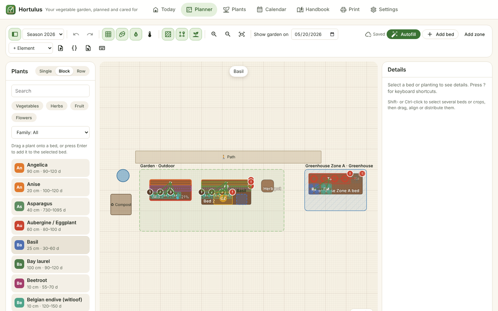
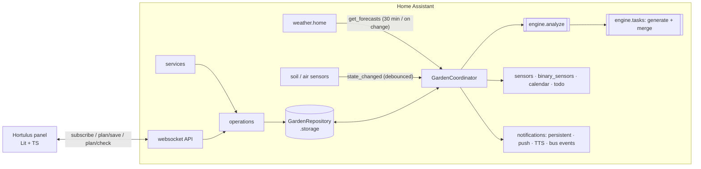
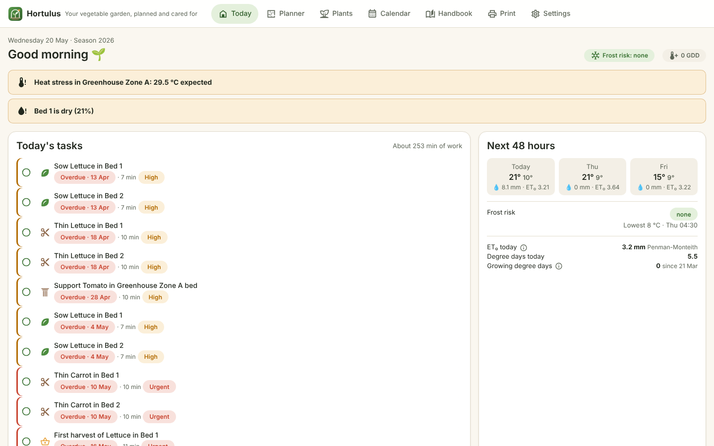
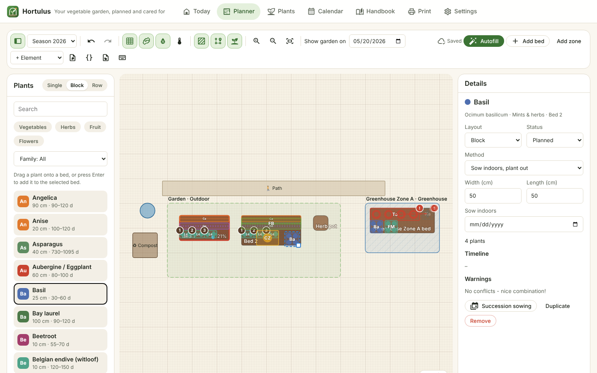
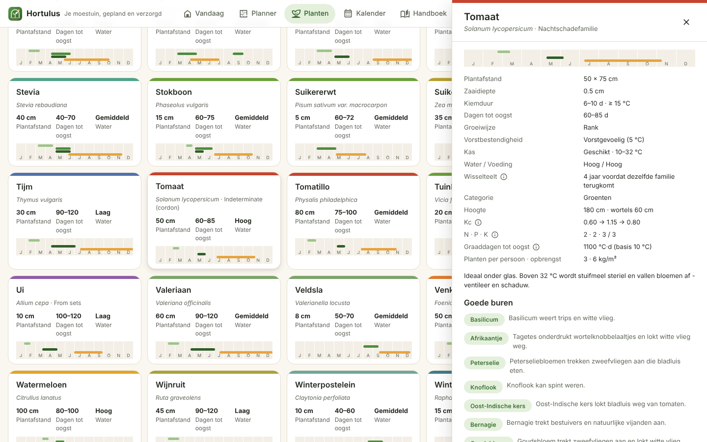
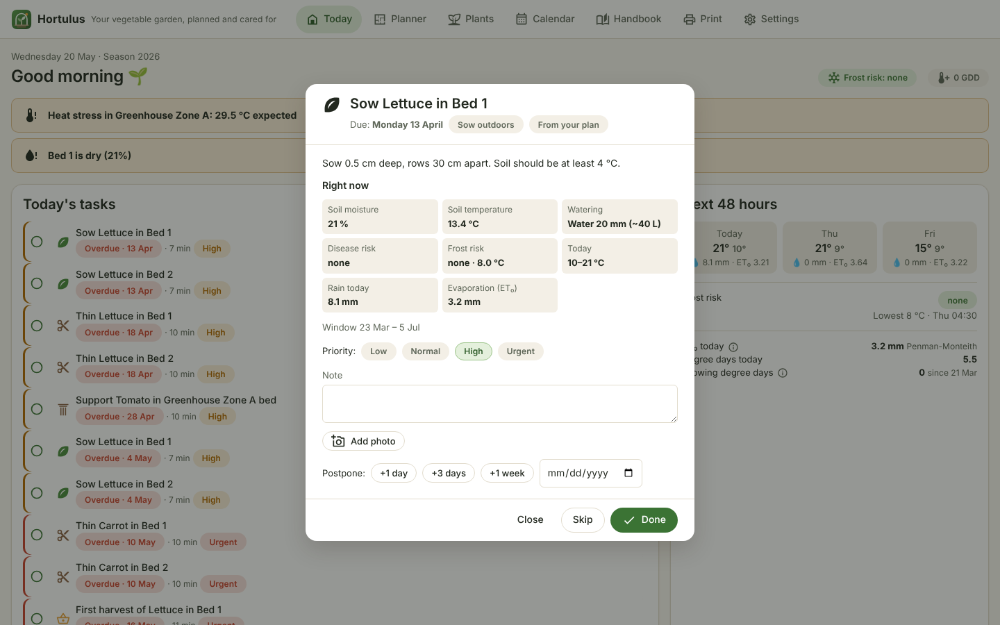
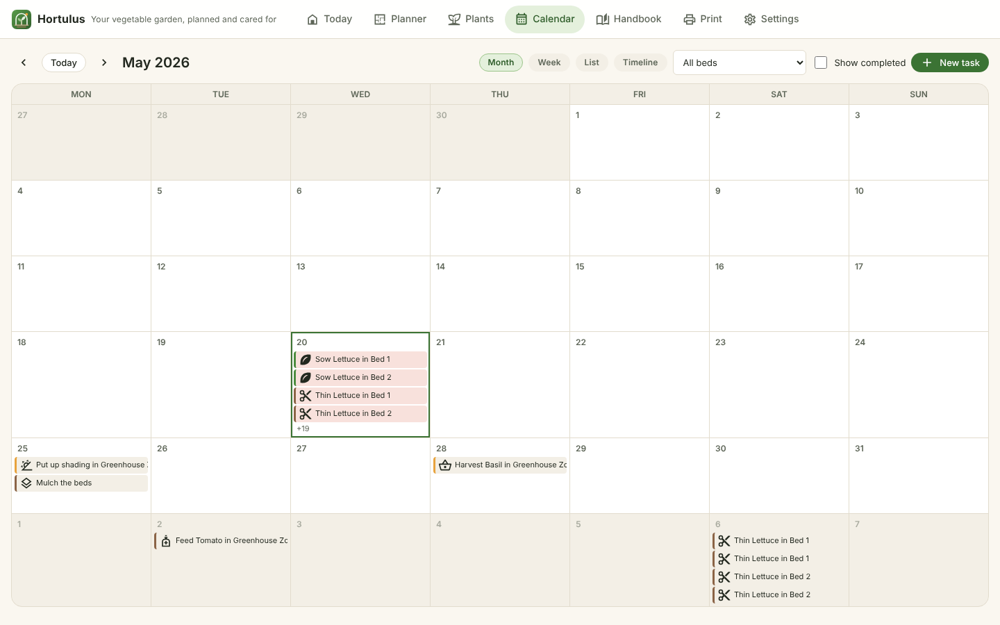
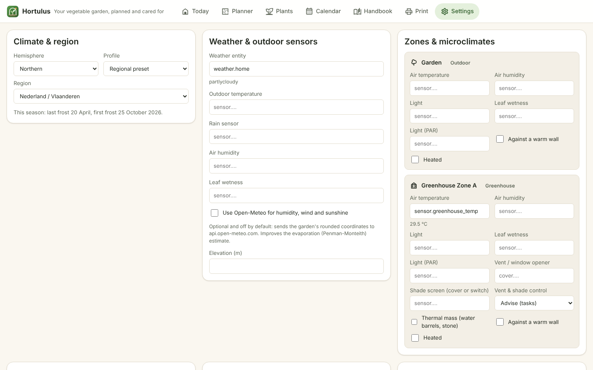

<!-- Generated from the sources by a script: code excerpts below are verbatim. -->
<p align="center"></p>

# Hortulus — architecture blueprint

> **Hortulus** (`garden_manager`) is a Home Assistant custom integration plus a sidebar
> panel for planning and running a vegetable garden. This blueprint is the single
> technical reference: architecture, data model, algorithms, APIs, UI and tests. All code
> excerpts are copied verbatim from the repository; follow the file links for the full
> implementation. Nederlandstalige gebruikersdocumentatie staat in [`docs/nl`](nl/).

**Contents**

1. [Overview](#1-overview)
2. [Architecture & Folder Tree](#2-architecture--folder-tree)
3. [Data Model](#3-data-model)
4. [Backend (Python)](#4-backend-python)
5. [Frontend (TypeScript)](#5-frontend-typescript)
6. [Services, Entities, and Events](#6-services-entities-and-events)
7. [Scheduling, Compatibility, and Watering Algorithms](#7-scheduling-compatibility-and-watering-algorithms)
8. [Example HA Automations & Dashboards](#8-example-ha-automations--dashboards)
9. [Tests](#9-tests)
10. [Documentation Files (README etc.)](#10-documentation-files-readme-etc)

---

## 1. Overview

| Requirement | Where it lives |
|---|---|
| Drag‑and‑drop planner (beds, greenhouse zones, containers, rows; single/block/row; succession; companion overlay; import/export; undo/redo, snap, tooltips, shortcuts) | `frontend/src/views/planner-view.ts`, `frontend/src/planner/*` |
| Plant database (140 crops, EN/NL, user overrides & custom plants) | `custom_components/garden_manager/data/plants.json`, `engine/plantdb.py` |
| Companion scoring, rotation, greenhouse suitability | `engine/compatibility.py`, `engine/schedule.py`, `engine/weather.py` |
| Task engine (generation, recurrence, completion, postpone cascade, priorities, durations, notes, photos) | `engine/tasks.py`, `operations.py` |
| Sensors + forecast (frost, heat, irrigation, GDD) | `engine/weather.py`, `engine/watering.py`, `coordinator.py` |
| HA entities, services, events, notifications | `sensor.py`, `binary_sensor.py`, `calendar.py`, `todo.py`, `button.py`, `services.py`, `notifications.py` |
| Config flow + options flow | `config_flow.py`, `options.py`, `seed.py` |
| Storage with versioning & migrations | `storage.py`, `engine/migrations.py` |
| Bilingual (EN/NL) | `translations/*.json`, `engine/i18n.py`, `frontend/src/i18n/*` |
| Brand (name, logo, icon, banner) & design system | `assets/brand/*`, [`DESIGN_SYSTEM.md`](DESIGN_SYSTEM.md) |

**Design tenets**

* **Pure engine, thin HA shell.** All horticultural logic lives in
  `engine/` – plain Python, no Home Assistant imports, no I/O – so it is fast to test
  and identical whether triggered by a sensor, a service call or the panel.
* **Event‑driven.** Sensors are never polled: the coordinator listens to state changes of
  exactly the mapped entities (debounced 10 s). Only the forecast is fetched on a timer
  (30 min) or when the weather entity updates (≥ 10 min apart).
* **Explainable advice.** Every warning, wait and task carries an i18n key + parameters
  so both the backend (notifications, calendar) and the panel can explain *why*.
* **Idempotent tasks.** Generated tasks have stable keys; regeneration never duplicates
  work or loses user decisions.
* **Local only.** No external services; data in `.storage/garden_manager.garden`.

<p align="center"></p>

---

## 2. Architecture & Folder Tree

```
greenhouse/                                  ← repository (brand: Hortulus)
├── README.md · README.nl.md · LICENSE · hacs.json · pyproject.toml · requirements_test.txt
├── .github/workflows/ci.yml                 ← ruff, pytest, tsc, node:test, bundle check, hassfest, HACS
├── assets/brand/                            ← icon, logo, dark logo, banner (SVG sources + PNG renders)
├── custom_components/garden_manager/
│   ├── __init__.py          setup/unload, runtime data, daily rollover & digest scheduling
│   ├── manifest.json        domain, deps (http, frontend, panel_custom, websocket_api, image_upload)
│   ├── const.py             constants, events, service names
│   ├── config_flow.py       guided setup (region → weather → areas+sensors → notifications → summary) + options
│   ├── options.py           options ⇄ stored settings
│   ├── seed.py              build the first garden (+ example plan) from the wizard answers
│   ├── coordinator.py       DataUpdateCoordinator: forecast fetch, state tracking, analysis, task merge
│   ├── storage.py           versioned Store + repository (debounced saves, revision)
│   ├── operations.py        write operations shared by services, websocket, calendar & todo
│   ├── services.py · services.yaml
│   ├── websocket_api.py     panel API (subscribe, plan/save, plan/check, plants, tasks …)
│   ├── notifications.py     persistent / push / TTS / bus events, de‑duplicated
│   ├── panel.py             static path + sidebar panel registration (content‑hashed URL)
│   ├── entity.py            base entities, per‑bed/zone devices, dynamic entity creation
│   ├── sensor.py · binary_sensor.py · calendar.py · todo.py · button.py · diagnostics.py
│   ├── number.py · select.py · switch.py   irrigation limits/mode, shading mode, auto irrigation
│   ├── controllers.py      irrigation (pump interlock, max runtime, safe shut-off) + greenhouse climate
│   ├── printing.py          authenticated PDF view + private export with signed links
│   ├── api.py               optional Open-Meteo client (opt-in)
│   ├── strings.json · translations/{en,nl}.json · icons.json
│   ├── data/plants.json     plant database (140 crops, EN/NL; built by scripts/build_plantdb.py)
│   ├── data/handbook/{en,nl}/NN-<id>.md · glossary.json   gardening handbook + tooltip glossary
│   ├── frontend/hortulus-panel.js   built panel bundle (committed)
│   └── engine/              ← pure Python, no HA imports
│       ├── models.py        dataclasses (Plant, Zone, GardenBed, Planting, Task, snapshots …)
│       ├── serde.py         lossless (de)serialisation, forward/backward compatible
│       ├── region.py        frost dates, hemispheres, seasons, leap years
│       ├── plantdb.py       database, overrides, symmetric companion relations, search
│       ├── geometry.py      footprints, plant positions, snapping
│       ├── schedule.py      windows, timelines, live timing advice
│       ├── compatibility.py companion scoring, overlaps, rotation
│       ├── weather.py       forecast parsing, frost, greenhouse climate, ET₀, GDD
│       ├── watering.py      moisture bands, irrigation recommendation
│       ├── tasks.py         generation, merge, recurrence, postpone cascade
│       ├── analysis.py      orchestrates everything into GardenAnalysis
│       ├── succession.py · planio.py · migrations.py · i18n.py
│       ├── phenology.py     growth stage, stage Kc, degree-day harvest estimate
│       ├── waterbalance.py  daily root-zone bucket per bed
│       ├── fertilizer.py    compost/fertiliser per bed, feed doses, nutrient balance index
│       ├── maintenance.py   seasonal garden & greenhouse work, bed turnover, perennial care
│       ├── irrigation.py    pure irrigation plan with the safety rules
│       ├── autoplan.py      autofill from area + resources
│       ├── handbook.py      chapters, glossary, search
│       ├── pdf.py           PDF writer + SVG surface (same drawing API)
│       └── printout.py      printable documents and page formats (incl. reMarkable)
├── frontend/                ← Lit + TypeScript sources (esbuild)
│   ├── src/hortulus-panel.ts            root element, routing, subscription, toasts
│   ├── src/api.ts · src/types.ts        typed websocket client mirroring engine/models.py
│   ├── src/views/{dashboard,planner,library,calendar,handbook,print,settings}-view.ts
│   ├── src/planner/{garden-canvas,geometry,history}.ts
│   ├── src/components/task-ui.ts        task row (swipe actions) + task dialog (live context)
│   ├── src/components/{info,markdown}.ts glossary tooltips, safe Markdown renderer
│   ├── src/styles/tokens.ts             design tokens (light/dark) + shared component styles
│   ├── src/i18n/{en,nl,index}.ts        catalogs (keys shared with the backend)
│   └── test/*.test.ts                   node:test unit tests
├── tests/                   ← pytest (+ pytest-homeassistant-custom-component)
│   ├── engine/test_{tasks,frost,compatibility,region_watering_data,agronomy,planning,print_handbook}.py
│   ├── test_config_flow.py · test_init.py · test_phase2.py
│   └── fixtures/{forecast_hourly_dst_frost,forecast_hourly_rain,forecast_daily,sensors}.json
├── examples/{automations,dashboard}.yaml
└── docs/  BLUEPRINT.md · DESIGN_SYSTEM.md · en/{CONFIGURATION,ENTITY_REFERENCE,FAQ}.md · nl/{CONFIGURATIE,ENTITEITEN,FAQ}.md · images/
```

### Runtime architecture



### Why Lit (and not React)

Home Assistant's frontend is built from Lit web components. A Lit panel receives the same
`hass` object, inherits HA theme variables through CSS custom properties, can use
`ha-icon`, and ships without a second framework runtime (whole panel ≈ 55 kB gzipped).
Drag‑and‑drop uses **pointer events with pointer capture** rather than HTML5 DnD, because
HTML5 DnD does not work on touch devices and offers poor keyboard accessibility; a full
keyboard path (Enter to place, arrows to move, Alt+arrows to resize) complements it.

---

## 3. Data Model

All models are dataclasses in [`engine/models.py`](../custom_components/garden_manager/engine/models.py)
serialised by [`engine/serde.py`](../custom_components/garden_manager/engine/serde.py)
(unknown keys ignored, missing keys defaulted, enums/dates as ISO strings). The frontend
mirrors them in [`frontend/src/types.ts`](../frontend/src/types.ts).

Conventions: lengths in **cm**, temperatures **°C**, rain **mm**; canvas origin top‑left;
planting coordinates relative to their bed; calendar dates local, timestamps tz‑aware; a
*season* is named after the year its spring falls in (southern hemisphere: July → June).

### 3.1 Layout: `Zone`, `GardenBed`, sensor mapping

```python
{{py:custom_components/garden_manager/engine/models.py::SensorMapping}}


{{py:custom_components/garden_manager/engine/models.py::Microclimate}}


{{py:custom_components/garden_manager/engine/models.py::Zone}}


{{py:custom_components/garden_manager/engine/models.py::GardenBed}}
```

### 3.2 `Plant`

Sowing windows are **weeks relative to a frost anchor**, which makes one database work on
both hemispheres and in every climate.

```python
{{py:custom_components/garden_manager/engine/models.py::Window}}


{{py:custom_components/garden_manager/engine/models.py::GreenhouseProfile}}


{{py:custom_components/garden_manager/engine/models.py::CompanionLink}}


{{py:custom_components/garden_manager/engine/models.py::CareRule}}


{{py:custom_components/garden_manager/engine/models.py::Plant}}
```

A database entry (excerpt of `data/plants.json`):

```json
{{lines:custom_components/garden_manager/data/plants.json::5::31}}
    …
```

### 3.3 `Planting`

```python
{{py:custom_components/garden_manager/engine/models.py::Planting}}
```

### 3.4 `Task`

```python
{{py:custom_components/garden_manager/engine/models.py::Recurrence}}


{{py:custom_components/garden_manager/engine/models.py::Task}}
```

### 3.5 Runtime snapshots: `WeatherSnapshot`, `SensorSnapshot`

```python
{{py:custom_components/garden_manager/engine/models.py::ForecastPoint}}


{{py:custom_components/garden_manager/engine/models.py::WeatherSnapshot}}


{{py:custom_components/garden_manager/engine/models.py::SensorReading}}


{{py:custom_components/garden_manager/engine/models.py::SensorSnapshot}}
```

### 3.6 Root document, versioning & migrations

```python
{{py:custom_components/garden_manager/engine/models.py::GardenData}}
```

The document is persisted with `homeassistant.helpers.storage.Store` at
`(version=1, minor_version=4)`. Minor versions are additive; HA calls our migration on load,
and the plan importer reuses the same chain for files exported by older releases.

```python
{{py:custom_components/garden_manager/engine/migrations.py::_v1_2_to_1_3}}


{{py:custom_components/garden_manager/engine/migrations.py::migrate}}
```

```python
{{py:custom_components/garden_manager/storage.py::GardenStore}}
```

The *revision* counter guards the plan for optimistic concurrency (the planner sends
`base_revision`); task edits do not bump it, so ticking off a chore never invalidates an
open editor.

---

## 4. Backend (Python)

### 4.1 Setup

```python
{{py:custom_components/garden_manager/__init__.py::async_setup_entry}}
```

### 4.2 Coordinator – event‑driven updates

```python
{{py:custom_components/garden_manager/coordinator.py::GardenCoordinator._on_state_changed}}


{{py:custom_components/garden_manager/coordinator.py::GardenCoordinator._async_update_data}}


{{py:custom_components/garden_manager/coordinator.py::GardenCoordinator.async_fetch_forecast}}


{{py:custom_components/garden_manager/coordinator.py::GardenCoordinator._compute}}
```

### 4.3 Storage repository

```python
{{py:custom_components/garden_manager/storage.py::GardenRepository.async_changed}}
```

### 4.4 Scheduling engine

```python
{{py:custom_components/garden_manager/engine/schedule.py::planting_timeline}}
```

### 4.5 Compatibility engine

```python
{{py:custom_components/garden_manager/engine/compatibility.py::evaluate_pair}}


{{py:custom_components/garden_manager/engine/compatibility.py::check_rotation}}
```

### 4.6 Task engine

```python
{{py:custom_components/garden_manager/engine/tasks.py::_apply_dependency_lag}}


{{py:custom_components/garden_manager/engine/tasks.py::merge_tasks}}


{{py:custom_components/garden_manager/engine/tasks.py::postpone_task}}
```

### 4.7 Config flow (excerpt)

```python
{{py:custom_components/garden_manager/config_flow.py::GardenConfigFlow.async_step_area_sensors}}
```

### 4.8 Websocket API (excerpt: live draft check used while dragging)

```python
{{py:custom_components/garden_manager/websocket_api.py::ws_plan_check}}
```

### 4.9 Edge cases handled

| Edge case | Handling |
|---|---|
| Southern hemisphere | season July→June, first frost in the next calendar year (`region.season_anchors`), USDA dates shifted 6 months |
| Leap years | `parse_mmdd(2026, "02-29")` → 28 Feb; ET₀ day‑of‑year uses 366 in leap years |
| DST | hourly forecast handled as instants; durations from instant differences; local day aggregation via `astimezone` |
| Missing / stale sensors | `unknown`/`unavailable` → `None`; `last_reported` older than *stale minutes* → ignored + alert |
| Forecast unavailable | frost: hourly → daily → current sensor → `unknown`; irrigation: sensor only, confidence lowered |
| Imperial units | forecast and sensor temperatures/precip/wind converted with HA unit converters |
| Frost‑free climates | synthetic anchors keep windows sensible; no frost limits on harvests |
| Late plans | open windows roll forward to *today*; dependants lag behind overdue prerequisites |
| Concurrent edits | revision check → `revision_conflict` → panel reloads |
| Corrupt storage | backup to `garden_manager.garden.corrupt`, start fresh, log error |

---

## 5. Frontend (TypeScript)

Lit 3 + TypeScript, bundled by esbuild into one ES module served from
`/garden_manager_static/hortulus-panel.js?v=<sha256>`.

### 5.1 Root panel – subscription

```ts
{{ts:frontend/src/hortulus-panel.ts::private async connect\(\)::private async loadPlants}}
```

### 5.2 Planner – palette drag & drop with live companion feedback

```ts
{{ts:frontend/src/views/planner-view.ts::private onPalettePointerDown::private ghostLabel}}
```

### 5.3 Canvas – move / resize with snapping (pointer capture)

```ts
{{ts:frontend/src/planner/garden-canvas.ts::private onPointerMove::private onPointerUp}}
```

### 5.4 Undo/redo & autosave with revision guard

```ts
{{lines:frontend/src/planner/history.ts::1::53}}
```

```ts
{{ts:frontend/src/views/planner-view.ts::private scheduleSave\(\)::private scheduleCheck}}
```

### 5.5 Keyboard shortcuts (accessible drag‑and‑drop alternative)

```ts
{{ts:frontend/src/views/planner-view.ts::private onKeyDown::private cycleSelection}}
```

### 5.6 Plant library – sowing calendar for *your* frost dates

```ts
{{ts:frontend/src/views/library-view.ts::private renderCalendar::private filtered}}
```

### 5.7 Task calendar – overdue tasks surface on today

```ts
{{ts:frontend/src/views/calendar-view.ts::private byDay\(\)::private move}}
```

### 5.8 Design tokens (excerpt)

```ts
{{lines:frontend/src/styles/tokens.ts::16::66}}
    /* … typography, spacing, radii, shadows, family colours … */
  }`;
```

Screens (English and Dutch, light and dark):

| | |
|---|---|
|  |  |
|  |  |
|  |  |

---

## 6. Services, Entities, and Events

**Entities** (English install; see [ENTITY_REFERENCE](en/ENTITY_REFERENCE.md)):

| Spec name | Entity | States / unit |
|---|---|---|
| `garden.bed_moisture_status` | `sensor.<bed>_moisture_status` | `dry`, `slightly_dry`, `optimal`, `wet`, `unknown` |
| `garden.frost_risk_next_48h` | `sensor.hortulus_frost_risk_next_48h` | `none`, `low`, `moderate`, `high`, `unknown` |
| `garden.irrigation_recommendation` | `sensor.<bed>_irrigation_recommendation` | mm (+ litres, minutes, action) |
| `garden.growing_degree_days` | `sensor.hortulus_growing_degree_days` | °C·d |
| – | `sensor.<zone>_greenhouse_advice` | `none`, `ventilate`, `shade`, `close_up`, `heat` |
| – | `sensor.hortulus_tasks_due_today`, `sensor.hortulus_next_task`, `sensor.<bed>_companion_score` | count / text / % |
| – | `binary_sensor.hortulus_frost_warning`, `binary_sensor.<bed>_needs_water`, `binary_sensor.<zone>_heat_stress` | on/off |
| – | `calendar.hortulus_garden_tasks`, `todo.hortulus_this_week` | editable |
| – | `button.hortulus_generate_tasks`, `button.hortulus_refresh_forecast` | |

**Services** (`garden.*` in the brief → `garden_manager.*`, HA requires the integration domain):

| Service | Purpose | Response |
|---|---|---|
| `garden_manager.add_task` | user task, optional recurrence | `task_id` |
| `garden_manager.complete_task` | done/skip, notes, photos; updates planting; rolls recurrence | `status`, `next_task_id`, `next_due` |
| `garden_manager.postpone_task` | move by days or to a date; dependants cascade | `due`, `shifted`, `warnings` |
| `garden_manager.delete_task` | delete user task / skip generated | – |
| `garden_manager.generate_tasks` | idempotent regeneration | counts |
| `garden_manager.recalculate_plan` | refetch forecast + recompute | frost, alerts, season |
| `garden_manager.export_plan` | plan document | plan (response only) |
| `garden_manager.import_plan` | merge / replace | counts |

**Events:** `garden_manager_task_due`, `garden_manager_task_completed`,
`garden_manager_frost_warning`, `garden_manager_heat_warning`,
`garden_manager_irrigation_recommended`, `garden_manager_plan_updated`.

**Notifications:** persistent notifications (`garden_manager_frost`, `_heat`, `_digest`),
any `notify.*` service with a deep link to `/hortulus`, optional `tts.speak` for frost.
De‑duplication keys live in `GardenData.notified` (pruned after 14 days).

**Websocket:** `garden_manager/subscribe`, `plants`, `plants/save`, `plants/delete`,
`plants/windows`, `plan/save`, `plan/check`, `plan/succession`, `plan/export`,
`plan/import`, `tasks/add`, `tasks/action`, `settings/save` (writes admin‑only except tasks).

---

## 7. Scheduling, Compatibility, and Watering Algorithms

### 7.1 Frost anchors and seasons

```python
{{py:custom_components/garden_manager/engine/region.py::parse_mmdd}}


{{py:custom_components/garden_manager/engine/region.py::season_anchors}}


{{py:custom_components/garden_manager/engine/region.py::season_for_date}}
```

### 7.2 Windows → timeline → live advice

1. **Window dates**: `anchor + start_week·7d … anchor + end_week·7d + 6d`.
2. **Greenhouse extension**: if the zone is enclosed and the crop is not unsuitable,
   spring windows start `season_extension_weeks` earlier (cold frame: half; heated: +2),
   autumn windows may run longer.
3. **Timeline**: actual dates > user overrides > computed; open windows roll forward to
   today; indoor sowing → transplant ≥ sow + `transplant_age_days[0]`; harvest from
   `days_to_maturity`; tender crops end at the (extended) first frost.
4. **Advice** for the next action: `not_yet` / `go` / `late`, downgraded to `wait` when
   *soil < min germination temperature* (or above `max_soil_temp_c`) or a frost below the
   crop's `min_temp_c` is forecast before planting out.

```python
{{py:custom_components/garden_manager/engine/schedule.py::timing_advice}}
```

### 7.3 Companion scoring

For plantings that share time in the ground:

* `reach = max(companion_radius, (spacing_a + spacing_b)/2)`; no interaction beyond it.
* `influence = 1 − gap / reach` (gap = shortest edge distance between footprints).
* friend `+10·strength·influence`; enemy `−20·strength·influence` (*error* when strength ≥ 2
  and influence > 0.5); overlap `−30·overlap_fraction`; same family touching `−3`.
* Bed score `clamp(50 + Σ, 0, 100)`; relations are symmetric and *enemy wins* when two
  sources disagree.

### 7.4 Crop rotation

History = manual records + one record per (bed, season, family) implied by plantings.
A family returning after `gap < rotation_years` seasons is flagged: one season short →
*warning*, sooner → *error*. Perennials and `rotation_years ≤ 1` are exempt.

### 7.5 Frost risk

```python
{{py:custom_components/garden_manager/engine/weather.py::radiative_adjustment}}


{{py:custom_components/garden_manager/engine/weather.py::classify_frost}}
```

Enclosures add a night offset (greenhouse +3 °C, cold frame +2 °C, configurable; exposed
outdoor sites −0.5 °C, sheltered +0.5 °C); heated zones never go below their heating floor.

### 7.6 Greenhouse climate

Inside estimate per forecast hour: `T_out + solar_gain·(1 − cloud)·(1 − shade)` by day,
`T_out + night_offset` by night. The most sensitive *active* crop sets the limits.

```python
{{py:custom_components/garden_manager/engine/weather.py::greenhouse_advice}}
```

### 7.7 Evapotranspiration & watering

Hargreaves–Samani (FAO‑56 eq. 52) with extraterrestrial radiation from latitude and day
of year (eq. 21):

```python
{{py:custom_components/garden_manager/engine/weather.py::et0_hargreaves}}
```

```python
{{py:custom_components/garden_manager/engine/watering.py::recommend_irrigation}}
```

`litres = mm × bed area (m²)`; `minutes = litres / flow (L/min)`.

### 7.8 Growing degree days

`GDD = max(0, (min(max(Tmax, base), 30) + min(max(Tmin, base), 30))/2 − base)`, accumulated
from the daily min/max log the coordinator keeps (outdoor sensor or weather temperature).

---

## 8. Example HA Automations & Dashboards

Full files: [`examples/automations.yaml`](../examples/automations.yaml) ·
[`examples/dashboard.yaml`](../examples/dashboard.yaml).

```yaml
{{lines:examples/automations.yaml::5::51}}
```

```yaml
{{lines:examples/automations.yaml::81::100}}
```

```yaml
{{lines:examples/automations.yaml::135::179}}
```

Dashboard (sections view, built‑in cards only):

```yaml
{{lines:examples/dashboard.yaml::3::35}}
```

---

## 9. Tests

```
pytest -q                       # 53 tests: engine + config flow + full HA setup
cd frontend && npm test         # geometry, history, i18n parity (node:test)
```

Fixtures (`tests/fixtures/`): an hourly forecast with a clear, calm frost night **across
the 29 March 2026 DST switch**, a rainy late‑spring hourly forecast, a 7‑day daily
forecast, and sensor states (`sensor.soil_moisture_bed_1`, `sensor.soil_temp_bed_1`,
`sensor.greenhouse_temp`, an outdoor sensor in °F, `weather.home`).

### 9.1 Task generation from a planting plan

```python
{{py:tests/engine/test_tasks.py::test_indoor_tomato_generates_full_lifecycle}}


{{py:tests/engine/test_tasks.py::test_postpone_cascades_to_dependants}}
```

### 9.2 Frost warning computation from forecast

```python
{{py:tests/engine/test_frost.py::test_hourly_frost_across_dst_switch}}


{{py:tests/engine/test_frost.py::test_forecast_unavailable_uses_sensor_or_unknown}}
```

### 9.3 Companion conflict detection

```python
{{py:tests/engine/test_compatibility.py::test_enemies_close_together_are_flagged_with_explanation}}


{{py:tests/engine/test_compatibility.py::test_overlap_only_conflicts_when_sharing_time}}
```

### 9.4 End‑to‑end in Home Assistant

```python
{{py:tests/test_init.py::test_setup_creates_entities_and_frost_warning}}
```

Other suites cover hemispheres/leap days/frost‑free zones, watering (rain credit,
greenhouse, soil shift, no‑sensor balance), ET₀ plausibility incl. polar night,
migrations, import/export, succession, database integrity (EN/NL names, companion
references), the config flow (validation, duplicates, single instance), services with
responses, the websocket API (revision conflicts, draft checks, YAML export) and the
options flow.

---

## 10. Documentation Files (README etc.)

| File | Language | Content |
|---|---|---|
| [`README.md`](../README.md) | EN | overview, screenshots, install, quick start, entity mapping |
| [`README.nl.md`](../README.nl.md) | NL | idem, incl. IJsheiligen tip |
| [`docs/en/CONFIGURATION.md`](en/CONFIGURATION.md) | EN | wizard, presets, sensor rules, options, panel, shortcuts, import/export format |
| [`docs/en/ENTITY_REFERENCE.md`](en/ENTITY_REFERENCE.md) | EN | every entity, attribute, service, event, websocket command |
| [`docs/en/FAQ.md`](en/FAQ.md) | EN | FAQ + troubleshooting |
| [`docs/nl/CONFIGURATIE.md`](nl/CONFIGURATIE.md) | NL | configuratie |
| [`docs/nl/ENTITEITEN.md`](nl/ENTITEITEN.md) | NL | entiteiten, diensten, events (incl. Dutch entity ids) |
| [`docs/nl/FAQ.md`](nl/FAQ.md) | NL | veelgestelde vragen |
| [`docs/DESIGN_SYSTEM.md`](DESIGN_SYSTEM.md) | EN | UX principles, personas, IA, tokens, components & states, brand, accessibility, decision log |
| [`docs/BLUEPRINT.md`](BLUEPRINT.md) | EN | this document |
| [`CHANGELOG.md`](../CHANGELOG.md) · [`CONTRIBUTING.md`](../CONTRIBUTING.md) | EN | history, how to contribute (plant data in both languages) |

---

## 11. Version 1.1 additions

### 11.1 Agronomy

FAO‑56 Penman‑Monteith (eq. 6) with radiation from cloud cover via Angström; verified
against FAO example 18 (Brussels, 6 July → 3.9 mm/day). Hargreaves‑Samani is the
fallback when humidity or wind are missing.

```python
{{py:custom_components/garden_manager/engine/weather.py::et0_penman_monteith}}
```

Crop coefficient by growth stage (FAO‑56 stage lengths 15/25/40/20 %):

```python
{{py:custom_components/garden_manager/engine/phenology.py::stage_kc}}
```

Root‑zone bucket (FAO‑56 eq. 85, no capillary rise); TAW = available water per metre of
soil × rooting depth; water when depletion ≥ 0.5 × TAW:

```python
{{py:custom_components/garden_manager/engine/watering.py::update_water_balance}}
```

Disease pressure (Hutton criteria, wet hours, greenhouse humidity, leaf wetness):

```python
{{py:custom_components/garden_manager/engine/weather.py::assess_disease}}
```

### 11.2 Companion factors beyond the relation table

```python
{{py:custom_components/garden_manager/engine/compatibility.py::_secondary_factors}}
```

### 11.3 Seasonal work and fertiliser

```python
{{py:custom_components/garden_manager/engine/fertilizer.py::bed_fertilizer_plan}}
```

Maintenance rules are anchored on frost dates (`GARDEN_RULES`, `GREENHOUSE_RULES`,
`PERENNIAL_RULES` in `engine/maintenance.py`); bed turnover adds *prepare soil* two
weeks before the next crop and *green manure* / *cover for winter* when a bed falls empty.

### 11.4 Irrigation safety

```python
{{py:custom_components/garden_manager/engine/irrigation.py::plan_irrigation}}
```

The controller (`controllers.py`) executes a plan under an `asyncio.Lock`: valve open →
settle → pump on → sleep → pump off → lead time → valve closed, and a `finally` block
switches off every touched valve and the pump (errors, cancellation, unload).

### 11.5 Autofill

Greedy and explainable: crop demand from goals and plants per person, scaled to the
available area; bed score from rotation, glass need, companions, shade and containers;
shelf packing with tall crops away from the sun; neighbours trimmed by whole rows when a
crop does not fit; time, water and compost budgets.

```python
{{py:custom_components/garden_manager/engine/autoplan.py::_bed_score}}
```

### 11.6 Printouts

`engine/pdf.py` implements one drawing API (`Surface`) twice: `PdfPage` (Helvetica /
WinAnsi, Flate streams, clipping for hatch patterns, round‑cap dots) and `SvgPage` (panel
preview). `engine/printout.py` lays out each document once in millimetres.

| Format | Size (mm) | Margins |
|---|---|---|
| A4 / A3 / A5 / Letter | ISO / US | 12 mm |
| reMarkable Paper Pro | 179.6 × 239.5 (4:3, 2160 × 1620 px @ 229 ppi) | left 13 mm (toolbar), others 6–7 mm |

Colour modes: *color* (family tints), *eink* (lighter tints + pattern per family),
*grayscale* (luminance conversion in the surface, patterns carry meaning).

### 11.7 Tests added in 1.1

ET₀ against FAO example 18 and the Hargreaves fallback, GDD accumulation and degree‑day
harvest shifts, stage Kc, water balance, fertiliser and nutrient index, Hutton/greenhouse
disease risk, irrigation frost lockout / rain skip / max runtime / advise mode, seasonal
and greenhouse tasks, soil prep with compost amount, green manure vs. winter cover,
perennial care, autofill (bounds, glass for tender crops, tall crops north, rotation,
budgets, containers), new companion factors, rotation alternatives, PDF validity
(xref offsets, operators, page sizes incl. reMarkable), e‑ink/grayscale rendering,
handbook EN/NL parity and glossary links; HA tests for every new service, the pump
interlock order, the frost lockout entity, shading control, autofill, the PDF view and the
new websocket commands.

```python
{{py:tests/test_phase2.py::test_irrigation_dry_run_and_run_with_pump_interlock}}
```

### 11.8 New entities, services and storage

See [ENTITY_REFERENCE](en/ENTITY_REFERENCE.md). Storage schema 1.5 adds `features`,
`water_balance`, `irrigation_log`, `settings.irrigation` and `settings.resources`
(migration `_v1_4_to_1_5`).
